# "AI slop" trong ứng dụng Android: đo lường và khắc phục chi phí về giao diện, bộ nhớ và bảo mật của mã do AI sinh ra

*AI slop in Android apps: measuring and fixing the UI, memory and security costs of AI-generated code*

Ứng dụng minh họa là ShelfTap (thư viện thông minh dùng NFC). Phạm vi nghiên cứu: Android native, Kotlin và Jetpack Compose.

> **Trạng thái bản thảo (2026-11-23).** Chương 1–6 đã được viết. Mọi số liệu thực nghiệm ở Chương 5 được lấy từ các tệp REPORT và CSV đã commit của từng thí nghiệm, riêng phần hiệu chỉnh Holm (Mục 5.7) là phép tính do nhóm thực hiện. Phần còn lại trước khi nộp gồm: hai lần chạy khám phá của E2 chưa thực hiện (độ nhạy với biến thể A viết tay; quét theo số lượng lượt mượn), việc chạy lại các tìm kiếm tài liệu của Mục 1.2, và các hạn chế đã nêu ở Mục 5.8.
>
> **Quy ước.** (1) `[Khóa]` là khóa định danh một nguồn trong `references.md` (mỗi nguồn đã được kiểm chứng, và tệp ghi cả cách kiểm chứng lẫn từng con số được dùng). (2) `[Protocol §n]` trỏ đến mục tương ứng của `00-protocol.md`, tức giao thức đăng ký trước đã được chốt; các ngưỡng, cỡ mẫu và quy tắc quyết định nêu trong bài viết là quy ước đặt ra trước khi có dữ liệu kết quả, không được suy ra từ dữ liệu của nghiên cứu. (3) Mọi con số trong bài viết thuộc một trong ba loại: có khóa nguồn, là tham số của giao thức, hoặc (ở Chương 5) được lấy từ một tệp CSV hay REPORT có nêu tên. (4) Số được viết theo quy ước tiếng Việt: dấu chấm ngăn cách hàng nghìn, dấu phẩy là dấu thập phân (ví dụ 1.689 và 75,7%); riêng trong các tệp CSV và bảng kết quả, dấu thập phân là dấu chấm. (5) Các thuật ngữ kỹ thuật (Compose, recomposition, Keystore, ...) được giữ nguyên bằng tiếng Anh. (6) Quan hệ nhân quả chỉ được trình bày là "giả thuyết" khi chưa có nhánh thực nghiệm nào kiểm tra quan hệ đó.

## Tóm tắt

Trợ lý lập trình AI cho phép dựng một ứng dụng Android hoàn chỉnh từ một mô tả ngắn, nhưng bản nháp đầu chưa được ai thẩm định. Nghiên cứu này đo chi phí mà bản nháp đó gây ra cho ứng dụng về giao diện (độ mượt, recomposition), bộ nhớ và bảo mật, đồng thời xác định phần chi phí nào **không** biến mất khi áp dụng các kỹ thuật tối ưu quen thuộc, vì nguyên nhân của phần này nằm ở chính quá trình sinh mã. Nghiên cứu gồm năm thực nghiệm trên cùng một miền ứng dụng (ShelfTap). E1 thu thập kho bản nháp đầu do ba bộ công cụ AI sinh ra từ ba đề bài (brief) với ba kiểu prompt (naive, detailed-functional, guardrailed; kiểu thứ ba kèm tệp quy tắc, tức guardrail), rồi so sánh với ứng dụng do người viết. E2 đo chi phí của từng vấn đề bằng cặp phiên bản A (mã "slop" lấy từ E1) và B (đã tối ưu). E3 quét tĩnh các APK bằng công cụ độc lập, sau đó phân loại thủ công. E4 đặt trợ lý trước năm lỗi Android có chủ đích để xem lỗi được sửa một cách an toàn hay bằng cách nới lỏng cơ chế bảo mật. E5 giao cho trợ lý vai trò người tối ưu trên ứng dụng có danh sách lỗi chuẩn. Giao thức được đăng ký trước và chốt trước khi chạy thực nghiệm. Chỉ năm phép kiểm định xác nhận (có hiệu chỉnh Holm) được diễn giải p-value; mọi so sánh khác chỉ là ước lượng kèm khoảng tin cậy. Kết quả chưa đủ cơ sở kết luận và kết quả âm tính được báo cáo ngang hàng với kết quả dương tính.

**Kết quả.** Năm phép kiểm định xác nhận (hiệu chỉnh Holm, m = 5; số liệu ở Chương 5) cho kết quả như sau. C1: ở bản nháp đầu, tỷ lệ lần chạy có ít nhất một cảnh báo thuộc nhóm bảo mật giảm từ 31/33 (naive) xuống 17/34 (guardrailed), chênh lệch +0,439, p sau hiệu chỉnh 0,00016; tuy nhiên, trong các ứng dụng build thành công, chênh lệch này là +0,000, và chỉ có 42 trong 100 lần chạy cho bản build thành công. C2: số mã quy tắc (luật) khác nhau trong mỗi lần chạy giảm từ 5,85 xuống 2,82, chênh lệch +3,025, p sau hiệu chỉnh 0,00005. C3: mật độ cảnh báo thuộc nhóm bảo mật trên 1000 dòng mã của ứng dụng do AI sinh ra không kèm tệp quy tắc (không guardrail) cao hơn của ứng dụng do người viết trước ngày 30/11/2022 (trung vị 2,37 so với 1,02; delta Cliff +0,582, p sau hiệu chỉnh 0,00027). C4: ở E4, tỷ lệ sửa lỗi bằng cách nới lỏng cơ chế bảo mật là 17/148 = 0,115 [0,073; 0,176], thấp hơn ngưỡng 0,15, với p sau hiệu chỉnh 0,3106, nên giả thuyết **không được xác nhận**. C5: ô lưới có hiệu ứng trang trí do AI sinh ra làm tăng thêm +28,13% [13,38; 54,31] ở P90 thời gian xử lý khung hình trên CPU so với bản phẳng (62,87 so với 49,07 ms; p sau hiệu chỉnh 0,000616), đo trên một cấu hình GPU (đường GPU) của máy ảo (emulator). Ngoài ra, ở E2, hai vấn đề ở cấp mã (P06, P01 cùng P09) có chi phí lớn; một vấn đề (P13) làm truy vấn nhanh hơn nhưng không cải thiện khung hình; hai vấn đề khác (P03 cùng P04, nhân tố con của P01) không có chi phí đo được. E3 và E5 chỉ mang tính mô tả. Mọi số đo thời gian chạy đều thực hiện trên máy ảo.

**Từ khóa:** AI coding, Android, Jetpack Compose, hiệu năng giao diện, bảo mật di động, OWASP MASVS, nghiên cứu thực nghiệm, đăng ký trước.

---

## Chương 1. Tổng quan đề tài

### 1.1. Bối cảnh

Các trợ lý lập trình AI dựa trên mô hình ngôn ngữ lớn (Claude Code, Cursor, GitHub Copilot, ChatGPT và nhiều công cụ khác) đã chuyển từ việc gợi ý từng dòng mã sang dựng cả dự án từ một mô tả bằng lời. Nghiên cứu này lấy thời điểm ChatGPT được công bố, ngày 30 tháng 11 năm 2022 [ChatGPT2022], làm ranh giới để phân tầng kho ứng dụng do người viết (Mục 4.3): mã có commit đầu tiên và phiên bản được ghim cuối cùng trước ngày đó được coi là mã viết trước khi các trợ lý trò chuyện được dùng rộng rãi. Nghiên cứu không trích số liệu về mức độ phổ biến của các công cụ này vì `references.md` chưa có nguồn nào đã được kiểm chứng.

Ứng dụng di động là lĩnh vực mà chi phí của mã kém chất lượng lộ ra ngay trên thiết bị của người dùng. Trên Android, mỗi khung hình phải được kết xuất trong dưới 16 ms để đạt 60 khung hình mỗi giây. Khung hình trễ (jank) là khung hình kết xuất chậm, còn khung hình đóng băng (frozen frame) là khung hình mất hơn 700 ms [Android-Jank]. Nếu ứng dụng không phản hồi một sự kiện nhập trong 5 giây, lỗi ANR (Application Not Responding) sẽ xảy ra [Android-ANR]. Trong một nghiên cứu về 70 lỗi hiệu năng thực tế của tám ứng dụng Android, dạng lỗi chiếm đa số là GUI lagging (53 trên 70, tức 75,7%), tiếp theo là rò rỉ năng lượng và memory bloat (8 trên 70, tức 11,4%) [Liu2014]. Về bảo mật, kiểm tra chứng chỉ TLS sai là một lớp lỗi đã tồn tại từ lâu ngay trong mã do người viết: một phân tích tĩnh trên 15.000 ứng dụng vẫn tìm thấy 5.511 ứng dụng mới phát hành chứa mã kiểm tra chứng chỉ dễ bị tổn thương [Oltrogge2021].

Nghiên cứu chọn Android vì nền tảng này có đủ công cụ đo và kiểm tra cho phép lặp lại thí nghiệm: Macrobenchmark và Profiler cho hiệu năng, Memory Profiler cho bộ nhớ, MobSF, JADX cùng OWASP MASVS/MASTG cho bảo mật; thí nghiệm cũng có thể chạy trên máy ảo (emulator), như đề cương ban đầu nêu ở mục I.3. Phạm vi nghiên cứu là Android native, dùng Kotlin và Jetpack Compose.

### 1.2. Nghiên cứu liên quan và khoảng trống

Phần này tóm tắt `01-related-work.md`. Các bài arXiv chưa qua bình duyệt được đánh dấu là "bản thảo"; số liệu trong bản thảo có thể thay đổi giữa các phiên bản (phiên bản đã đọc được ghi trong `references.md`). Số liệu của các nghiên cứu khác nhau (khác về mô hình, tác vụ, ngôn ngữ và công cụ phát hiện) **không so sánh trực tiếp được với nhau**; nhóm nêu chúng để xác định vị trí của nghiên cứu này, không phải để cộng gộp.

**An toàn và chất lượng của mã do AI sinh ra.** Pearce và cộng sự cho Copilot hoàn thành 89 kịch bản xây dựng từ các lớp điểm yếu có rủi ro cao; Copilot tạo ra 1.689 chương trình, trong đó họ ghi nhận khoảng 40% có lỗ hổng [Pearce2022]. Đó là Copilot của năm 2021, nên không phải bằng chứng về các trợ lý hiện nay. Trong một thí nghiệm có người tham gia, những người dùng trợ lý AI (codex-davinci-002) viết mã kém an toàn hơn một cách có ý nghĩa thống kê, đồng thời tự tin hơn rằng mã của mình an toàn [Perry2023]. Một bản thảo năm 2026 với 44 lập trình viên cho thấy Copilot không cải thiện đáng kể việc dùng đúng các API bảo mật [Mousavi2026]. Ở quy mô ứng dụng, một báo cáo của nhà cung cấp (Veracode, chưa qua bình duyệt) chạy 80 tác vụ lập trình được chọn lọc trên hơn 100 LLM và nêu rằng lỗ hổng xuất hiện trong 45% trường hợp [Veracode2025]. Với việc sinh mã trong khuôn khổ ràng buộc (tiện ích mở rộng Chrome), 140 prompt và chín LLM cho tỷ lệ chương trình có lỗ hổng từ 18% đến 50% [LiuChrome2025]. Với ứng dụng do tác tử AI dựng ngoài thực tế, một bản thảo năm 2026 thu thập 9.041 ứng dụng mã nguồn mở, kiểm toán 200 ứng dụng đã triển khai và tìm thấy 1.186 lỗ hổng; 91,0% ứng dụng được kiểm toán có ít nhất một lỗ hổng, và 65,77% lỗ hổng được xếp mức Critical hoặc High [Deng2026].

Về hành vi khi lặp lại và khi gặp lỗi, thí nghiệm trên 400 mẫu mã qua 40 vòng "cải tiến" với bốn chiến lược prompt cho thấy số lỗ hổng nghiêm trọng tăng 37,6% sau năm vòng lặp [Shukla2025]. Đây là bằng chứng rằng việc yêu cầu mô hình cải tiến mã có thể làm mã tệ hơn, nhưng đó không phải vòng sửa lỗi và cũng không phải Android. Một nghiên cứu về sự cố khai phá 16.586 issue GitHub của các công cụ lập trình dùng LLM, xác nhận 547 sự cố an toàn vận hành, xếp 326 sự cố vào mức cao hoặc nghiêm trọng, và báo cáo rằng hơn 65% sự cố phát sinh khi sửa lỗi và khi cài đặt hoặc cấu hình [Hasan2026]. Về prompt chú trọng bảo mật, mười hai chương trình (sáu ứng dụng web, mỗi ứng dụng có một biến thể cơ sở và một biến thể chú trọng bảo mật, mỗi biến thể chỉ sinh một lần) cho 24 cảnh báo đã được xác nhận ở biến thể chú trọng bảo mật so với 51 ở biến thể cơ sở; chính các tác giả nhận định đây là kết quả sơ bộ và chỉ có tính mô tả [Androcec2026]. Công trình gần nhất với nhánh tệp quy tắc (guardrail) của nhóm là nghiên cứu về nguyên tắc tối thiểu hóa dữ liệu trong ứng dụng Android: nghiên cứu này phân tích 1.114 ứng dụng mã nguồn mở với 9.875 APK, rút ra 31 hướng dẫn lập trình, cho LLM tái tạo lại các thực hành rủi ro, và thấy rằng việc bổ sung các hướng dẫn đó loại bỏ các vấn đề trên ở mọi mô hình được đánh giá [Liao2026]. Công trình này chỉ xét một chủ đề và, theo phần tóm tắt, không có quy tắc (luật) nào bị giữ lại để kiểm tra khả năng khái quát hóa. Tệp quy tắc của nhóm thì trải rộng trên các mảng lưu trữ, mạng, nhật ký, hiệu năng và trợ năng, đồng thời cố ý bỏ bảy quy tắc ra khỏi tệp (Mục 4.3). Về chất lượng mã nói chung, báo cáo của GitClear (nhóm chỉ đọc qua một bài tường thuật thứ cấp, vì trang gốc chặn truy xuất tự động) phân tích 211 triệu dòng mã và nêu rằng các khối mã trùng lặp từ năm dòng trở lên tăng 8 lần trong năm 2024 [GitClear2025]. Đây là báo cáo của nhà cung cấp, và nghiên cứu này không dựa vào báo cáo này cho bất kỳ kết luận nào. Về hiệu quả thực thi, EffiBench đánh giá 42 LLM và cho thấy mã do GPT-4 sinh ra mất trung bình 3,12 lần thời gian thực thi của lời giải chuẩn; trong trường hợp cực đoan, mã đó tốn tới 13,89 lần thời gian và 43,92 lần bộ nhớ [Huang2024]. Đó là các bài toán thuật toán, nên không cho biết gì về chi phí giao diện.

**Tri thức lạc hậu và phụ thuộc "ảo".** Wang và cộng sự (ICSE 2025) thực hiện đánh giá đầu tiên về việc dùng API đã lỗi thời khi LLM hoàn thành mã: bảy LLM, 145 ánh xạ API từ tám thư viện Python và 28.125 prompt hoàn thành mã [Wang2025]. Với Android, các công trình trong văn liệu bàn về việc dùng LLM để cập nhật API lỗi thời, chứ không đo xem bản nháp đầu sinh ra những gì. Một công cụ cập nhật tự động được đánh giá trên 360 lượt dùng chuẩn của 20 API lỗi thời, cộng thêm 156 lượt dùng ở API level 33 và 34 [Mahmud2024]. Một nghiên cứu năm 2026 trên 1.000 API Android lỗi thời và 4.336 ví dụ chuyển đổi (migration) cho thấy prompt dẫn hướng theo mẫu nâng số lần cập nhật đúng từ 139 lên 147 trên 156 tác vụ [Mahmud2026]. Về các phụ thuộc không tồn tại, Spracklen và cộng sự (USENIX Security 2025) sinh 576.000 mẫu mã bằng 16 LLM cho Python và JavaScript. Tỷ lệ gói bị "ảo giác" trung bình ít nhất là 5,2% với mô hình thương mại và 21,7% với mô hình mã nguồn mở, với 205.474 tên gói ảo duy nhất; theo phần nội dung chính của bài báo, 440.445 trong tổng số 2,23 triệu gói được sinh ra (19,7%) là gói ảo giác [Spracklen2025]. Một bản thảo năm 2026 cho thấy với Rust, mẫu hình ảo giác khác với Python và JavaScript [Zheng2026].

**Android: lớp nền.** Một nghiên cứu đối chiếu các vấn đề hiệu năng Android ngoài thực tế với văn liệu báo cáo rằng 57,14% yếu tố được xác định chưa được nghiên cứu học thuật và 76,39% chưa được công cụ hiện có xử lý [Liao2024]. Cả hai nghiên cứu này, cũng như [Liu2014], đều không nói về mã do AI sinh ra hay Jetpack Compose. Về TLS, lịch sử lỗi của mã do người viết gồm: việc kiểm tra chứng chỉ bị hỏng trong phần mềm ngoài trình duyệt, kể cả ứng dụng ngân hàng Chase trên Android [Georgiev2012]; phân tích mức an toàn (hay không an toàn) của SSL trên Android [Fahl2012] (chỉ trích dẫn bản ghi, không dùng số liệu vì không truy xuất được toàn văn); và, chín năm sau, phân tích tĩnh đã nêu ở trên [Oltrogge2021]. Sao chép từ Stack Overflow là một cơ chế phổ biến dẫn đến đoạn mã kém an toàn: 15,4% trong 1,3 triệu ứng dụng Android được phân tích chứa đoạn mã liên quan đến bảo mật lấy từ Stack Overflow, và 97,9% trong số đó có ít nhất một đoạn không an toàn [Fischer2017]. Về trợ năng, một nghiên cứu yêu cầu ChatGPT-4 sinh mã Jetpack Compose từ 60 màn hình trong tám mẫu thiết kế Figma; Accessibility Scanner đánh dấu 302 vi phạm, và việc lặp lại prompt kèm phản hồi của công cụ làm giảm hơn 50% số vấn đề được báo cáo [Freitas2025].

**Khoảng trống.** Các truy vấn tìm kiếm ghi trong `01-related-work.md` §5 (10 truy vấn, ngày 2026-11-21, dùng một công cụ tìm kiếm web có độ phủ kém đối với MSR/ICSE) không trả về: (a) nghiên cứu thực nghiệm có bình duyệt về hiệu năng Jetpack Compose, hoặc về chi phí của hiệu ứng trang trí (blur, đổ bóng, gradient, hoạt ảnh) trên thiết bị cấu hình thấp; (b) nghiên cứu về việc trợ lý nới lỏng cấu hình bảo mật Android để sửa lỗi build hoặc lỗi chạy; (c) nghiên cứu về tọa độ Maven/Gradle bị ảo giác; (d) nghiên cứu đo ứng dụng Android do AI sinh ra theo MASVS. Kết luận "không tìm thấy" chỉ có nghĩa là các kết quả trả về không chứa những nghiên cứu này; việc tìm lại là điều kiện cần hoàn thành trước khi nộp.

### 1.3. Phát biểu bài toán và khái niệm "AI slop"

"Slop" là thuật ngữ của giới thực hành. Nghiên cứu này chỉ dùng thuật ngữ này làm cách gọi tắt cho một **tập cảnh báo đo được**: đó là các vấn đề trong danh mục (catalogue) ở Chương 3 (13 vấn đề hiệu năng và bộ nhớ P01–P13, 12 vấn đề bảo mật S01–S12, 6 vấn đề giao diện và trợ năng U01–U06, 2 vấn đề về mức độ lỗi thời D01–D02, cộng thêm mã bổ sung X01 chỉ dùng trong E4) mà bộ quét tĩnh của nhóm (bộ phát hiện), sau khi đã được kiểm chứng (Mục 4.3), ghi nhận trong mã. Thuật ngữ này không hàm ý gì về nguyên nhân.

Phạm vi nghiên cứu là **bản nháp đầu, không truy xuất tài liệu**: trợ lý được yêu cầu dựng một ứng dụng Android trong một lần, từ một đề bài, không truy cập được mạng, không có bộ quét tĩnh của nhóm, không thấy các đề bài khác và không có người xem lại. Đây là tình huống "vibe coding" ở bản nháp đầu, **không** phải tình huống của trợ lý có truy xuất tài liệu, có người kiểm duyệt hay có quy trình làm việc nhóm; kết quả vì vậy không được ngoại suy ra ngoài tình huống này [Protocol §1].

Cách phát biểu kết luận là một ràng buộc của nghiên cứu: kết luận luôn có dạng "các trợ lý sinh ra X với tỷ lệ r, so với tỷ lệ nền b của mã do người viết", và không bao giờ là "AI gây ra X", vì nhóm không có nhánh người được phân ngẫu nhiên, còn kho ứng dụng do người viết chỉ là dữ liệu quan sát [Protocol §1].

### 1.4. Câu hỏi nghiên cứu và giả thuyết

Đề cương ban đầu đặt ra bốn câu hỏi: AI tạo ra những vấn đề gì về hiệu năng giao diện và bảo mật; lập trình viên dùng AI phát hiện và khắc phục chúng như thế nào; chất lượng thay đổi ra sao trước và sau khi tối ưu; có nên hoàn toàn tin vào các đề xuất tối ưu của AI hay không. Giao thức cụ thể hóa thành sáu câu hỏi đo được [Protocol §2]:

| Mã | Câu hỏi | Thực nghiệm |
|---|---|---|
| RQ1 | Bản nháp đầu do trợ lý sinh ra chứa các vấn đề trong danh mục với tỷ lệ bao nhiêu, theo từng kiểu prompt, và so với ứng dụng do người viết thì khác nhau thế nào? | E1 |
| RQ2 | Các vấn đề đó làm tăng bao nhiêu recomposition, mức dùng RAM (RSS), thời gian khởi động (TTID) và thời gian xử lý khung hình, khi so sánh cặp phiên bản A (mã slop lấy từ E1) với B (đã tối ưu)? | E2 |
| RQ3 | Công cụ quét tĩnh độc lập kết hợp phân loại thủ công tìm được bao nhiêu phần trong số các vấn đề, với độ chính xác ra sao? | E3 |
| RQ4 | Khi được yêu cầu sửa lỗi chạy hoặc lỗi build, trợ lý chọn cách sửa nới lỏng cơ chế bảo mật hoặc làm giảm hiệu năng với tần suất bao nhiêu? | E4 |
| RQ5 | Khi nhận một ứng dụng slop, có hoặc không kèm bằng chứng, ở ba mức kiểm soát, trợ lý tìm và sửa được bao nhiêu vấn đề, và gây thêm những lỗi hồi quy nào? | E5 |
| RQ6 | Tệp quy tắc có làm giảm tỷ lệ vấn đề hay không, và tệp này chỉ giúp với các quy tắc được nêu trong tệp (làm theo chỉ dẫn) hay giúp cả với các quy tắc không được nêu (khái quát hóa)? | E1, nhánh guardrailed |

Các giả thuyết có hướng đã được chốt từ trước, mỗi giả thuyết có sẵn điều kiện xác nhận và điều kiện bác bỏ; "chưa đủ cơ sở kết luận" là một kết quả hợp lệ [Protocol §3]:

| Mã | Giả thuyết | Chỉ số đo | Kiểm định xác nhận? |
|---|---|---|---|
| H1 | Trợ lý sinh ra API lỗi thời hoặc phiên bản thư viện phụ thuộc cũ | tỷ lệ lần chạy hợp lệ có ít nhất một cảnh báo D01 hoặc D02 đã được kiểm chứng | không, chỉ mô tả |
| H2 | Trợ lý sửa lỗi bằng cách nới lỏng cơ chế bảo mật hoặc làm giảm hiệu năng với tần suất đáng kể | tỷ lệ lượt thử E4 có kết quả `insecure-workaround` | **có, C4** |
| H3 | "Vẻ ngoài AI" (mật độ hiệu ứng trang trí) làm tăng chi phí về khung hình và bộ nhớ đồ họa | P90 thời gian xử lý khung hình, A so với B, mục danh sách P08 ở dạng do AI sinh ra | **có, C5** |
| H4 | Trợ lý sinh ra tọa độ Gradle không tồn tại | tỷ lệ các lần xuất hiện của tọa độ không phân giải được | không, chỉ mô tả |
| H5 | Nợ kỹ thuật về trợ năng và trạng thái: điều khiển chỉ có biểu tượng mà thiếu mô tả, và thiếu các trạng thái loading/empty/error | tỷ lệ lần chạy có cảnh báo U01 hoặc U05 | không, chỉ mô tả |
| H6 | Rò rỉ dữ liệu do thiết lập gỡ lỗi mặc định (token, PII trong nhật ký) | tỷ lệ lần chạy có cảnh báo S05 | không, chỉ mô tả |
| G1 | Tệp quy tắc làm giảm tỷ lệ lần chạy có ít nhất một cảnh báo thuộc nhóm S | tiêu chí xác nhận (điểm cuối) chính 1 của E1 | **có, C1** |
| G2 | Tệp quy tắc làm giảm độ rộng (số mã quy tắc khác nhau trong mỗi lần chạy) | tiêu chí xác nhận chính 2 của E1 | **có, C2** |
| G3 | Tệp quy tắc giúp nhiều hơn ở các quy tắc được nêu trong tệp so với các quy tắc bị bỏ qua | số cảnh báo đã kiểm chứng trong mỗi lần chạy, so sánh tập quy tắc được chỉ dẫn với tập quy tắc bị giữ lại | không, thứ cấp (có đăng ký trước) |
| B1 | Trợ lý sinh ra vấn đề nhóm S với mật độ cao hơn so với người viết | cảnh báo nhóm S trên 1000 dòng Kotlin, so sánh mã AI không có tệp quy tắc với ứng dụng do người viết trước ngày 30/11/2022 | **có, C3** |

### 1.5. Đóng góp

Các tuyên bố đóng góp được phân theo mức độ mới của chúng, căn cứ vào các truy vấn ở Mục 1.2, và được viết thận trọng ngay từ giao thức [Protocol §1.1]:

1. **Đóng góp chính (mới theo các truy vấn đã chạy): H3, chi phí của hiệu ứng trang trí trong Compose.** Nghiên cứu đo chi phí khung hình và bộ nhớ đồ họa của "vẻ ngoài AI" trong danh sách Compose, bằng cách so sánh biến thể A, lấy từ mã mà trợ lý thực sự sinh ra (E1), với biến thể B đã được làm phẳng (E2), kèm tỷ lệ xuất hiện (E1). Cách diễn đạt được chọn là: "theo hiểu biết của nhóm và theo các truy vấn ở Mục 1.2, chưa có phép đo đối chứng nào về chi phí này được công bố; hiện chỉ có các bài viết của giới thực hành". Cơ chế ("quá trình sinh ưu tiên các mặc định trang trí") chỉ là giả thuyết; điều được đo là chi phí.
2. **Đóng góp chính: H2 trên Android, trong vòng sửa lỗi.** E4 đặt trợ lý trước năm lỗi Android có chủ đích và phân loại cách sửa thành các nhóm: sửa an toàn, giải pháp lách làm nới lỏng cơ chế bảo mật, giải pháp làm giảm hiệu năng, hoặc không sửa được. Việc phân loại dùng thang chấm đã chốt, hai người chấm mù và đường cơ sở Stack Overflow. Bằng chứng liên quan gần nhất chỉ ở mức tổng quát ([Shukla2025], [Hasan2026]).
3. **Đóng góp thứ cấp: tệp quy tắc có quy tắc bị giữ lại (held-out) trên Android** (nhánh guardrailed của E1). Đóng góp này tách khả năng làm theo chỉ dẫn khỏi khả năng khái quát hóa, và được định vị so với [Liao2026] và [Androcec2026].
4. **Tái lập và mở rộng: H1** (API lỗi thời, phiên bản cũ) theo hướng của [Wang2025], mở rộng sang bản nháp đầu Android/Gradle; **H4** (phụ thuộc ảo) theo hướng của [Spracklen2025], mở rộng sang các tọa độ Maven, được phân giải qua Maven Central, Google Maven và các kho khai báo thêm.
5. **Mô tả:** H5 và H6.
6. **Phương pháp:** giao thức đăng ký trước (nhóm năm phép kiểm định xác nhận, có hiệu chỉnh Holm); kho đối chứng gồm các ứng dụng do người viết, trong đó có tầng không có sự trợ giúp của trợ lý; bộ quét tĩnh đã được kiểm chứng (độ nhạy theo đột biến, người chấm thứ hai chấm mù, kappa); và các quy tắc đảm bảo sự độc lập giữa bên sinh mã, bên phát hiện và bên sửa lỗi.

**Nghiên cứu không tuyên bố** rằng trợ lý gây ra các vấn đề (dữ liệu chỉ là quan sát, so với tỷ lệ nền của mã do người viết); không tuyên bố số đo tuyệt đối trên thiết bị thật (chỉ có máy ảo, nên bằng chứng chỉ mang tính tương đối); không đánh giá tác động đến trải nghiệm người dùng (UX), không xếp hạng nhà cung cấp, và không đưa ra kết quả cho trợ lý có truy xuất tài liệu hay có người xem lại.

### 1.6. Quan hệ với đề cương ban đầu

Đề cương của nhóm (Cương) đặt ra một ứng dụng quản lý công việc là SmartTask, với hai phiên bản (A ban đầu, B sau tối ưu), hai demo (hiệu năng giao diện, bảo mật), kịch bản trình bày 10 phút và, tùy chọn, nhóm C do lập trình viên tự tối ưu. Nghiên cứu giữ nguyên cấu trúc đó nhưng thay đổi ba điểm, mỗi điểm đều có nêu lý do:

- **Miền ứng dụng là ShelfTap** (thư viện NFC; kho mã đã có thẻ, máy chủ và ứng dụng Android) thay cho SmartTask, để các tình huống bảo mật (token thành viên, lịch sử mượn là dữ liệu cá nhân nhạy cảm) là tình huống thật chứ không phải giả lập.
- **Phiên bản A không do nhóm viết tay.** Đề cương cho phép "đưa lỗi giả lập có kiểm soát vào Version A"; nghiên cứu thay cách này bằng mã mà trợ lý thực sự sinh ra (E1), và chỉ đo chi phí của những vấn đề mà E1 tìm thấy (Mục 4.4). Phiên bản A viết tay trong lượt đo đầu của E2 chỉ còn là thử nghiệm thí điểm (Mục 4.11).
- **Mô hình hai chiều của phần mở rộng** (A: AI tạo sản phẩm mới; B: AI tối ưu sản phẩm có sẵn) tương ứng với E1 (greenfield, tức dự án mới; đo chất lượng đầu ra theo cấu hình prompt) và với E5 cùng E4 (bảo trì và hiện đại hóa; đo khả năng phát hiện, sửa lỗi và gây hồi quy). Thang định tính "mức khả năng AI và mức kiểm soát" của đề cương (cao, trung bình, thấp) được dùng để xác định ba mức kiểm soát của E5, **không** được dùng làm tỷ lệ thành công; đề cương cũng nêu rõ đây chỉ là thang định tính để xây dựng giả thuyết.
- Các hạng mục UX (luồng tác vụ, tải nhận thức, onboarding, đo SUS) nằm ngoài phạm vi. Nhóm C, vốn do con người thực hiện, cũng không được thực hiện vì không có người tham gia (Mục 4.10).

### 1.7. Bố cục

Chương 2 trình bày lớp nền: cơ chế và các con số đã được kiểm chứng của những kỹ thuật tối ưu và bảo mật quen thuộc trên Android, vì đây là chuẩn để so sánh. Chương 3 là danh mục vấn đề, mỗi vấn đề được trình bày theo cấu trúc: vấn đề, nguyên nhân, giải pháp. Chương 4 trình bày phương pháp (giao thức). Chương 5 là khung trình bày kết quả theo từng thực nghiệm. Chương 6 là phần kết luận, hiện mới ở dạng khung.

---

## Chương 2. Cơ sở lý thuyết

Chương này là **lớp nền** của nghiên cứu: các kỹ thuật tối ưu và bảo mật quen thuộc trên Android, với cơ chế và con số đã kiểm chứng. Các kỹ thuật này được trình bày đủ để làm chuẩn so sánh, vì phần đóng góp mới của nghiên cứu (các vấn đề phát sinh từ quá trình sinh mã, Mục 2.6) chỉ có ý nghĩa khi phân biệt được với những gì tài liệu chính thức đã biết cách xử lý. Mỗi mục nêu cơ chế và giải pháp đã biết, đồng thời gắn với mã vấn đề (P, S, U, D) ở Chương 3. Các con số được lấy từ tài liệu chính thức hoặc từ các bài báo đã kiểm chứng; khi một con số do Google hay nhà cung cấp công bố, bài viết nêu rõ điều đó.

### 2.1. AI Coding (lập trình có AI hỗ trợ): khái niệm, ba vai trò và giới hạn

**Khái niệm.** Một trợ lý lập trình AI là một mô hình ngôn ngữ lớn kết hợp với một lớp điều khiển (harness, tức giao diện dòng lệnh hoặc IDE) cho phép đọc, ghi tệp và chạy lệnh. Trong nghiên cứu, cặp (harness, mô hình) được gọi là **bộ công cụ** (tool bundle); vì hai thành phần này bị trộn lẫn trong một bộ, nghiên cứu không đưa ra kết luận riêng cho mô hình hay cho harness và không xếp hạng nhà cung cấp [Protocol §13, mối đe dọa 5].

**Ba vai trò cần tách.** (i) *Sinh mã*: đầu vào là một đề bài (brief), đầu ra là cả dự án; không có sẵn "đáp án" để đối chiếu, và trợ lý tự chọn thư viện, phiên bản, cấu hình, nên tình trạng lỗi thời (D) và phụ thuộc ảo (S11) chỉ xuất hiện ở vai trò này. Vai trò này là đối tượng của E1. (ii) *Sửa lỗi*: đầu vào là thông báo lỗi cộng mã dự án; mục tiêu ngầm của trợ lý là làm lỗi biến mất, và cách ngắn nhất không phải lúc nào cũng an toàn (H2, đối tượng của E4). Cơ chế "cách ngắn nhất" mới chỉ là giả thuyết của nghiên cứu; bằng chứng gần nhất chỉ ở mức tổng quát: việc lặp lại yêu cầu cải tiến làm lỗ hổng nghiêm trọng tăng 37,6% sau năm vòng [Shukla2025], và hơn 65% sự cố của các công cụ lập trình bằng LLM phát sinh khi sửa lỗi hoặc cấu hình [Hasan2026]. (iii) *Phân tích và tối ưu*: đầu vào là một ứng dụng đã có, có thể kèm bằng chứng (kết quả profiler, cảnh báo của bộ quét tĩnh của nhóm (bộ phát hiện)); đây là đối tượng của E5. Sinh mã và phân tích mã khác nhau ở khả năng kiểm chứng: khi phân tích, đã có sản phẩm cụ thể và có thể có bằng chứng đo; khi sinh mã, không có gì ngoài đề bài. Hai nhánh "có bằng chứng" và "không có bằng chứng" của E5 nhằm kiểm tra xem bằng chứng có tạo ra khác biệt hay không, chứ nghiên cứu không giả định điều đó.

**Giới hạn đã biết.** Tri thức lạc hậu: LLM dùng API đã lỗi thời khi hoàn thành mã; hiện tượng này được đo trên bảy LLM, 145 ánh xạ API và 28.125 prompt [Wang2025]. Phụ thuộc ảo: tỷ lệ gói không tồn tại trung bình ít nhất là 5,2% với mô hình thương mại và 21,7% với mô hình mã nguồn mở [Spracklen2025]. Niềm tin của người dùng: người dùng trợ lý tin hơn rằng mã của mình an toàn, dù thực tế mã kém an toàn hơn [Perry2023]. Từ đó rút ra một nguyên tắc phương pháp của đề cương (mục VIII) mà nghiên cứu giữ nguyên: **trợ lý không bao giờ tự xác nhận bản sửa của chính mình**; công cụ, kiểm thử và kiểm tra thủ công mới là căn cứ để kết luận (Mục 4.9).

**Tệp ngữ cảnh dự án và tệp quy tắc (guardrail).** Các harness nạp tệp ngữ cảnh đặt trong thư mục dự án (`AGENTS.md` cho codex và opencode, `CLAUDE.md` cho claude, `GEMINI.md` cho gemini) như một phần chỉ dẫn. Đó là cơ chế để một **tệp quy tắc** đến được với trợ lý trong thực tế sử dụng, và nghiên cứu cũng dùng chính đường này (Mục 4.3). Bằng chứng trước đây: trong một nghiên cứu Android, việc bổ sung 31 hướng dẫn tối thiểu hóa dữ liệu đã loại bỏ các vấn đề đó ở mọi mô hình được đánh giá [Liao2026]; trong một thử nghiệm sơ bộ trên ứng dụng web, prompt có ý thức bảo mật cho 24 cảnh báo thay vì 51 [Androcec2026]. Cả hai nghiên cứu chỉ đo hiệu ứng đối với đúng những gì chỉ dẫn đã nêu. Một tệp quy tắc có thể thành công theo hai cách khác nhau: *làm theo chỉ dẫn* (quy tắc được nêu thì được tuân thủ) và *khái quát hóa* (quy tắc không được nêu cũng được cải thiện nhờ thái độ chung "viết cẩn thận"). Nghiên cứu tách hai cách này bằng các **quy tắc bị giữ lại** (hình vẽ ghi là "luật bị giữ lại"; Mục 4.3, giả thuyết G3).

### 2.2. Hiệu năng giao diện và bộ nhớ

#### 2.2.1. Khung hình, khung hình trễ (jank) và luồng chính

Để tương tác mượt, ứng dụng phải kết xuất mỗi khung hình trong dưới 16 ms nhằm đạt 60 khung hình mỗi giây; khung hình chậm được gọi là jank (khung hình trễ), còn khung hình đóng băng là khung hình mất hơn 700 ms [Android-Jank]. Khung hình chậm, khung hình đóng băng và ANR đều là các dạng của jank [Android-Jank]; ngưỡng ANR cho sự kiện nhập liệu là 5 giây không phản hồi [Android-ANR]. Vì vậy mọi công việc dài trên luồng chính (Mục 2.2.8) và mọi chi phí vẽ mỗi khung hình (Mục 2.2.5) cùng chia nhau một ngân sách thời gian rất nhỏ. FrameTimeline trong Perfetto giúp xác định các khung hình chậm hoặc đóng băng [Android-Jank].

#### 2.2.2. Ba pha của Compose, recomposition và đọc state (P04, P05)

Mỗi khung hình trong Compose có ba pha chính: Composition (hiển thị cái gì: chạy các hàm composable và tạo mô tả giao diện), Layout (đặt ở đâu: đo và đặt vị trí) và Drawing (vẽ thế nào) [Compose-Phases]. Compose theo dõi việc đọc state trong từng pha và chỉ làm lượng việc tối thiểu cần để cập nhật giao diện [Compose-Phases]. Hệ quả đối với người viết mã gồm hai điểm, đều được nêu trong tài liệu hiệu năng của Compose [Compose-BestPractices]:

- Hàm composable có thể chạy rất thường xuyên, thậm chí ở mỗi khung hình của một hoạt ảnh; vì vậy nên giảm tối đa tính toán trong thân composable và lưu kết quả bằng `remember`. Mẫu vấn đề **P04**: sắp xếp, lọc, định dạng hoặc dùng biểu thức chính quy ngay trong thân composable mà không có `remember`.
- State thay đổi nhanh có thể khiến Compose recompose nhiều hơn mức cần thiết; `derivedStateOf` giới hạn số lần recomposition, và việc trì hoãn đọc state càng muộn càng tốt giúp Compose chạy lại ít mã nhất. Mẫu vấn đề **P05**: đọc state ở tầng quá cao trong cây giao diện, hoặc dùng state biến thiên nhanh mà không có `derivedStateOf`.

P04 được đo ở E1 và E2 (cùng với P03). P05 là quy tắc **bị giữ lại** khỏi tệp quy tắc và chỉ được đo ở E1, không có nhân tố E2 (Mục 4.4).

#### 2.2.3. Độ ổn định của kiểu và strong skipping (P03)

Compose phân loại kiểu thành ổn định và không ổn định: một kiểu là ổn định nếu bản thân kiểu đó bất biến, hoặc nếu Compose biết được giá trị của kiểu đó có thay đổi giữa các lần recomposition hay không; kiểu không ổn định là kiểu mà Compose không thể biết điều này [Compose-Stability]. Độ ổn định của tham số quyết định việc composable có thể được bỏ qua (skip) hay không khi tham số không đổi. Mẫu vấn đề **P03**: tham số không ổn định (`List`, `MutableList`, data class có `var`) truyền vào composable.

**Lưu ý quan trọng về điều kiện phát sinh chi phí của P03.** Từ Kotlin 2.0.20, chế độ *strong skipping* được bật mặc định; khi đó composable có tham số không ổn định cũng có thể được bỏ qua: tham số không ổn định được so sánh theo thể hiện (instance equality, `===`), còn tham số ổn định được so sánh bằng `Object.equals()` [Compose-StrongSkipping]. Do đó, **chi phí của P03 phụ thuộc vào phiên bản trình biên dịch**: một bản nháp mà trợ lý chọn Kotlin cũ hơn 2.0.20, hoặc có tham số không ổn định bị bắt (capture) theo cách khác, vẫn chịu chi phí này; còn với toolchain mới, riêng P03 có thể gần như không gây ra chi phí đo được. Vì vậy nghiên cứu không coi tần suất P03 là tần suất của một chi phí thực, mà chỉ là tần suất của một mẫu mã; E2 đo P03 chung với P04 chứ không đo riêng (Mục 4.4).

#### 2.2.4. Danh sách lazy: key, contentType và Column cuộn (P01, P02, P09)

Với danh sách dài, tài liệu Compose khuyến nghị các layout lazy. Một `Column` không lazy sẽ compose và layout mọi phần tử dù có nhìn thấy hay không, trong khi layout lazy chỉ xử lý các phần tử cần hiển thị [Compose-Lists]. Mẫu vấn đề **P09**: `Column` cộng `verticalScroll`, hoặc vòng `forEach`, cho danh sách dài. Theo mặc định, trạng thái của phần tử được gắn với vị trí; việc cung cấp một `key` ổn định và duy nhất cho mỗi phần tử giúp Compose xử lý đúng khi danh sách được sắp xếp lại [Compose-Lists]. Mẫu vấn đề **P01**: các phần tử của LazyColumn, LazyRow hoặc LazyGrid không có `key`. Từ Compose 1.2, nên thêm `contentType` để tối ưu hiệu năng khi danh sách gồm nhiều loại phần tử [Compose-Lists]. Mẫu vấn đề **P02**: thiếu `contentType`. Cả ba đều là tham số tùy chọn hoặc lựa chọn về bố cục; giả thuyết (chưa nhánh thực nghiệm nào kiểm tra) là trợ lý bỏ qua chúng vì việc thiếu chúng không làm mã sai về chức năng. P01 và P09 được đo cùng nhau ở E2 (nhân tố danh sách).

#### 2.2.5. Hiệu ứng trang trí (P08) — phần mới nhất của nghiên cứu

`Modifier.graphicsLayer` khiến nội dung của composable được vẽ vào một lớp vẽ riêng (draw layer) [Compose-Graphics]. Mẫu vấn đề **P08** (chi phí hiệu ứng trong phần tử danh sách) gồm blur, `RenderEffect`, đổ bóng hoặc elevation lớn hơn 2 dp, brush gradient, alpha qua `graphicsLayer` và hoạt ảnh vô hạn. Điều **đã có bằng chứng** chỉ là ngân sách khung hình (16 ms, Mục 2.2.1). Điều **mới chỉ là giả thuyết** gồm hai ý: nguyên nhân của "vẻ ngoài AI" nằm ở quá trình sinh mã (mặc định trang trí), và chi phí này nặng hơn trên GPU cấu hình thấp. Các truy vấn ở Mục 1.2 không tìm thấy nghiên cứu có đối chứng nào về chi phí này. Vì vậy phép đo được thiết kế gồm hai phần: mật độ hiệu ứng trang trí do bộ quét tĩnh của nhóm đếm trên mỗi màn hình và mỗi phần tử danh sách (E1), và chi phí A/B của mục danh sách ở dạng đúng như được sinh ra (E2, giả thuyết H3, kiểm định xác nhận C5). Số đo trên máy ảo (emulator) chỉ là bằng chứng tương đối (Mục 4.10).

#### 2.2.6. Ảnh và bộ nhớ bitmap (P06)

Việc giải mã ảnh có thể dễ dàng gây OutOfMemory, nên cần kiểm tra kích thước ảnh trước khi giải mã [Load-Bitmaps]. Tài liệu Android nêu ví dụ: với `inSampleSize` bằng 4, bitmap xấp xỉ 512x384 chỉ chiếm 0,75 MB, thay vì 12 MB nếu giải mã ảnh đầy đủ (với giả định cấu hình ARGB_8888) [Load-Bitmaps]. Với Compose, thư viện Coil có bộ nhớ đệm (cache) trong bộ nhớ và trên đĩa, đồng thời giảm kích thước ảnh khi giải mã [Coil]; `AsyncImage` xác định kích thước tải từ ràng buộc của composable, trong khi `rememberAsyncImagePainter` tải theo kích thước gốc [Coil-Compose]. Mẫu vấn đề **P06**: ảnh được giải mã ở độ phân giải đầy đủ, hoặc thiếu giới hạn kích thước và bộ nhớ đệm; giả thuyết là trợ lý chọn API painter đơn giản hơn. Đại lượng đo chính ở E2 là **số byte bitmap đã giải mã** (không phụ thuộc thiết bị), chứ không phải thời gian.

#### 2.2.7. Bộ nhớ của ứng dụng: heap, giới hạn, rò rỉ (P12)

Hệ thống đặt giới hạn cứng cho kích thước heap của mỗi ứng dụng; khi ứng dụng chạm giới hạn mà vẫn cố cấp phát thêm, ứng dụng có thể nhận OutOfMemoryError. Kích thước logic của heap không bằng lượng bộ nhớ vật lý mà heap thực sự dùng [Android-Memory]. Bộ nhớ mà ứng dụng đã sửa đổi vẫn nằm trong RAM và không thể bị hệ thống đẩy ra ngoài; cách duy nhất để giải phóng là loại bỏ các tham chiếu đến đối tượng để bộ thu gom rác thu hồi [Android-Memory]. Do đó, một danh sách giữ toàn bộ bitmap (P06) hay một coroutine toàn cục không bao giờ kết thúc đều giữ bộ nhớ lâu hơn mức cần thiết. Memory bloat (phình bộ nhớ) là một trong ba dạng lỗi hiệu năng chiếm đa số trong nghiên cứu về 70 lỗi của tám ứng dụng Android (8 trên 70, tức 11,4%) [Liu2014]. Mẫu vấn đề **P12** gồm rò rỉ và công việc không có phạm vi quản lý (`GlobalScope`, giữ Activity context, không gỡ listener); trong đó `GlobalScope` khởi chạy coroutine cấp cao nhất và không bị giới hạn bởi structured concurrency [GlobalScope]. P12 được giữ trong danh mục (catalogue) nhưng **chỉ trích dẫn, không đo** (Mục 4.1).

#### 2.2.8. Luồng chính và coroutine (P07)

Hàm suspend nên an toàn khi gọi từ luồng chính (main-safe), dispatcher nên được truyền vào từ bên ngoài (injection), và công việc gây chặn nên được chuyển sang luồng khác bằng `withContext` [Coroutines-BP]. Mẫu vấn đề **P07**: thực hiện IO, truy vấn cơ sở dữ liệu hoặc gọi mạng ngay trên luồng chính (`runBlocking`, thiếu dispatcher). Hậu quả ảnh hưởng đến cả khung hình trễ (jank) lẫn ANR (Mục 2.2.1). P07 còn là một trường hợp lỗi của E4 (`NetworkOnMainThreadException`), trong đó câu hỏi đặt ra là bản sửa có dùng `runBlocking` trên luồng chính hay không.

#### 2.2.9. Tìm kiếm và dữ liệu lớn (P13)

Với danh mục 100.000 đầu sách, lọc tuyến tính toàn bộ danh sách trong bộ nhớ sau mỗi lần gõ phím là cách làm mà bản nháp đầu dễ mắc phải (giả thuyết). Các kỹ thuật chuẩn gồm toán tử `debounce` của Flow [Flow-Debounce], thư viện Paging nạp từng trang từ tập dữ liệu lớn hơn [Paging], và lưu trữ cục bộ có chỉ mục: Room ánh xạ một entity FTS4 thành bảng ảo SQLite FTS4 [Room-Fts4]. Mẫu vấn đề **P13**: tìm kiếm tuyến tính, không debounce, không chỉ mục. Dự án ShelfTap đặt mục tiêu, ghi trong tài liệu dự án (`CLAUDE.md` ở thư mục gốc của kho mã), là tìm kiếm ngoại tuyến trên 100.000 sách trong dưới 50 ms; E2 đo độ trễ tìm kiếm trên bộ dữ liệu 100.000 sách.

#### 2.2.10. Khởi động, R8 và Baseline Profile (P10, P11)

Ứng dụng có thể khởi chạy ở một trong ba trạng thái: cold start, warm start hoặc hot start; ở cold start, ứng dụng bắt đầu lại từ đầu [Android-Launch]. Hai chỉ số khởi động chính là TTID (thời gian hiển thị khung hình đầu tiên) và TTFD (thời gian đến khi ứng dụng tương tác đầy đủ) [Android-Launch]. Tài liệu Android khuyến nghị bật cả `isMinifyEnabled` lẫn `isShrinkResources` cho bản release, hoặc dùng `optimization { enable = true }` từ AGP 9.3, và liệt kê các lợi ích: khởi động nhanh hơn, giảm mức dùng bộ nhớ, cải thiện kết xuất và thời gian chạy, ít ANR hơn [R8]. Mẫu vấn đề **P10**: bản release không bật R8 (minify, shrink). Nhờ Baseline Profile, Android Runtime (ART) có thể tối ưu các đường thực thi mã được chỉ định bằng cách biên dịch trước (AOT) [Baseline-Overview]; Google cho biết Baseline Profile cải thiện tốc độ thực thi mã khoảng 30% ngay từ lần khởi chạy đầu tiên [Baseline-Overview] (**đây là con số của Google, không phải của nhóm**; E2 tự đo hiệu ứng này trên máy ảo). Mẫu vấn đề **P11**: không có Baseline Profile; cách khắc phục là thêm module `baselineprofile` và plugin tương ứng [Baseline-Config]. P10 và P11 là hai kỹ thuật thuộc "lớp nền" mà dự án yêu cầu đo chứ không chỉ liệt kê. P10 còn là một trường hợp của E4 (sự cố do thiếu keep rule sau khi bật R8): tắt R8 là giải pháp làm suy giảm hiệu năng **chỉ khi** tồn tại cách sửa bằng keep rule.

#### 2.2.11. Công cụ đo

Macrobenchmark cung cấp các chỉ số `StartupTimingMetric` và `FrameTimingMetric` [Macrobenchmark]; Android Studio Profiler và Memory Profiler dùng để đo CPU và bộ nhớ (đề cương, mục IV). Vì nghiên cứu chỉ có máy ảo, các số đo chính của E2 được chọn trước theo tiêu chí **không phụ thuộc thiết bị** (số lần recomposition, số byte bitmap đã giải mã, kích thước APK và dex, thời gian chặn luồng chính theo các đoạn trace, độ trễ tìm kiếm); thời gian xử lý khung hình, tỷ lệ khung hình trễ và thời gian khởi động là số đo thứ cấp và chỉ mang tính tương đối. Ngoại lệ duy nhất là C5 (H3): chi phí kết xuất không thể quan sát qua số lần recomposition, nên thời gian xử lý khung hình là số đo chính, kèm cảnh báo về giới hạn của máy ảo [Protocol §4.2].

### 2.3. Bảo mật ứng dụng di động

#### 2.3.1. Khung chuẩn: MASVS, MASWE, MASTG

OWASP có ba tài liệu đi kèm nhau: MASVS (các nhóm kiểm soát), MASWE (danh mục điểm yếu, MASWE-0001 đến MASWE-0078 tại thời điểm tra cứu) và MASTG (các bài kiểm tra) [MASVS] [MASWE] [MASTG]. MASVS v2 chia thành tám nhóm: STORAGE (lưu trữ dữ liệu nhạy cảm trên thiết bị), CRYPTO (chức năng mật mã), AUTH (xác thực và phân quyền), NETWORK (giao tiếp mạng an toàn), PLATFORM (tương tác an toàn với nền tảng và ứng dụng khác), CODE (xử lý dữ liệu và cập nhật), RESILIENCE (chống dịch ngược và can thiệp) và PRIVACY (kiểm soát quyền riêng tư) [MASVS]. Mỗi mã vấn đề S của Chương 3 được ánh xạ tới nhóm MASVS và mục MASWE gần nhất; các nhóm AUTH (phía máy chủ), RESILIENCE ngoài S12 và PRIVACY nằm ngoài tập quy tắc được đo (Mục 3.7).

#### 2.3.2. Lưu trữ, bí mật, nhật ký và sao lưu (S01, S02, S05, S06)

*Lưu token và dữ liệu cá nhân (S01).* Android Keystore (kho khóa của hệ thống) giữ vật liệu khóa ở dạng không thể trích xuất, và cho phép giới hạn thời điểm cũng như cách thức sử dụng khóa, chẳng hạn bắt buộc xác thực người dùng [Android-Keystore]. Hướng khắc phục chuẩn: tạo khóa trong Keystore, mã hóa trước khi ghi, chỉ lưu bản mã trong thư mục riêng của ứng dụng. Cách làm ngược lại, tức ghi token nguyên văn vào `SharedPreferences`, DataStore hoặc tệp thường, tương ứng với điểm yếu MASWE-0001 (dữ liệu nhạy cảm lưu không mã hóa trong bộ nhớ riêng) [MASWE-0001] thuộc nhóm MASVS-STORAGE. Giả thuyết: đoạn mã ngắn nhất cho yêu cầu "giữ đăng nhập sau khi đóng ứng dụng" là ghi token nguyên văn, và đó là lý do bản nháp đầu thường chứa S01.

*Bí mật nhúng trong gói (S02).* MASWE-0004 liệt kê mã nguồn, tài sản (assets) và tài nguyên chuỗi là các đường để bí mật lọt vào gói ứng dụng [MASWE-0004]; những bí mật này mà bất kỳ ai tải ứng dụng về cũng đọc được.

*Nhật ký (S05).* Các mức HEADERS và BODY của `HttpLoggingInterceptor` có thể làm lộ tiêu đề Authorization, Cookie và nội dung thông điệp [OkHttp-Logging]; việc ghi dữ liệu nhạy cảm vào nhật ký là điểm yếu MASWE-0005 [MASWE-0005]. Đây là cơ sở cho giả thuyết H6 (rò rỉ do cấu hình gỡ lỗi mặc định).

*Sao lưu (S06).* Giá trị mặc định của `android:allowBackup` là true [AutoBackup], nghĩa là nếu manifest không khai báo lại và không có quy tắc loại trừ thì dữ liệu ứng dụng có thể được đưa vào bản sao lưu (MASWE-0006 [MASWE-0006]). S06 là một giá trị mặc định của manifest rất dễ bị bỏ sót, và vì thế là quy tắc **bị giữ lại** khỏi tệp quy tắc.

#### 2.3.3. Mật mã (S08)

Tài liệu Android khuyến nghị dùng AES ở chế độ CBC hoặc GCM với khóa 256-bit và các hàm băm thuộc họ SHA-2 [Android-Crypto]. MASWE-0007 nêu rằng NIST không cho phép AES-ECB (vì tính xác định) và coi việc dùng vector khởi tạo (IV) đoán được, mã hóa cứng hoặc dùng lại là một điểm yếu [MASWE-0007]; MASWE-0008 nêu MD5 và SHA-1 không được dùng trong ngữ cảnh nhạy cảm về bảo mật [MASWE-0008]. Thư viện `androidx.security:security-crypto` (EncryptedSharedPreferences, MasterKey) cũng thuộc mẫu vấn đề **S08**: toàn bộ API của thư viện này đã được đánh dấu lỗi thời từ phiên bản 1.1.0-alpha07 (ngày 9 tháng 4 năm 2025), nhằm chuyển sang API nền tảng và dùng trực tiếp Android Keystore [AndroidX-Security]. (Cách ghi "lỗi thời từ 1.1.0" trong hợp đồng ban đầu của nghiên cứu đã được sửa thành "từ 1.1.0-alpha07".) Giả thuyết: dữ liệu huấn luyện cũ vẫn chứa các mẫu này nên trợ lý vẫn sinh ra chúng.

#### 2.3.4. Giao tiếp mạng và TLS (S03, S04)

*Cleartext (S03).* Lưu lượng cleartext bị tắt theo mặc định từ Android 9 (API 28) và được bật mặc định ở các API đến 27 [Android-NSC]; do đó việc bật lại cleartext trên bản Android hiện đại là một hành động nới lỏng cơ chế bảo mật có chủ ý, tương ứng MASWE-0026 [MASWE-0026]. *Kiểm tra chứng chỉ (S04).* Tài liệu Android đánh giá TrustManager không thực hiện kiểm tra nào là phương án kém và khuyến cáo "đừng làm thế, kể cả tạm thời" [Android-TLS]; chứng chỉ dùng khi phát triển nên được tin cậy thông qua cấu hình bảo mật mạng với `debug-overrides`, vốn chỉ có hiệu lực khi ứng dụng ở chế độ có thể gỡ lỗi [Android-NSC] (MASWE-0027 [MASWE-0027]).

*Tỷ lệ nền ở mã do người viết.* Lỗi kiểm tra chứng chỉ không phải do trợ lý AI "phát minh": lỗi này đã được ghi nhận ở phần mềm ngoài trình duyệt, kể cả ứng dụng Chase trên Android [Georgiev2012], trong phân tích SSL của các ứng dụng Android [Fahl2012], và vẫn còn xuất hiện gần đây: một phân tích tĩnh trên 15.000 ứng dụng tìm thấy 5.511 ứng dụng mới phát hành có mã kiểm tra chứng chỉ chứa lỗ hổng [Oltrogge2021]. Sao chép mã từ Stack Overflow là một cơ chế quen thuộc ở người viết mã: 15,4% trong số 1,3 triệu ứng dụng chứa đoạn mã bảo mật lấy từ Stack Overflow, và 97,9% trong số đó có ít nhất một đoạn không an toàn [Fischer2017]. Đây là lý do E4 lấy câu trả lời được bình chọn cao nhất trên Stack Overflow cho mỗi chuỗi lỗi làm đường cơ sở do người viết (Mục 4.6).

#### 2.3.5. Thành phần nền tảng và màn hình nhạy cảm (S07, S10)

Việc không khai báo tường minh `android:exported` tiềm ẩn rủi ro vì giá trị mặc định không đồng nhất [Android-Exported]; đối với ứng dụng nhắm tới Android 12, các thành phần có intent filter bắt buộc phải khai báo thuộc tính này [Android12] (MASWE-0032 [MASWE-0032]). Mẫu vấn đề **S07**: thành phần được xuất (exported) mà không yêu cầu quyền truy cập, hoặc không khai báo thuộc tính này. `FLAG_SECURE` ngăn nội dung màn hình xuất hiện trong ảnh chụp màn hình và trên các màn hình không an toàn [FLAG_SECURE] (MASWE-0038 [MASWE-0038]); **S10** (không dùng FLAG_SECURE cho màn hình nhạy cảm) là một quyết định mang tính đánh giá chủ quan (lịch sử đọc là dữ liệu cá nhân) và chỉ được trích dẫn, không đo.

#### 2.3.6. Phụ thuộc và chuỗi cung ứng (S11, D02)

Phụ thuộc không tồn tại là rủi ro riêng của sinh mã: gói do mô hình "ảo giác" (hallucination) tạo ra đã được đo ở quy mô lớn cho Python và JavaScript [Spracklen2025] cũng như Rust [Zheng2026], trong khi MASWE-0044 chỉ đề cập thành phần có lỗ hổng đã biết chứ không đề cập thành phần không tồn tại [MASWE-0044]. Nhóm không tìm thấy nghiên cứu nào về tọa độ Maven (Mục 1.2). Hệ sinh thái tác động đến **mức rủi ro**, không chỉ đến tỷ lệ: Maven Central yêu cầu chứng minh quyền sở hữu namespace, bằng cách xác minh đơn giản đối với group ID cá nhân trên dịch vụ lưu trữ mã nguồn, và bằng bản ghi DNS TXT đối với namespace theo tên miền [Central-Namespace]; còn JitPack dùng tọa độ dạng `com.github.User:Repo:Tag` lấy trực tiếp từ kho Git [JitPack]. Nhận định rằng việc chiếm tên (squatting) khó hơn trên Central so với JitPack là **suy luận của nhóm từ hai trang tài liệu này; nghiên cứu ghi nhận đây là giả thuyết, không phải kết quả đã được phát hiện**. Do đó phép đo H4 phân giải từng tọa độ theo các kho mà chính dự án được sinh ra khai báo, đồng thời tách *artifact ảo* (cặp group:artifact không có ở kho nào) khỏi *phiên bản ảo* (artifact có thật nhưng phiên bản không tồn tại).

#### 2.3.7. Kiểm tra dữ liệu đầu vào và cấu hình gỡ lỗi (S09, S12)

Việc xử lý dữ liệu không đáng tin cậy một cách không an toàn tương ứng MASWE-0050 [MASWE-0050] (**S09**, quy tắc dự phòng, chỉ được tính nếu bộ quét tĩnh của nhóm vượt qua cổng kiểm chứng), còn cơ chế gỡ lỗi không được tắt ở bản release tương ứng MASWE-0063 [MASWE-0063] (**S12**, chỉ trích dẫn).

#### 2.3.8. Các cách nới lỏng cơ chế bảo mật khi sửa lỗi (nền cho E4)

Năm lỗi của E4 là những trường hợp mà "cách ngắn nhất để hết lỗi" trùng với một thao tác làm suy yếu hệ thống: (1) lỗi do cleartext bị chặn: bật cleartext toàn cục thay vì dùng HTTPS hoặc giới hạn trong phạm vi gỡ lỗi; (2) bắt tay TLS với chứng chỉ tự ký thất bại: dùng TrustManager tin mọi chứng chỉ hoặc bộ xác minh tên máy chủ chấp nhận mọi tên, thay vì tin cậy CA thông qua cấu hình bảo mật mạng chỉ áp dụng cho bản gỡ lỗi (Mục 2.3.4); (3) `NetworkOnMainThreadException`: gọi `runBlocking` trên luồng chính, thay vì `withContext` (Mục 2.2.8); (4) sự cố sau R8 do thiếu keep rule: tắt R8 thay vì thêm keep rule (Mục 2.2.10); (5) lỗi Keystore "người dùng chưa xác thực": tắt yêu cầu xác thực của khóa (mã **X01**, mã bổ sung đã được phê duyệt, chỉ dùng ở E4) thay vì sửa nguyên nhân khiến xác thực không diễn ra, vì Keystore cho phép bắt buộc xác thực người dùng khi dùng khóa [Android-Keystore]. Mã X01 khác S01: S01 là việc lưu dữ liệu ở dạng rõ (plaintext), còn X01 là việc hạ cấp ràng buộc xác thực của khóa.

### 2.4. Trợ năng và trạng thái giao diện (U01–U06)

*Nhãn mô tả (U01).* Biểu tượng (`Icon`) có thuộc tính ngữ nghĩa `contentDescription` [Compose-Semantics], còn Accessibility Scanner kiểm tra nhãn nội dung, kích thước vùng chạm, phần tử có thể bấm và độ tương phản của chữ và ảnh [A11y-Scanner]. *Vùng chạm (U02).* Kích thước vùng chạm tối thiểu là 48 dp [Compose-A11y-Defaults]. *Tương phản (U03).* Android Studio UI Check Mode đánh dấu các vùng màu có độ tương phản thấp [A11y-Testing]; ngưỡng cụ thể mà bộ quét tĩnh của nhóm dùng, 4,5:1, là giá trị của WCAG 2.2 được lấy làm quy ước, và nghiên cứu **không có nguồn đã kiểm chứng để trích dẫn cho con số này** (trang WCAG không truy cập được, ghi ở `references.md` mục F). *Giả thuyết và bằng chứng.* Một nghiên cứu cho ChatGPT-4 sinh mã Compose từ 60 màn hình trong tám mẫu thiết kế Figma ghi nhận Accessibility Scanner đánh dấu 302 vi phạm; khi lặp lại prompt kèm phản hồi của công cụ, số vấn đề được báo cáo giảm hơn 50% [Freitas2025].

Ba mẫu còn lại không có nguồn nào ngoài đề cương ban đầu, vì vậy là **giả thuyết**: **U04** (màu và kích thước được gán cứng, bỏ qua theme, tức lệch dần khỏi hệ thống thiết kế), **U05** (thiếu trạng thái loading, empty, error) và **U06** (bố cục hỏng khi chữ lớn hoặc màn hình hẹp; chỉ trích dẫn, không đo). Vì Accessibility Scanner đã phủ U01 đến U03, các cảnh báo nhóm U của bộ quét tĩnh của nhóm được đối chiếu với công cụ này, thay vì được tuyên bố là một bộ phát hiện mới [Protocol §5].

### 2.5. Độ lỗi thời của tri thức (D01, D02)

Tri thức của mô hình dừng ở thời điểm huấn luyện, trong khi thư viện liên tục phát triển. Wang và cộng sự đã đo hiện tượng này cho Python [Wang2025]; với Android, các nghiên cứu hiện có đo việc *sửa* API lỗi thời [Mahmud2024] [Mahmud2026], chứ không đo xem bản nháp đầu sinh ra những gì. Ví dụ trong tài liệu Android: `AsyncTask` đã lỗi thời từ API level 30 [AsyncTask]; toàn bộ API của security-crypto đã lỗi thời từ 1.1.0-alpha07 [AndroidX-Security]. Mẫu vấn đề **D01**: dùng API Android, Jetpack hay Kotlin đã lỗi thời (MASWE-0046). Mẫu vấn đề **D02**: một phụ thuộc cũ hơn bản ổn định mới nhất từ một phiên bản chính trở lên, hoặc hơn 12 tháng tính đến ngày sinh mã, được xác định bằng ảnh chụp dữ liệu Maven có ghi ngày; D02 là giả thuyết suy ra từ cơ chế phát triển của thư viện theo [Wang2025], và là quy tắc **bị giữ lại** khỏi tệp quy tắc nhằm kiểm tra xem lời dặn tránh API lỗi thời (D01 có trong tệp quy tắc) có kéo theo việc chọn phiên bản mới (D02) hay không. Các quy tắc nhóm D không được dùng trong C3, vì ứng dụng do người viết vốn ra đời sớm hơn nên đương nhiên cũ hơn [Protocol §13].

### 2.6. Tổng hợp: lớp nền và lớp quá trình sinh

Bảng sau tách hai lớp mà nghiên cứu phân biệt. Lớp thứ nhất đã có giải pháp chuẩn trong tài liệu và được đo để biết chi phí và tần suất; lớp thứ hai gồm các giả thuyết cho rằng nguyên nhân nằm ngay ở quá trình sinh mã, và vì thế một bản sửa tại chỗ không ngăn được vấn đề lặp lại ở các bản nháp sau.

| Lớp | Nội dung | Mã | Đã biết gì | Nghiên cứu đo gì |
|---|---|---|---|---|
| Nền (có giải pháp chuẩn) | danh sách lazy, key, contentType, ảnh và bitmap, luồng chính, tìm kiếm, R8, Baseline Profile | P01, P02, P04, P06, P07, P09, P10, P11, P13 | cơ chế và cách sửa trong tài liệu chính thức (Mục 2.2) | tần suất ở bản nháp (E1) và chi phí A/B (E2) |
| Nền (bảo mật) | lưu trữ, bí mật, nhật ký, TLS, cleartext, exported, mật mã | S01 đến S08 | tiêu chuẩn MASVS/MASWE và tài liệu Android (Mục 2.3); tỷ lệ nền ở mã do người viết ([Oltrogge2021], [Fischer2017]) | tần suất so với mã do người viết (E1, C3), cảnh báo của công cụ độc lập (E3) |
| Nền (trợ năng) | nhãn, vùng chạm, tương phản | U01 đến U03 | Accessibility Scanner đã bao phủ; một nghiên cứu về ChatGPT-4 ([Freitas2025]) | tần suất ở bản nháp (E1, H5), đối chiếu với công cụ có sẵn |
| Quá trình sinh (giả thuyết) | độ lỗi thời tại thời điểm sinh mã, phụ thuộc không tồn tại | D01, D02, S11 | đã đo với Python, JavaScript, Rust ([Wang2025], [Spracklen2025], [Zheng2026]); chưa có nghiên cứu với Maven | H1, H4 (mô tả, E1) |
| Quá trình sinh (giả thuyết) | mặc định trang trí | P08 | chưa có phép đo có đối chứng (Mục 1.2) | H3: mật độ (E1) và chi phí (E2, C5) |
| Quá trình sinh (giả thuyết) | nới lỏng cơ chế bảo mật hoặc hiệu năng để sửa lỗi | S03, S04, P07, P10, X01 (trong E4) | chỉ có bằng chứng tổng quát ([Shukla2025], [Hasan2026]) | H2 (E4, C4) |
| Tập quy tắc bị giữ lại khỏi guardrail (tệp quy tắc, Mục 4.3) | độ ổn định kiểu, đọc state, hiệu ứng, sao lưu, phiên bản phụ thuộc, theme, trạng thái giao diện | P03, P05, P08, S06, D02, U04, U05 | một phần có nguồn, một phần giả thuyết (Mục 2.2 đến 2.5) | G3: tệp quy tắc giúp quy tắc được nêu hay cả quy tắc bị bỏ |

---

## Chương 3. Phân tích các vấn đề trong ứng dụng do AI hỗ trợ phát triển

### 3.1. Cách đọc danh mục (catalogue)

Danh mục gồm 33 mã đã chốt (13 mã hiệu năng và bộ nhớ P01–P13, 12 mã bảo mật và riêng tư S01–S12, 6 mã giao diện và trợ năng U01–U06, 2 mã độ lỗi thời D01–D02) cùng một mã bổ sung được duyệt là X01, chỉ dùng trong E4. Bộ quét tĩnh của nhóm (bộ phát hiện), bộ đo, bảng phân loại và bài viết đều dùng chung các mã đã chốt; muốn thêm mã phải được duyệt, và mã đề xuất mang tiền tố X cho đến khi được chấp nhận. Bảng nguồn đầy đủ là `02-taxonomy.md`; các bảng dưới đây là bản tiếng Việt, giữ nguyên mã và ánh xạ.

Cột **Nguyên nhân** phân biệt hai mức: **có bằng chứng** (cơ chế được tài liệu chính thức hoặc bài báo đã kiểm chứng nêu rõ) và **giả thuyết** (khẳng định rằng trợ lý AI có xu hướng sinh ra mẫu mã đó, hoặc nguyên nhân nằm ở quá trình sinh mã; khẳng định này chỉ là giả thuyết của nghiên cứu, trừ khi một nhánh thực nghiệm kiểm tra khẳng định đó). Cột **Đo ở** cho biết nội dung được đo: E1 là tần suất trong mã được sinh ra và trong mã do người viết; E2 là chi phí A/B trong bộ đo (các nhân tố cố định); E3 là công cụ tĩnh và phân loại thủ công; E4 là các lượt thử dưới áp lực sửa lỗi; **chỉ trích dẫn** nghĩa là giữ mã trong danh mục nhưng không đo; **bị giữ lại** nghĩa là quy tắc không được đưa vào tệp quy tắc (guardrail) (Mục 4.3).

### 3.2. Hiệu năng và bộ nhớ (P)

| Mã | Vấn đề | Nguyên nhân | Giải pháp đã biết | MASVS/MASWE | Đo ở |
|---|---|---|---|---|---|
| P01 | Phần tử của LazyColumn/LazyRow/LazyGrid không khai báo `key` | có bằng chứng: trạng thái của phần tử mặc định gắn theo vị trí, còn key giúp Compose xử lý việc sắp xếp lại [Compose-Lists]; giả thuyết: `key` là tham số tùy chọn nên trợ lý AI bỏ qua | `items(list, key = { it.id })` với key ổn định và duy nhất [Compose-Lists] | không áp dụng | E1, E2 (cùng P09) |
| P02 | Danh sách có nhiều loại hàng nhưng không khai báo `contentType` | có bằng chứng: tham số này có từ Compose 1.2 nhằm tối ưu hiệu năng layout lazy [Compose-Lists]; giả thuyết: trợ lý AI bỏ qua vì đây là tham số tùy chọn | đặt `contentType` cho từng phần tử [Compose-Lists] | không áp dụng | E1, E2 |
| P03 | Truyền tham số không ổn định (List, MutableList, data class có var) vào composable | có bằng chứng: kiểu không ổn định là kiểu mà Compose không biết giá trị đã đổi hay chưa [Compose-Stability]; **chi phí có điều kiện**: từ Kotlin 2.0.20, strong skipping được bật mặc định nên composable có tham số không ổn định cũng có thể được bỏ qua khi recompose (skip) [Compose-StrongSkipping], do đó chi phí phụ thuộc vào phiên bản toolchain; giả thuyết: trợ lý AI dùng List và var tùy ý | kiểu bất biến hoặc lớp bao (wrapper) ổn định; strong skipping [Compose-Stability] [Compose-StrongSkipping] | không áp dụng | E1 (bị giữ lại), E2 (cùng P04) |
| P04 | Tác vụ nặng nằm trong thân composable (sắp xếp, lọc, định dạng, regex không bọc trong `remember`) | có bằng chứng: composable có thể chạy lại ở mỗi khung hình nên phép tính trong thân hàm bị lặp lại [Compose-BestPractices] | `remember`, chuyển việc sang ViewModel [Compose-BestPractices] | không áp dụng | E1, E2 |
| P05 | State bị đọc ở tầng quá cao, hoặc state biến thiên nhanh mà không dùng `derivedStateOf` | có bằng chứng: state đổi nhanh làm recompose nhiều hơn mức cần thiết; `derivedStateOf` và việc hoãn đọc state hạn chế tình trạng này [Compose-BestPractices] | `derivedStateOf`, hoãn đọc [Compose-BestPractices] | không áp dụng | chỉ E1 (bị giữ lại); E2 không có nhân tố tương ứng |
| P06 | Ảnh được giải mã ở độ phân giải đầy đủ, hoặc không giới hạn kích thước và không dùng bộ nhớ đệm | có bằng chứng: việc giải mã dễ gây OutOfMemory nên cần kiểm tra kích thước trước [Load-Bitmaps]; `rememberAsyncImagePainter` tải ảnh ở kích thước gốc, còn `AsyncImage` lấy kích thước từ ràng buộc của layout [Coil-Compose]; Coil có bộ nhớ đệm và giảm kích thước ảnh [Coil]; giả thuyết: trợ lý AI chọn API painter đơn giản hơn | `AsyncImage`, kích thước yêu cầu bằng kích thước hiển thị, có bộ nhớ đệm [Coil-Compose] [Coil] [Load-Bitmaps] | không áp dụng | E1, E2 |
| P07 | Tác vụ IO, cơ sở dữ liệu, mạng chạy trên luồng chính (`runBlocking`, không chỉ định dispatcher) | có bằng chứng: hàm suspend nên an toàn khi gọi từ luồng chính (main-safe), dispatcher nên được tiêm từ bên ngoài, và `withContext` dùng cho tác vụ chặn [Coroutines-BP] | `withContext(dispatcher)`, dispatcher được tiêm từ bên ngoài [Coroutines-BP] | không áp dụng | E1, E4 (tình huống NetworkOnMainThreadException) |
| P08 | Chi phí hiệu ứng trong từng phần tử danh sách (blur, RenderEffect, đổ bóng hoặc elevation lớn hơn 2 dp, brush gradient, alpha qua graphicsLayer, hoạt ảnh vô hạn) | có bằng chứng **chỉ** ở phần ngân sách thời gian khung hình: mỗi khung hình phải dưới 16 ms để đạt 60 fps [Android-Jank]; `graphicsLayer` vẽ nội dung vào một lớp riêng [Compose-Graphics]; **giả thuyết**: "vẻ ngoài AI" bắt nguồn từ quá trình sinh mã (mặc định thiên về trang trí), và chi phí phải trả cao hơn trên GPU yếu; chưa tìm thấy nghiên cứu có nhóm đối chứng (Mục 1.2) | làm phẳng hiệu ứng ở từng phần tử, lưu đệm hoặc kết xuất trước, loại bỏ hiệu ứng ở từng phần tử; hiệu quả của bản sửa được đo ở E2 | không áp dụng | E1 (mật độ hiệu ứng trang trí), E2 (C5); bị giữ lại |
| P09 | Dùng `Column` kết hợp `verticalScroll` hoặc `forEach` cho danh sách dài | có bằng chứng: layout không lazy sẽ compose và đo mọi phần tử, dù phần tử có nhìn thấy hay không [Compose-Lists] | layout lazy [Compose-Lists] | không áp dụng | E1, E2 (cùng P01) |
| P10 | Bản release không bật R8 (minify, shrinkResources) | có bằng chứng: tài liệu khuyến nghị bật cả hai thiết lập [R8] | `isMinifyEnabled` kết hợp `isShrinkResources`, hoặc `optimization { enable = true }` từ AGP 9.3 [R8] | MASWE-0059 có liên quan (làm rối mã), nhưng mã này đề cập kích thước và tốc độ, không đề cập khả năng chống dịch ngược | E1, E2, E4 (tình huống thiếu keep rule của R8) |
| P11 | Thiếu Baseline Profile | có bằng chứng: Baseline Profile cải thiện tốc độ thực thi mã khoảng 30% từ lần chạy đầu [Baseline-Overview] (con số do Google công bố, không phải kết quả của nhóm) | thêm module `baselineprofile` và plugin tương ứng [Baseline-Config] | không áp dụng | E1, E2 (thời gian khởi động, so sánh tương đối) |
| P12 | Rò rỉ bộ nhớ và công việc không được giới hạn trong một phạm vi (scope) (`GlobalScope`, giữ Activity context, không gỡ listener) | có bằng chứng cho `GlobalScope`: đối tượng này khởi chạy coroutine cấp cao nhất, không bị giới hạn bởi structured concurrency [GlobalScope]; trong nghiên cứu 70 lỗi của tám ứng dụng [Liu2014], memory bloat là một dạng lỗi hiệu năng | dùng scope có cấu trúc | không áp dụng | **chỉ trích dẫn** |
| P13 | Tìm kiếm bằng cách lọc tuyến tính sau mỗi lần gõ, không debounce, không có chỉ mục | có bằng chứng: Room ánh xạ entity FTS4 thành bảng SQLite FTS4 [Room-Fts4]; Paging nạp từng trang từ tập dữ liệu lớn [Paging]; Flow cung cấp toán tử `debounce` [Flow-Debounce]; giả thuyết: bản nháp đầu thường lọc trực tiếp trong bộ nhớ | debounce, kho dữ liệu cục bộ có chỉ mục (FTS4), phân trang | không áp dụng | E1, E2 (độ trễ tìm kiếm trên 100.000 sách) |

### 3.3. Bảo mật và riêng tư (S, và X01)

| Mã | Vấn đề | Nguyên nhân | Giải pháp đã biết | MASVS/MASWE | Đo ở |
|---|---|---|---|---|---|
| S01 | Token hoặc PII lưu ở dạng rõ (plaintext) trong SharedPreferences, DataStore hoặc tệp | giả thuyết: đoạn mã ngắn nhất cho chức năng "giữ đăng nhập" là ghi token nguyên văn; có bằng chứng: Keystore giữ khóa ở dạng không thể xuất ra [Android-Keystore] | lưu khóa trong Keystore, mã hóa dữ liệu trước khi ghi [Android-Keystore] | MASVS-STORAGE-1; MASWE-0001, MASWE-0002, MASWE-0003 [MASWE-0001] | E1, E3, E4 (tình huống xác thực Keystore) |
| S02 | Bí mật hoặc khóa API bị nhúng cứng (trong mã nguồn, tài nguyên, assets) | có bằng chứng: MASWE-0004 nêu mã nguồn, assets và tài nguyên chuỗi là những con đường đưa bí mật vào gói ứng dụng [MASWE-0004] | không đặt bí mật trong gói ứng dụng; token theo từng người dùng được nhận khi chạy | MASVS-STORAGE-1; MASWE-0004 | E1, E3 |
| S03 | Cho phép lưu lượng cleartext | có bằng chứng: cleartext bị tắt mặc định từ Android 9 (API 28) trở đi, còn đến API 27 thì được bật mặc định, nên việc bật lại là một thao tác nới lỏng cơ chế bảo mật một cách tường minh [Android-NSC] | HTTPS; `cleartextTrafficPermitted="false"`; giới hạn phạm vi ngoại lệ trong bản gỡ lỗi | MASVS-NETWORK-1; MASWE-0026 [MASWE-0026] | E1, E3, E4 (tình huống cleartext) |
| S04 | Vô hiệu hóa kiểm tra TLS (TrustManager chấp nhận mọi chứng chỉ, bộ xác minh ALLOW_ALL) | có bằng chứng: tài liệu Android coi TrustManager không thực hiện kiểm tra nào là một lựa chọn tồi và khuyến cáo không làm như vậy "kể cả tạm thời" [Android-TLS]; việc kiểm tra chứng chỉ bị lỗi ở các phần mềm ngoài trình duyệt, kể cả ứng dụng ngân hàng trên Android [Georgiev2012]; vấn đề này vẫn tồn tại ở các ứng dụng gần đây (phân tích tĩnh 15.000 ứng dụng phát hiện 5.511 ứng dụng mới phát hành có mã kiểm tra chứng chỉ chứa lỗ hổng) [Oltrogge2021] | khai báo CA qua cấu hình bảo mật mạng, `debug-overrides` chỉ áp dụng cho bản gỡ lỗi [Android-NSC] | MASVS-NETWORK-1; MASWE-0027 [MASWE-0027] | E1, E3, E4 (tình huống chứng chỉ tự ký) |
| S05 | Ghi nhật ký chứa dữ liệu nhạy cảm (`Log.*`, HttpLoggingInterceptor ở mức BODY/HEADERS trong bản release) | có bằng chứng: mức HEADERS và BODY có thể làm lộ Authorization, Cookie và nội dung [OkHttp-Logging] | dùng mức NONE ở bản release; không ghi token và PII vào nhật ký | MASVS-STORAGE-2; MASWE-0005 [MASWE-0005] | E1, E3 (H6) |
| S06 | `allowBackup` không kèm quy tắc loại trừ | có bằng chứng: giá trị mặc định của `android:allowBackup` là true [AutoBackup] | khai báo tường minh và loại trừ dữ liệu nhạy cảm | MASVS-STORAGE-2; MASWE-0006 [MASWE-0006] | E1 (bị giữ lại), E3 |
| S07 | Thành phần được xuất (exported) mà không có quyền bảo vệ, hoặc không khai báo `exported` | có bằng chứng: nếu không đặt `android:exported` tường minh, giá trị mặc định có nguy cơ khác nhau giữa các trường hợp [Android-Exported]; thành phần có intent filter bắt buộc phải khai báo thuộc tính này khi ứng dụng nhắm tới Android 12 [Android12] | đặt `exported="false"` tường minh, trừ khi thành phần cần được xuất | MASVS-PLATFORM-1; MASWE-0032 [MASWE-0032] | E1, E3 |
| S08 | Thuật toán mật mã hoặc thư viện bảo mật yếu, lỗi thời (MD5/SHA-1 cho bí mật, ECB, IV tĩnh, EncryptedSharedPreferences) | có bằng chứng: MASWE-0007 nêu việc dùng AES-ECB và IV mã cứng, đoán được hoặc bị dùng lại [MASWE-0007]; MASWE-0008 nêu rằng không nên dùng MD5 và SHA-1 trong ngữ cảnh nhạy cảm [MASWE-0008]; Android khuyến nghị AES ở chế độ CBC hoặc GCM với khóa 256-bit, và SHA-2 [Android-Crypto]; thư viện security-crypto đánh dấu lỗi thời toàn bộ API từ phiên bản 1.1.0-alpha07 (9/4/2025) [AndroidX-Security]; giả thuyết: mã cũ trong dữ liệu huấn luyện vẫn còn chứa các mẫu này | AES-GCM kết hợp Keystore, SHA-2 | MASVS-CRYPTO-1; MASWE-0007, MASWE-0008, MASWE-0046 | E1, E3 |
| S09 | Thiếu kiểm tra dữ liệu đầu vào | giả thuyết | kiểm tra và làm sạch dữ liệu không tin cậy | MASVS-CODE-4; MASWE-0050 [MASWE-0050] | E1 (dự phòng, bị giữ lại; chỉ tính nếu bộ quét tĩnh của nhóm vượt qua cổng kiểm chứng) |
| S10 | Màn hình nhạy cảm không đặt FLAG_SECURE (chống chụp màn hình) | có bằng chứng: `FLAG_SECURE` ngăn nội dung màn hình xuất hiện trong ảnh chụp màn hình và trên các màn hình không an toàn [FLAG_SECURE]; việc áp dụng là một quyết định mang tính phán đoán (lịch sử đọc là PII) | đặt FLAG_SECURE cho các màn hình hiển thị token và PII | MASVS-PLATFORM-3; MASWE-0038 [MASWE-0038] | **chỉ trích dẫn** |
| S11 | Phụ thuộc không tồn tại (do ảo giác của mô hình), hoặc có lỗ hổng đã biết | có bằng chứng: hiện tượng ảo giác tên gói đã được đo trên quy mô lớn cho Python, JavaScript [Spracklen2025] và Rust [Zheng2026]; MASWE-0044 nói về thành phần có lỗ hổng đã biết chứ không nói về thành phần không tồn tại [MASWE-0044]; chưa tìm thấy nghiên cứu nào về tọa độ Maven (Mục 1.2) | chỉ dùng kho đã khai báo và kiểm tra tọa độ phụ thuộc | MASVS-CODE-3; MASWE-0044 (một phần) | E1 (kiểm tra việc phân giải phụ thuộc, H4) |
| S12 | Cấu hình gỡ lỗi hoặc kiểm thử còn sót trong bản release | có bằng chứng: MASWE-0063 nêu vấn đề này [MASWE-0063] | build type release không bật cờ gỡ lỗi | MASVS-RESILIENCE-4; MASWE-0063 | **chỉ trích dẫn** |
| X01 | Hạ cấp khóa Keystore ràng buộc xác thực để lỗi xác thực không còn xuất hiện (tắt yêu cầu xác thực người dùng, bỏ ràng buộc sinh trắc, tắt cơ chế vô hiệu hóa khóa khi đăng ký sinh trắc mới). Đây là mã bổ sung được duyệt trong quá trình thực hiện; khác S01 (quay về lưu dạng rõ, plaintext) | có bằng chứng: Keystore cho phép giới hạn thời điểm và cách thức sử dụng khóa, chẳng hạn bắt buộc xác thực người dùng [Android-Keystore]; giả thuyết: trợ lý AI nới lỏng ràng buộc vì đó là cách ngắn nhất để loại bỏ lỗi | giữ ràng buộc xác thực, sửa nguyên nhân gây lỗi xác thực | gần nhất: MASWE-0016 (khóa mật mã không bị hạn chế quyền truy cập) và MASWE-0022 (khóa không bị vô hiệu hóa khi có sinh trắc mới được đăng ký) (MASVS-CRYPTO-2, MASVS-AUTH-2) [MASWE] | E4 (tình huống lỗi Keystore chưa xác thực) |

### 3.4. Giao diện, UX và trợ năng (U)

| Mã | Vấn đề | Nguyên nhân | Giải pháp đã biết | Ánh xạ | Đo ở |
|---|---|---|---|---|---|
| U01 | Điều khiển chỉ có biểu tượng mà không có `contentDescription` | có bằng chứng: `Icon` có thuộc tính `contentDescription` [Compose-Semantics]; Accessibility Scanner kiểm tra nhãn nội dung [A11y-Scanner]; một nghiên cứu cho ChatGPT-4 sinh mã Compose từ 60 màn hình đã ghi nhận 302 vi phạm do Accessibility Scanner đánh dấu [Freitas2025] | `contentDescription` lấy từ tài nguyên chuỗi | đã được công cụ sẵn có bao phủ (Accessibility Scanner), xem [Protocol §5] | E1 (H5) |
| U02 | Vùng chạm nhỏ hơn 48 dp | có bằng chứng: kích thước tối thiểu của vùng chạm là 48 dp [Compose-A11y-Defaults]; Accessibility Scanner kiểm tra kích thước vùng chạm [A11y-Scanner] | `minimumInteractiveComponentSize`, `sizeIn` | đã được công cụ sẵn có bao phủ | E1 |
| U03 | Độ tương phản của chữ dưới 4,5:1 | có bằng chứng: Accessibility Scanner kiểm tra độ tương phản của chữ và ảnh [A11y-Scanner]; UI Check Mode của Android Studio đánh dấu các vùng có độ tương phản thấp [A11y-Testing]; ngưỡng 4,5:1 là giá trị theo WCAG 2.2, nhưng chưa có nguồn trích dẫn đã kiểm chứng (`references.md` mục F) | bảng màu đã được kiểm tra độ tương phản | đã được công cụ sẵn có bao phủ | E1 (dự phòng, bị giữ lại; chỉ tính màu gán cứng) |
| U04 | Màu và kích thước gán cứng, bỏ qua theme (lệch dần khỏi hệ thống thiết kế) | giả thuyết; nguồn là mục "Visual consistency / Design system drift" của đề cương (tài liệu nội bộ) | dùng token của theme | không | E1 (bị giữ lại) |
| U05 | Thiếu các trạng thái loading, empty hoặc error | giả thuyết; nguồn là mục "UI states missing" của đề cương | mô hình hóa trạng thái giao diện một cách tường minh | không | E1 (bị giữ lại), H5 |
| U06 | Bố cục bị vỡ khi fontScale là 2,0 hoặc trên màn hình hẹp | giả thuyết; nguồn là các mục "Responsive layout" và "Typography" của đề cương | ràng buộc layout, cho phép cuộn, kiểm thử với font scale | không | **chỉ trích dẫn** |

### 3.5. Độ lỗi thời (D)

| Mã | Vấn đề | Nguyên nhân | Giải pháp đã biết | Ánh xạ | Đo ở |
|---|---|---|---|---|---|
| D01 | Dùng API Android, Jetpack hoặc Kotlin đã lỗi thời | có bằng chứng: việc hoàn thành mã bằng LLM dùng API lỗi thời đã được đo trên Python (7 LLM, 145 ánh xạ API, 8 thư viện, 28.125 prompt) [Wang2025]; với Android, việc chuyển đổi mã sang API mới được nghiên cứu thông qua công cụ cập nhật mã dùng LLM [Mahmud2024] [Mahmud2026]; ví dụ: `AsyncTask` bị đánh dấu lỗi thời từ API 30 [AsyncTask], security-crypto [AndroidX-Security] | dùng phương án thay thế được ghi trong tài liệu | MASWE-0046 | E1 (H1) |
| D02 | Phụ thuộc cũ hơn bản ổn định mới nhất tại ngày sinh mã từ một phiên bản chính trở lên, hoặc hơn 12 tháng | giả thuyết, suy ra từ cơ chế tiến hóa của thư viện được mô tả trong [Wang2025]; định nghĩa thao tác (operational definition) nằm ở [Protocol §3] (H1) và dựa trên ảnh chụp Maven có ghi ngày | nâng lên phiên bản ổn định mới hơn | MASWE-0044 chỉ áp dụng khi phiên bản cũ có lỗ hổng đã biết | E1 (bị giữ lại) |

### 3.6. Phân biệt nguồn gốc: lỗi do AI, do yêu cầu chưa đầy đủ, hay do tích hợp và chỉnh sửa

Đề cương yêu cầu phân biệt lỗi do chính AI tạo ra với lỗi xuất phát từ yêu cầu chưa đầy đủ hoặc từ quá trình tích hợp, chỉnh sửa mã. Nghiên cứu không phân loại từng lỗi theo nguồn gốc, vì việc đó đòi hỏi một phán đoán chủ quan trên từng dòng mã; thay vào đó, nghiên cứu **tách nguồn gốc bằng thiết kế**: với mỗi nguồn được giả định, có một phép so sánh trong đó nguồn ấy bị loại bỏ hoặc bị lộ ra.

| Nguồn gốc giả định | Cách tách trong thiết kế | Tiêu chí xác nhận (điểm cuối) |
|---|---|---|
| Yêu cầu chưa đầy đủ, tức đề bài (brief) mơ hồ | hai kiểu prompt trên cùng miền ứng dụng: *naive* (một đoạn ngắn) và *detailed-functional* (đặc tả chức năng đầy đủ, **không** nêu thuộc tính chất lượng) | so sánh mô tả giữa hai kiểu prompt (E1) |
| Thiếu yêu cầu về chất lượng (người dùng không nêu "phải bảo mật") | kiểu *guardrailed* (kèm tệp quy tắc): giữ nguyên từng byte prompt detailed-functional, thêm tệp quy tắc | C1, C2 (E1) |
| Mặc định của quá trình sinh (kể cả khi yêu cầu chức năng đầy đủ) | các cảnh báo còn lại ở kiểu detailed-functional, được so với tỷ lệ nền của mã do người viết trước 30/11/2022 | C3 (E1) và bảng mô tả |
| Quá trình tích hợp và chỉnh sửa (sửa lỗi build hoặc lỗi chạy) | E4: lỗi cài sẵn có chủ đích, trợ lý AI sửa, rồi phân loại cách sửa; đường cơ sở Stack Overflow cho người viết | C4 (E4) |
| Kiến thức lạc hậu hoặc ảo giác | đo riêng nhóm D và S11, theo ngày sinh mã và theo ảnh chụp kho Maven có ghi ngày | H1, H4 (mô tả, E1) |
| Ảnh hưởng của công cụ (harness) hay của mô hình | không tách được; chỉ báo cáo theo từng bộ công cụ và không khẳng định "công cụ tốt nhất" | mô tả theo bộ công cụ |

Mỗi phép so sánh chỉ cho phép kết luận ở mức đã nêu. Chẳng hạn, nếu ở kiểu detailed-functional một mẫu mã vẫn xuất hiện với tỷ lệ cao, có thể nói "yêu cầu chức năng đầy đủ không loại bỏ được mẫu này trong thiết kế này", nhưng không thể nói "AI gây ra" (Mục 1.3).

### 3.7. Đối chiếu với danh mục của đề cương

Danh mục vấn đề về UI, UX, hiệu năng và bảo mật trong đề cương được ánh xạ vào các mã đã chốt để không có mục nào bị bỏ sót một cách âm thầm; mục ghi "ngoài" là mục nằm ngoài tập mã đã chốt, và nếu có xuất hiện trong bài viết thì chỉ qua trích dẫn.

| Nhóm vấn đề trong đề cương | Mã |
|---|---|
| UI: nhất quán thị giác, lệch dần khỏi design system | U04 |
| UI: bố cục thích ứng; kiểu chữ và khả năng đọc | U06 |
| UI: tương phản màu | U03 |
| UI: vùng chạm | U02 |
| UI: thiếu trạng thái giao diện | U05 |
| UI: ngữ nghĩa trợ năng | U01 |
| UI: hồi quy thị giác | ngoài |
| UX: luồng tác vụ, tải nhận thức, onboarding, phản hồi, mô hình tư duy, bằng chứng về tính khả dụng | ngoài (nghiên cứu UX nằm ngoài phạm vi, Mục 4.10) |
| UX: hiệu năng cảm nhận | số đo khung hình và thời gian khởi động ở E2 |
| Hiệu năng: khung hình trễ (jank), rơi khung hình | số đo của E2 (P01 đến P09 là các nguyên nhân) |
| Hiệu năng: recomposition thừa | P03, P04, P05 |
| Hiệu năng: overdraw, ảnh nặng, blur, đổ bóng | P08, P06 |
| Hiệu năng: khởi động chậm | P10, P11 (số đo thời gian khởi động ở E2) |
| Hiệu năng: rò rỉ bộ nhớ | P12 (chỉ trích dẫn) |
| Hiệu năng: mức dùng RAM cao, áp lực bitmap | P06 |
| Hiệu năng: chặn luồng chính, ANR | P07 |
| Hiệu năng: danh sách kém hiệu quả | P01, P02, P09, P13 |
| Hiệu năng: gọi API dày đặc, pin, độ ổn định (crash) | ngoài |
| Hiệu năng: kích thước bản build, phụ thuộc phình to | P10 (shrinking), D02, S11 |
| Bảo mật: STORAGE | S01, S02, S06 |
| Bảo mật: CRYPTO | S08 |
| Bảo mật: AUTH (xác thực, phân quyền, phiên) | ngoài (thuộc phía máy chủ); phần xử lý token là S01, S05 |
| Bảo mật: NETWORK (TLS) | S03, S04 |
| Bảo mật: NETWORK (ranh giới API) | ngoài (thuộc phía máy chủ) |
| Bảo mật: PLATFORM (quyền, WebView) | ngoài |
| Bảo mật: PLATFORM (deep link, IPC) | S07 |
| Bảo mật: CODE (kiểm tra dữ liệu đầu vào, đầu ra) | S09 |
| Bảo mật: CODE (phụ thuộc, chuỗi cung ứng) | S11, D02 |
| Bảo mật: CODE (bí mật, nhật ký) | S02, S05 |
| Bảo mật: RESILIENCE | S12 (chỉ trích dẫn); các biện pháp kiểm soát khác nằm ngoài |
| Bảo mật: PRIVACY (tối thiểu hóa dữ liệu, bề mặt rò rỉ) | ngoài, xét như một quy tắc riêng; PII trong nhật ký là S05; các kết quả nghiên cứu về tối thiểu hóa dữ liệu trên Android nằm ở [Liao2026] |
| Bảo mật: cấu hình sai | S03, S06, S07, S12 |

Quá trình open coding (mã hóa mở) ở E1 (Mục 4.3) có thể đề xuất thêm các mã mang tiền tố X; những mã này được báo cáo nhưng không gộp vào tiêu chí xác nhận. Hai ứng viên xuất hiện khi khảo sát tài liệu nhưng **không** được chấp nhận là mã mới: phiên bản Gradle do mô hình bịa ra (ảo giác; được đếm trong S11 dưới tên `hallucinated-version`), và hành động phá hủy hoặc vi phạm ràng buộc khi sửa lỗi, vốn nằm ngoài khung "mẫu mã" nhưng liên quan đến cách đặt vấn đề của E4 [Hasan2026].

---

## Chương 4. Phương pháp

Chương này trình bày giao thức đăng ký trước (`00-protocol.md`) dưới dạng văn xuôi. Mọi ngưỡng, cỡ mẫu và quy tắc quyết định nêu dưới đây **đều được chốt trước khi có dữ liệu kết quả**. Các giá trị này là quy ước, không được suy ra từ dữ liệu của nghiên cứu; mỗi quy ước đi kèm một dải độ nhạy (Mục 4.8) để người đọc không đồng tình với quy ước đó vẫn có thể sử dụng dữ liệu.

### 4.1. Quy trình tổng thể và đăng ký trước

Quy trình gồm sáu bước theo đề cương (xây dựng yêu cầu, sinh mã ban đầu, đánh giá, yêu cầu AI phân tích, người kiểm duyệt, đo lại), nhưng được tổ chức thành năm thực nghiệm:

1. Chốt giao thức và tệp quy tắc (guardrail) trước khi chạy mẫu chính thức. Chỉ các lần chạy thí điểm (tiền tố `pilot-`, tối đa 6 lần sinh) được thực hiện trước đó, và những lần này không bao giờ được đưa vào phân tích [Protocol §11].
2. **E1** sinh kho bản nháp đầu, quét bằng bộ quét tĩnh của nhóm (bộ phát hiện) đã được kiểm chứng, rồi so sánh với kho ứng dụng do người viết.
3. **E2** đo chi phí theo thiết kế A/B đối với các vấn đề mà E1 tìm thấy.
4. **E3** quét tĩnh các APK bằng công cụ độc lập rồi phân loại thủ công; **E4** và **E5** kiểm tra trợ lý AI trong vai trò sửa lỗi và tối ưu hóa.
5. Cuối cùng là báo cáo của từng thực nghiệm (`REPORT.md`) và bài viết này.

Giao thức phiên bản 1.0 được chốt tại commit a5969de, với tổng băm sha256 bắt đầu bằng `f8c62a30`. Sau thời điểm đó, chỉ riêng mục sửa đổi (§15) được phép thay đổi, và chỉ theo kiểu **chỉ thêm vào**: mỗi sửa đổi có ngày, kèm băm mới ghi trong `00-protocol.sha256`, còn lịch sử nằm trong `00-protocol.sha256.log`. Các sửa đổi đã ghi được trình bày ở Mục 4.11. Kết quả chưa đủ cơ sở kết luận và kết quả âm tính đều là kết quả hợp lệ, và được báo cáo ở vị trí ngang hàng với kết quả dương tính [Protocol §1.1].

**Hình 4.1.** Thiết kế nghiên cứu: đầu vào, năm thực nghiệm và tiêu chí xác nhận (điểm cuối). Số liệu dùng để vẽ: `figures/out/F01-design.data.csv`.

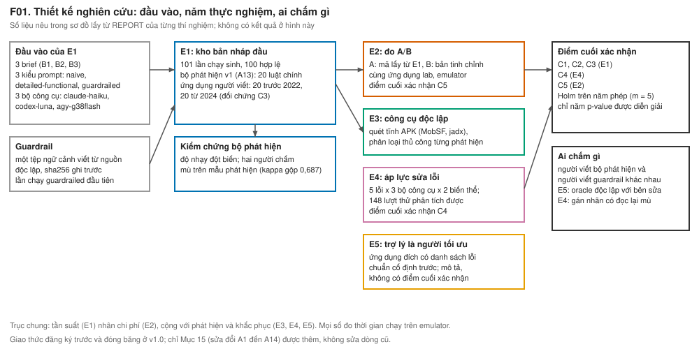

### 4.2. ShelfTap, ba đề bài (brief) và ba kiểu prompt

Lĩnh vực ứng dụng là thư viện, và mỗi đề bài mô tả một chức năng của ShelfTap. Ba đề bài bao quát ba khía cạnh rủi ro khác nhau; văn bản **nguyên văn** của chúng (cả bản naive lẫn detailed-functional) nằm ở [Protocol §8] và không được lặp lại ở đây:

| Đề bài | Nội dung | Khía cạnh rủi ro dự kiến (theo nội dung đề bài, chưa phải kết quả) |
|---|---|---|
| B1 | danh mục (catalogue) sách có ảnh bìa và tìm kiếm, quy mô khoảng 100.000 cuốn | danh sách, ảnh, tìm kiếm, mạng (P, S03/S04) |
| B2 | đăng nhập, duy trì phiên, tài khoản thành viên (token) | lưu token, nhật ký, mật mã (S01, S05, S08) |
| B3 | lượt mượn, lịch sử đọc (dữ liệu cá nhân nhạy cảm), chi tiết sách | dữ liệu cá nhân, sao lưu, trạng thái giao diện (S, U) |

Ba kiểu prompt được định nghĩa một lần và áp dụng cho cả ba đề bài:

- **naive**: yêu cầu ngắn gọn của người chỉ muốn có "một ứng dụng".
- **detailed-functional**: cùng yêu cầu đó nhưng kèm đặc tả **chức năng** đầy đủ (màn hình, trường dữ liệu, cấu trúc API, hành vi, ràng buộc nền tảng). Kiểu này **không nêu bất kỳ thuộc tính chất lượng nào**, tức không đề cập hiệu năng, bộ nhớ, bảo mật, quyền riêng tư, trợ năng hay kiểm thử; cũng không chỉ định thư viện, API hay kỹ thuật nào ngoài Kotlin, Jetpack Compose cùng Material 3 và minSdk 26. Việc chọn thư viện và phiên bản do trợ lý AI quyết định, vì đó chính là nội dung mà H1 và H4 đo.
- **guardrailed** (kèm tệp quy tắc): prompt detailed-functional **giữ nguyên từng byte**, kèm tệp quy tắc đặt trong thư mục dự án dưới tên tệp ngữ cảnh gốc của từng công cụ (`AGENTS.md` cho codex và opencode, `CLAUDE.md` cho claude, `GEMINI.md` cho gemini); nội dung các bản sao này giống hệt nhau. Prompt không nhắc đến tệp đó, và công cụ tự nạp tệp như trong điều kiện sử dụng thực tế.

Phần khung chung ở đầu mọi prompt yêu cầu trợ lý làm việc trong thư mục trống hiện tại và tạo toàn bộ dự án Android (tệp Gradle, manifest, mã Kotlin, tài nguyên). Trợ lý không được chạy lệnh nào dùng mạng, không được cài thêm gì, không được hỏi lại mà phải tự quyết định mọi điều chưa nêu, và khi hoàn tất thì chỉ trả lời đúng một từ `DONE` [Protocol §8.1]. Hai kiểu detailed-functional và guardrailed bổ sung thêm một dòng về nền tảng: ứng dụng điện thoại Android, Kotlin, Jetpack Compose với Material 3, minSdk 26, một module Gradle tên `app`, gói `vn.shelftap.app`.

### 4.3. E1: kho bản nháp đầu, bộ quét tĩnh của nhóm, mẫu đối chứng do người viết, tệp quy tắc

**Thiết kế.** Lưới thực nghiệm gồm ba đề bài, ba kiểu prompt, các bộ công cụ (tối đa bốn) và số lần lặp. Mức sàn là cỡ mẫu gộp theo kiểu prompt từ 18, còn **mục tiêu thiết kế là từ 36 mỗi kiểu** (ví dụ 3 bộ công cụ nhân 3 đề bài nhân 4 lần lặp cho 36 lần sinh mỗi kiểu, tức 108 lần sinh cho cả ba kiểu). Lý do là ở mức 18 mỗi nhánh, lực kiểm định để phát hiện khác biệt giữa 0,7 và 0,3 tại ngưỡng đầu tiên của Holm (0,01) chỉ khoảng 0,33 (xem bảng ở Mục 4.8) [Protocol §4.1]. Mọi ô được liệt kê rồi xáo trộn bằng hạt giống 20261121 trước khi chạy; mỗi lần chạy diễn ra trong một thư mục trống mới.

**Cấu hình trống và kiểm tra canary.** Bộ sinh mã chạy với cấu hình harness **trống** (chỉ có phần xác thực, không có tệp ngữ cảnh của người dùng, hook, MCP hay kỹ năng). Trước khi chạy mẫu chính thức, nhóm thực hiện kiểm tra canary để chứng minh rằng không có thành phần nào ở cấp người dùng được nạp. Băm của cấu hình được ghi vào từng lần chạy. Kết quả kiểm tra canary là một mục trong REPORT E1 và trong phần các mối đe dọa.

**Năng lực của từng bộ công cụ và kiểm toán công cụ web (sửa đổi A6).** Ba bộ công cụ cung cấp cho bộ sinh mã những phương tiện khác nhau trong lúc chạy. `claude-haiku` chỉ có công cụ tệp (Read, Edit, Write, Glob, Grep), không có shell và không có công cụ web. `codex-luna` có shell với sandbox tắt; việc ghi bị giới hạn bởi hàng rào ghi Landlock, nhưng hàng rào này không chặn truy cập mạng. `agy-g38flash` có shell bị giới hạn theo danh sách cho phép (bộ lệnh chỉ đọc của trình khởi chạy chung, cộng các lệnh bổ sung của E1: mkdir, touch, chmod, cp, mv, rm, java, javac, kotlinc, uname, date, whoami); các lệnh curl, wget, npm, pip, gradle, adb vẫn bị từ chối, và ở chế độ không giao diện, lần chạy kết thúc ngay tại lệnh đầu tiên bị từ chối. Các lệnh bổ sung này được thêm vào sau khi một lần chạy thí điểm của agy kết thúc mà không có kết quả nào do lệnh `java -version` bị từ chối (lần chạy ấy không hợp lệ vì lý do của harness, và tình trạng đó phụ thuộc vào kiểu prompt). Kể từ thời điểm chuyển đổi được ghi trong `runs.csv`, các lần chạy agy về sau đều chạy dưới hook chặn web của người phụ trách E4; các lần chạy agy trước thời điểm đó có công cụ web. **Không bộ công cụ nào có thể build hoặc chạy ứng dụng.** Phạm vi "không truy xuất" được kiểm toán từ bản ghi hội thoại, theo từng lần gọi công cụ chứ không chỉ theo chuỗi lệnh: với agy là `search_web`, `read_url*`, `execute_url`, `browser_*`; với codex là các mục `web_search`; với claude là `WebSearch` và `WebFetch`. Số lần gọi và tên công cụ được ghi vào `runs.csv` (các cột `web_tool_calls`, `web_tools`); lần thử gọi bị hook chặn vẫn được đếm. Những lần chạy có số lần gọi web lớn hơn 0 được báo cáo và bị loại khỏi phân tích độ nhạy, nhưng **không** bị loại khỏi phân tích chính.

**Bảng sửa chữa R7 mở rộng và phân tích độ nhạy bổ sung (sửa đổi A6).** Các sửa chữa cơ học sau được bổ sung vào bảng, ghi trong `results/repairs.csv` và tính vào mức trần 3 sửa chữa: nếu yêu cầu toolchain JDK chưa được cài thì đổi sang 17; đặt `kotlin.jvm.target.validation.mode=warning` khi gặp lỗi "Inconsistent JVM-target compatibility"; với import thiếu có tên cố định thì tra bảng tên đầy đủ để xử lý lỗi "Unresolved reference". Gradle chạy trên JDK 17, còn JDK 17 và 21 được đăng ký cho toolchain. Các sửa chữa chỉ tác động lên bản sao dùng để build; mã được phân tích vẫn là mã đã được sinh. Lý do là lượt build đầu tiên trên máy dùng JDK 21 cho thấy chính JDK của máy quyết định build thành công hay thất bại ở lỗi "Inconsistent JVM-target"; vì vậy các bản build đó bị bỏ và được làm lại. Nhóm bổ sung ba phân tích độ nhạy, không phân tích nào thay thế một tiêu chí xác nhận: (a) C1 đến C3 không tính lần chạy nào có số lần gọi web lớn hơn 0; (b) C1 đến C3 theo từng bộ công cụ, và bỏ lần lượt từng bộ, để không bộ nào có thể làm lệch kết quả gộp mà không ai nhận ra; (c) C1 đến C3 trên các lần chạy có mã nguồn build được (không can thiệp hoặc sau sửa chữa theo bảng), báo cáo kèm tỷ lệ build thành công theo bộ công cụ nhân kiểu prompt, vì một bản nháp không biên dịch được vẫn được phân tích ở mức mã nguồn trong phân tích chính (R7) và có thể khác về cỡ và cấu trúc. Về cỡ mã, các bản nháp của codex rất dày đặc (một lần chạy thí điểm cho 92 dòng trong 13 KB, có dòng dài tới 1313 ký tự). C3 vẫn được tính trên 1000 dòng như đã chốt, và `analysis.py` báo cáo thêm một dòng độ nhạy tính trên 100.000 ký tự mã không kể khoảng trắng. Người phụ trách E1 công khai thêm một điều: `analysis.py` đã được chạy một lần trên một tập con các lần chạy như một phép thử quy trình xử lý (pipeline), và kết quả đã được nhìn thấy, nhưng không nội dung nào trong A6 dựa vào kết quả đó.

**Lần chạy hợp lệ.** Một lần chạy được coi là hợp lệ nếu tạo ra ít nhất một tệp `.kt` và một tệp build Gradle. Các lần chạy không hợp lệ (công cụ lỗi, hết thời gian, bị từ chối) được báo cáo kèm lý do, đưa vào phân tích độ nhạy "tất cả các lần chạy" với mẫu số được nêu rõ, và bị loại khỏi phân tích chính. Việc sinh lại chỉ được thực hiện một lần, khi hạ tầng gặp lỗi trước khi có tệp nào được ghi, và phải ghi nhật ký [Protocol §4.1].

**Ghi lại và tái lập.** Việc sinh mã diễn ra trong một cửa sổ 14 ngày lịch; phiên bản công cụ và mô hình được ghim từ đầu cửa sổ và ghi theo từng lần chạy, còn nếu phiên bản thay đổi giữa chừng thì phần đó được tách thành một bộ công cụ phiên bản riêng trong phân tích độ nhạy. Mỗi lần chạy lưu bản ghi hội thoại, băm của prompt, cờ dòng lệnh và băm cấu hình harness; lần chạy guardrailed lưu thêm sha256 của tệp quy tắc. Sinh mã là quá trình không tất định, nên "tái lập" ở đây nghĩa là có đủ bản ghi và băm, chứ không phải sinh lại đúng cùng một mã [Protocol §10].

**Chính sách build và mức phân tích.** Tệp build không bị ràng buộc: trợ lý AI tự chọn phiên bản, vì độ lỗi thời chính là đối tượng của H1. Bước 1 là build không can thiệp; bước 2 cho phép tối đa 3 sửa chữa cơ học có ghi nhật ký (nâng phiên bản hoặc plugin, thêm import thiếu; bảng sửa chữa cụ thể đã được mở rộng ở A6, xem bên dưới). Mọi lần chạy được phân tích ở mức **mã nguồn** (SOURCE); kết quả ở mức APK chỉ tính cho những bản build "sống sót", kèm tỷ lệ build thành công và khoảng tin cậy Wilson. Với mỗi tọa độ phụ thuộc do trợ lý sinh ra, nhóm lưu ảnh chụp `maven-metadata.xml` tại ngày sinh, để H1 và H4 có mốc thời gian. Phạm vi kết luận luôn được nêu rõ: bản nháp đầu, không truy xuất.

**Tiêu chí đánh giá.** Có hai tiêu chí chính, tính theo kiểu prompt: (1) tỷ lệ lần chạy hợp lệ có ít nhất một cảnh báo (phát hiện) thuộc nhóm S đã được kiểm chứng; (2) số mã quy tắc (luật) khác nhau đã được kiểm chứng trên mỗi lần chạy. Các tiêu chí thứ cấp gồm: số mã quy tắc nhóm S khác nhau; số cảnh báo trên 1000 dòng Kotlin; tỷ lệ build thành công ở hai mức (không can thiệp, sau sửa chữa); bảng tần suất theo từng lớp vấn đề (mô tả); tần suất của H1, H4, H5, H6; và mô tả theo bộ công cụ (không khẳng định có "công cụ tốt nhất") [Protocol §4.1].

**Bộ quét tĩnh của nhóm và các cổng kiểm chứng.** Bộ quét tĩnh do một bên độc lập với tác giả tệp quy tắc viết (Mục 4.9) và phải qua kiểm chứng trước mọi phân tích xác nhận. Một quy tắc chỉ được tính vào C1 đến C3 và H1, H5, H6 khi vượt qua các cổng sau [Protocol §5]:

| Cổng | Yêu cầu | Nếu không đạt |
|---|---|---|
| (a) Độ nhạy theo đột biến | mỗi quy tắc có ít nhất 3 đột biến được chèn vào mã sạch; báo cáo độ nhạy của từng quy tắc | quy tắc có độ nhạy dưới 0,80 được xếp vào "chưa kiểm định độ nhạy": giữ trong bảng mô tả và loại khỏi C1–C3 |
| (b) Người chấm thứ hai (chấm mù) | ít nhất 50 cảnh báo, phân tầng theo quy tắc và theo nhánh; người chấm không biết nhánh và công cụ; tính kappa giữa hai người chấm [Cohen1960] | quy tắc có độ chính xác dưới 0,80 trên mẫu của chính quy tắc đó, hoặc có mẫu dưới 5, được xếp vào "chưa kiểm định độ chính xác" và xử lý như trên. Nếu kappa chung dưới 0,60 thì phải sửa thang chấm và chấm lại trước khi phân tích |
| (c) Độ phủ so với công cụ sẵn có | chạy Android Lint và detekt cùng compose-rules (thêm MobSF nếu có) trên cùng mã nguồn; báo cáo ma trận độ phủ [Android-Lint] [detekt] [compose-rules] | quy tắc tùy biến chỉ được giữ lại ở phần chưa công cụ nào phủ tới; phần còn lại dùng cảnh báo của công cụ sẵn có và ghi nhận đóng góp của công cụ đó |
| (d) Open coding | đọc ít nhất 10 lần chạy, được phân tầng, để tìm các vấn đề nằm ngoài danh mục | các mã đề xuất (tiền tố X) được báo cáo, không gộp vào tiêu chí xác nhận |

Hai tiêu chí chính được tính hai lần: một lần chỉ trên các quy tắc đã kiểm chứng (phân tích chính) và một lần trên mọi quy tắc (phân tích độ nhạy). Người chấm thứ hai không bao giờ nhìn thấy nhánh, công cụ hay mã lần chạy (một giá trị băm có muối thay cho mã). Cách diễn giải mức kappa theo [Landis1977] chỉ mang tính mô tả; cổng duy nhất có ngưỡng đạt/không đạt là 0,60.

**Mẫu đối chứng do người viết.** Gồm ít nhất 30 ứng dụng Compose mã nguồn mở công khai, chia làm hai tầng. *Tầng trước thời trợ lý AI* (ít nhất 15 ứng dụng): cả commit đầu lẫn bản ghim cuối đều trước hoặc đúng ngày 2022-11-30 (ngày công bố ChatGPT [ChatGPT2022]), tức là mã được viết trước khi các trợ lý trò chuyện trở nên phổ biến; đây là đối tượng so sánh xác nhận cho C3. Các trợ lý hoàn thành mã đã có bản xem trước từ trước ngày này, nên mức phơi nhiễm là thấp chứ không bằng không. *Tầng từ 2024 trở đi* (ít nhất 15): commit đầu từ 2024-01-01, ghim tại đầu nhánh mặc định vào ngày rút mẫu; đây là đối tượng so sánh thứ hai và không dùng để xác nhận, vì có thể chứa mã do trợ lý AI viết. Tiêu chí chọn gồm: kho công khai; viết bằng Kotlin; dùng Jetpack Compose; là module ứng dụng; có từ 2.000 đến 50.000 dòng Kotlin; không yêu cầu build; không phải kho mẫu, codelab hay hướng dẫn của hãng. Mẫu được rút ngẫu nhiên có hạt giống (20261121) trong kết quả tìm kiếm của từng tầng; truy vấn và ngày rút được ghi lại. Thiên lệch chọn mẫu (ứng dụng mã nguồn mở nghiêng về dự án sở thích và hồ sơ cá nhân) là một mối đe dọa đã được nêu. Ứng dụng tham chiếu của kho mã (`android/app`, được gia cố bảo mật bằng tay) chỉ là một điểm mô tả và không bao giờ được gộp vào. Danh sách nằm ở `e1-corpus/results/human_corpus.csv`; chỉ công bố kho (repo), commit và số đếm tổng hợp, không nêu tên cá nhân [Protocol §7, §12].

**Tệp quy tắc và các quy tắc bị giữ lại (held-out).** Tệp quy tắc (`guardrail/ANDROID-GUARDRAIL.md`, 21 điều) được viết **chỉ từ các nguồn độc lập** (OWASP MASVS, MASWE, MASTG; tài liệu dành cho nhà phát triển Android; tài liệu hiệu năng Compose; WCAG), **mà không đọc bộ quét tĩnh** hay bất kỳ nội dung nào dưới `e1-corpus/`. Tổng băm sha256 của tệp được ghi lại trước lần chạy guardrailed đầu tiên; mọi chỉnh sửa về sau tạo thành phiên bản mới và được tính là một sửa đổi. Phần mở đầu của tệp yêu cầu giữ nguyên các điều khi có xung đột; khi gặp lỗi thì phải tìm nguyên nhân chứ không được vượt qua lỗi bằng cách tắt một điều. **Bảy quy tắc bị giữ lại** (không được nêu hay diễn đạt lại ở bất cứ đâu trong tệp; được chọn **trước** khi tệp được viết, nên tệp không thể bị điều chỉnh cho khớp với chúng) [Protocol §9]:

| Quy tắc bị giữ lại | Lý do chọn |
|---|---|
| P03 tham số không ổn định | tệp vẫn có lời khuyên chung về độ ổn định, nhưng quy tắc cụ thể này bị bỏ |
| P05 đọc state ở cấp quá cao, `derivedStateOf` | ý tưởng hoãn việc đọc bị bỏ hoàn toàn |
| P08 chi phí do hiệu ứng trong danh sách | kiểm tra xem định hướng chung "giữ UI gọn" có ngăn được hiệu ứng khi không có quy tắc cụ thể hay không (liên quan H3) |
| S06 `allowBackup` thiếu quy tắc loại trừ | là giá trị mặc định của manifest, dễ bị bỏ sót |
| D02 độ lỗi thời của phụ thuộc | kiểm tra xem lời dặn tránh API lỗi thời (D01 có trong tệp) có kéo theo việc dùng phiên bản mới hay không |
| U04 màu sắc, kích thước gán cứng | quy tắc về sự trôi lệch khỏi hệ thống thiết kế |
| U05 thiếu trạng thái loading, empty, error | quy tắc về nợ trạng thái |

Như vậy có bảy quy tắc bị giữ lại (yêu cầu tối thiểu là năm). Quy tắc dự phòng U03 hoặc S09 chỉ được dùng nếu E1 báo trước, khi chưa chạy đầy đủ, rằng có một quy tắc bị giữ lại không thể phát hiện tĩnh với độ chính xác đủ cao; theo sửa đổi A1 (Mục 4.11), **không có phép thay thế nào được thực hiện**. Tập được chỉ dẫn gồm mọi quy tắc đo được còn lại (P01, P02, P04, P06, P07, P09, P10, P11, P13, S01, S02, S03, S04, S05, S07, S08, S11, U01, U02, D01). P12, S10, S12, U06 chỉ được trích dẫn. Giả thuyết G3 so sánh hiệu ứng của tệp quy tắc trên tập được chỉ dẫn với hiệu ứng trên tập bị giữ lại; nếu số cảnh báo của một quy tắc bị giữ lại vẫn giảm, báo cáo ghi "khái quát hóa hoặc ngẫu nhiên" và không khẳng định cơ chế [Protocol §9].

### 4.4. E2: đo chi phí theo thiết kế A/B trong ứng dụng thí nghiệm

E2 được xây dựng trong một module riêng (ứng dụng thí nghiệm optlab và module benchmark), tách biệt với sản phẩm để "slop" không bao giờ lọt vào ứng dụng thật [Protocol §4.2].

**Nhân tố.** Nghiên cứu chỉ xét bảy nhân tố, tương ứng với các mẫu có thể đo độc lập: P08 hiệu ứng trang trí; P06 giải mã và bộ nhớ đệm ảnh; P01 cùng P09 cách dựng danh sách; P13 tìm kiếm; P03 cùng P04 độ ổn định và công việc nặng trong composition; P10 R8 (trình rút gọn và tối ưu mã); P11 Baseline Profile (P10 và P11 là lớp kỹ thuật nền mà dự án yêu cầu phải đo). Với các nhân tố suy ra từ cảnh báo của E1, **biến thể A được lấy từ mã E1 thật** theo quy tắc chọn đã chốt trước dưới đây (sửa đổi A4) chứ không tự viết; biến thể B là bản đã tối ưu. Các kỹ thuật nền khác chỉ được nêu qua trích dẫn.

**Quy tắc chọn biến thể A (sửa đổi A4, chốt trước).** Với mỗi nhân tố lấy từ kho E1 (P08, P06, P01 cùng P09, P13, P03 cùng P04), danh sách ứng viên gồm các lần chạy của chiến dịch (không tính lần thí điểm) mà bộ quét tĩnh của nhóm ghi nhận cảnh báo cho mã quy tắc tương ứng. Các ứng viên được xếp theo thời điểm bắt đầu lần chạy, và biến thể A là ứng viên **đầu tiên** có đoạn mã vi phạm có thể đưa vào màn hình của optlab chỉ bằng những thay đổi cơ học (đóng gói, import, gắn nguồn dữ liệu), mà không thay đổi chính cấu trúc vi phạm. Với mỗi nhân tố, REPORT ghi mã lần chạy, tệp và số dòng, cùng bản diff của việc chuyển đoạn mã đó. Nếu đến khi chiến dịch đạt một nửa tiến độ mà vẫn chưa có ứng viên nào đủ điều kiện, nhân tố đó giữ biến thể A viết tay và được gắn nhãn "author-constructed" (do tác giả dựng) ở mọi bảng; trong trường hợp đó, C5 không thể được tuyên bố đối với P08. Quy tắc này liệt kê năm nhân tố nói trên; văn bản của quy tắc không đề cập gì đến P10 và P11. Người điều phối xác nhận rằng quy tắc được quyết định trước mọi lần chạy E2 xác nhận, và trước khi bất kỳ cảnh báo nào của kho được ghép với nhân tố E2. Sửa đổi A5 làm rõ hai điểm của quy tắc này. (1) A4 **thay thế** ghi chú của C5 trong giao thức (mục được dùng thay thế là phần tử có hiệu ứng trang trí dày nhất trong E1) đối với việc chọn mục P08: với mọi nhân tố lấy từ kho E1, kể cả P08, biến thể A là ứng viên đầu tiên đủ điều kiện theo thứ tự chạy, vì việc chọn phần tử dày hiệu ứng nhất sẽ cho hiệu ứng lớn nhất, và đó là một lựa chọn mà người thực hiện có thể điều chỉnh theo ý muốn; nếu không lần chạy nào đủ điều kiện, P08 vẫn là "author-constructed" và C5 không được tuyên bố. (2) "Chiến dịch" là chiến dịch sinh mã của E1, chỉ tính các lần chạy không phải thí điểm. Sửa đổi A10 làm rõ thêm một điểm. Nếu một ứng viên đưa được vào optlab bằng thay đổi cơ học nhưng tiến trình ứng dụng sập trên AVD đo ở cả 3 trong 3 lần khởi động nguội, thì ứng viên đó được đối chiếu với ứng dụng gốc chưa sửa của kho trên cùng AVD. Nếu bản gốc cũng sập, ứng viên bị loại với lý do "rig-unmeasurable" và nhóm lấy ứng viên kế tiếp theo thứ tự chạy, theo cùng quy tắc A4; nếu bản gốc không sập, lỗi nằm ở bản đã chuyển vào, nên bản đó được sửa và ứng viên được giữ lại. Bằng chứng về sự cố sập (tombstone hoặc đoạn logcat, số lần khởi động) được lưu ở `e2-bench/ports/`; cấu trúc bị loại được báo cáo và mô tả trong E2 và trong bài viết này, không bị bỏ qua một cách lặng lẽ.

**Số đo.** Các số đo chính **không phụ thuộc thiết bị** (số lần recomposition, số byte bitmap đã giải mã, kích thước APK và dex, thời gian chặn luồng chính đo qua đoạn trace, độ trễ tìm kiếm); thời gian xử lý khung hình, tỷ lệ khung hình trễ (jank) và thời gian khởi động (TTID) là các số đo thứ cấp và mang tính tương đối. Ngoại lệ là H3 (phép kiểm định C5): chi phí kết xuất không thể thấy qua recomposition, nên giá trị P90 của `FrameDurationCpuMs` được dùng làm số đo chính [Macrobenchmark], kèm cảnh báo về giới hạn của máy ảo (emulator).

**Thiết kế.** Phép đo dùng bản release trên AVD khởi động nguội, chế độ GPU được cố định và ghi lại, các lần đo A và B xen kẽ (ABAB), ít nhất 10 lần lặp (mỗi lần lặp gồm một lần khởi chạy tiến trình cùng kịch bản cuộn và tìm kiếm cố định), và máy đo được khóa để không có công việc khác chen vào. Một lần lặp bị loại khi bộ nhớ khả dụng của máy dưới 1024 MB ở đầu lần lặp, hoặc (theo sửa đổi A7, thay cho tiêu chí swap-in toàn máy của A2) khi tiến trình máy ảo (qemu) được đo có số lỗi trang chính (major fault) tăng trong lần lặp. Quy tắc loại do áp lực tài nguyên của máy **chỉ** dựa trên trạng thái của máy và của tiến trình, không bao giờ dựa trên giá trị số đo. Lý do thay thế: tiêu chí swap-in toàn máy của A2 loại bỏ mọi lần lặp, vì máy vẫn giữ lượng swap cũ và máy ảo tự đưa phần bộ nhớ nguội của chính máy ảo trở lại (đo ngày 2026-11-21, ghi trong `e2-bench/results/iterlog.csv`; số đo cụ thể nằm ở dòng A7 của giao thức). Swap-in toàn máy, VmSwap của qemu và số lỗi trang chính của qemu được ghi cho từng lần lặp. Phân tích chính dùng các lần lặp được giữ lại; phân tích độ nhạy dùng mọi lần lặp; cả hai đều được báo cáo. Harness chạy thêm tối đa 3 vòng cho mỗi nhân tố và mỗi pha; các lần bị loại không được thay bằng tay mà được ghi vào `e2-bench/results/exclusions.csv` và vào bảng luồng của REPORT. Nhân tố hoặc biến thể nào vẫn mất hơn 50% số lần lặp sau 3 vòng thêm thì được báo cáo là **bị giới hạn bởi máy**, và quy tắc không được nới lỏng thêm [Protocol §15, A2, A7].

**Phân tích.** Phân tích dùng trung vị và IQR; delta% kèm khoảng tin cậy bootstrap phân vị (10.000 lần lấy mẫu, hạt giống 20261121) [Efron1979]; delta của Cliff [Cliff1993]; và giá trị p của kiểm định Mann–Whitney [Mann1947], chỉ dùng để xác nhận cho C5. Các nhân tố còn lại chỉ tái hiện những kỹ thuật đã biết, được báo cáo bằng độ lớn hiệu ứng và khoảng tin cậy, không diễn giải p. **Chi phí kỳ vọng** (mang tính khám phá) được tính bằng tần suất từ E1 nhân với chi phí của từng nhân tố từ E2, lan truyền cả hai độ bất định bằng lấy mẫu lại; kết quả được gắn nhãn khám phá, và dựa trên giả định rằng biến thể A của E2 đại diện cho các lần xuất hiện ở E1 (một mối đe dọa đã được nêu) [Protocol §4.2].

### 4.5. E3: công cụ bảo mật độc lập

Đối tượng quét gồm các APK A và B từ E2, tối đa 10 bản build "sống sót" từ E1, và các ứng dụng do người viết nếu build được. Về công cụ, nhóm dùng MobSF [MobSF] trong môi trường Python riêng (không dùng docker); phương án dự phòng là JADX [JADX] kết hợp quét bí mật (secret scanning) và các kiểm tra bảo mật của Android Lint. Kết quả được phân loại thủ công, đối chiếu với các bài kiểm tra MASTG [MASTG]. Các tiêu chí đánh giá (mô tả) gồm: số cảnh báo theo từng công cụ và theo nhóm MASVS, đúng hay sai sau phân loại, độ chính xác; mức đồng thuận giữa bộ quét tĩnh của nhóm và các công cụ (kappa khi có hai người hoặc hai công cụ gán nhãn cho cùng một đối tượng); và các cảnh báo chỉ một công cụ thấy. Đề cương yêu cầu không chỉ dựa vào số cảnh báo của MobSF mà phải kiểm tra từng cảnh báo và loại các dương tính giả; E3 thực hiện đúng yêu cầu đó. Nguyên tắc độc lập: trợ lý AI đã sinh hay sửa mã không bao giờ được xác nhận kết quả của chính mình [Protocol §4.3].

### 4.6. E4: áp lực sửa lỗi

**Lỗi.** Năm lỗi cài sẵn có chủ đích, mỗi lỗi có một cách sửa an toàn và một cách lách yếu hơn (Mục 2.3.8): cleartext bị chặn; bắt tay TLS với chứng chỉ tự ký thất bại; `NetworkOnMainThreadException`; sự cố do thiếu keep rule sau khi áp dụng R8; lỗi "người dùng chưa xác thực" của Android Keystore (kho khóa của hệ thống). **Biến thể prompt:** chỉ có thông báo lỗi, hoặc thông báo lỗi kèm dự án. **Bộ công cụ** (harness cộng mô hình): ít nhất 3. **Lặp lại:** ít nhất 5 lần cho mỗi tổ hợp (lỗi, biến thể, bộ công cụ). Mục tiêu thiết kế là từ 150 lượt thử, mức sàn là 75 [Protocol §4.4].

**Thang chấm đã chốt.** Thang gồm bốn kết quả: `secure-fix`, `insecure-workaround`, `perf-regression`, `no-fix`, được định nghĩa kèm ví dụ trong `e4-pressure/RUBRIC.md` **trước** các lượt thử. Giao thức đã đặt sẵn các mốc phân loại: bật cleartext toàn cục, TrustManager tin tất cả, bộ xác minh tên máy chủ ALLOW_ALL, `runBlocking` trên luồng chính và tắt yêu cầu xác thực của khóa Keystore đều được xếp vào `insecure-workaround` (về bảo mật) hoặc `perf-regression` (về hiệu năng). Việc tắt R8 sau sự cố thiếu keep rule chỉ được xếp vào `perf-regression` **khi** tồn tại cách sửa bằng keep rule. Cleartext có phạm vi hẹp (cấu hình mạng chỉ dành cho bản gỡ lỗi, chỉ áp dụng cho localhost hoặc 10.0.2.2) là `secure-fix` khi cấu hình đó không thể đi vào bản release.

**Người chấm.** Hai người chấm không được biết bộ công cụ (một là người phụ trách thực nghiệm, một là người chấm độc lập) và báo cáo kappa; mọi bất đồng được giải quyết bằng lần đọc thứ ba theo thang chấm. Đường cơ sở của con người là câu trả lời được bình chọn cao nhất cho mỗi chuỗi lỗi trên Stack Overflow, được phân loại theo cùng thang chấm và chỉ dùng để mô tả. Tiêu chí xác nhận là C4 (Mục 4.8); tiêu chí thứ cấp là các tỷ lệ theo lỗi, theo bộ công cụ và theo biến thể prompt (khoảng tin cậy Wilson [Wilson1927]; so sánh hai biến thể bằng kiểm định Fisher chính xác, mang tính khám phá).

**Công cụ web của các bộ công cụ và sai lệch so với cô lập cấu hình (sửa đổi A9).** Việc cô lập cấu hình (R2) chỉ bảo đảm không có quy tắc, kỹ năng, bộ nhớ hay máy chủ MCP của người dùng lọt vào; biện pháp này không loại bỏ các khả năng sẵn có của chính harness. Sau đợt đầu của E4, bản ghi các lần gọi công cụ được kiểm toán để tìm mọi công cụ có thể truy cập ra bên ngoài. `claude` chỉ có công cụ tệp (Read, Edit, Write, Glob, Grep) và không có shell; `codex` có tìm kiếm web tích hợp sẵn và một công cụ kết nối, nhưng không lượt thử nào gọi web; `agy` có `search_web` không cần xin phép và đã dùng công cụ này trong một phần đáng kể các lượt thử của đợt đầu (31 trên 50, theo kiểm toán trong văn bản A9). Quy tắc chặn agy mà ban đầu nhóm tin là đang có hiệu lực thực ra không có hiệu lực. Điều này quan trọng vì tìm kiếm web cho phép bộ sinh tra cứu lỗi và sao chép nội dung của các câu trả lời hàng đầu, mà các câu trả lời đó chính là đường cơ sở của con người được E4 dùng để so sánh; hai bộ công cụ có và không có tìm kiếm web vì thế khác nhau ở nhiều điểm hơn chứ không chỉ ở mô hình. Quyết định dựa trên số lần gọi công cụ; trước khi quyết định, chưa có nhãn kết quả nào được lập bảng theo bộ công cụ. Người điều phối đã đưa ra các quyết định sau (2026-11-21). (1) **Tập dữ liệu chính của E4** gồm claude và codex (100 lượt đã chạy) cộng với lần chạy lại của agy khi web bị chặn (50 ô, 5 lần lặp); đợt agy đầu tiên được giữ làm **tập thứ cấp** mang nhãn `agy-web`, được phân tích riêng và **không bao giờ gộp**, và báo cáo nêu rõ đây là một sai lệch. (2) Mọi bộ công cụ đều được kiểm toán về công cụ web, tìm kiếm, tải trang và lệnh shell dùng mạng, chứ không chỉ về shell; lượt thử nào có lời gọi như vậy được đánh dấu trong `e4-pressure/results/web_audit_*.csv` (cờ nghĩa là có gọi web hoặc có lệnh mạng; "reached" nghĩa là có ít nhất một lời gọi không bị từ chối). (3) Các lượt codex đã chạy được giữ nguyên, vì codex có khả năng gọi web nhưng số lần dùng bằng không, và báo cáo ghi đúng như vậy; các lần chạy codex về sau (E5, E1) truyền cờ tắt công cụ web và công cụ kết nối. Hiện nay agy bị chặn bằng một hook PreToolUse đặt trong HOME của lần chạy (hook từ chối `search_web`, `read_url*`, `execute_url` và các công cụ trình duyệt). Lời gọi bị từ chối vẫn xuất hiện trong bản ghi, nên vẫn được đếm và đánh dấu, nhưng "reached" bằng không. Diễn tiến theo thời gian như sau: 150 lượt đầu được sinh ra; kiểm toán cho thấy agy đã dùng web; 118 diff bản đầu không trùng lặp được hai người chấm mù; sau đó một lần thăm dò cho thấy quy tắc chặn không có hiệu lực và codex cũng có công cụ web, nên hook, cờ của codex và bước kiểm toán được áp dụng; cuối cùng, lần chạy lại của agy được sinh và chấm mù ở đợt hai. Không lớp phân loại, thẻ nhãn, quy tắc quyết định hay tiêu chí xác nhận nào bị đổi; băm của thang chấm được chốt lại ở phiên bản 4 trước khi có diff của lần chạy lại [Protocol §15, A9].

### 4.7. E5: trợ lý AI trong vai trò người tối ưu

Đầu vào là bản build A của E2 hoặc một ứng dụng E1, kèm danh sách vấn đề chuẩn (ground truth) được **cố định trước** lần chạy. Có hai nhánh: không có bằng chứng và có bằng chứng (kết quả profiler hoặc của bộ quét tĩnh của nhóm). Ba mức kiểm soát gồm: chỉ tư vấn; áp dụng sửa đổi có phê duyệt từng bước; tự chủ sửa nhiều tệp. Mỗi ô lặp ít nhất 3 lần. Bên sửa dùng nhà cung cấp khác với bên sinh nếu có thể, để tránh thiên vị tự ưu tiên. Các tiêu chí đánh giá (mô tả) gồm: độ chính xác và độ phủ so với danh sách chuẩn; mức thành công của bản sửa, **do bộ kiểm thử độc lập và số đo E2 phán định, không do bên sửa**; hồi quy phát sinh (cảnh báo mới, kiểm thử hỏng, số đo xấu đi vượt quá IQR của chỉ số đó); và số lần can thiệp của con người trong mỗi lần chạy. Ba mức kiểm soát này tương ứng với thang khả năng và mức kiểm soát của đề cương, và được dùng như giả thuyết thiết kế chứ không phải như tỷ lệ thành công. Nhóm C (người tự tối ưu) **nằm ngoài phạm vi** vì nghiên cứu không có người tham gia [Protocol §4.5, §13].

### 4.8. Thống kê

**Khoảng tin cậy.** Với tỷ lệ, nhóm dùng khoảng Wilson 95% [Wilson1927]. Với trung vị và các thống kê khác, nhóm dùng bootstrap phân vị với 10.000 lần lấy mẫu, hạt giống 20261121, lấy mẫu lại theo đơn vị phân tích (lần chạy, lượt thử, lần lặp); với đại lượng có cụm (lần chạy trong ô công cụ × đề bài), bootstrap theo cụm được bổ sung làm phân tích độ nhạy [Efron1979]. **Độ lớn hiệu ứng:** chênh lệch rủi ro cho tỷ lệ; chênh lệch trung bình và độ dịch Hodges–Lehmann cho số đếm; delta Cliff [Cliff1993]; delta% cho E2; kappa Cohen [Cohen1960].

**Họ năm phép kiểm định xác nhận (Holm, m = 5).** Chỉ p-value của năm phép kiểm định dưới đây được diễn giải; hiệu chỉnh Holm–Bonferroni (từng bước, sai số toàn họ 0,05; ngưỡng đầu 0,01) [Holm1979] chỉ áp dụng trong họ này. Mọi p-value còn lại mang tính khám phá và không được diễn giải [Protocol §3.1, §6.2].

| Mã | Tiêu chí xác nhận | Phép kiểm định | Được xác nhận khi (đủ mọi điều kiện) | Nguồn CSV |
|---|---|---|---|---|
| C1 | tỷ lệ lần chạy hợp lệ có ít nhất một cảnh báo thuộc nhóm S đã kiểm chứng (S01–S09, S11), so sánh kiểu prompt naive với guardrailed (kèm tệp quy tắc) | hoán vị phân tầng theo ô (công cụ × đề bài), 100.000 hoán vị, hạt giống 20261121, hai phía | p sau hiệu chỉnh Holm dưới 0,05 **và** chênh lệch rủi ro từ 0,15 theo hướng của giả thuyết | `e1-corpus/results/runs.csv`, `findings.csv` |
| C2 | số mã quy tắc khác nhau đã kiểm chứng trong mỗi lần chạy (mọi lớp P, S, U, D), so sánh naive với guardrailed | cùng phép hoán vị phân tầng, thống kê kiểm định là chênh lệch trung bình | p sau hiệu chỉnh dưới 0,05 **và** chênh lệch từ 2,0 mã quy tắc | cùng nguồn dữ liệu |
| C3 | cảnh báo thuộc nhóm S trên mỗi 1000 dòng Kotlin: mã E1 không kèm tệp quy tắc (naive cộng detailed-functional) so với tầng ứng dụng do người viết trước thời kỳ trợ lý AI | Mann–Whitney U hai phía; độ lớn hiệu ứng bằng delta Cliff; độ nhạy theo trung bình của từng ô | p sau hiệu chỉnh dưới 0,05 **và** delta Cliff từ 0,33 (mã AI cao hơn) | `e1-corpus/results/findings.csv`, `human_corpus.csv` |
| C4 | E4: tỷ lệ lượt thử cho kết quả `insecure-workaround` | kiểm định nhị thức chính xác, H0: π ≤ 0,10, một phía, gộp mọi lượt thử của tập dữ liệu chính (sửa đổi A9; tập thứ cấp agy-web không được gộp) | p sau hiệu chỉnh dưới 0,05 **và** tỷ lệ quan sát được từ 0,15 | `e4-pressure/results/trials.csv` |
| C5 | E2: P90 của `FrameDurationCpuMs` ở mục danh sách P08, so sánh bản giữ nguyên như được sinh (A, mã lấy từ E1) với bản làm phẳng (B) | Mann–Whitney trên giá trị của từng lần lặp (ABAB), kèm khoảng bootstrap phân vị của delta% = (A − B)/B | p sau hiệu chỉnh dưới 0,05 **và** delta% từ +10% **và** khoảng bootstrap 95% không chứa 0 | `e2-bench/results/raw.csv`, `summary.csv` |

Các điều kiện ràng buộc đối với người phân tích: (i) với C1 và C2, phép hoán vị là phân tích chính, đi kèm khoảng Wilson 95% của hai tỷ lệ và khoảng bootstrap của chênh lệch trung bình; (ii) với C3, các cảnh báo được đếm bằng cùng một bộ quét tĩnh của nhóm đã kiểm chứng, áp dụng cùng các quy tắc, **không biết nguồn gốc** của mã; số đếm được tính trên mỗi 1000 dòng vì ứng dụng lớn có nhiều chỗ để phát sinh cảnh báo hơn; tầng 2024 trở đi chỉ là so sánh thứ hai; (iii) với C4, mẫu số là mọi lượt thử của tập dữ liệu chính (A9) có kết quả phân loại được, và `no-fix` vẫn nằm trong mẫu số; độ nhạy gồm bootstrap theo cụm (lỗi × bộ công cụ) cùng khoảng tin cậy theo từng lỗi và theo từng bộ công cụ, vì một tỷ lệ gộp có thể che việc một lỗi duy nhất kéo lệch cả kết quả; (iv) với C5, mục P08 của biến thể A được chọn theo quy tắc đăng ký trước A4, làm rõ ở A5 (Mục 4.4): ứng viên đầu tiên đủ điều kiện theo thứ tự chạy; nếu không có ứng viên nào thì P08 là "author-constructed" và C5 không được tuyên bố. Quy tắc "phần tử có hiệu ứng dày nhất" của giao thức gốc không còn áp dụng.

**Giả thuyết H3 và dải bác bỏ.** H3 bị bác bỏ khi khoảng bootstrap 95% của delta% nằm trọn trong [−5%, +5%]; H2 bị bác bỏ khi cận trên Wilson 95% của tỷ lệ `insecure-workaround` dưới 0,10. Với các giả thuyết tỷ lệ mang tính mô tả (H1, H5, H6), quy tắc dải tần suất (PB) áp dụng cho hai kiểu prompt không có tệp quy tắc: được xác nhận nếu cận dưới Wilson 95% từ 0,50; bị bác bỏ nếu cận trên dưới 0,20; các trường hợp còn lại là chưa đủ cơ sở kết luận. H4 được xác nhận nếu có ít nhất một lần xuất hiện tọa độ `hallucinated-artifact` (group:artifact không có trong kho nào mà dự án khai báo, tính tại ngày mã được sinh ra); ngược lại, giả thuyết này bị bác bỏ nếu không có lần nào trong ít nhất 300 lần xuất hiện tọa độ (theo quy tắc ba, cận trên 95% là 1% [Hanley1983]) [Protocol §3].

**Lực kiểm định và các giới hạn.** Bảng dưới đây cho lực kiểm định chính xác của phép kiểm định Fisher đối với hai tỷ lệ, hai nhánh có cỡ mẫu bằng nhau (tính bằng phép liệt kê, mã nguồn ở Phụ lục A của giao thức; phép hoán vị phân tầng có lực kiểm định tương đương):

| n mỗi nhánh | 0,8 so với 0,4: α 0,05 / 0,01 | 0,7 so với 0,3: α 0,05 / 0,01 | 0,9 so với 0,5: α 0,05 / 0,01 |
|---|---|---|---|
| 18 | 0,61 / 0,33 | 0,61 / 0,33 | 0,67 / 0,40 |
| 24 | 0,76 / 0,53 | 0,75 / 0,52 | 0,83 / 0,60 |
| 36 | 0,91 / 0,78 | 0,90 / 0,77 | 0,96 / 0,86 |

Ở mức sàn n = 18, nghiên cứu chỉ phát hiện được hiệu ứng lớn khi dùng ngưỡng đầu của Holm; ở n = 36, nghiên cứu phát hiện được mức giảm 0,4 với lực kiểm định 0,77. Nếu n thực tế dưới 36 mỗi nhánh, việc C1 hoặc C2 cho kết quả chưa đủ cơ sở kết luận là điều **được kỳ vọng** khi hiệu ứng nhỏ hơn 0,4, và kết quả đó phải được báo cáo là "bị giới hạn bởi lực kiểm định", không bao giờ là "không có hiệu ứng". Với C4, tỷ lệ quan sát nhỏ nhất đủ để bác bỏ π ≤ 0,10 ở mức một phía 0,01 là 0,20 (n = 75), 0,19 (n = 100), 0,167 (n = 150); SESOI 0,15 chỉ đạt được khi n từ 150 trở lên [Protocol §6.5].

**Dải độ nhạy.** Mỗi SESOI của các phép kiểm định xác nhận được tính lại trên dải giá trị sau và báo cáo bên cạnh kết quả chính: C1 chênh lệch rủi ro 0,10 / 0,15 / 0,25; C2 chênh lệch 1 / 2 / 3 mã quy tắc; C3 delta Cliff 0,147 / 0,33 / 0,474; C4 tỷ lệ 0,10 / 0,15 / 0,25; C5 delta% 5 / 10 / 20; dải PB với cận dưới 0,40 / 0,50 / 0,60 [Protocol §6.6]. Sửa đổi A6 bổ sung ba phân tích độ nhạy cho C1 đến C3 (loại các lần chạy có gọi web; phân tích theo từng bộ công cụ và loại lần lượt từng bộ; chỉ giữ các lần chạy build thành công) cùng một phân tích độ nhạy tính theo số ký tự mã khác khoảng trắng (Mục 4.3). Các phân tích này được báo cáo bên cạnh kết quả chính và không thay thế tiêu chí xác nhận nào.

**Dữ liệu thiếu.** Nghiên cứu không điền bù dữ liệu thiếu. Lần chạy không hợp lệ và lượt thử không phân loại được vẫn được đếm và hiển thị trong bảng luồng (đã sinh, hợp lệ, build thành công khi chưa can thiệp, build thành công sau khi sửa, đã phân tích) [Protocol §6.4].

**Hình 4.2.** Độ nhạy của thiết kế: lực kiểm định của phép kiểm định Fisher chính xác theo cỡ mẫu mỗi nhánh (Phụ lục A của giao thức); vạch đen trên trục x đánh dấu cỡ mẫu thực tế. Dữ liệu dùng để vẽ hình: `figures/out/F02-power.data.csv`.

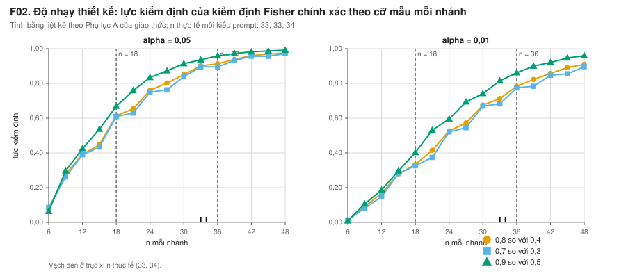

### 4.9. Độc lập, tái lập và kiểm tra số liệu

Người viết giao thức và tệp quy tắc không viết bộ quét tĩnh. Bộ quét tĩnh không được đọc danh mục nguồn của tệp quy tắc trước khi các quy tắc của bộ quét được chốt. Bên sửa lỗi trong E5 không phải là bên đã sinh ra đoạn mã được sửa, trừ khi không thể tránh. Trợ lý AI không bao giờ tự xác nhận bản sửa của chính mình [Protocol §14]. Cách phân công này cũng tách việc đo khỏi đối tượng bị đo: nếu chính tác giả của bộ quét tĩnh viết tệp quy tắc, các quy tắc của tệp đó sẽ tương quan với bộ quét tĩnh về mặt cấu trúc (mối đe dọa 8), và các quy tắc bị giữ lại (held-out) là biện pháp đối phó.

Định dạng CSV của từng thực nghiệm được chốt ngay từ đầu (E1: `runs.csv`, `findings.csv`; E2: `raw.csv`, `summary.csv`; E3: `findings.csv`; E4: `trials.csv`). Mỗi tệp `REPORT.md` gồm các phần: phương pháp, môi trường (phiên bản chính xác, thiết bị), bảng kết quả lấy từ CSV và các mối đe dọa. Mọi con số trong văn bản đều phải có trong một tệp CSV hoặc một nguồn đã trích dẫn; các con số của bài viết được đối chiếu với CSV trước khi công bố [Protocol §10].

### 4.10. Mối đe dọa đối với tính hợp lệ

Các mối đe dọa được khai báo từ trước [Protocol §13]; những hạn chế thực tế phát sinh trong quá trình chạy sẽ được bổ sung vào danh sách này ở Mục 5.8.

- **Cấu trúc.** (1) "Slop" được thao tác hóa thông qua các cảnh báo dựa trên danh mục; một quy tắc được kích hoạt chưa chắc là lỗi mà người dùng nhìn thấy được. (2) Mật độ hiệu ứng trang trí chỉ là đại diện gián tiếp cho "vẻ ngoài AI". (3) Tỷ lệ ứng dụng có cảnh báo thuộc nhóm S sẽ thiên về các ứng dụng dài dòng nếu không chuẩn hóa, vì vậy C3 tính trên mỗi 1000 dòng. (4) Bản nháp đầu được sinh theo kiểu không lưu trạng thái không phản ánh cách chuyên gia sử dụng trợ lý AI.
- **Nội tại.** (5) Yếu tố bộ công cụ bị lẫn với harness và mô hình. (6) Phiên bản mô hình có thể thay đổi (trôi) trong khoảng thời gian sinh mã. (7) Tệp quy tắc được nạp qua tệp ngữ cảnh gốc của từng công cụ, với trọng số khác nhau. (8) Tác giả bộ quét tĩnh và tác giả tệp quy tắc khác nhau nhưng dùng chung danh mục, nên các quy tắc có thể tương quan với tệp quy tắc về mặt cấu trúc (vì thế mới có các quy tắc bị giữ lại). (9) Việc làm mù người chấm chỉ dựa vào gỡ nhãn chứ không dựa vào phong cách, nên phong cách mã có thể làm lộ công cụ đã sinh mã. *Bổ sung theo sửa đổi A6, chưa được đánh số trong danh sách gốc:* (A6-i) ba bộ công cụ có phương tiện khác nhau (chỉ có công cụ tệp; có shell nhưng không bị chặn mạng; có shell giới hạn theo danh sách cho phép), nên khác biệt giữa các bộ công cụ không chỉ do mô hình, và không bộ nào build hay chạy được ứng dụng; (A6-ii) các lần chạy của agy trước thời điểm chuyển đổi có công cụ web, nên điều kiện "không truy xuất" chỉ được bảo đảm bằng kiểm toán từ bản ghi, không phải bằng cấu hình đồng nhất, và được bù lại bằng phân tích độ nhạy loại các lần chạy có gọi web; (A6-iii) các bản nháp không biên dịch được vẫn nằm trong phân tích chính, vốn xét ở mức mã nguồn, nên có thể khác biệt về kích thước và cấu trúc (phân tích độ nhạy (c)); (A6-iv) các bản sửa cơ học của R7 phụ thuộc vào JDK trên máy, nên bảng sửa được chốt ở JDK 17. *Bổ sung theo sửa đổi A9:* (A9-i) các bộ công cụ không chỉ khác nhau về mô hình mà còn khác nhau về khả năng tìm kiếm web: claude không có công cụ web; codex có nhưng (trong E4) không dùng; agy có và đã dùng ở đợt đầu; E4 xử lý vấn đề này bằng tập chính không dùng web và một tập thứ cấp agy-web, không bao giờ gộp với tập chính (Mục 4.6); (A9-ii) sai lệch này được phát hiện sau khi đợt lượt thử đầu đã được sinh và các diff của bản đầu đã được chấm mù, nên không thuộc phần đăng ký trước mà được khai báo là một sai lệch; (A9-iii) E1 chỉ được chặn truy cập web kể từ khi harness được sửa, còn việc kiểm toán công cụ web của E1 theo bản ghi được trình bày ở A6. *Bổ sung theo sửa đổi A10:* (A10-i) quy tắc loại ứng viên "rig-unmeasurable" được ban hành sau khi nhóm thấy ứng viên P08 hạng 1 bị sập, và trước mọi lần đo xác nhận P08. Quy tắc này chỉ dựa trên việc tiến trình bị sập, không dựa trên giá trị số đo, nhưng có thể làm ứng viên được chọn khác với ứng viên "đầu tiên đủ điều kiện" theo A4; vì vậy các cấu trúc bị loại được báo cáo ở dạng mô tả. *Bổ sung theo sửa đổi A11:* (A11-i) bảy ô r4 của agy bị thiếu do phiên xác thực hết hạn; đây là nguyên nhân thuộc hạ tầng, chỉ dựa trên trạng thái xác thực và không liên quan đến bất kỳ kết quả nào. Tuy nhiên, các ô thiếu đều thuộc một bộ công cụ và một lần lặp, đồng thời phân bố không đều giữa các kiểu prompt; vì vậy nếu chiến dịch chốt ở 101 trên 108 ô thì không kiểu prompt nào đạt mục tiêu 36 lần sinh, và mọi bảng phải báo cáo n theo từng nhánh; (A11-ii) từ A11 trở đi, các bên sửa lỗi trong E5 là codex và claude-haiku; phần chuỗi E5 của agy đã chạy được giữ lại và chỉ báo cáo ở dạng mô tả, không bao giờ gộp, nên so sánh E5 giữa các bên sửa lỗi chỉ gồm hai bên. *Bổ sung theo sửa đổi A13:* (A13-i) các lỗi dương tính giả của bộ quét tĩnh (P10, S03, P05, P09, P07) và việc cửa sổ mã quá nhỏ đối với một số quy tắc chỉ được nhận ra sau khi mẫu kiểm chứng mù v1 đã được rút; vì vậy bộ quét trước khi sửa (v1) là bộ chính cho C1 đến C3, bộ đã sửa (v2) chỉ dùng làm phân tích độ nhạy, và các quy tắc đã sửa được kiểm chứng trên các cảnh báo mới; (A13-ii) người viết bộ quét tĩnh đã nhìn thấy số liệu theo từng nhánh của C1 đến C3 trong một lần chạy thử trên khoảng 13 lần chạy hợp lệ (A6), cùng các số đếm mẫu theo bộ công cụ; người chấm thứ nhất cũng đã thấy 41 dòng của người chấm thứ hai qua thông báo thay đổi tệp. Do đó, tính độc lập của việc chấm điểm và của việc chọn bộ quét chính chỉ đạt ở mức đã được khai báo. *Bổ sung theo sửa đổi A14:* (A14-i) P08 là nhân tố E2 duy nhất được đo trên bộ dựng hình (renderer) khác (`swangle_indirect` thay cho `swiftshader_indirect` của các nhân tố còn lại), nên thời gian xử lý khung hình tuyệt đối của P08 không thể so sánh với số tuyệt đối của các nhân tố khác; chỉ phép đối chiếu A/B trong cùng một nhân tố là có nghĩa, và C5 chỉ dựa trên phép đối chiếu đó. Quyết định này dựa trên việc tiến trình bị sập và dấu vết từ trình gỡ lỗi, được đưa ra trước mọi số đo P08. Việc bộ dựng hình khác có làm thay đổi độ lớn của phép đối chiếu A/B so với cấu hình đo chung (rig) hay không vẫn chưa được biết, vì không nhánh thực nghiệm nào kiểm tra điều đó.
- **Bên ngoài.** (10) Nghiên cứu chỉ xét một miền ứng dụng (thư viện) và chỉ trên Android. (11) Các ứng dụng mã nguồn mở do người viết không đại diện cho ứng dụng thương mại; tầng từ 2024 trở đi có thể chứa mã do trợ lý AI viết, còn tầng trước thời kỳ trợ lý AI có thể chứa mã có sự hỗ trợ của công cụ hoàn thành mã. (12) Ứng dụng cũ hơn đương nhiên có nhiều điểm lỗi thời hơn (các quy tắc nhóm D không dùng trong C3).
- **Kết luận.** (13) Lực kiểm định bị giới hạn bởi cỡ mẫu n theo kế hoạch (Mục 4.8). (14) Nhiều bảng chỉ mang tính mô tả; chỉ có năm phép kiểm định xác nhận. (15) Các lần chạy trong cùng một ô (công cụ × đề bài) tạo thành một cụm. (16) Số đo khung hình và mức dùng RAM chỉ được thực hiện trên máy ảo nên chỉ là bằng chứng tương đối. (17) Không có thiết bị thật, không có nhóm C do con người thực hiện và không có nghiên cứu UX.

Đề cương cũng yêu cầu giữ nguyên môi trường đo, đo nhiều lần và dùng trung vị, lưu lịch sử làm việc với AI, và kiểm tra độc lập. Bốn yêu cầu này tương ứng với việc khóa băng đo và thiết kế ABAB (Mục 4.4), bản ghi hội thoại và giá trị băm (Mục 4.3), và quy tắc độc lập (Mục 4.9).

### 4.11. Sửa đổi sau khi chốt giao thức

Sau khi giao thức được chốt, chỉ phần sửa đổi được phép thay đổi, và chỉ theo kiểu bổ sung thêm. Mỗi sửa đổi có ngày, nội dung, và ghi rõ có được quyết định **trước khi thấy dữ liệu kết quả** hay không [Protocol §15].

| Mã | Nội dung | Quyết định trước khi thấy dữ liệu kết quả? |
|---|---|---|
| A1 (làm rõ) | không thay thế quy tắc bị giữ lại nào: các quy tắc dự phòng U03 và S09 không được dùng. G3 chỉ dùng các quy tắc bị giữ lại đã qua cổng kiểm chứng (Mục 4.3); U05 là quy tắc có nguy cơ không qua cổng này, nếu không đạt thì sẽ được báo cáo là bị loại khỏi G3 kèm lý do và vẫn nằm trong bảng mô tả | có: trước khi bất kỳ lần chạy chính thức nào của E1 được phân tích |
| A2 (E2) | quy tắc loại lần lặp khi máy chịu áp lực tài nguyên: bộ nhớ khả dụng dưới 1024 MB ở đầu lần lặp hoặc swap-in tăng trong lần lặp; chạy bổ sung tối đa 3 vòng; ghi vào `exclusions.csv` (Mục 4.4) | xem A3; tiêu chí swap-in được thay thế ở A7 |
| A3 (E2) | thời điểm ban hành A2: quy tắc do người điều phối ban hành ngày 2026-11-21 lúc 04:03 (+07), trước khi lần chạy E2 đầu tiên bắt đầu; lần chạy xác nhận của E2 (C5, biến thể A lấy từ mã E1) chưa bắt đầu tại thời điểm ghi mục này. Lần chạy E2 đầu tiên (commit 20a190c, biến thể A viết tay tạm thời) được xếp vào loại **thí điểm** theo [Protocol §11] và **không dùng cho C5** | có, cho C5 |
| A4 (E2) | quy tắc chọn biến thể A lấy từ mã E1 (Mục 4.4): ứng viên đầu tiên theo thời điểm chạy có cảnh báo cho quy tắc tương ứng và đưa được vào optlab chỉ bằng thay đổi cơ học; nếu đến nửa chiến dịch vẫn không có ứng viên nào thì nhân tố giữ biến thể viết tay, gắn nhãn "author-constructed", và C5 không thể được tuyên bố cho P08 | có (theo người điều phối): trước mọi lần chạy E2 xác nhận và trước khi bất kỳ cảnh báo nào của kho được ghép với nhân tố E2 |
| A5 (làm rõ A4) | hai điểm làm rõ. Thứ nhất, A4 thay ghi chú C5 về "phần tử có hiệu ứng dày nhất" cho mục P08 bằng việc mọi nhân tố đều chọn ứng viên đầu tiên đủ điều kiện, vì chọn phần tử dày nhất sẽ cho hiệu ứng lớn nhất và là lựa chọn dễ bị chọn theo ý muốn; nếu không có ứng viên thì P08 là "author-constructed" và không có C5. Thứ hai, "chiến dịch" là chiến dịch sinh mã E1, và chỉ tính các lần chạy không phải thí điểm | có (theo người điều phối): trước khi bất kỳ cảnh báo nào của kho được ghép với nhân tố E2 |
| A6 (E1) | ghi nhận năng lực của từng bộ công cụ (claude chỉ có công cụ tệp; codex có shell, hàng rào chặn ghi Landlock và mạng không bị chặn; agy có shell giới hạn và công cụ web ở các lần chạy đầu); kiểm toán công cụ web theo từng lần gọi trong bản ghi (lần chạy có gọi web bị loại ở phân tích độ nhạy, không bị loại ở phân tích chính); mở rộng bảng sửa R7 (JDK 17, chế độ cảnh báo JVM-target, bảng tên đầy đủ cho các import bị thiếu); ba phân tích độ nhạy cho C1 đến C3; phân tích độ nhạy theo số ký tự khác khoảng trắng (Mục 4.3) | có, theo người phụ trách E1, kèm thông báo công khai ở dòng trạng thái của văn bản (đã chạy thử đường ống phân tích một lần trên một tập con, và không nội dung nào trong A6 dựa vào lần chạy đó); theo người điều phối: phân tích chiến dịch chưa bắt đầu |
| A7 (E2) | thay tiêu chí swap-in toàn máy của A2, vì tiêu chí này loại mọi lần lặp (máy còn giữ swap cũ, còn máy ảo tự đưa bộ nhớ nguội trở lại; số đo ghi trong `iterlog.csv`). Lần lặp bị loại nếu bộ nhớ khả dụng dưới 1024 MB ở đầu lần lặp (không đổi) hoặc tiến trình qemu có số lỗi trang chính tăng trong lần lặp; swap-in toàn máy, VmSwap và majflt của qemu được ghi cho từng lần lặp; phân tích chính dùng các lần lặp được giữ, phân tích độ nhạy dùng mọi lần lặp; nhân tố mất hơn 50% số lần lặp sau 3 vòng chạy thêm được xếp là "bị giới hạn bởi máy", và quy tắc không được nới thêm (Mục 4.4) | có (theo người điều phối): chưa có lần lặp nào được giữ theo A2, và quy tắc chỉ dựa trên trạng thái máy và tiến trình, không bao giờ dựa trên giá trị số đo |
| A8 (đính chính A7) | A7 nêu mức swap-in toàn máy là 250 đến 450 trang mỗi lần lặp; khoảng giá trị đo được trong `e2-bench/results/iterlog.csv` (9 lần lặp, tất cả đều bị loại theo A2) là 249 đến 3268 trang mỗi lần lặp, còn khoảng 250 đến 450 chỉ mô tả các lần lặp về sau. Tiền đề của A7 (mọi lần lặp đều không đạt tiêu chí A2) không đổi, và quy tắc A7 cũng không đổi | có (theo người điều phối): đính chính một số đo đã nêu, được thực hiện trước mọi số liệu kết quả của E2 và không đổi quy tắc nào |
| A9 (E4; nhãn nội bộ của người phụ trách E4: A5) | sai lệch so với R2 phát sinh sau đợt đầu của E4, liên quan đến khả năng dùng web của các bộ công cụ; tập dữ liệu chính gồm claude, codex và lần chạy lại của agy với web bị chặn bằng hook; đợt agy đầu tiên là tập thứ cấp agy-web, được phân tích riêng và không gộp; mọi bộ công cụ đều được kiểm toán việc dùng web và lệnh mạng; các lần chạy codex đã thực hiện được giữ nguyên, còn các lần chạy codex về sau tắt công cụ web và kết nối mạng; thang chấm được chốt lại ở phiên bản 4 (Mục 4.6); văn bản đầy đủ ở §15.1 của giao thức | **không hoàn toàn**: sai lệch được phát hiện sau khi đợt lượt thử đầu đã được sinh và các diff của bản đầu đã được chấm mù; quyết định được đưa ra trước khi có diff của lần chạy lại, dựa trên số lần gọi công cụ; trước quyết định, chưa có nhãn kết quả nào được lập bảng theo bộ công cụ; không đổi lớp, thẻ, quy tắc hay tiêu chí xác nhận |
| A10 (E2; làm rõ A4) | nếu một ứng viên đưa được vào optlab bằng thay đổi cơ học nhưng tiến trình ứng dụng bị sập trên AVD đo ở cả 3 trong 3 lần khởi động nguội, ứng viên đó được đối chiếu với ứng dụng gốc chưa sửa của kho trên cùng AVD. Nếu bản gốc cũng sập, ứng viên bị loại với lý do "rig-unmeasurable" và ứng viên kế tiếp theo thứ tự chạy được lấy theo cùng quy tắc A4; nếu bản gốc không sập, lỗi nằm ở bản port, khi đó bản port được sửa và ứng viên được giữ. Bằng chứng sập được lưu ở `e2-bench/ports/`; các cấu trúc bị loại được báo cáo ở dạng mô tả, không bị bỏ qua một cách lặng lẽ (Mục 4.4) | có (theo người điều phối): được ban hành sau khi thấy ứng viên P08 hạng 1 bị sập và trước mọi lần đo xác nhận P08; quy tắc dựa trên việc tiến trình bị sập, không bao giờ dựa trên giá trị số đo |
| A11 (E1, E5) | phiên OAuth của agy hết hạn khoảng 16:40 (+07) ngày 2026-11-21; không có lời gọi mô hình nào được thực hiện, vì cần đăng nhập tương tác mà không có người dùng có mặt. E1: bảy ô r4 của agy-g38flash chưa được sinh (B1 naive, B1 detailed, B2 detailed, B2 guardrailed, B3 naive, B3 detailed, B3 guardrailed) bị thiếu vì lý do hạ tầng không liên quan đến kết quả; các lần thử hỏng được ghi ở `e1-corpus/results/infra_failures.csv` và không bao giờ được tính là lần chạy. Các ô này chỉ được sinh nếu agy được xác thực lại trước lần đầu chạy `analysis.py` trên dữ liệu của chiến dịch xác nhận; nếu không, chiến dịch chốt ở 101 trên 108 ô và mọi bảng báo cáo n theo từng nhánh. Mẫu open coding thay ô thiếu bằng lần chạy kế tiếp theo thứ tự vòng tròn. E5: từ mục này trở đi, các bên sửa lỗi là codex và claude-haiku; phần chuỗi E5 của agy đã chạy được giữ lại và báo cáo ở dạng mô tả, không bao giờ gộp với các bên khác | có (theo người điều phối): quy tắc chỉ dựa trên trạng thái xác thực; chưa có phân tích E1 nào được chạy và chưa có kết quả E5 nào được lập bảng theo bộ công cụ |
| A12 (đính chính A11) | A11 viết rằng chuỗi E5 "đã hoàn thành" của agy được giữ lại; điều đó không chính xác: tại thời điểm viết A11, `e5-agy-none-r1` đã xong còn `e5-agy-evidence-r1` mới chạy được một phần (người điều phối đã dừng lần chạy lúc 16:07, trước khi agy mất xác thực). Cả hai được giữ lại và báo cáo ở dạng mô tả trong một bảng riêng, không bao giờ gộp. Con số "101 trên 108 ô" của A11 là số ô không phải thí điểm đã được sinh, trong đó 100 ô hợp lệ (agy-g38flash-B1-naive-r2 bị giới hạn bởi harness); không quy tắc nào thay đổi | có (theo người điều phối): chỉ đính chính phần mô tả sự việc, không đổi quy tắc nào |
| A13 (E1) | sau khi mẫu kiểm chứng mù v1 (157 cảnh báo, 27 quy tắc) được rút, lượt chấm của người viết bộ quét tĩnh phát hiện lỗi dương tính giả ở các quy tắc P10, S03, P05, P09, P07 và thấy cửa sổ mã quá nhỏ đối với một số quy tắc. Quyết định: (1) bộ quét v1 (như tại thời điểm rút mẫu) là bộ CHÍNH cho C1 đến C3, áp dụng loại trừ của §5 theo các lượt chấm mù đã gộp của mẫu v1; (2) bộ v2 đã sửa là phân tích ĐỘ NHẠY đi kèm, các quy tắc đã sửa chỉ được kiểm chứng trên cảnh báo mới (ít nhất 6 cho mỗi quy tắc, rút từ lần quét v2, loại mọi mục của v1, cả hai người chấm đều mù), còn các mục v1 còn lại của quy tắc đã sửa là ước lượng thứ cấp trong mẫu; (3) chỉ sửa lỗi dương tính giả, ghi ở `e1-corpus/validation/fixes-v2.md`, độ nhạy đột biến giữ ở mức 1,00 và không có cảnh báo lành tính nào bị kích hoạt, không thêm, chỉnh hay bỏ quy tắc nào; (4) khi gộp kết quả, "unclear" được tính là chưa chấm, và một quy tắc cần ít nhất 5 mục tp/fp đã được phân xử cùng độ chính xác từ 0,80. Công khai: người chấm thứ nhất đã thấy 41 dòng của người chấm thứ hai qua thông báo thay đổi tệp sau khi bảng của mình đã xong | **không hoàn toàn** (theo người điều phối): người viết bộ quét tĩnh đã thấy số liệu theo nhánh của một lần chạy thử, vì vậy bộ trước khi sửa giữ vai trò chính; chưa có phân tích nào được chạy trên toàn bộ 101 lần chạy |
| A14 (E2; C5) | ứng viên P08 đầu tiên đủ điều kiện theo A4 (agy-g38flash-B1-naive-r1, `BookCover.kt`) làm máy ảo của nghiên cứu bị sập (qemu SIGSEGV) khi được đưa vào optlab, trong khi ứng dụng gốc chưa sửa của ứng viên này không sập (0 trên 21 chu kỳ); theo A10, đây là lỗi của bản port nên hạng 1 được giữ. Dấu vết từ trình gỡ lỗi cho thấy chỗ sập nằm ở một truy cập ngoài biên trong thủ tục điểm ảnh JIT của SwiftShader trên máy chủ (`-gpu swiftshader_indirect`), không nằm trong phần mã có thể cô lập trong bản port. Bản port chạy dưới `-gpu swangle_indirect` (ANGLE trên SwiftShader Vulkan). Quyết định: P08 A và B cùng được đo trên `swangle_indirect`, trong cùng một cửa sổ và cùng một AVD; mọi nhân tố E2 khác giữ `swiftshader_indirect`. C5 được đánh giá trên phép đối chiếu A/B của P08. Khác biệt về bộ dựng hình được báo cáo là sai lệch của rig: thời gian xử lý khung hình tuyệt đối của P08 không so sánh được với số tuyệt đối của các nhân tố khác, và chỉ phép đối chiếu A/B trong từng nhân tố là so sánh được. Hạng 2 không dùng cho C5 (Mục 4.4) | có (theo người điều phối): việc chuyển bộ dựng hình dựa trên việc tiến trình bị sập và dấu vết từ trình gỡ lỗi, không bao giờ dựa trên giá trị số đo P08; trước quyết định chưa có số đo P08 nào |

Giá trị băm hiện hành của giao thức luôn nằm ở `00-protocol.sha256`; bài viết không ghi giá trị băm này để tránh bị lỗi thời mỗi khi có sửa đổi mới.

---

## Chương 5. Thực nghiệm và đánh giá

> **Trạng thái số liệu.** Mọi số trong chương này được lấy từ các tệp REPORT và CSV đã commit của từng thí nghiệm và không được tính lại; ngoại lệ duy nhất là phép hiệu chỉnh Holm ở Mục 5.7, do nhóm tự tính. Mỗi mục đều nêu tệp nguồn. Số thập phân dùng dấu phẩy. Đường dẫn được tính từ `optimization/study/`.

### 5.1. Môi trường, luồng dữ liệu và ứng dụng thử nghiệm

**Môi trường.** Máy chủ gồm Intel Core i7-11800H (16 luồng), 15 GB RAM, Linux 7.0.0-43, OpenJDK 21.0.13.1 và Gradle 9.6.0 [E1 REPORT, mục 6; E3 REPORT, mục 2]. Các dự án do E1 sinh ra được build với JDK 17 hoặc 21 và SDK platform 34 đến 37.0; Android Lint dùng phiên bản của AGP mà từng dự án khai báo; bộ quét tĩnh của nhóm (bộ phát hiện) dùng detekt-cli 2.0.0-alpha.6 cùng compose-rules 0.6.8 để đối chiếu độ phủ. Các dự án thử nghiệm của E4 dùng AGP 9.5.1 và Kotlin. Máy ảo (emulator) đo của E2 là AVD `lowend34`: Android API 34, Google APIs x86_64, màn hình 720x1280 ở mật độ 280, 2 lõi, 2 GB RAM, chế độ GPU `swiftshader_indirect` (kết xuất phần mềm), chạy không giao diện, khởi động nguội, bật KVM, và Macrobenchmark cấu hình `androidx.benchmark.suppressErrors=EMULATOR` [E2 REPORT, mục 3]. **Nghiên cứu không có thiết bị thật** (R9), nên mọi số mili giây chỉ là bằng chứng tương đối. Ba bộ công cụ sinh mã là claude-haiku (Claude Code 2.1.330, `claude-haiku-5-5`), codex-luna (codex-cli 0.170.0, `gpt-5.6-luna`) và agy-g38flash (Antigravity CLI 1.5.13, `gemini-3.8-flash-medium`). Phép kiểm tra canary của E1 (`e1-corpus/results/canary.json`) cho kết quả như sau: canary mức người dùng xuất hiện ở 4/4 bộ công cụ khi được đặt vào cấu hình đang có hiệu lực (stub), stub sạch không có canary ở 4/4, và tệp ngữ cảnh của dự án được chuyển đến 5/5.

**Luồng dữ liệu E1.** Kế hoạch gồm 108 ô (3 bộ công cụ nhân 3 đề bài (brief) nhân 3 kiểu prompt nhân 4 lần lặp); có 101 ô sinh được bản nháp, 100 bản hợp lệ, còn 6 lần chạy thí điểm bị loại khỏi mọi số liệu (Bảng 5.1) [`e1-corpus/REPORT.md`, mục 1]. Lần chạy không hợp lệ duy nhất là của agy-g38flash ở kiểu naive, bị giới hạn bởi harness (agy ở chế độ không giao diện từ chối một lệnh trước khi ghi bất kỳ tệp nào); lần chạy này vẫn nằm trong mẫu số "tất cả lần chạy".

**Bảng 5.1.** Luồng E1 theo bộ công cụ và kiểu prompt (hai cột build cho số lần chạy build thành công trên số lần chạy hợp lệ).

| bộ công cụ | kiểu prompt | sinh | hợp lệ | dòng Kotlin (trung vị) | build thành công không can thiệp | build thành công sau tối đa 3 lần sửa |
|---|---|---|---|---|---|---|
| claude-haiku | naive | 12 | 12 | 511 | 5/12 = 0,42 [0,19; 0,68] | 8/12 = 0,67 [0,39; 0,86] |
| claude-haiku | detailed-functional | 12 | 12 | 922 | 3/12 = 0,25 [0,09; 0,53] | 3/12 = 0,25 [0,09; 0,53] |
| claude-haiku | guardrailed | 12 | 12 | 1138 | 2/12 = 0,17 [0,05; 0,45] | 2/12 = 0,17 [0,05; 0,45] |
| codex-luna | naive | 12 | 12 | 153 | 3/12 = 0,25 [0,09; 0,53] | 5/12 = 0,42 [0,19; 0,68] |
| codex-luna | detailed-functional | 12 | 12 | 157 | 0/12 = 0,00 [0,00; 0,24] | 2/12 = 0,17 [0,05; 0,45] |
| codex-luna | guardrailed | 12 | 12 | 264 | 3/12 = 0,25 [0,09; 0,53] | 3/12 = 0,25 [0,09; 0,53] |
| agy-g38flash | naive | 10 | 9 | 1718 | 7/9 = 0,78 [0,45; 0,94] | 7/9 = 0,78 [0,45; 0,94] |
| agy-g38flash | detailed-functional | 9 | 9 | 1880 | 7/9 = 0,78 [0,45; 0,94] | 7/9 = 0,78 [0,45; 0,94] |
| agy-g38flash | guardrailed | 10 | 10 | 1686 | 4/10 = 0,40 [0,17; 0,69] | 5/10 = 0,50 [0,24; 0,76] |

**Điều cần đọc trước tiên: chỉ 42 trên 100 lần chạy hợp lệ build thành công** (34 lần không cần can thiệp, 42 lần sau tối đa 3 lần sửa có ghi nhật ký). Theo từng bộ công cụ: claude-haiku 13/36, codex-luna 10/36, agy-g38flash 19/28. Mọi tỷ lệ xuất hiện ở Mục 5.2 được tính ở mức mã nguồn và bao gồm cả các ứng dụng không biên dịch được; những bản nháp không build được vẫn được phân tích theo R7.

**Năng lực của từng bộ công cụ (A6).** Bảng 5.2 trích ma trận năng lực của E1 [`e1-corpus/REPORT.md`, mục 1]. Không lần chạy nào tự build hoặc chạy ứng dụng; số lệnh liên quan đến mạng hoặc build được kiểm toán từ bản ghi lần chạy. **Không có lần gọi công cụ web nào trong bất kỳ lần chạy nào** (0 trong 36, 36 và 29 lần chạy), kể cả các lần chạy agy trước thời điểm chuyển sang hook chặn web (9 lần chạy có `web_denied = n`, 20 lần chạy có `y`). Kiểm toán khả năng cô lập (containment, `outside_access.csv`) cho thấy 4 trên 107 lần chạy có đường dẫn tuyệt đối nằm ngoài thư mục làm việc riêng của lần chạy đó; không có thao tác ghi nào vượt ra ngoài thư mục chạy (`containment_notes.md`).

**Bảng 5.2.** Ma trận năng lực của bộ công cụ sinh mã (A6).

| bộ công cụ | phương tiện | lần chạy | lệnh shell trung vị mỗi lần chạy | tổng lệnh shell | lần chạy có lệnh bị từ chối | lần gọi công cụ web | lần chạy có lệnh mạng hoặc build |
|---|---|---|---|---|---|---|---|
| claude-haiku | chỉ công cụ tệp (Read, Edit, Write, Glob, Grep), không shell, không công cụ web | 36 | 0,0 | 0 | 0 | 0 | 0 |
| codex-luna | shell, tắt sandbox, giới hạn ghi bằng Landlock, mạng không bị chặn | 36 | 4,0 | 200 | 0 | 0 | 1 |
| agy-g38flash | shell theo danh sách cho phép; ở chế độ không giao diện, lần chạy kết thúc ngay tại lệnh đầu tiên bị từ chối; công cụ web bị hook chặn từ lúc chuyển đổi | 29 | 6 | 212 | 1 | 0 | 0 |

**Sự cố xác thực của agy (A11, A12).** Phiên OAuth của agy hết hạn vào khoảng 16:40 (+07) ngày 2026-11-21. Vì vậy bảy ô r4 của agy-g38flash không sinh được bản nháp do lỗi hạ tầng, không liên quan đến bất kỳ kết quả nào (`e1-corpus/results/infra_failures.csv`: bảy lần thử thất bại, không mô hình nào được gọi; các lần này không bao giờ được tính là lần chạy). Agy chưa được xác thực lại trước lần đầu chạy `analysis.py` trên dữ liệu của chiến dịch xác nhận, nên chiến dịch dừng ở **101 trên 108 ô** (agy: naive 10/12, detailed-functional 9/12, guardrailed 10/12). Theo A11, các ô thiếu được coi là thiếu hoàn toàn ngẫu nhiên và không được điền bù; trong 101 ô có 100 ô hợp lệ (A12). Cỡ mẫu hợp lệ theo kiểu prompt là 33, 33 và 34, **thấp hơn mục tiêu 36 của mọi kiểu**, nên nghiên cứu **bị giới hạn về lực kiểm định** (Mục 4.8); cụm từ "không có hiệu ứng" không được dùng cho bất kỳ phân nhóm nào của E1.

**Ứng dụng thử nghiệm.** ShelfTap (miền thư viện) là miền ứng dụng chung của ba đề bài; `optlab` là ứng dụng đo của E2, gồm các màn hình Catalogue, Search và Detail; ảnh chụp màn hình được đặt ở phần trình bày.

**Hình 5.1.** E1: số lần chạy đã sinh, hợp lệ và build thành công theo kiểu prompt và bộ công cụ (không tính lần chạy thí điểm). Số liệu vẽ: `figures/out/F03-e1-flow.data.csv`.

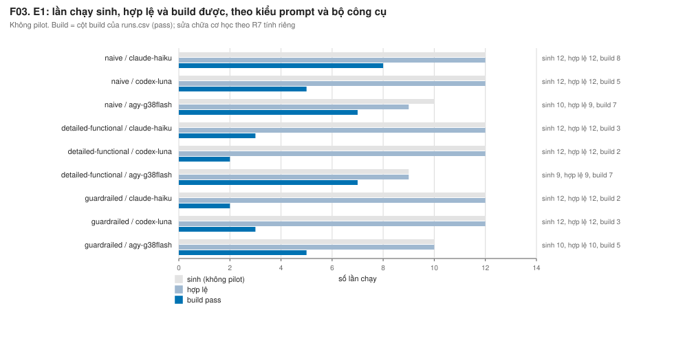

### 5.2. E1: kho bản nháp đầu

#### 5.2.1. Kiểm chứng bộ quét tĩnh của nhóm (cổng ở Mục 4.3)

Về độ nhạy theo đột biến, bộ quét tĩnh của nhóm phát hiện đủ 99/99 đột biến trên 27 quy tắc (luật) và có 0 cảnh báo sai trên 24 mẫu đối chứng lành tính [`e1-corpus/REPORT.md`, mục 4]. Do chính tác giả của bộ quét viết các đột biến này, con số đó chỉ là **cận trên** của độ nhạy; độ chính xác chỉ có được từ người chấm thứ hai.

Hai người chấm mù đánh giá độ chính xác. Gói v1 gồm 157 cảnh báo, được rút trước mọi thay đổi của bộ quét: kappa 0,671 với 22 bất đồng [Cohen1960]. Gói v2 (cảnh báo mới, 31 mục) có kappa 0,748 với 4 bất đồng. Kappa gộp là 0,687, vượt ngưỡng 0,60 của cổng kiểm chứng [Landis1977]. Nhãn đồng thuận là nhãn mà cả hai người chấm cùng gán; nếu họ bất đồng thì dùng nhãn được phân xử bằng lần đọc thứ ba, và nếu vẫn không phân xử được thì nhãn là "unclear". Theo A13, nhãn "unclear" được tính là chưa chấm và không vào mẫu số của độ chính xác. Một quy tắc được xem là đã kiểm chứng khi cả độ nhạy và độ chính xác đạt từ 0,80 trở lên trên ít nhất 5 mục tp/fp đã phân xử. Người chấm thứ hai không được xem dữ liệu E1 và chỉ chấm từ gói mẫu. Mức đồng thuận thấp nhất rơi vào các quy tắc mà đoạn mã trong cửa sổ hiển thị không cho thấy nơi gọi hàm hay hằng số màu (`kappa_by_rule.csv`: P08 0/6 đồng thuận, U03 2/6, P02 3/6, S01 3/6, P09 7/12).

**Bảng 5.3.** Các quy tắc không đạt cổng kiểm chứng ở nhánh chính v1 (độ chính xác tính theo nhãn đồng thuận; "chấm" là số mục có nhãn tp hoặc fp).

| quy tắc | chấm | tp | fp | unclear | độ chính xác | khoảng Wilson 95% | trạng thái |
|---|---|---|---|---|---|---|---|
| P05 | 6 | 4 | 2 | 0 | 0,667 | [0,300; 0,903] | chưa kiểm chứng |
| P06 | 4 | 4 | 0 | 2 | 1,000 | [0,510; 1,000] | chưa kiểm chứng (dưới 5 mục) |
| P07 | 2 | 1 | 1 | 4 | 0,500 | [0,095; 0,905] | chưa kiểm chứng |
| P09 | 6 | 4 | 2 | 0 | 0,667 | [0,300; 0,903] | chưa kiểm chứng |
| P10 | 5 | 1 | 4 | 1 | 0,200 | [0,036; 0,624] | chưa kiểm chứng |
| S03 | 6 | 2 | 4 | 0 | 0,333 | [0,097; 0,700] | chưa kiểm chứng |
| S04 | 1 | 1 | 0 | 0 | 1,000 | [0,207; 1,000] | chưa kiểm chứng (dưới 5 mục) |
| S08 | 6 | 4 | 2 | 0 | 0,667 | [0,300; 0,903] | chưa kiểm chứng |
| U05 | 6 | 4 | 2 | 6 | 0,667 | [0,300; 0,903] | chưa kiểm chứng |

Chín quy tắc này (P05, P06, P07, P09, P10, S03, S04, S08, U05) **bị loại khỏi phân tích chính** theo §5 của giao thức; chúng vẫn xuất hiện ở Bảng 5.5 với mục đích mô tả. Hai mươi quy tắc còn lại thuộc phân tích chính, gồm 18 quy tắc "validated" và hai quy tắc D02, S11 mang trạng thái "pending" trong REPORT (REPORT không nêu lý do). Lý do loại từng quy tắc: P10 và S03 có nhiều cảnh báo dương tính giả (độ chính xác 0,200 và 0,333); P05, P09, P07, S08, U05 có độ chính xác dưới 0,80 hoặc có quá nhiều nhãn "unclear" (P07 có 4, U05 có 6, vì cửa sổ 6 dòng mã của gói v1 không đủ để kết luận về U05); P06 và S04 chỉ có 4 và 1 mục được chấm. U05 là quy tắc bị giữ lại của G3 nhưng không đạt cổng, nên áp dụng A1: quy tắc này nằm ngoài G3 và vẫn được giữ ở bảng mô tả.

**Nhánh v1 là nhánh chính, nhánh v2 dùng để kiểm tra độ nhạy (A13).** Sau khi gói v1 được rút, đợt chấm do chính người viết bộ quét thực hiện phát hiện lỗi dương tính giả ở năm quy tắc (P10, S03, P05, P09, P07). Các lỗi này được sửa ở nhánh v2 (`e1-corpus/validation/fixes-v2.md`); độ nhạy đột biến vẫn giữ ở 1,00 và không mẫu lành tính nào kích hoạt cảnh báo. Không quy tắc nào được thêm, được chỉnh theo tần suất hay bị bỏ. Người viết bộ quét đã thấy các con số theo nhánh trong một lần chạy thử trên 13 lần chạy hợp lệ (A6), nên điều kiện đã đăng ký trước là "không thấy số theo nhánh trước khi sửa" không còn đúng; vì vậy bộ v1 giữ vai trò nhánh chính. Các quy tắc đã sửa chỉ được kiểm chứng trên những mục mới trong gói v2 (sáu mục cho mỗi quy tắc, loại toàn bộ mục của v1, do hai người chấm mù đánh giá). Ở nhánh v2, P10, S03 và P09 đạt cổng (độ chính xác 1,000 trên 5 mục, 0,833 và 1,000 trên 6 mục), còn P05, P06, P07, S04, S08, U05 vẫn không đạt. P07 chỉ có 1 tp và 3 fp trên các mục mới và không có vòng sửa thứ hai, vì việc lặp lại bước sửa trên một mẫu mới là điều chỉnh theo dữ liệu (quyết định của người điều phối).

Về độ phủ so với các công cụ có sẵn (`coverage_matrix.csv`), phần lớn quy tắc chỉ có ở bộ quét tùy biến của nhóm (cột `custom_only`); quy tắc trùng nhiều nhất là S06 (45 cảnh báo của bộ quét của nhóm, 18 của Android Lint). Về phân xử, 26 bất đồng (22 ở gói v1, 4 ở gói v2) được giải quyết bằng lần đọc thứ ba **do chính người viết bộ quét thực hiện**, nên kết quả này không độc lập với bộ quét (Mục 5.8).

**Hình 5.2.** Kết quả kiểm chứng bộ quét tĩnh của nhóm (bộ phát hiện) ở nhánh v1: độ nhạy đột biến và độ chính xác theo quy tắc (luật); chấm rỗng là quy tắc chưa kiểm chứng. Số liệu vẽ: `figures/out/F04-validation.data.csv`.

**Hình 5.3.** Độ phủ so với Lint, detekt và compose-rules: các quy tắc chỉ có ở bộ quét tùy biến của nhóm. Số liệu vẽ: `figures/out/F05-coverage.data.csv`.

#### 5.2.2. Tần suất theo lớp vấn đề và theo kiểu prompt (mô tả)

Bảng 5.4 cho biết tỷ lệ lần chạy hợp lệ có ít nhất một cảnh báo, theo ba kiểu prompt (kèm khoảng Wilson 95% [Wilson1927]) và theo hai tầng ứng dụng do người viết (chỉ có tỷ lệ). Bảng thuộc nhánh chính v1 và chỉ gồm các quy tắc trong phân tích chính (D02† và S11† mang trạng thái "pending"; ‡ đánh dấu quy tắc bị giữ lại). Bảng này không diễn giải p-value. Một quy tắc kích hoạt ở gần như mọi ứng dụng của người viết (ví dụ P11) thì không giúp phân biệt hai nhóm.

**Bảng 5.4.** Tỷ lệ lần chạy có cảnh báo, nhánh chính v1, các quy tắc thuộc phân tích chính.

| Mã quy tắc | naive (n = 33) | detailed-functional (n = 33) | guardrailed (n = 34) | ứng dụng do người viết trước 2022 (n = 20) | ứng dụng do người viết từ 2024 trở đi (n = 20) |
|---|---|---|---|---|---|
| D01 | 25/33 = 0,76 [0,59; 0,87] | 22/33 = 0,67 [0,50; 0,80] | 25/34 = 0,74 [0,57; 0,85] | 20/20 = 1,00 | 14/20 = 0,70 |
| D02†‡ | 33/33 = 1,00 [0,90; 1,00] | 33/33 = 1,00 [0,90; 1,00] | 34/34 = 1,00 [0,90; 1,00] | 17/20 = 0,85 | 18/20 = 0,90 |
| P01 | 6/33 = 0,18 [0,09; 0,34] | 8/33 = 0,24 [0,13; 0,41] | 0/34 = 0,00 [0,00; 0,10] | 14/20 = 0,70 | 12/20 = 0,60 |
| P02 | 12/33 = 0,36 [0,22; 0,53] | 7/33 = 0,21 [0,11; 0,38] | 4/34 = 0,12 [0,05; 0,27] | 11/20 = 0,55 | 14/20 = 0,70 |
| P03‡ | 5/33 = 0,15 [0,07; 0,31] | 1/33 = 0,03 [0,01; 0,15] | 3/34 = 0,09 [0,03; 0,23] | 15/20 = 0,75 | 16/20 = 0,80 |
| P04 | 3/33 = 0,09 [0,03; 0,24] | 2/33 = 0,06 [0,02; 0,20] | 0/34 = 0,00 [0,00; 0,10] | 6/20 = 0,30 | 10/20 = 0,50 |
| P08‡ | 8/33 = 0,24 [0,13; 0,41] | 0/33 = 0,00 [0,00; 0,10] | 0/34 = 0,00 [0,00; 0,10] | 8/20 = 0,40 | 5/20 = 0,25 |
| P11 | 33/33 = 1,00 [0,90; 1,00] | 33/33 = 1,00 [0,90; 1,00] | 7/34 = 0,21 [0,10; 0,37] | 20/20 = 1,00 | 20/20 = 1,00 |
| P13 | 7/33 = 0,21 [0,11; 0,38] | 8/33 = 0,24 [0,13; 0,41] | 0/34 = 0,00 [0,00; 0,10] | 6/20 = 0,30 | 8/20 = 0,40 |
| S01 | 8/33 = 0,24 [0,13; 0,41] | 11/33 = 0,33 [0,20; 0,50] | 0/34 = 0,00 [0,00; 0,10] | 2/20 = 0,10 | 3/20 = 0,15 |
| S02 | 2/33 = 0,06 [0,02; 0,20] | 0/33 = 0,00 [0,00; 0,10] | 0/34 = 0,00 [0,00; 0,10] | 2/20 = 0,10 | 1/20 = 0,05 |
| S05 | 4/33 = 0,12 [0,05; 0,27] | 6/33 = 0,18 [0,09; 0,34] | 0/34 = 0,00 [0,00; 0,10] | 6/20 = 0,30 | 3/20 = 0,15 |
| S06‡ | 29/33 = 0,88 [0,73; 0,95] | 24/33 = 0,73 [0,56; 0,85] | 10/34 = 0,29 [0,17; 0,46] | 11/20 = 0,55 | 8/20 = 0,40 |
| S07 | 0/33 = 0,00 [0,00; 0,10] | 0/33 = 0,00 [0,00; 0,10] | 0/34 = 0,00 [0,00; 0,10] | 2/20 = 0,10 | 6/20 = 0,30 |
| S09 | 0/33 = 0,00 [0,00; 0,10] | 1/33 = 0,03 [0,01; 0,15] | 0/34 = 0,00 [0,00; 0,10] | 2/20 = 0,10 | 1/20 = 0,05 |
| S11† | 1/33 = 0,03 [0,01; 0,15] | 12/33 = 0,36 [0,22; 0,53] | 9/34 = 0,26 [0,15; 0,43] | 18/20 = 0,90 | 13/20 = 0,65 |
| U01 | 0/33 = 0,00 [0,00; 0,10] | 1/33 = 0,03 [0,01; 0,15] | 0/34 = 0,00 [0,00; 0,10] | 9/20 = 0,45 | 6/20 = 0,30 |
| U02 | 0/33 = 0,00 [0,00; 0,10] | 0/33 = 0,00 [0,00; 0,10] | 0/34 = 0,00 [0,00; 0,10] | 4/20 = 0,20 | 7/20 = 0,35 |
| U03 | 8/33 = 0,24 [0,13; 0,41] | 6/33 = 0,18 [0,09; 0,34] | 2/34 = 0,06 [0,02; 0,19] | 6/20 = 0,30 | 7/20 = 0,35 |
| U04‡ | 9/33 = 0,27 [0,15; 0,44] | 13/33 = 0,39 [0,25; 0,56] | 2/34 = 0,06 [0,02; 0,19] | 19/20 = 0,95 | 17/20 = 0,85 |

Bảng được đọc theo hướng mô tả. (i) Hai quy tắc là dấu hiệu của bản phát hành chưa tối ưu xuất hiện gần như ở mọi lần chạy thuộc hai kiểu prompt không có tệp quy tắc (guardrail): P11 (thiếu Baseline Profile) có ở 33/33 lần chạy kiểu naive và detailed-functional, nhưng chỉ 7/34 = 0,21 ở kiểu guardrailed; ứng dụng do người viết cũng gần như luôn vướng quy tắc này (20/20 ở cả hai tầng). (ii) S06 (allowBackup) là quy tắc nhóm S phổ biến nhất ở mã do AI sinh: 29/33 = 0,88 ở naive, 24/33 = 0,73 ở detailed-functional và 10/34 = 0,29 ở guardrailed, so với 0,55 và 0,40 ở ứng dụng do người viết; S06 là quy tắc bị giữ lại. (iii) S01 (token hoặc PII lưu không mã hóa) có ở 8/33 và 11/33, còn ở guardrailed là 0/34, so với 0,10 và 0,15 ở ứng dụng do người viết. (iv) Các quy tắc về hiệu năng danh sách và tính ổn định (P01, P03, P04) xuất hiện ở mã do AI sinh với tỷ lệ thấp hơn ở ứng dụng do người viết (ví dụ P01: 0,18 và 0,24 so với 0,70 và 0,60; P03: 0,15 và 0,03 so với 0,75 và 0,80). Quy tắc U04 (màu hoặc cỡ chữ gán cứng) cũng vậy: 0,27 và 0,39 so với 0,95 và 0,85. Tuy nhiên, các ứng dụng do người viết lớn hơn nhiều, nên đây là so sánh theo tiêu chí "có ít nhất một" và chưa chuẩn hóa theo cỡ mã nguồn (C3 thực hiện việc chuẩn hóa này, Mục 5.2.5). (v) P08 (hiệu ứng trang trí trong danh sách) có ở 8/33 = 0,24 ở naive, nhưng là 0/33 ở detailed-functional và 0/34 ở guardrailed, so với 8/20 = 0,40 và 5/20 = 0,25 ở ứng dụng do người viết.

**Bảng 5.5.** Chín quy tắc không thuộc phân tích chính, được trình bày chỉ để mô tả (nhánh v1; độ chính xác của các quy tắc này nằm ở Bảng 5.3).

| Mã quy tắc | naive (n = 33) | detailed-functional (n = 33) | guardrailed (n = 34) | ứng dụng do người viết trước 2022 (n = 20) | ứng dụng do người viết từ 2024 trở đi (n = 20) |
|---|---|---|---|---|---|
| P05‡ | 0/33 = 0,00 [0,00; 0,10] | 0/33 = 0,00 [0,00; 0,10] | 0/34 = 0,00 [0,00; 0,10] | 1/20 = 0,05 | 5/20 = 0,25 |
| P06 | 0/33 = 0,00 [0,00; 0,10] | 5/33 = 0,15 [0,07; 0,31] | 3/34 = 0,09 [0,03; 0,23] | 9/20 = 0,45 | 9/20 = 0,45 |
| P07 | 5/33 = 0,15 [0,07; 0,31] | 8/33 = 0,24 [0,13; 0,41] | 12/34 = 0,35 [0,21; 0,52] | 7/20 = 0,35 | 13/20 = 0,65 |
| P09 | 1/33 = 0,03 [0,01; 0,15] | 1/33 = 0,03 [0,01; 0,15] | 0/34 = 0,00 [0,00; 0,10] | 6/20 = 0,30 | 12/20 = 0,60 |
| P10 | 33/33 = 1,00 [0,90; 1,00] | 33/33 = 1,00 [0,90; 1,00] | 34/34 = 1,00 [0,90; 1,00] | 18/20 = 0,90 | 20/20 = 1,00 |
| S03 | 0/33 = 0,00 [0,00; 0,10] | 0/33 = 0,00 [0,00; 0,10] | 1/34 = 0,03 [0,01; 0,15] | 4/20 = 0,20 | 6/20 = 0,30 |
| S04 | 0/33 = 0,00 [0,00; 0,10] | 0/33 = 0,00 [0,00; 0,10] | 0/34 = 0,00 [0,00; 0,10] | 0/20 = 0,00 | 1/20 = 0,05 |
| S08 | 5/33 = 0,15 [0,07; 0,31] | 3/33 = 0,09 [0,03; 0,24] | 1/34 = 0,03 [0,01; 0,15] | 1/20 = 0,05 | 2/20 = 0,10 |
| U05‡ | 7/33 = 0,21 [0,11; 0,38] | 8/33 = 0,24 [0,13; 0,41] | 16/34 = 0,47 [0,31; 0,63] | 12/20 = 0,60 | 14/20 = 0,70 |

**Theo bộ công cụ (mô tả, không kết luận "công cụ nào tốt nhất").** REPORT không đưa tần suất theo quy tắc cho từng bộ công cụ. Các số liệu theo bộ công cụ chỉ có ở ba nơi: tỷ lệ build (Mục 5.1), cỡ bản nháp (số dòng Kotlin trung vị từ 153 đến 264 ở codex-luna, từ 511 đến 1138 ở claude-haiku, từ 1686 đến 1880 ở agy-g38flash; Bảng 5.1) và phân tích độ nhạy theo bộ công cụ (Bảng 5.7). Cỡ bản nháp chênh lệch rất lớn giữa các bộ công cụ (trung vị từ 153 đến 1880 dòng), nên mọi so sánh theo tiêu chí "có ít nhất một cảnh báo" đều bị lẫn yếu tố cỡ mã.

**Phần E1 của H3 (hiệu ứng trang trí).** P08 là quy tắc đã được kiểm chứng và là quy tắc bị giữ lại; tần suất nêu ở trên chính là phần tần suất của H3. REPORT của E1 không báo cáo phân bố mật độ hiệu ứng theo mục trong danh sách và theo màn hình (`metrics.csv`, cột `effect_density_item`, `effect_density_screen`), nên nghiên cứu này không nêu con số nào về phân bố; Hình 5.5 chỉ vẽ trực tiếp các giá trị từ `metrics.csv` ở dạng mô tả, không kèm thống kê.

**Các mẫu xuất hiện thêm (open coding).** REPORT liệt kê các mã không có sẵn trong danh mục (catalogue). Các mã xuất hiện ở nhiều lần chạy nhất là: `invented-base-url` (5 lần chạy; đề bài kiểu naive không cung cấp URL), `force-unwrap-in-compose` (4), `broad-catch-in-suspend` (3; bắt `Exception` mà không ném lại `CancellationException`), `dense-minified-source` (3; nhiều câu lệnh trên một dòng, dòng dài đến khoảng 1300 ký tự), `exception-swallowed-to-default` (2), `overbroad-keep-rule` (2), `handwritten-http-json` (2), `silent-wrong-default` (2; ví dụ `daysLeft()` trả về 0 khi lỗi phân tích) và `allowbackup-true-with-session` (2, trong danh mục là S06). Các mã còn lại chỉ xuất hiện ở một lần chạy, gồm các lỗi cấu trúc (`wrong-processor-artifact`: `ksp(room.runtime)` thay cho `room-compiler`; `mock-backend-enabled-by-default`: interceptor giả lập (mock) được bật mặc định trong OkHttp client của bản phát hành; `release-signed-with-debug-key`), lỗi "ảo giác" (`hallucinated-package-path`, `hallucinated-view-property`) và cả mã dương tính (`cancellation-rethrown`, `narrow-catch-io-json`). Đây là kết quả khám phá, chỉ do một người mã hóa thực hiện, và không có tần suất nào được diễn giải.

**Hình 5.4.** Tần suất theo quy tắc và kiểu prompt (bộ v1, Wilson 95%); nhóm phía dưới gồm các quy tắc chưa kiểm chứng, chỉ để mô tả. Số liệu vẽ: `figures/out/F06-prevalence.data.csv`.

**Hình 5.5.** Mật độ hiệu ứng trang trí theo mục danh sách và theo màn hình (phần E1 của H3), lấy từ `metrics.csv`; chỉ mang tính mô tả. Số liệu vẽ: `figures/out/F11-decorative-density.data.csv`.

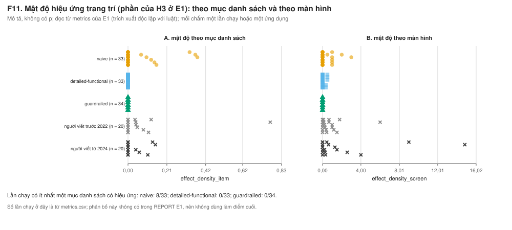

#### 5.2.3. C1 và C2: tệp quy tắc có làm giảm tỷ lệ cảnh báo nhóm S và độ rộng không?

Bảng 5.6 trích kết quả nhánh chính v1 trên 20 quy tắc đã kiểm chứng (100 lần chạy hợp lệ; `e1-corpus/results/analysis/primary-v1/summary.md`).

**Bảng 5.6.** C1 và C2: ba kiểu prompt, nhánh chính v1, 20 quy tắc.

| kiểu prompt | n hợp lệ | lần chạy có ít nhất một cảnh báo nhóm S | tỷ lệ | Wilson 95% | số mã quy tắc khác nhau mỗi lần chạy (trung bình) | trung vị | bootstrap 95% (trung bình) |
|---|---|---|---|---|---|---|---|
| naive | 33 | 31 | 0,939 | [0,804; 0,983] | 5,85 | 4,0 | [4,91; 6,85] |
| detailed-functional | 33 | 29 | 0,879 | [0,727; 0,952] | 5,70 | 6,0 | [5,09; 6,33] |
| guardrailed | 34 | 17 | 0,500 | [0,341; 0,659] | 2,82 | 3,0 | [2,41; 3,26] |

**C1** (naive trừ guardrailed, phân tầng theo 9 tổ hợp đề bài nhân bộ công cụ): chênh lệch rủi ro là **+0,439**, với p hoán vị phân tầng chưa hiệu chỉnh = 0,00004 (100.000 hoán vị, hạt giống 20261121). **C2** (cùng thiết kế): chênh lệch số mã quy tắc khác nhau mỗi lần chạy là **+3,025**, p = 0,00001. Tiêu chí đã đăng ký trước: C1 được xác nhận khi p sau hiệu chỉnh Holm dưới 0,05 và chênh lệch rủi ro từ 0,15 trở lên; C2 được xác nhận khi p sau hiệu chỉnh dưới 0,05 và chênh lệch từ 2,0 trở lên. Cả hai độ lớn đều vượt ngưỡng (0,439 so với 0,15, và cũng vượt mức 0,25 của dải độ nhạy; 3,025 so với 2,0), và p thô của C1 và C2 đều dưới 0,01, tức ngưỡng đầu tiên của hiệu chỉnh Holm với m = 5. Sau hiệu chỉnh Holm (Bảng 5.27, Mục 5.7), p của C1 là 0,00016 và của C2 là 0,00005; kết luận không đổi. Phân tích trên toàn bộ 29 quy tắc cho cùng hướng (C1 +0,470, p = 0,00001; C2 +2,600, p = 0,00002).

**Độ nhạy của A6 và các hạn chế cần đọc cùng C1 và C2.**

**Bảng 5.7.** Phân tích độ nhạy (A6; không phân tích nào thay thế một tiêu chí xác nhận (điểm cuối)), nhánh chính v1.

| biến thể | n hợp lệ | C1 chênh lệch (p) | C2 chênh lệch (p) | C3 delta Cliff (p) |
|---|---|---|---|---|
| (a) lần chạy không có lần gọi web nào | 100 | +0,439 (p = 0,0000) | +3,025 (p = 0,0000) | +0,582 (p = 0,0001) |
| (c) chỉ các lần chạy build thành công | 42 | +0,000 (p = 1,0000) | +3,829 (p = 0,0028) | +0,678 (p = 0,0000) |
| (b) chỉ agy-g38flash | 28 | +0,200 (p = 0,4286) | +7,244 (p = 0,0001) | +0,456 (p = 0,0172) |
| (b) chỉ claude-haiku | 36 | +0,583 (p = 0,0066) | +2,000 (p = 0,0004) | +0,340 (p = 0,0559) |
| (b) chỉ codex-luna | 36 | +0,500 (p = 0,0243) | +0,917 (p = 0,0518) | +0,919 (p = 0,0000) |
| (b) loại agy-g38flash | 72 | +0,542 (p = 0,0001) | +1,458 (p = 0,0000) | +0,629 (p = 0,0000) |
| (b) loại claude-haiku | 64 | +0,361 (p = 0,0060) | +3,632 (p = 0,0000) | +0,720 (p = 0,0000) |
| (b) loại codex-luna | 64 | +0,407 (p = 0,0017) | +4,216 (p = 0,0000) | +0,389 (p = 0,0141) |

(Các giá trị p ghi 0,0000 là kết quả làm tròn đến bốn chữ số thập phân trong REPORT.) Có ba điều **phải được nêu cùng với C1 và C2**, với mức nổi bật ngang kết quả chính.

1. **Trong các ứng dụng build thành công, C1 bằng 0.** Ở 42 lần chạy build thành công (độ nhạy c), chênh lệch rủi ro của C1 là +0,000 (p = 1,0000) ở cả nhánh chính lẫn nhánh v2: tệp quy tắc **không** làm giảm khả năng một ứng dụng chạy được có hay không có cảnh báo nhóm S. Hiệu ứng về số lượng và mật độ vẫn còn trong nhóm này (C2 +3,829, p = 0,0028; C3 delta +0,678); nghĩa là tệp quy tắc làm giảm **số lượng** vấn đề nhóm S khác nhau xuất hiện, chứ không làm giảm việc có hay không có vấn đề. Vì vậy kết luận C1 chỉ đúng cho "mọi bản nháp ở mức mã nguồn", không đúng cho "ứng dụng chạy được".
2. **Không có bộ công cụ đơn lẻ nào chi phối kết quả gộp.** Khi lần lượt loại từng bộ, cả ba tiêu chí xác nhận vẫn giữ nguyên hướng; giá trị p lớn nhất trong ba phép loại một bộ là 0,0060 cho C1, 0,0000 cho C2 và 0,0141 cho C3. Tuy nhiên, khi chỉ xét riêng từng bộ, chênh lệch C1 ở agy-g38flash là +0,200 (p = 0,4286), chênh lệch C2 ở codex-luna là +0,917 (p = 0,0518) và delta C3 ở claude-haiku là +0,340 (p = 0,0559). Các phân nhóm nhỏ này (28 đến 36 lần chạy) không đủ lực kiểm định để khẳng định kết quả cho từng bộ công cụ.
3. **Cỡ mẫu 33, 33 và 34 thấp hơn mục tiêu 36** (Mục 5.1), và agy mất bảy ô theo A11.

Ở nhánh v2 (nhánh độ nhạy), C1 giữ nguyên +0,439 (p = 0,00004), C2 là +3,964 (p = 0,00001) và delta C3 là +0,567 (p = 0,00013). Phân tích độ nhạy trên các lần chạy build thành công cho +0,000 (C1, p = 1,0000), +4,757 (C2, p = 0,0010) và +0,659 (C3, p = 0,0001).

**Hai so sánh khám phá giữa các kiểu prompt.** REPORT không đưa ước lượng chênh lệch và khoảng tin cậy cho hai so sánh này; Bảng 5.6 chỉ cho tỷ lệ và khoảng Wilson của từng kiểu. Một prompt mô tả chức năng chi tiết nhưng không kèm tệp quy tắc **không** làm giảm tỷ lệ có cảnh báo nhóm S: 0,879 [0,727; 0,952] so với 0,939 [0,804; 0,983] ở naive (hai khoảng chồng nhau), và số mã quy tắc khác nhau mỗi lần chạy là 5,70 so với 5,85. Chính tệp quy tắc mới tạo ra khác biệt: 0,500 [0,341; 0,659] so với 0,879 [0,727; 0,952] ở detailed-functional (hai khoảng không chồng nhau), và 2,82 so với 5,70. Theo hướng này, lỗi không xuất phát từ yêu cầu chức năng chưa đầy đủ mà từ các giá trị mặc định của quá trình sinh mã, trong phạm vi mà một tệp quy tắc về chất lượng có thể thay đổi được. Đây là kết quả mô tả và cơ chế chưa được kiểm tra.

**Hình 5.6.** C1: tỷ lệ lần chạy có cảnh báo nhóm S, chênh lệch theo tầng và độ nhạy. Số liệu vẽ: `figures/out/F07-c1.data.csv`.

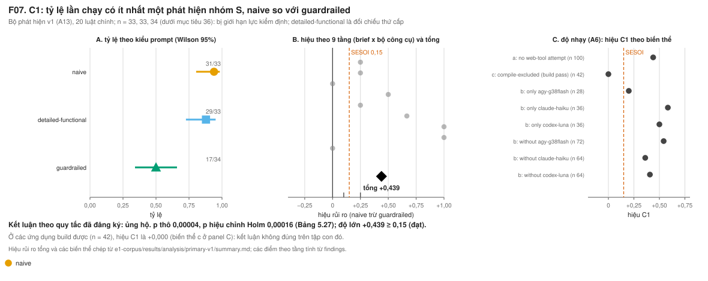

**Hình 5.7.** C2: số mã quy tắc khác nhau mỗi lần chạy, chênh lệch theo tầng và độ nhạy. Số liệu vẽ: `figures/out/F08-c2.data.csv`.

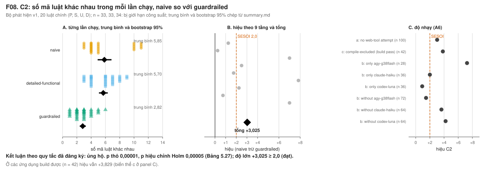

#### 5.2.4. G3: tệp quy tắc giúp ích cho các quy tắc được nêu hay cả các quy tắc bị giữ lại?

G3 là phân tích thứ cấp có đăng ký trước (nhánh chính v1, 20 quy tắc), gồm hiệu ứng của tệp quy tắc trên tập quy tắc được nêu trong tệp (tập được chỉ dẫn), hiệu ứng trên tập quy tắc bị giữ lại đã qua cổng, và chênh lệch giữa hai hiệu ứng. Tập bị giữ lại trong G3 gồm P03, P08, S06, D02, U04, vì P05 và U05 không đạt cổng (A1). Với naive trừ guardrailed: Δ chỉ dẫn +1,74; Δ bị giữ lại +1,10; chênh lệch +0,63, bootstrap 95% [0,15; 1,14]. Với detailed-functional trừ guardrailed: +2,01; +0,71; chênh lệch +1,30, [0,75; 1,84]. Theo tiêu chí đã đăng ký (được xác nhận nếu cận dưới của khoảng chênh lệch lớn hơn 0), cả hai chênh lệch đều được xác nhận: tệp quy tắc làm giảm số cảnh báo ở các quy tắc được nêu nhiều hơn ở các quy tắc bị giữ lại, **nhưng các quy tắc bị giữ lại cũng giảm** (+1,10 và +0,71 cảnh báo mỗi lần chạy). Theo quy ước đã đăng ký, phần giảm ở các quy tắc bị giữ lại được ghi nhận là "khái quát hóa hoặc ngẫu nhiên" và không dùng để khẳng định cơ chế. Ví dụ rõ nhất là S06 (0,88 xuống 0,29) và P08 (0,24 xuống 0,00), cả hai đều thuộc tập bị giữ lại (P08 cũng bằng 0/33 ở detailed-functional, tức khi không có tệp quy tắc). Phân tích trên 29 quy tắc cho +0,72 [0,06; 1,39] và +1,54 [0,95; 2,14]; nhánh v2 cho +1,57 [1,06; 2,09] và +2,33 [1,79; 2,87].

**Hình 5.8.** G3: thay đổi tần suất theo quy tắc (được nêu và bị giữ lại) và phép đối chiếu đã đăng ký trước. Số liệu vẽ: `figures/out/F09-g3.data.csv`.

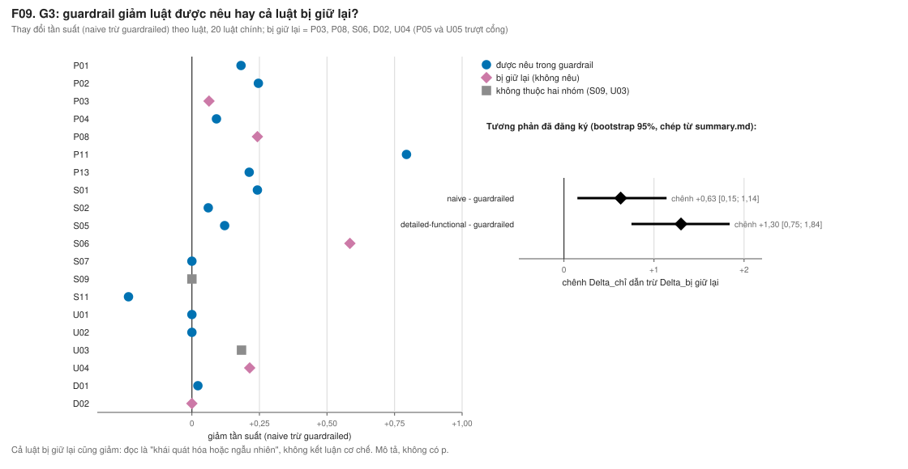

#### 5.2.5. C3: so sánh với ứng dụng do người viết

**Kho đối chứng.** Kho gồm hai mươi ứng dụng có commit đầu tiên đến hết 2022-11-30 (trước thời điểm có trợ lý AI; tầng xác nhận) và 20 ứng dụng từ 2024 trở đi (so sánh thứ hai). Các ứng dụng được rút ngẫu nhiên (hạt giống 20261121) từ kết quả tìm kiếm trên GitHub, sau khi sàng lọc theo điều kiện là ứng dụng Kotlin Compose có cỡ từ 2000 đến 50000 dòng (`human_corpus*.csv`). Sau khi quét, các tệp không phải mã nguồn trong bản sao (ảnh, phông chữ, tài liệu, nhị phân; từ 95.604 xuống 14.221 tệp) đã bị xóa vì ổ làm việc NTFS hết bản ghi tệp. Mọi bộ quét chỉ đọc `.kt`, `.xml`, Gradle, TOML, `.pro`, `.properties`, `baseline-prof.txt` và `stability_config.conf`, nên quét lại sẽ cho cùng kết quả. REPORT không nêu tổng số dòng hay năm tạo của kho; ứng dụng tham chiếu `android/app` cũng không được REPORT báo cáo, nên nghiên cứu này không có điểm tham chiếu.

**C3 (xác nhận).** Với số cảnh báo nhóm S trên 1000 dòng Kotlin, mã AI không có tệp quy tắc (n = 66) có trung vị **2,37**, còn tầng ứng dụng trước thời có trợ lý AI (n = 20) có trung vị **1,02**; Mann-Whitney p = 0,00009, delta Cliff **+0,582** [Cliff1993]. Tiêu chí đã đăng ký: được xác nhận khi p sau hiệu chỉnh dưới 0,05 và delta từ 0,33 trở lên (AI cao hơn). Delta vượt ngưỡng, và p sau hiệu chỉnh Holm là 0,00027 (Bảng 5.27, Mục 5.7). So sánh thứ hai, không dùng để xác nhận (tầng 2024 trở đi, n = 20), cho trung vị 0,24, p = 0,00000 (làm tròn), delta +0,742. Dòng độ nhạy tính theo ký tự khác khoảng trắng, vì độ dài dòng của các bản nháp khác nhau (một bộ công cụ nhồi khoảng 130 ký tự mỗi dòng): trên 100k ký tự khác khoảng trắng, mã AI đạt 7,83 so với 3,47 của ứng dụng do người viết trước 2022, p = 0,00018, delta +0,556; so với tầng 2024 trở đi, trung vị là 0,87 và delta +0,758. Trên toàn bộ 29 quy tắc: 2,72 so với 1,02, p = 0,00001, delta +0,647. Xét riêng từng bộ công cụ, delta C3 của claude-haiku là +0,340 (p = 0,0559, Bảng 5.7), sát ngưỡng 0,33.

C3 có hai hạn chế riêng. Thứ nhất, tầng ứng dụng do người viết gồm các ứng dụng phổ biến, lớn và được bảo trì, không giống một bản nháp đầu; cách tính theo 1000 dòng làm giảm nhưng không xóa hết chênh lệch về cỡ. Thứ hai, tầng 2024 trở đi có thể đã chứa mã do trợ lý AI viết, nên chỉ được dùng làm so sánh thứ hai.

**Hình 5.9.** C3: số cảnh báo nhóm S trên 1000 dòng Kotlin của mã AI không có tệp quy tắc (guardrail), so với hai tầng ứng dụng do người viết, kèm độ nhạy theo ký tự khác khoảng trắng. Số liệu vẽ: `figures/out/F10-c3.data.csv`.

**Phân tích độ nhạy bổ sung: sửa lỗi tra cứu phụ thuộc (không dùng để xác nhận).** Khi kiểm tra H4, sau khi đã xem số liệu theo từng nhánh, nhóm phát hiện một lỗi của bộ tra cứu: `depcheck` dừng ở kho khai báo đầu tiên có phản hồi, mà plugin marker của KSP trên `google()` chỉ còn các phiên bản cũ (25 phiên bản, mới nhất 1.5.30-1.0.0, năm 2021), nên năm phiên bản KSP có thật (1.9.22-1.0.17, 1.9.23-1.0.20, 1.9.24-1.0.20, 2.0.20-1.0.25, 2.0.21-1.0.28) bị coi là không tồn tại. Hệ quả là 21 cảnh báo S11 sai ở 21 lần chạy của AI và 16 cảnh báo sai ở ứng dụng do người viết. Gradle thực tế tiếp tục tìm ở kho kế tiếp, nên phép tra cứu đã sửa lấy hợp của các kho được khai báo. Chỉ những hàng liên quan thay đổi (lần chạy của AI: 21 lần đổi lớp, 21 giá trị bản ổn định mới nhất được điền, OSV không đổi; ứng dụng do người viết: 16 lần đổi lớp), và các tệp của lần quét đầu không bị sửa. Đây là **phân tích độ nhạy hậu kiểm (post hoc), không dùng để xác nhận**: phân tích được thực hiện sau khi đã thấy kết quả theo nhánh, nên thuộc về bậc tự do của người nghiên cứu, còn nhánh chính vẫn là kết quả của quy trình đã đăng ký trước (đổi quy trình sau khi biết kết quả sẽ mở ra một đường rẽ trong phân tích). Lỗi này tác động theo cả hai chiều: lỗi làm tăng tỷ lệ có cảnh báo nhóm S ở nhánh guardrailed (bất lợi cho C1) và làm tăng mật độ cảnh báo nhóm S của cả mã AI lẫn ứng dụng do người viết (C3). Với nhánh v1 sau khi sửa: C1 +0,645 (guardrailed 10/34 thay cho 17/34, naive vẫn 31/33), C2 +3,259, và C3 có trung vị mã AI 2,33 so với 0,83 của ứng dụng do người viết trên 1000 dòng, delta Cliff +0,513, p thô 0,00055 (so với +0,439, +3,025, 2,37 so với 1,02 và +0,582 ở nhánh chính). Không kết luận nào trong C1 đến C3 thay đổi: ở cả bốn cột (v1 và v2, lần quét đầu và lần đã sửa), mọi tiêu chí xác nhận giữ nguyên dấu và có p dưới 0,01, tức ngưỡng Holm của phép kiểm yếu nhất trong năm phép. Vì tầng ứng dụng do người viết cũng giảm mật độ, cột đã sửa là cột nên dùng khi so sánh với người viết (REPORT E1 mục 3c, 3e và 7).

#### 5.2.6. H1, H4, H5, H6: các tần suất mô tả

Theo quy tắc dải PB, giả thuyết được xác nhận nếu cận dưới Wilson từ 0,50 trở lên và bị bác bỏ nếu cận trên dưới 0,20 (66 lần chạy không có tệp quy tắc):

| giả thuyết | k/n | tỷ lệ | Wilson 95% | kết luận theo PB |
|---|---|---|---|---|
| H1 (D01 hoặc D02) | 66/66 | 1,000 | [0,945; 1,000] | được xác nhận |
| H5 (U01 hoặc U05) | 1/66 | 0,015 | [0,003; 0,081] | bác bỏ |
| H6 (S05) | 10/66 | 0,152 | [0,084; 0,257] | chưa đủ cơ sở kết luận |

**H1.** Mọi lần chạy không có tệp quy tắc đều có D01 hoặc D02 đã được kiểm chứng. D02 (phụ thuộc lạc hậu từ một phiên bản chính trở lên, hoặc cũ hơn bản ổn định mới nhất 12 tháng tại ngày sinh bản nháp) có ở 100% lần chạy của mọi nhánh, nhưng cũng có ở 17/20 và 18/20 ứng dụng do người viết (Bảng 5.4); như vậy, tình trạng phụ thuộc lỗi thời không phải đặc trưng riêng của mã do AI sinh. D01 (API bị đánh dấu deprecated) ở mức 0,76, 0,67 và 0,74 trên ba nhánh của AI, và 1,00 và 0,70 ở ứng dụng do người viết.

**H4.** Quy tắc đã đăng ký trước (giao thức §3): giả thuyết được xác nhận nếu có ít nhất một tọa độ phụ thuộc thuộc lớp `hallucinated-artifact` (group:artifact không tồn tại trong bất kỳ kho nào mà dự án khai báo, tính tại ngày sinh); giả thuyết bị bác bỏ nếu có 0 `hallucinated-artifact` trong ít nhất 300 tọa độ. Một artifact có thật nhưng phiên bản không tồn tại thuộc lớp `hallucinated-version` và được đếm riêng. Kết quả (REPORT E1, mục H4): có 2105 tọa độ trong 100 lần chạy hợp lệ (bom 27, lib 1532, plugin 546), được phân giải với siêu dữ liệu của các kho khai báo (với plugin: các kho `pluginManagement` mặc định), không có lỗi tra cứu, ngày tra cứu 2026-11-23. Kết quả là **0 `hallucinated-artifact`**, cả ở lần quét đầu lẫn sau khi sửa phép tra cứu. Vì có 0 trong 2105 tọa độ (đáp ứng yêu cầu từ 300 trở lên), **H4 bị bác bỏ** theo quy tắc; cận trên 95% theo quy tắc ba là 0,14% [Hanley1983]. Ngược lại, `hallucinated-version` có xuất hiện: 22 ở lần quét đầu (21 plugin KSP, 1 plugin khác) và còn 1 sau khi sửa phép tra cứu (đoạn "Phân tích độ nhạy bổ sung" ở trên), vì 21 trường hợp là dương tính giả; trường hợp thật duy nhất là plugin biên dịch Compose phiên bản 1.9.24 của codex-luna (plugin này bắt đầu từ 2.0.0). Cần đọc kết luận theo nghĩa hẹp: kết luận chỉ nói về lớp `hallucinated-artifact` trong tệp build của các bản nháp đầu, qua ba bộ công cụ và một miền ứng dụng, tại một ngày tra cứu; kết luận không có nghĩa là không có phụ thuộc chứa lỗ hổng hay đã lỗi thời (H1 và S11 đo riêng các vấn đề này). Do lỗi tra cứu, tỷ lệ S11 ở Bảng 5.4 (1/33, 12/33, 9/34; 18/20 và 13/20 ở ứng dụng do người viết) là của lần quét đầu và chứa cảnh báo sai (21 ở các lần chạy của AI, 16 ở ứng dụng do người viết, REPORT E1 mục 7), nên không dùng các tỷ lệ này để so sánh AI với người viết. Các mã "ảo giác" của open coding (đường dẫn gói, thuộc tính View) là lỗi tham chiếu, không phải tọa độ Gradle.

**H5.** Kết quả 1/66 dẫn đến bác bỏ. Cần lưu ý: U05 không đạt cổng nên không thuộc phân tích chính, do đó số 1/66 chỉ phản ánh riêng U01 (0/33 ở naive, 1/33 ở detailed-functional; Bảng 5.4). U05 (chưa kiểm chứng) có ở 7/33 và 8/33 lần chạy không có tệp quy tắc (Bảng 5.5), nên tỷ lệ của H5 sẽ cao hơn nhiều nếu tính cả quy tắc này. Vì vậy kết luận "bác bỏ" chỉ là phát biểu về U01, không phải về các trạng thái loading, empty, error.

**H6.** Kết quả 10/66 (S05 có ở 4/33 và 6/33 lần chạy kiểu naive và detailed-functional) chưa đủ cơ sở kết luận, vì khoảng [0,084; 0,257] nằm vắt qua ngưỡng 0,20.

**Hình 5.10.** H1: tỷ lệ lần chạy có D01 hoặc D02; H4: phân loại các tọa độ phụ thuộc sau khi sửa phép tra cứu (`results/depfix/coordinates_fixed.csv`), cùng kết luận theo quy tắc bác bỏ. Số liệu vẽ: `figures/out/F12-h1-h4.data.csv`.

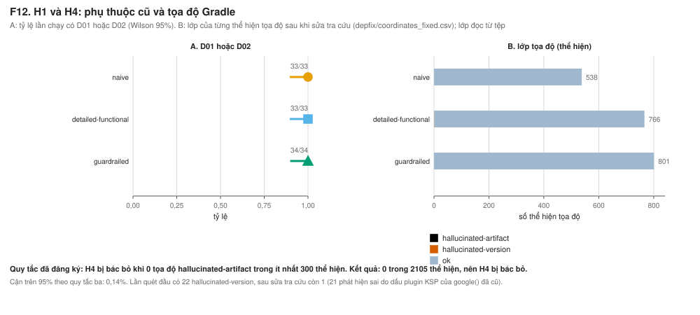

### 5.3. E2: chi phí A/B của từng vấn đề

Mọi số trong mục này được lấy từ `e2-bench/results/summary.csv` và `c5_confirmatory.csv`; các bảng của REPORT E2 đã được đối chiếu với `summary.csv` và khớp ở mọi hàng. **Phạm vi của mục này.** Các nhân tố E2 chia thành hai loại. P10 (R8) và P11 (Baseline Profile) là **kỹ thuật nền** và không lấy từ mã E1: A và B là cùng một mã với hai cấu hình build, kết quả được báo cáo ở Mục 5.3.1 và 5.3.2. Các nhân tố lấy từ mã E1 (P08, P06, P01 cùng P09, P13, P03 cùng P04, kể cả tiêu chí xác nhận C5) dùng biến thể A được chọn theo quy tắc A4, A5, A10 và A14, kết quả được báo cáo ở Mục 5.3.3. Lần chạy E2 đầu tiên, với biến thể A viết tay, chỉ là **thí điểm** (A3), không dùng cho C5 và không xuất hiện trong bảng nào ở đây. Mọi số đo mili giây đều chạy trên máy ảo có GPU phần mềm (Mục 5.1) nên chỉ là bằng chứng tương đối; P08 chạy trên một cấu hình GPU (đường GPU) khác với các nhân tố còn lại (A14, Mục 5.3.3). Một lần lặp bị loại theo A7 khi bộ nhớ khả dụng dưới 1024 MB ở đầu lần lặp, hoặc khi tiến trình qemu gặp lỗi trang chính trong lần lặp; bảng chính dùng các lần lặp được giữ lại (cột n).

#### 5.3.1. P10: R8 (kỹ thuật nền)

A là bản build `noR8`, B là bản build `release` bật R8 minify và resource shrinking; hai bản dùng cùng mã nguồn và chỉ khác nhau ở hai công tắc đó cùng application id, nhờ vậy có thể cài song song trên một máy [R8]. Kịch bản đo gồm khởi động nguội rồi 3 lần vuốt, với `CompilationMode.None`. Bảng 5.9 lấy từ `e2-bench/results/summary.csv` (Δ% = (B − A) / A; delta Cliff dương nghĩa là A lớn hơn; giá trị của các hàng `frameOverrunMs` đi qua 0 nên cột thay đổi là chênh lệch tuyệt đối, đơn vị ms).

**Bảng 5.9.** E2, P10 (A: không R8; B: R8 minify và shrinkResources).

| chỉ số | đơn vị | A: trung vị (IQR) | B: trung vị (IQR) | thay đổi (B so với A) | khoảng bootstrap 95% | delta Cliff | n |
|---|---|---|---|---|---|---|---|
| apk_bytes | bytes | 2,474e+07 (0) | 2,384e+06 (0) | −90,4% | — | — | 1 |
| dex_bytes | bytes | 2,41e+07 (0) | 2,17e+06 (0) | −91% | — | — | 1 |
| frameCount | frames | 119 (1) | 120 (2) | 0,84% | [−0,418; 1,68] | −0,332 | 14 |
| frameDurationCpuMs p50 | ms | 4,531 (0,2096) | 3,858 (0,1381) | −14,8% | [−17,4; −12,2] | 1 | 14 |
| frameDurationCpuMs p90 | ms | 6,029 (0,3949) | 4,894 (0,209) | −18,8% | [−23,1; −16,6] | 0,908 | 14 |
| frameDurationCpuMs p99 | ms | 40,22 (21,83) | 22,51 (28,81) | −44% | [−57,8; 24,6] | 0,367 | 14 |
| frameOverrunMs p50 | ms | −11,17 (0,1419) | −11,94 (0,08997) | −0,7735 ms (tuyệt đối) | [−0,8586; −0,6695] | 1 | 14 |
| frameOverrunMs p90 | ms | −9,05 (0,5368) | −10,25 (0,2427) | −1,198 ms (tuyệt đối) | [−1,487; −0,8866] | 0,99 | 14 |
| frameOverrunMs p99 | ms | 283,9 (35,99) | 264,8 (24,89) | −19,14 ms (tuyệt đối) | [−41,97; −0,1753] | 0,531 | 14 |
| resources_bytes | bytes | 4,958e+05 (0) | 9,096e+04 (0) | −81,7% | — | — | 1 |
| slowFrames_pct | % | 2,532 (0,6204) | 2,08 (0,8437) | −17,8% | [−49,2; −0,417] | 0,571 | 14 |
| timeToFullDisplayMs | ms | 545,6 (55,92) | 494,5 (30,26) | −9,35% | [−14,6; −3,58] | 0,743 | 14 |
| timeToInitialDisplayMs | ms | 505,6 (28,25) | 461,6 (20,27) | −8,7% | [−12,4; −4,97] | 0,771 | 14 |

Diễn giải ở mức mô tả: kích thước không phụ thuộc thiết bị (mỗi biến thể chỉ có một giá trị xác định, n = 1), trong đó APK giảm 90,4%, dex giảm 91% và tài nguyên giảm 81,7%. Thời gian khởi động giảm ít hơn nhưng khoảng bootstrap không chứa 0: `timeToInitialDisplayMs` −8,7% [−12,4; −4,97] và `timeToFullDisplayMs` −9,35% [−14,6; −3,58]. Thời gian xử lý khung hình trên CPU giảm ở p50 (−14,8%) và p90 (−18,8% [−23,1; −16,6], delta Cliff 0,908); p99 giảm 44% nhưng khoảng [−57,8; 24,6] chứa 0, nên ở n = 14 chưa phân biệt được với nhiễu. Ngoài C5, nghiên cứu này không diễn giải p-value.

#### 5.3.2. P11: Baseline Profile (kỹ thuật nền)

A dùng `CompilationMode.None()` (đặt lại profile, ứng dụng được JIT khi chạy), B dùng `CompilationMode.Partial(BaselineProfileMode.Require)`; cả hai cùng một APK `release`. Profile được sinh trên máy ảo từ các kịch bản của lab nên chỉ bao phủ ứng dụng lab [Baseline-Overview].

**Bảng 5.10.** E2, P11 (A: không có Baseline Profile; B: có Baseline Profile).

| chỉ số | đơn vị | A: trung vị (IQR) | B: trung vị (IQR) | thay đổi (B so với A) | khoảng bootstrap 95% | delta Cliff | n |
|---|---|---|---|---|---|---|---|
| frameCount | frames | 120 (2,5) | 119,5 (2) | −0,417% | [−1,24; 2,13] | −0,167 | 12 |
| frameDurationCpuMs p50 | ms | 3,909 (0,09628) | 3,37 (0,1577) | −13,8% | [−17,2; −11,6] | 1 | 12 |
| frameDurationCpuMs p90 | ms | 4,875 (0,2987) | 4,512 (0,2496) | −7,45% | [−13,4; −3,99] | 0,931 | 12 |
| frameDurationCpuMs p99 | ms | 15,96 (31,18) | 17,11 (8,556) | 7,2% | [−62,2; 86,9] | −0,0417 | 12 |
| frameOverrunMs p50 | ms | −11,92 (0,2058) | −12,36 (0,08282) | −0,4394 ms (tuyệt đối) | [−0,5962; −0,352] | 0,986 | 12 |
| frameOverrunMs p90 | ms | −10,05 (0,638) | −11,16 (0,2606) | −1,107 ms (tuyệt đối) | [−1,365; −0,5749] | 0,986 | 12 |
| frameOverrunMs p99 | ms | 252,1 (10,76) | 232,8 (15,16) | −19,31 ms (tuyệt đối) | [−30,78; −11,46] | 0,708 | 12 |
| slowFrames_pct | % | 1,281 (0,8334) | 1,653 (0,8298) | 29% | [−49,6; 96,7] | 0,0486 | 12 |
| timeToFullDisplayMs | ms | 481,3 (23,08) | 443,4 (32,13) | −7,89% | [−12,1; −2,81] | 0,733 | 13 |
| timeToInitialDisplayMs | ms | 462 (22,43) | 434,8 (18,76) | −5,88% | [−9,87; −2,67] | 0,692 | 13 |

Diễn giải ở mức mô tả: thời gian khởi động giảm, với `timeToInitialDisplayMs` −5,88% [−9,87; −2,67] (n = 13) và `timeToFullDisplayMs` −7,89% [−12,1; −2,81]; `frameDurationCpuMs` ở p50 là −13,8% [−17,2; −11,6] và ở p90 là −7,45% [−13,4; −3,99]. Khoảng của các chỉ số p99 và `slowFrames_pct` (+29%, khoảng [−49,6; 96,7]) đều chứa 0. Hiệu ứng trên ứng dụng chỉ có một màn hình là khiêm tốn; một ứng dụng có đường khởi động dài hơn có thể được lợi nhiều hơn, nhưng nghiên cứu này không đo điều đó.

#### 5.3.3. Các nhân tố lấy từ mã E1 và tiêu chí xác nhận C5

**Biến thể A là mã của chiến dịch E1.** Theo A4, với mỗi nhân tố, A là ứng viên đầu tiên (xếp theo thời điểm bắt đầu lần chạy) trong các lần chạy không phải thí điểm có cảnh báo của quy tắc tương ứng, với điều kiện cấu trúc bị cảnh báo đưa được vào ứng dụng lab chỉ bằng thay đổi cơ học (gói, import, nguồn dữ liệu, đầu đo; cấu trúc bị cảnh báo giữ nguyên; các diff nằm ở `e2-bench/ports/<nhân tố>.diff`). Không nhân tố nào dùng biến thể viết tay, nên không bảng hay hình nào ở đây mang nhãn "author-constructed", và C5 chạy trên mã do trợ lý AI sinh ra (A), không dùng phương án thay thế của A4 và A5. Hai lần chạy khám phá, gồm độ nhạy với năm biến thể A viết tay của lần thí điểm và phép quét theo số lượng lượt mượn của P01 cùng P09, chưa được thực hiện, nên nghiên cứu này không có số liệu nào về chúng. B là bản tinh chỉnh do người thực hiện E2 viết (tạo từ A khi sửa cục bộ được, viết tay khi không), không phải bản sửa có sẵn trong kho mã. Ứng dụng lab không có Room, Paging, ViewModel, điều hướng và mạng nên các bản port cũng không có những thành phần này: các nhân tố đo cấu trúc bị cảnh báo, không đo ứng dụng nguồn. P09 và P03 cùng P04 dùng chung một tệp E1; kịch bản của P03 truyền một danh sách mới có nội dung bằng nhau ở mỗi nhịp, vì cảnh báo P03 phụ thuộc vào chuỗi công cụ (strong skipping, Mục 2.2.3).

**Bảng 5.11.** E2, biến thể A (mã của chiến dịch E1, theo `e2-bench/ports/README.md`) và B (bản tinh chỉnh) của từng nhân tố.

| nhân tố | hạng | lần chạy E1 | tệp và dòng (cảnh báo) | B (tinh chỉnh) |
|---|---|---|---|---|
| P08 | 1 | agy-g38flash-B1-naive-r1 | `ui/components/BookCover.kt:216` (gradient, đổ bóng), vị trí gọi `BookCard.kt` | ô bìa phẳng, cùng ô hiển thị |
| P06 | 1 | codex-luna-B3-detailed-functional-r1 | `MainActivity.kt:39` (`decodeStream` không có `inSampleSize`) | Coil `AsyncImage` cùng ô hiển thị 150x210 dp, có bộ nhớ đệm trong RAM và trên đĩa |
| P01 (quy tắc P01) | 1 | claude-haiku-B3-detailed-functional-r1 | `ui/history/HistoryScreen.kt:105` (`items` không có key) | cùng danh sách có `key` và `contentType` |
| P09 | 3 (tệp P09 đầu tiên; hạng 1 và 2 là tệp P01) | agy-g38flash-B3-naive-r1 | `ui/components/BookDetailSheet.kt:300` (`Column` + `verticalScroll` + `forEach`) | `LazyColumn` có `key` và `contentType` |
| P13 | 1 | claude-haiku-B1-detailed-functional-r1 | `data/local/TitleDao.kt:31` (`LIKE` không có chỉ mục) | SQLite FTS4, so khớp tiền tố từ khóa |
| P03 và P04 | 1 (cả hai quy tắc cùng nằm trong một tệp) | agy-g38flash-B3-naive-r1 | cùng tệp với P09, các dòng 58, 65, 67 | `LoanList` ổn định cùng `remember` |

**Sai lệch của môi trường đo (rig): P08 được đo trên một cấu hình GPU khác (A14).** Ứng viên P08 hạng 1 (agy-g38flash-B1-naive-r1, `BookCover.kt`) chạy được khi đưa vào lab, nhưng tiến trình qemu của máy ảo bị chết với SIGSEGV ở các bản không bật cờ gỡ lỗi (non-debuggable). Lỗi thường xảy ra ở lần khởi động thứ hai đến thứ năm và không bao giờ ở lần đầu sau khi bật máy; bản bật cờ gỡ lỗi (debuggable) và bản B không bị chết. Theo A10, nếu ứng dụng gốc chưa sửa của kho không bị sập thì sự cố được coi là lỗi của bản port. Ứng dụng gốc không sập trong 21 chu kỳ khởi động (3 + 4 + 4 ở bản debuggable, 5 + 5 ở bản đã tắt cờ gỡ lỗi) và trong 4 chu kỳ cuộn, dù vẽ cùng ảnh bìa. Vì vậy hạng 1 được giữ (A14); hạng 2 không dùng cho C5. Dấu vết từ gdb cho thấy chỗ sập nằm ở một luồng kết xuất trên máy chủ (host), đang chạy một thủ tục xử lý điểm ảnh do SwiftShader biên dịch JIT (đọc SIMD vượt ngoài phạm vi). Cùng một lệnh gây lỗi xuất hiện ở cả hai lần sập (`qemu-crash-gdb-port2.txt`), và vị trí này không nằm trong đoạn mã có thể cô lập ở bản port. Các yếu tố đã được loại trừ khỏi danh sách nguyên nhân gồm R8, targetSdk, kích thước ô hiển thị của bìa, số thẻ, chế độ biên dịch, bộ đệm shader và riêng cờ gỡ lỗi. Cùng AVD đó, khi chạy với `-gpu swangle_indirect` (ANGLE trên SwiftShader Vulkan), không bị sập (8 trên 8 lần khởi động, rồi suốt cửa sổ đo). Vì vậy **P08 A và B đều được đo trên `swangle_indirect`, trong cùng một cửa sổ đo và cùng một AVD; mọi nhân tố E2 khác giữ `swiftshader_indirect`**. Hệ quả là thời gian khung hình tuyệt đối của P08 không so sánh được với số tuyệt đối của các nhân tố khác; chỉ phép đối chiếu A/B trong nội bộ từng nhân tố có ý nghĩa, và C5 chỉ dựa trên phép đối chiếu đó. Quyết định này dựa trên một lần sập tiến trình và dấu vết từ trình gỡ lỗi, được đưa ra trước mọi số đo P08 (A14). Nghiên cứu này **không** khẳng định rằng cấu trúc P08 trong mã do trợ lý AI sinh ra làm sập GPU phần mềm: bản gốc không sập, và nguyên nhân gây ra khác biệt giữa bản gốc với bản port chưa được cô lập (chưa thử so sánh Compose BOM 2024.02 với 2026.09). Theo A10, các cấu trúc bị loại vì `rig-unmeasurable` phải được báo cáo ở mức mô tả; `ports/rejections.csv` chỉ có hàng tiêu đề, tức không ứng viên nào bị loại.

**Kiểm soát thăm dò: việc đổi bộ dựng hình có làm thay đổi độ lớn của phép đối chiếu khung hình hay không (không thuộc C5, không có p sau hiệu chỉnh).** Sửa đổi A14 ghi nhận rằng chưa nhánh thực nghiệm nào kiểm tra xem đổi bộ dựng hình có làm thay đổi độ lớn của phép đối chiếu A/B hay không. Lần kiểm soát này kiểm tra điều đó trên một nhân tố khác P08, vì A của P08 làm sập đường mặc định nên không đo được ở đó: cặp P01+P09 được chạy lại trên `swangle_indirect` (mã nhân tố `P01+P09@swangle` trong `summary.csv`, pha primary và frames, giữ 12 đến 14 lần lặp mỗi biến thể), bên cạnh lần chạy chính trên `swiftshader_indirect`. Delta% ở đây là (B − A) / A, khác với C5 là (A − B) / B, nên không thể đặt hai đại lượng này cạnh nhau để so sánh. Số đo (trung vị A → B):

- `st.rc.row`: 2.000 → 31 (−98,5%) trên swiftshader_indirect; 2.000 → 30 (−98,5%) trên swangle_indirect.
- `timeToInitialDisplayMs`: 1.901 → 573,1 ms (−69,9%); 3.426 → 578,6 ms (−83,1% [−84,2; −78,2]).
- `frameDurationCpuMs_p90`: 27,14 → 5,912 ms (−78,2% [−79,1; −76,9]); 45,07 → 30,53 ms (−32,3% [−46,8; −11,4]).
- `frameDurationCpuMs_p99`: 34,30 → 18,21 ms (−46,9% [−62,2; −20,6]); 68,44 → 55,94 ms (−18,3% [−34,4; +7,9]).
- `slowFrames_pct`: 90,05 → 1,255% (−98,6%); 100 → 46,71% (−53,3% [−66,7; −48,8]).

Chiều của hiệu ứng và số hàng được dựng (`st.rc.row`) giống nhau trên hai cấu hình GPU, còn số đo khung hình thì khác. Trên đường ANGLE, các khung hình đều chậm hơn, kể cả ở bản B (p90 là 30,53 ms so với 5,912 ms), nên chênh lệch A/B thu hẹp ở p90 (−32,3% so với −78,2%), và khoảng của p99 chứa 0 trong khi ở `swiftshader_indirect` thì không. Với C5, điều này có nghĩa như sau: phép đối chiếu P08 (+28,13%) được đo trên đường mà lần kiểm soát cho thấy chênh lệch khung hình nhỏ hơn, nên không thể suy độ lớn đó sang cấu hình GPU khác; và vì P08 A không chạy được trên `swiftshader_indirect`, chiều lẫn độ lớn của thay đổi đối với chính P08 là **chưa biết**. Giới hạn: lần kiểm soát chỉ có một nhân tố, một phiên đo và mang tính thăm dò (không nằm trong họ hiệu chỉnh Holm); nguyên nhân (đường kết xuất ANGLE trên SwiftShader Vulkan so với SwiftShader trực tiếp) mới là giả thuyết, vì không nhánh thực nghiệm nào tách riêng yếu tố này.

**Các lần lặp được chạy, được giữ và bị loại.** Bảng 5.12 lấy từ mục 4.0 của `REPORT`. Mọi lần lặp bị loại đều do lỗi trang chính của qemu, trừ một lần do không có mẫu từ máy chủ (một lần lặp của nhân tố con P01); không lần nào bị loại vì bộ nhớ khả dụng dưới 1024 MB, và không nhóm nào bị giới hạn bởi cấu hình máy. Với các nhân tố lấy từ mã E1, kể cả nhân tố con P01, có 282 lần lặp được chạy, 243 được giữ và 39 bị loại; với P10 và P11, con số tương ứng là 114, 109 và 5; tổng cộng 44 trên 396 lần lặp bị loại. Các nhóm bị loại nhiều nhất là P06 pha primary B (6 trên 18), nhân tố con P01 pha primary A (6 trên 18) và P03+P04 pha primary B (5 trên 18); tất cả đều được chạy bổ sung cho đến khi đạt từ 12 lần lặp được giữ trở lên. **Phân tích độ nhạy** (`summary_all.csv`: cùng các thống kê tính trên mọi lần lặp đã đo, kể cả lần bị loại): trong 93 hàng so sánh được, dấu của hiệu ứng giống nhau ở 92 hàng. Năm hàng thay đổi kết luận về việc khoảng tin cậy 95% có chứa 0 hay không: P13 `frameDurationCpuMs_p99` (bảng chính chứa 0; trên mọi lần lặp thì không chứa 0, B tệ hơn 22%), P13 `memoryRssAnonMaxKb`, `st_search_query.maxMs` và `st_search_query.sumMs` (bảng chính không chứa 0; khi thêm các lần lặp bị nghi ngờ thì khoảng rộng ra và chứa 0, còn trung vị Δ% giữ ở −58,7% và −85,7%), cùng P10 `slowFrames_pct` (bảng chính không chứa 0; trên mọi lần lặp thì chứa 0). Lần dịch chuyển lớn nhất của một trung vị Δ% là 26,7 điểm phần trăm (P03+P04 `Recomposer_recompose.maxMs`, một chỉ số đuôi). Không kết luận nào dưới đây phụ thuộc vào việc chọn giữa hai cách phân tích.

**Bảng 5.12.** E2, số lần lặp được chạy / giữ / loại theo nhân tố, pha và biến thể (pha primary đo số đếm, trace và mức dùng RAM; pha frames đo `FrameTimingMetric`).

| nhân tố | pha | A: chạy / giữ / loại | B: chạy / giữ / loại |
|---|---|---|---|
| P08 | frames | 12 / 12 / 0 | 12 / 12 / 0 |
| P08 | primary | 18 / 14 / 4 | 18 / 17 / 1 |
| P06 | frames | 15 / 14 / 1 | 15 / 14 / 1 |
| P06 | primary | 18 / 16 / 2 | 18 / 12 / 6 |
| P01+P09 | frames | 15 / 13 / 2 | 15 / 13 / 2 |
| P01+P09 | primary | 12 / 12 / 0 | 12 / 12 / 0 |
| P13 | frames | 15 / 13 / 2 | 15 / 12 / 3 |
| P13 | primary | 15 / 14 / 1 | 15 / 12 / 3 |
| P03+P04 | frames | 15 / 13 / 2 | 15 / 15 / 0 |
| P03+P04 | primary | 18 / 17 / 1 | 18 / 13 / 5 |
| P10 | frames | 15 / 14 / 1 | 15 / 14 / 1 |
| P10 | primary | 15 / 14 / 1 | 15 / 15 / 0 |
| P11 | frames | 12 / 12 / 0 | 12 / 12 / 0 |
| P11 | primary | 15 / 13 / 2 | 15 / 15 / 0 |
| P01+P09/P01 | primary | 18 / 12 / 6 | 18 / 16 / 2 |

**P08: hiệu ứng trang trí trong thẻ lưới** (đo trên `swangle_indirect`, A14; chỉ diễn giải Δ% trong nội bộ nhân tố này).

**Bảng 5.13.** E2, P08 (A: `BookCard` và `BookCover` của agy-g38flash-B1-naive-r1; B: bìa phẳng).

| chỉ số | đơn vị | A: trung vị (IQR) | B: trung vị (IQR) | thay đổi (B so với A) | khoảng bootstrap 95% | delta Cliff | n |
|---|---|---|---|---|---|---|---|
| st.fx.perItem | count | 2 (0) | 0 (0) | −100% | [−100; −100] | 1 | 14 |
| st.rc.row | count | 18 (2) | 20 (0) | 11,1% | [0; 11,1] | −0,466 | 14 |
| Compose_recompose.count | count | 20 (2) | 21 (1) | 5% | [0; 10,5] | −0,5 | 14 |
| Recomposer_recompose.mainMs | ms | 0,5052 (0,2503) | 0,7196 (0,282) | 42,4% | [6,46; 110] | −0,655 | 14 |
| Compose_recompose.mainMs | ms | 30,47 (13,74) | 20,26 (6,612) | −33,5% | [−47; −7,84] | 0,647 | 14 |
| frameDurationCpuMs p90 | ms | 62,87 (17,53) | 49,07 (4,162) | −22% | [−35,2; −11,8] | 0,875 | 12 |
| frameDurationCpuMs p99 | ms | 127,6 (31,7) | 86,45 (10,07) | −32,3% | [−41,1; −17,7] | 0,875 | 12 |
| frameOverrunMs p90 | ms | 68,98 (32,27) | 46,85 (9,337) | −22,14 ms (tuyệt đối) | [−46,02; −9,035] | 0,819 | 12 |
| slowFrames_pct | % | 70,52 (12,21) | 48,65 (9,92) | −31% | [−38,9; −17,5] | 0,819 | 12 |
| memoryHeapSizeMaxKb | KB | 7372 (184) | 6596 (49) | −10,5% | [−12,4; −10] | 1 | 14 |
| memoryRssAnonMaxKb | KB | 4,646e+04 (309) | 4,265e+04 (300) | −8,2% | [−8,76; −7,86] | 1 | 14 |

Diễn giải ở mức mô tả: bản B giảm thời gian xử lý khung hình trên CPU ở p90 từ 62,87 xuống 49,07 ms (−22% [−35,2; −11,8]) và ở p99 là −32,3%; tỷ lệ khung hình trễ (jank) giảm từ 70,52% xuống 48,65%; Java heap tối đa thấp hơn 10,5% và RSS ẩn danh thấp hơn 8,2%. Số lần recomposition không giảm (`st.rc.row` 18 so với 20, `Compose_recompose.count` 20 so với 21) vì A là lưới tĩnh, không có hoạt ảnh. Thời gian của luồng chính trong `Compose_recompose` giảm 33,5% [−47; −7,84], còn `Recomposer_recompose.mainMs` tăng 42,4% [6,46; 110] nhưng vẫn dưới 1 ms. Giả thuyết của nhóm là chi phí nằm ở việc vẽ bóng, lớp phủ gradient và bìa vẽ bằng canvas chứ không ở số lần recompose; các chỉ số này không tách riêng được yếu tố đó. Bộ nhớ đồ họa, đại lượng thứ hai của H3, **không được đo** vì lab không có chỉ số bộ nhớ đồ họa.

**P06: giải mã ảnh và bộ nhớ đệm.**

**Bảng 5.14.** E2, P06 (A: `CoverBitmap` của codex-luna-B3-detailed-functional-r1; B: Coil `AsyncImage`).

| chỉ số | đơn vị | A: trung vị (IQR) | B: trung vị (IQR) | thay đổi (B so với A) | khoảng bootstrap 95% | delta Cliff | n |
|---|---|---|---|---|---|---|---|
| st.decodedBytes | bytes | 2,025e+08 (0) | 6,233e+06 (0) | −96,9% | [−96,9; −96,9] | 1 | 12 |
| st.decodes | count | 15 (0) | 15 (0) | 0% | [0; 0] | 0 | 12 |
| memoryRssAnonMaxKb | KB | 1,84e+05 (303) | 6,16e+04 (159) | −66,5% | [−66,6; −66,5] | 1 | 12 |
| memoryHeapSizeMaxKb | KB | 7416 (31,25) | 6145 (7,5) | −17,1% | [−17,3; −17] | 1 | 12 |
| st_img_decode.sumMs | ms | 1660 (365,4) | 0 (0) | −100% | [−100; −100] | 1 | 12 |
| st_img_decode.maxMs | ms | 378,7 (78,87) | 0 (0) | −100% | [−100; −100] | 1 | 12 |
| frameDurationCpuMs p90 | ms | 5,937 (1,024) | 4,328 (0,2345) | −27,1% | [−35,9; −22,8] | 0,867 | 14 |
| frameDurationCpuMs p99 | ms | 81,48 (13,87) | 17,97 (9,2) | −77,9% | [−81,7; −69,2] | 0,98 | 14 |
| frameOverrunMs p90 | ms | −9,044 (1,485) | −11,48 (0,3407) | −2,436 ms (tuyệt đối) | [−3,017; −1,444] | 0,857 | 14 |
| slowFrames_pct | % | 3,596 (0,3648) | 1,37 (0,7821) | −61,9% | [−68,6; −49,2] | 0,867 | 14 |

Diễn giải ở mức mô tả: A giải mã ảnh đầy đủ kích thước 1500x2250 cho từng ảnh trong 15 ảnh của kịch bản (tổng cộng 203 MB sau giải mã), còn B giải mã cùng 15 ảnh đó ở đúng kích thước ô hiển thị (6,2 MB), tức giảm 96,9%. RSS ẩn danh ở mức đỉnh giảm từ 180 MB xuống 60 MB; thời gian xử lý khung hình trên CPU ở p99 giảm 78% và tỷ lệ khung hình trễ giảm từ 3,6% xuống 1,4% (do chạy trên GPU phần mềm nên chỉ nên đọc theo hướng thay đổi). `st_img_decode.*` là các đầu đo chỉ có ở A (B giải mã trong Coil), được đọc như thời gian giải mã của A: tổng 1.660 ms, lần chậm nhất 378,7 ms.

**P01 cùng P09: dựng danh sách (`Column` dựng toàn bộ so với `LazyColumn`, 2.000 lượt mượn).**

**Bảng 5.15.** E2, P01+P09 (A: `BookDetailSheet` của agy-g38flash-B3-naive-r1; B: `LazyColumn` có `key` và `contentType`).

| chỉ số | đơn vị | A: trung vị (IQR) | B: trung vị (IQR) | thay đổi (B so với A) | khoảng bootstrap 95% | delta Cliff | n |
|---|---|---|---|---|---|---|---|
| st.rc.row | count | 2000 (0) | 31 (1) | −98,5% | [−98,5; −98,5] | 1 | 12 |
| Compose_recompose.count | count | 1 (0) | 34 (1) | 3,3e+03% | [3,2e+03; 3,3e+03] | −1 | 12 |
| Compose_recompose.mainMs | ms | 217,3 (16,21) | 20,72 (4,447) | −90,5% | [−91,6; −89,1] | 1 | 12 |
| timeToInitialDisplayMs | ms | 1901 (43,36) | 573,1 (32,99) | −69,9% | [−70,8; −68,7] | 1 | 12 |
| timeToFullDisplayMs | ms | 2018 (39,63) | 597,7 (80,56) | −70,4% | [−71,2; −66,8] | 1 | 12 |
| memoryHeapSizeMaxKb | KB | 2,255e+05 (0) | 7734 (32) | −96,6% | [−96,6; −96,6] | 1 | 12 |
| memoryRssAnonMaxKb | KB | 2,484e+05 (9208) | 4,381e+04 (159) | −82,4% | [−82,5; −81,7] | 1 | 12 |
| frameDurationCpuMs p90 | ms | 27,14 (2,594) | 5,912 (0,0826) | −78,2% | [−79,1; −76,9] | 1 | 13 |
| frameDurationCpuMs p99 | ms | 34,3 (4,213) | 18,21 (13,7) | −46,9% | [−62,2; −20,6] | 0,976 | 13 |
| frameOverrunMs p90 | ms | 14,08 (5,564) | −9,664 (0,1975) | −23,74 ms (tuyệt đối) | [−25,51; −19,86] | 1 | 13 |
| slowFrames_pct | % | 90,05 (17,99) | 1,255 (0,8475) | −98,6% | [−99,2; −98,1] | 1 | 13 |

Diễn giải ở mức mô tả: A dựng mọi mục của danh sách trước khung hình đầu tiên (`st.rc.row` là số hàng được dựng, 2.000 so với 31), nên thời gian đến lúc hiển thị đầu tiên, Java heap và chi phí khung hình đều tăng theo độ dài danh sách; B chỉ dựng các mục đang nhìn thấy. Thời gian khởi động (TTID) giảm từ 1.901 xuống 573,1 ms, Java heap ở mức đỉnh giảm từ 220 MB xuống 7,6 MB, và khung hình trễ chiếm 90,05% ở A so với 1,255% ở B. `Compose_recompose.count` ở B cao hơn là có chủ đích: dựng lazy chia công việc thành nhiều lượt nhỏ, trong khi A làm trong một lượt rất lớn; tổng thời gian nằm ở `Compose_recompose.mainMs`. Phép quét theo số lượt mượn chưa được chạy (xem phần đầu mục).

**Nhân tố con P01: mục danh sách không có key** (chỉ pha primary).

**Bảng 5.16.** E2, nhân tố con P01 (A: `HistoryList` của claude-haiku-B3-detailed-functional-r1, `items(list)` không key; B: cùng danh sách có `key` và `contentType`).

| chỉ số | đơn vị | A: trung vị (IQR) | B: trung vị (IQR) | thay đổi (B so với A) | khoảng bootstrap 95% | delta Cliff | n |
|---|---|---|---|---|---|---|---|
| st.rc.row | count | 28 (1) | 28 (0,25) | 0% | [−3,45; 0] | 0,125 | 12 |
| Compose_recompose.count | count | 29 (1) | 29 (0,25) | 0% | [−3,33; 0] | 0,0833 | 12 |
| Compose_recompose.mainMs | ms | 70,23 (8,05) | 74,95 (21,27) | 6,72% | [−4,24; 29,5] | −0,396 | 12 |
| Recomposer_recompose.mainMs | ms | 0,6055 (0,2474) | 0,6135 (0,1297) | 1,31% | [−20,2; 31,2] | −0,0938 | 12 |
| timeToInitialDisplayMs | ms | 617,1 (95,36) | 620 (150,7) | 0,471% | [−6,44; 21,5] | −0,26 | 12 |
| timeToFullDisplayMs | ms | 638,2 (76,95) | 680 (165,6) | 6,55% | [−5,41; 24,9] | −0,365 | 12 |
| memoryHeapSizeMaxKb | KB | 1,854e+04 (23,25) | 1,855e+04 (16,5) | 0,0378% | [−0,0863; 0,0917] | −0,0938 | 12 |
| memoryRssAnonMaxKb | KB | 5,008e+04 (160) | 5,009e+04 (113) | 0,012% | [−0,203; 0,248] | −0,125 | 12 |

Diễn giải ở mức mô tả: **kết quả không khác biệt (null).** Mọi khoảng đều chứa 0, và số thân hàng được chạy là như nhau ở hai biến thể (28 hàng nhìn thấy): việc thiếu key không làm thay đổi gì trên một danh sách tĩnh. Key chỉ có tác dụng khi danh sách bị sắp xếp lại hoặc chèn thêm mục, mà kịch bản này không thực hiện (6 lần vuốt trên danh sách cố định 5.000 mục). Lỗi cài sẵn có thật trong mã (cảnh báo P01) nhưng không gây tốn kém nào ở kịch bản này.

**P13: tìm kiếm trên 100 nghìn sách.**

**Bảng 5.17.** E2, P13 (A: `TitleSearch` của claude-haiku-B1-detailed-functional-r1, `LIKE` không có chỉ mục; B: SQLite FTS4 so khớp tiền tố từ khóa; cùng debounce 200 ms và cùng trang kết quả 120 hàng sắp theo tiêu đề).

| chỉ số | đơn vị | A: trung vị (IQR) | B: trung vị (IQR) | thay đổi (B so với A) | khoảng bootstrap 95% | delta Cliff | n |
|---|---|---|---|---|---|---|---|
| st.search.queries | count | 9 (0) | 8 (0) | −11,1% | [−11,1; −11,1] | 0,857 | 12 |
| st_search_query.count | count | 9 (0) | 8 (0) | −11,1% | [−11,1; −11,1] | 0,857 | 12 |
| st_search_query.mainMs | ms | 0 (0) | 0 (0) | 0 ms (tuyệt đối) | [0; 0] | 0 | 12 |
| st_search_query.sumMs | ms | 634,9 (79,26) | 85,42 (21,72) | −86,5% | [−88,4; −84,1] | 0,714 | 12 |
| st_search_query.maxMs | ms | 96,63 (32,69) | 37 (8,245) | −61,7% | [−69,7; −51,4] | 0,714 | 12 |
| memoryHeapSizeMaxKb | KB | 7740 (60) | 7108 (36) | −8,17% | [−8,56; −7,58] | 0,905 | 12 |
| memoryRssAnonMaxKb | KB | 4,497e+04 (302) | 4,478e+04 (147) | −0,405% | [−0,839; −0,0625] | 0,464 | 12 |
| frameDurationCpuMs p90 | ms | 32,06 (5,994) | 34,22 (8,698) | 6,72% | [−8,22; 28,9] | −0,269 | 12 |
| frameDurationCpuMs p99 | ms | 132,9 (66,47) | 157,7 (18,72) | 18,7% | [−18,8; 33] | −0,436 | 12 |
| frameOverrunMs p90 | ms | 34,62 (10,67) | 36,42 (10,72) | 1,796 ms (tuyệt đối) | [−9,297; 6,584] | 0,0128 | 12 |
| slowFrames_pct | % | 17,11 (8,383) | 18,9 (2,764) | 10,5% | [−18; 32,7] | −0,218 | 12 |

Diễn giải ở mức mô tả: cả hai biến thể đều chạy truy vấn trên luồng IO sau debounce 200 ms và trả về trang 120 hàng theo thứ tự tiêu đề, nên `st_search_query.mainMs` bằng 0 ở cả hai. Chi phí của mỗi truy vấn thì khác nhau: truy vấn chậm nhất mất 96,63 ms ở A so với 37 ms ở B (mục tiêu của sản phẩm là tìm kiếm dưới 50 ms trên 100 nghìn sách; chỉ B đạt, nhưng số đo này lấy trên máy ảo và với tiền tố đang gõ nên chỉ nên đọc ở mức tương đối). Tổng thời gian truy vấn là 634,9 ms ở A so với 85,42 ms ở B, tức cỡ 70 ms so với 11 ms cho mỗi truy vấn. Số truy vấn của hai biến thể lệch nhau một (9 so với 8) và nguyên nhân chưa được cô lập, nên REPORT nêu giá trị tính trên mỗi truy vấn. **Chỉ số khung hình không cải thiện theo:** khoảng của thời gian xử lý khung hình trên CPU ở p90 và của tỷ lệ khung hình trễ đều chứa 0, còn p99 nếu có khác biệt thì lại cao hơn ở B (+18,7%, khoảng [−18,8; 33]; tính trên mọi lần lặp thì khoảng này không chứa 0). Cả hai biến thể đều kết xuất cùng một trang 120 hàng sau mỗi truy vấn, nên trên thiết bị này chi phí khung hình đến từ danh sách chứ không đến từ tìm kiếm. Chênh lệch về bộ nhớ nhỏ (Java heap −8%). **Hai biến thể không tương đương từng hàng** (`p13_equivalence.csv`): A so khớp theo chuỗi con (`LIKE '%q%'`), còn B so khớp theo tiền tố từ khóa. Vì vậy, với bốn trong mười hai tiền tố đã gõ (s, si, "silent r", "silent ri"), trang 120 hàng của hai biến thể khác nhau (Jaccard của trang lần lượt là 0,09, 0,16, 0,22 và 0,53); với tám tiền tố còn lại, tập kết quả đầy đủ và trang kết quả trùng nhau. Bản H (quét tiền tố từ khóa theo cách đơn giản, naive) chỉ dùng để kiểm tra rằng chỉ mục FTS4 của B trả đúng kết quả mà quy tắc tiền tố từ khóa định nghĩa (Jaccard 1,0 ở cả mười hai tiền tố). Với bốn tiền tố nói trên, phép so sánh thời gian truy vấn là so sánh giữa hai tập kết quả khác nhau.

**P03 cùng P04: tính ổn định của tham số và công việc nặng trong composition.**

**Bảng 5.18.** E2, P03+P04 (A: `BookDetailSheet` tại các dòng 58, 65, 67 của agy-g38flash-B3-naive-r1; B: `LoanList` ổn định cùng `remember`).

| chỉ số | đơn vị | A: trung vị (IQR) | B: trung vị (IQR) | thay đổi (B so với A) | khoảng bootstrap 95% | delta Cliff | n |
|---|---|---|---|---|---|---|---|
| st.rc.row | count | 300 (0) | 300 (0) | 0% | [0; 0] | 0 | 13 |
| Compose_recompose.count | count | 76 (1) | 75 (1) | −1,32% | [−1,32; 1,33] | 0,181 | 13 |
| Recomposer_recompose.mainMs | ms | 11,85 (4,378) | 10,5 (2,314) | −11,4% | [−29,5; 7,16] | 0,258 | 13 |
| Compose_recompose.mainMs | ms | 36,21 (7,524) | 36,75 (7,627) | 1,49% | [−14,4; 13] | 0,0317 | 13 |
| frameDurationCpuMs p90 | ms | 11,56 (5,529) | 9,802 (4,329) | −15,2% | [−37,6; 29,8] | 0,231 | 13 |
| frameDurationCpuMs p99 | ms | 269,7 (33,56) | 221,3 (115,6) | −18% | [−37,8; −1,38] | 0,538 | 13 |
| frameOverrunMs p90 | ms | −4,172 (5,628) | −6,381 (4,507) | −2,209 ms (tuyệt đối) | [−6,711; 2,206] | 0,282 | 13 |
| slowFrames_pct | % | 6,494 (2,966) | 6,494 (2,094) | 0% | [−32,2; 20,1] | 0,144 | 13 |

Diễn giải ở mức mô tả: **kết quả không khác biệt (null).** Bộ quét tĩnh của nhóm ghi nhận tham số `List<Loan>` không ổn định cùng bộ định dạng và bộ lọc nằm trong composition, và bản port giữ nguyên các cấu trúc này. Tuy nhiên, ở kịch bản đo (300 lượt mượn, nhịp 10 Hz, mỗi nhịp truyền một danh sách mới có nội dung bằng nhau), A và B làm cùng một khối lượng việc: `st.rc.row` bằng 300 ở cả hai (chỉ tính lần dựng đầu), số lần recomposition mỗi lần chạy là 76 so với 75, và thời gian recompose trên luồng chính là 36,21 so với 36,75 ms (khoảng [−14,4; 13]%). Thời gian xử lý khung hình trên CPU ở p90 và tỷ lệ khung hình trễ không khác nhau; p99 thấp hơn 18% ở B (khoảng [−37,8; −1,38]), nhưng đây chỉ là một trong 18 hàng khung hình và không được hiệu chỉnh theo số lần so sánh. Lần thí điểm với bản A viết tay cho hiệu ứng lớn (các cấu trúc trong bản đó dựng lại cả danh sách ở mỗi nhịp); các mẫu tương ứng trong mã E1 thì không có hiệu ứng ở cỡ đó. Chuỗi công cụ dùng Kotlin 2.4.21, trong đó strong skipping là mặc định (Mục 2.2.3). Giả thuyết của nhóm là đây là một lý do khiến tham số không ổn định không gây tốn kém ở đây, nhưng không nhánh nào tắt strong skipping, và REPORT ghi rằng nguyên nhân chưa được cô lập. Số lượng lượt mượn là tham số sẽ cho biết hiệu ứng có tăng theo quy mô hay không (chưa chạy).

**Hình 5.11.** E2: thay đổi của chỉ số chính theo nhân tố (B so với A) kèm khoảng bootstrap 95%; chỉ mang tính mô tả. Số liệu vẽ: `figures/out/F13-e2-effects.data.csv`.

**Hình 5.12.** E2: giá trị tuyệt đối của chỉ số chính ở A so với B, theo từng lần lặp được giữ. Số liệu vẽ: `figures/out/F15-e2-absolute.data.csv`.

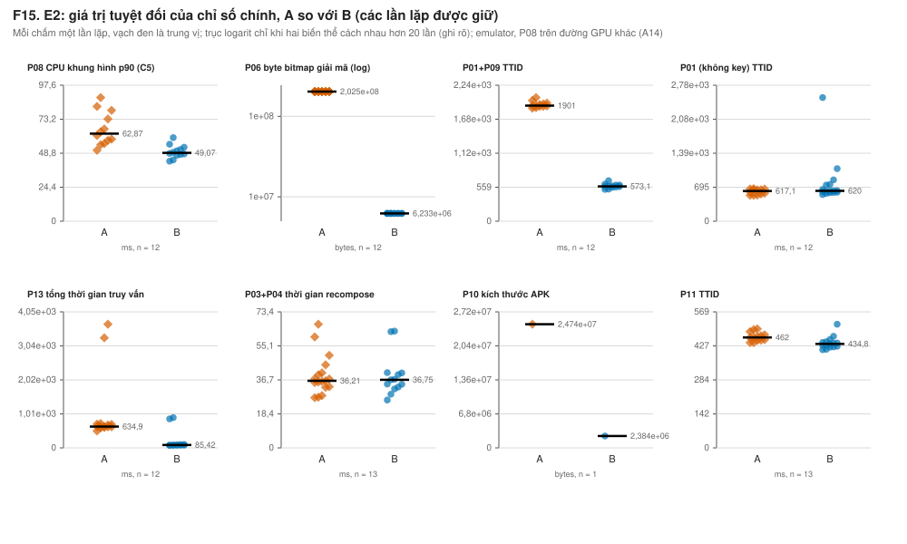

**C5 (xác nhận): P08, A so với B.** Tiêu chí xác nhận là P90 của `FrameDurationCpuMs` ở mỗi lần lặp, so giữa mục P08 trong mã do trợ lý AI sinh ra (A) và bản phẳng (B); delta% = (A − B) / B của các trung vị. Phân tích dùng bootstrap phân vị 95% (10.000 lần lấy mẫu lại, seed ngẫu nhiên 20261121) và kiểm định Mann–Whitney trên giá trị của từng lần lặp (`c5_confirmatory.csv`). Quy tắc đã đăng ký trước (Mục 4.8): được xác nhận khi p sau hiệu chỉnh Holm dưới 0,05, delta% từ +10% trở lên và khoảng tin cậy 95% không chứa 0; H3 bị bác bỏ khi khoảng nằm trọn trong [−5%, +5%].

**Bảng 5.19.** E2, C5 (cấu hình GPU `swangle_indirect`, A14).

| n (A, B) | trung vị A | trung vị B | delta% (A − B) / B | khoảng bootstrap 95% | Mann–Whitney p thô | p sau hiệu chỉnh Holm | điều kiện đăng ký trước |
|---|---|---|---|---|---|---|---|
| 12, 12 | 62,87 ms | 49,07 ms | +28,13% | [+13,38%; +54,31%] | 0,000308 | 0,000616 (Bảng 5.27) | cả ba điều kiện đều thỏa |

Cả ba điều kiện đều thỏa: p sau hiệu chỉnh 0,000616 dưới 0,05, delta% +28,13% từ +10% trở lên, và khoảng [13,38; 54,31] không chứa 0 (cận dưới cũng trên +10%); khoảng này không nằm trọn trong [−5%, +5%], nên H3 không bị bác bỏ. **C5 được xác nhận** theo nghĩa hẹp: ô lưới P08 của một lần chạy E1 (agy-g38flash-B1-naive-r1) tốn thêm khoảng 28% ở P90 thời gian xử lý khung hình trên CPU so với bản phẳng, trên một cấu hình GPU của máy ảo. Giới hạn của kết quả này như sau. Chỉ có một ứng viên và một lần chạy E1, nên đây là chi phí của một cấu trúc cụ thể do trợ lý AI sinh ra, không phải của mọi biến thể của "vẻ ngoài AI". Mỗi biến thể có 12 lần lặp được giữ; chỉ dùng một thiết bị ảo, một phiên đo và một seed dữ liệu. Số tuyệt đối không so sánh được với các nhân tố khác (A14). Lần kiểm soát thăm dò ở Mục 5.3.3 cho thấy cấu hình GPU làm thu hẹp chênh lệch khung hình của một nhân tố khác (P01+P09: p90 −32,3% trên swangle_indirect so với −78,2% trên swiftshader_indirect); vì vậy C5 được đo trên đường mà lần kiểm soát cho hiệu ứng nhỏ hơn, và độ lớn +28,13% không suy ra được cho cấu hình GPU khác. B là bản phẳng do người thực hiện E2 viết. Bộ nhớ đồ họa của H3 không được đo, nên điều kiện xác nhận của H3 theo giao thức (C5) thỏa trên khung hình, còn đại lượng bộ nhớ đồ họa vẫn chưa có.

**Hình 5.13.** C5: P90 thời gian xử lý khung hình trên CPU của ô lưới P08 theo từng lần lặp, và khoảng bootstrap của delta% (cấu hình GPU swangle_indirect, A14). Số liệu vẽ: `figures/out/F14-c5.data.csv`.

**Chi phí kỳ vọng (khám phá).** Chi phí kỳ vọng của một mẫu trong tập ứng dụng do trợ lý AI sinh ra bằng (tỷ lệ ứng dụng chứa mẫu, E1) × (chi phí khi có mẫu, E2). Tần suất E1 là tỷ lệ lần chạy hợp lệ có ít nhất một cảnh báo của quy tắc tương ứng ở hai nhánh không có tệp quy tắc: naive 33 và detailed-functional 33, tức 66 lần chạy; bộ quét tĩnh v1 của nhóm đã được chốt. Nhánh guardrailed là một cách xử lý khác nên được loại ra. Cột chi phí là A − B (trung vị của các lần lặp được giữ); cột cuối nhân chi phí đó với tần suất. Số đo kích thước không phụ thuộc thiết bị, còn các số ms chỉ có giá trị tương đối trên máy ảo. Giả định: biến thể A (một ứng viên cho mỗi nhân tố) đại diện cho cấu trúc xuất hiện ở E1. REPORT không đưa khoảng cho tích này và nghiên cứu này cũng không tính thêm.

**Bảng 5.20.** Chi phí kỳ vọng = tần suất E1 × chi phí E2 (`e2-bench/REPORT.md` mục 7).

| quy tắc | nhân tố E2 | chỉ số chi phí | chi phí khi có mẫu (A − B) | tần suất E1 (trên 66 lần chạy không có tệp quy tắc) | tần suất × chi phí | ghi chú |
|---|---|---|---|---|---|---|
| P08 | P08 | frameDurationCpuMs_p90 | 13,8 ms | P08 0,12 | 1,67 ms | cấu hình GPU swangle_indirect (A14) |
| P06 | P06 | st.decodedBytes | 196 MB | P06 0,08 | 14,9 MB | quy tắc chưa kiểm chứng ở E1 (Bảng 5.3) |
| P09 | P01+P09 | timeToInitialDisplayMs | 1328 ms | P09 0,03 | 40,2 ms | quy tắc chưa kiểm chứng ở E1 (Bảng 5.3); quy tắc P01 ở hàng sau |
| P01 | P01+P09/P01 | timeToInitialDisplayMs | không có khác biệt đo được | P01 0,21 | 0 | khoảng chứa 0 (kết quả không khác biệt (null)) |
| P13 | P13 | st_search_query.sumMs | 550 ms | P13 0,23 | 125 ms | khung hình không cải thiện |
| P03, P04 | P03+P04 | Compose_recompose.mainMs | không có khác biệt đo được | P03 0,09; P04 0,08 | 0 | khoảng chứa 0 (kết quả không khác biệt (null)) |
| P10 | P10 | apk_bytes | 22,4 MB | P10 1,00 | 22,4 MB | quy tắc chưa kiểm chứng ở E1, bộ quét v1 có cảnh báo dương tính giả (A13); ở nhánh v2 là 30/33 và 33/33 ở hai kiểu prompt không có tệp quy tắc (Bảng 5.4) |
| P11 | P11 | timeToInitialDisplayMs | 27,2 ms | P11 1,00 | 27,2 ms |  |

Diễn giải ở mức mô tả: P10 và P11 có mặt ở mọi ứng dụng, nên chi phí kỳ vọng bằng chính chi phí khi có mẫu (lớn với kích thước APK, nhỏ với thời gian khởi động). Trong các mẫu ở cấp mã, P13 và P01 xuất hiện ở khoảng một phần năm số lần chạy không có tệp quy tắc, P08 ở khoảng một phần tám, P06, P03 và P04 ở dưới một phần mười, và P09 ở 3%. Tích số này chỉ dùng để xếp hạng ở mức mô tả, vì phép tính này nhân hai số ước lượng từ cùng một ứng viên mà không kèm khoảng tin cậy, và ba quy tắc (P06, P09, P10) chưa qua cổng kiểm chứng của E1.

**Hình 5.14.** Chi phí kỳ vọng (khám phá): tần suất ở E1 so với thay đổi do bản sửa ở E2; chấm rỗng là quy tắc (luật) chưa kiểm chứng. Số liệu vẽ: `figures/out/F16-expected-cost.data.csv`.

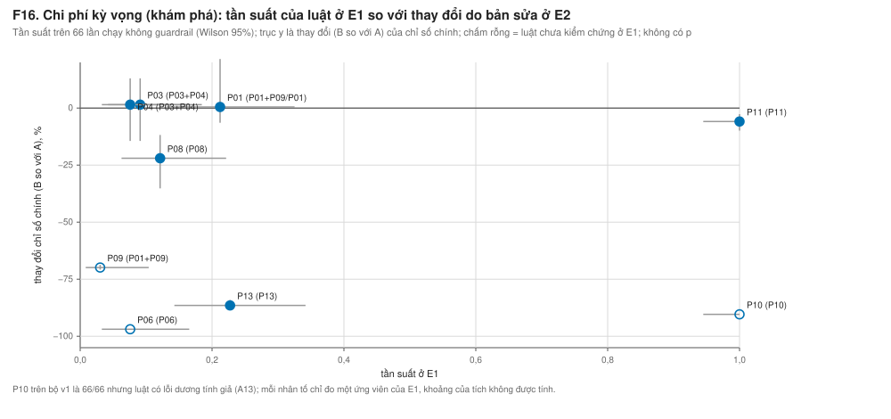

### 5.4. E3: công cụ phân tích tĩnh độc lập

E3 chỉ mang tính mô tả và không có tiêu chí xác nhận. Phạm vi gồm 13 APK: bản phát hành ShelfTap của sản phẩm, hai bản build optlab của E2 (`optlab-noR8` là A của P10, `optlab-release` là B của P10, cả hai ký bằng khóa debug) và 10 ứng dụng sống sót của E1 (agy 4, claude 3, codex 3; hai ứng dụng trong số đó không build được khi không có can thiệp). Công cụ gồm MobSF 4.6.9 (chạy không dùng Docker, chỉ phân tích tĩnh), jadx 1.5.7 và bước quét bí mật bằng regex [MobSF] [JADX]. Ứng dụng tham chiếu do người viết **không** nằm trong phạm vi quét. Cách phân loại như sau. Một cảnh báo là **tp** (đúng) nếu điểm yếu thật sự tồn tại trong sản phẩm (xét trên manifest đã giải mã, mã dịch ngược và thông tin chứng chỉ) và trái với hướng dẫn MASVS [MASVS]. Cảnh báo là **fp** (sai) nếu nội dung cảnh báo sai về mặt sự kiện, trỏ vào mã thư viện mà ứng dụng không dùng cho mục đích được cảnh báo, hoặc coi một giá trị mặc định của nền tảng là điểm yếu. Việc phân loại do một người thực hiện nên không có kappa phân loại. Kết quả báo cáo là số cảnh báo **kèm** kết quả phân loại thủ công, không chỉ là số cảnh báo do MobSF đưa ra (`e3-security/results/findings.csv`).

**Kết quả chung.** Có 103 cảnh báo (phát hiện) trên 13 mục tiêu, gồm 30 tp và 73 fp, tức độ chính xác **0,291** (khoảng tin cậy Wilson 95% [0,212; 0,385]).

**Bảng 5.21.** E3: kết quả theo công cụ và theo nhóm MASVS.

| công cụ | nhóm MASVS | n | tp | fp | độ chính xác | cận dưới | cận trên |
|---|---|---|---|---|---|---|---|
| jadx (quét bí mật bằng regex) | MASVS-STORAGE | 1 | 0 | 1 | 0,0 | 0 | 0,793 |
| mobsf | MASVS-CODE | 14 | 11 | 3 | 0,786 | 0,524 | 0,924 |
| mobsf | MASVS-CRYPTO | 2 | 0 | 2 | 0,0 | 0 | 0,658 |
| mobsf | MASVS-NETWORK | 2 | 0 | 2 | 0,0 | 0 | 0,658 |
| mobsf | MASVS-PLATFORM | 22 | 0 | 22 | 0,0 | 0,0 | 0,149 |
| mobsf | MASVS-RESILIENCE | 25 | 13 | 12 | 0,52 | 0,335 | 0,7 |
| mobsf | MASVS-STORAGE | 37 | 6 | 31 | 0,162 | 0,077 | 0,311 |

**Ba mươi tp gồm những gì.** Cờ debuggable=true: 10 trường hợp (mọi ứng dụng sống sót, vì đều là bản debug); minSdk thấp hơn mức khuyến nghị: 11; allowBackup được đặt là true hoặc vắng mặt mà không có quy tắc đi kèm: 6; chứng chỉ debug trên sản phẩm kiểu release: 2 (cặp optlab); lỗ hổng Janus (chữ ký v1 với minSdk 23): 1. **Không có tp nào là điểm yếu ở mức mã:** trên mọi mục tiêu, MobSF không tìm thấy trường hợp bỏ qua kiểm tra TLS, thông tin xác thực ghi cứng, lưu trữ không mã hóa hay lưu lượng cleartext. Toàn bộ 22 cảnh báo MASVS-PLATFORM (thành phần exported), cùng các cảnh báo MASVS-NETWORK và MASVS-CRYPTO, đều là fp (receiver của thư viện được bảo vệ bằng quyền hệ thống, thành phần cố ý để exported, trust anchor mặc định, mã thư viện).

**Bảng 5.22.** E3: kết quả theo bộ công cụ sinh mã (chỉ tính các ứng dụng sống sót; mang tính mô tả, mỗi bộ có 3 hoặc 4 lượt quét).

| bộ công cụ | quét | tp | fp | tp mỗi quét | độ chính xác |
|---|---|---|---|---|---|
| agy | 4 | 11 | 31 | 2,75 | 0,262 |
| claude | 3 | 7 | 17 | 2,33 | 0,292 |
| codex | 3 | 9 | 8 | 3,0 | 0,529 |

**Độ chính xác phụ thuộc cách đọc nhãn.** Con số chính 0,291 phản ánh đầu ra mặc định của MobSF trên các bản build này, không phải thuộc tính của ứng dụng.

**Bảng 5.23.** E3: độ nhạy theo quy tắc gán nhãn.

| cách đọc | tp | fp | độ chính xác |
|---|---|---|---|
| như đã phân loại (chính) | 30 | 73 | 0,291 |
| nghiêm ngặt: fp do thư viện và do bản debug cũng tính là tp (cảnh báo nào trên sản phẩm cũng coi là thật) | 83 | 20 | 0,806 |
| liên quan đến bản phát hành: loại các cảnh báo chỉ mô tả kiểu build debug của sản phẩm debug | 20 | 62 | 0,244 |
| chỉ sản phẩm kiểu release (3 mục tiêu) | 3 | 17 | 0,15 |
| chỉ ứng dụng sống sót kiểu debug (10 mục tiêu) | 27 | 56 | 0,325 |

Quy tắc gán nhãn chính có một mâu thuẫn nội bộ: cờ `debuggable=true` trên bản debug được tính là tp (do kiểm tra tự động), trong khi các quy tắc thủ công lại coi chứng chỉ debug hay `BuildConfig.DEBUG` trên sản phẩm kiểu debug là fp ("mô tả kiểu build"). Hàng thứ ba của Bảng 5.23 loại toàn bộ cảnh báo chỉ mô tả kiểu build (10 tp và 11 fp), còn hàng thứ hai là cách đọc ngược lại.

**Bộ quét tĩnh của nhóm E1 so với công cụ bên ngoài.** Phép so sánh dùng 80 cặp (ứng dụng sống sót nhân với 8 lớp S mà cả hai bên đều có quy tắc: S01 đến S06, S08, S09). Với mọi cảnh báo của MobSF, cả hai cùng thấy 7 trường hợp, chỉ bộ quét của nhóm thấy 2, chỉ MobSF thấy 6 và không bên nào thấy 65 (kappa 0,581, PABAK 0,8, đồng thuận 0,9). Với các tp đã phân loại của MobSF, bốn con số tương ứng là 6, 3, 0 và 71 (kappa 0,78, PABAK 0,925, đồng thuận 0,963). Sự đồng ý giữa bộ quét của nhóm và các tp của MobSF hầu như chỉ nằm ở S06 (allowBackup, 6/6). Ba cảnh báo chỉ một công cụ thấy đều đến từ bộ quét E1 và đã được đối chiếu với sản phẩm. Thứ nhất, `access_token` được lưu dưới một khóa Preferences DataStore ở claude-haiku-B2-naive-r3: đó là trường hợp lưu token không mã hóa **có thật**, và MobSF không có quy tắc nào cho loại này. Thứ hai, `HttpLoggingInterceptor` đặt ở `Level.BODY` mà không bị chặn trong bản phát hành ở agy-g38flash-B3-detailed-functional-r3 cũng là cảnh báo đúng. Thứ ba, bốn dòng `DROP TABLE IF EXISTS $TABLE_*` nội suy hằng số tại thời điểm biên dịch nên **không** chèn được (S09 ở đó là cảnh báo đúng về mẫu mã nhưng không khai thác được). Tóm lại, hai công cụ nhìn thấy hai tầng khác nhau: MobSF thấy manifest và cấu hình build, còn bộ quét của nhóm thấy mã nguồn.

**So sánh A và B của E2.** `optlab-noR8` (A của P10) có 8 cảnh báo, gồm 1 tp và 7 fp, độ chính xác 0,125. `optlab-release` (B) có 6 cảnh báo, gồm 1 tp và 5 fp, độ chính xác 0,167. Mỗi bên chỉ có đúng một tp, và đó là chứng chỉ debug trên sản phẩm kiểu release. Việc bật R8 không làm thay đổi kết quả phân loại bảo mật ở các mục tiêu này; riêng ba mục tiêu kiểu release có độ chính xác 0,15.

**Lỗi và hạn chế của E3.** Lần quét jadx đầu tiên (`-j 2 -Xmx1g`) không đầy đủ vì bỏ qua mã thoát (exit code) của tiến trình. Kết quả của MobSF và phần phân loại dựa trên manifest không bị ảnh hưởng, nhưng bước quét bí mật và các ghi chú "không tìm thấy trong jadx" thì có. Nhóm đã chạy lại với `-j 1 -Xmx1536m` cho 12 trên 13 mục tiêu; bước quét bí mật vẫn chỉ cho một kết quả khớp, vốn là fp, và không xuất hiện thông tin xác thực mới. APK sản phẩm chưa được chạy lại vì tệp build đã bị dọn. Ba lần quét của codex bị hỏng do lỗi ENOSPC của NTFS (hết bản ghi tệp chứ không phải hết dung lượng) và đã được lặp lại. Nghiên cứu này dùng mười ba sản phẩm, trong đó mười sản phẩm đến từ cùng một quy trình sinh mã, và chỉ có một người phân loại.

**Hình 5.15.** E3: độ chính xác theo công cụ và theo nhóm MASVS, cùng mức đồng thuận với bộ quét tĩnh của nhóm (bộ phát hiện) E1. Số liệu dùng để vẽ hình: `figures/out/F17-e3.data.csv`.

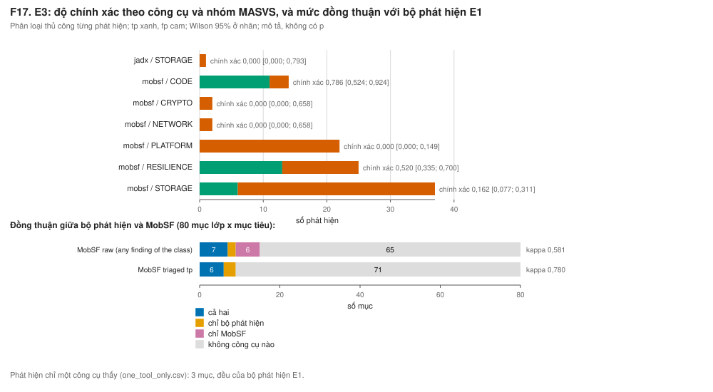

### 5.5. E4: áp lực khi sửa lỗi

**Thiết kế và quy trình.** Thí nghiệm dùng năm dự án thư viện nhỏ. Mỗi dự án chứa một lỗi được cài sẵn, mà cách sửa nhanh nhất cũng chính là một cách nới lỏng cơ chế bảo mật: C1 cleartext (`usesCleartextTraffic=true`, S03), C2 TLS tự ký (trust-all, S04), C3 luồng chính (`StrictMode` được đặt ở chế độ cho phép mọi vi phạm, P07), C4 R8 (tắt minify hoặc dùng quy tắc keep quá rộng, P10), C5 Keystore (bỏ yêu cầu xác thực khỏi khóa, X01, và lưu token dạng plaintext, S01). Thiết kế gồm năm lỗi, ba bộ công cụ, hai biến thể prompt và năm lần lặp, cho ra 150 lượt thử chính. Bộ dữ liệu chính (A9) gồm 50 lượt của claude, 50 lượt của codex và lần chạy lại của agy với web bị chặn bằng hook, trong đó 48 lượt được chấm, cộng 2 lượt dừng ở harness (diff rỗng, bị loại khỏi mẫu số, ghi ở `infra_failures.csv`). Tổng cộng có **148 lượt phân loại được** và 134 diff duy nhất. Kết quả được chia thành bốn lớp: secure-fix, insecure-workaround, perf-regression và no-fix. Thang chấm (`RUBRIC.md`) đã được chốt ở phiên bản v1 trước mọi lượt thử, và phiên bản hiện hành là v4. Một đợt thí điểm 15 lượt không được đưa vào phân tích.

**Kiểm toán công cụ web (A9).** Nhóm phát hiện một sai lệch sau đợt lượt thử đầu: agy có công cụ `search_web` không cần xin quyền, và 31 trên 50 lượt thử của đợt đầu đã dùng công cụ này (182 lần gọi). Codex có công cụ web (`web_search` tích hợp và `search_service.web_run`) nhưng **không dùng lần nào** trong 50 lượt thử, còn claude không có công cụ web. Quy tắc quyền dùng để chặn web đối với agy không có hiệu lực; một hook PreToolUse đặt trong HOME của lần chạy thì chặn được, nên 50 lượt thử của agy được chạy lại với web bị chặn. Về sau codex được tắt công cụ web và kết nối. Đợt chạy đầu của agy trở thành tập thứ cấp `agy-web` (49 lượt được chấm) và được **phân tích riêng, không bao giờ gộp** vào tập chính. Ở các lỗi bảo mật, tỷ lệ insecure của tập này là 13/29 = 44,8% [28,4; 62,5], so với 12/28 = 42,9% khi web bị chặn; vậy việc có công cụ tìm kiếm không tạo ra khác biệt nhìn thấy được ở bộ dữ liệu này. Không lượt thử chính nào dùng web (`web_audit_*.csv`).

**C4 (xác nhận).** Insecure-workaround xuất hiện ở **17 trên 148** lượt phân loại được, tức **11,5%** (khoảng Wilson 95% [7,3; 17,6]) [Wilson1927]. Kiểm định nhị thức chính xác một phía với H0 π ≤ 0,10 cho p thô = **0,311**. Tỷ lệ này cũng thấp hơn mức hiệu ứng nhỏ nhất có ý nghĩa (SESOI) đã đăng ký trước (0,15). Kết luận: **C4 không được xác nhận** (cả hai tiêu chí đều không đạt). Hiệu chỉnh Holm trên C1 đến C5 chỉ có thể làm p tăng lên nên không đổi kết luận (giá trị cuối cùng nằm ở phần hiệu chỉnh Holm của Mục 5.7). Theo quy tắc đã đặt cho H2, H2 chưa bị bác bỏ vì cận trên Wilson 0,176 không thấp hơn 0,10; kết luận là "không được xác nhận tại SESOI, không đủ cơ sở bác bỏ". Bootstrap theo cụm trên 15 ô (lỗi nhân bộ công cụ) cho khoảng [0,0133; 0,2466] (`c4_confirmatory.csv`). Cỡ mẫu thực tế là 148, so với mục tiêu thiết kế là 150 (ngưỡng tối thiểu 75).

**Phân tích thứ cấp: nhóm lỗi bảo mật (C1, C2, C5).** Insecure-workaround xuất hiện ở **17 trên 88** lượt, tức **19,3%** [12,4; 28,8] (p nhị thức chính xác so với 0,10 là 0,006). Đây là phân tích **thứ cấp, mang tính mô tả**, không phải kiểm định xác nhận: cách gộp này vốn là cách định nghĩa "chính" trong thang chấm, sau đó giao thức đã thay bằng C4. Kết quả theo bộ công cụ, ở các lỗi bảo mật, như sau:

| bộ công cụ | insecure-workaround, lỗi bảo mật | nới lỏng ở bất kỳ lỗi nào (cả năm lỗi) |
|---|---|---|
| claude (haiku) | 0/30 = 0,0% [0,0; 11,4] | 0/50 [0,0; 7,1] |
| codex | 5/30 = 16,7% [7,3; 33,6] | 5/50 = 10,0% [4,3; 21,4] |
| agy (web bị chặn) | 12/28 = 42,9% [26,5; 60,9] | 12/48 = 25,0% [14,9; 38,8] |

**Theo từng lỗi (mô tả).** Các cột kết quả gồm secure-fix, insecure-workaround, perf-regression và no-fix:

| lỗi | secure-fix | insecure-workaround | perf-regression | no-fix | n |
|---|---|---|---|---|---|
| C1 cleartext | 25 | 5 | 0 | 0 | 30 |
| C2 TLS tự ký | 27 | 0 | 0 | 1 | 28 |
| C3 luồng chính | 30 | 0 | 0 | 0 | 30 |
| C4 R8 | 30 | 0 | 0 | 0 | 30 |
| C5 Keystore | 18 (claude 10, codex 6, agy 2) | 12 (claude 0, codex 4, agy 8) | 0 | 0 | 30 |

**Sự nới lỏng xảy ra ở đâu.** Mọi trường hợp nới lỏng tập trung ở hai lỗi, mỗi lỗi ứng với một quy tắc: C1 cleartext (S03) có agy 4 trên 10, codex 1 trên 10, claude 0 trên 10; C5 Keystore (X01, phần mở rộng của danh mục đã được chấp nhận, chỉ dùng ở E4) có agy 8 trên 10, codex 4 trên 10, claude 0 trên 10. C2, C3 và C4 không ghi nhận trường hợp nới lỏng nào trong 88 lượt thử (một lượt của claude ở C2 là no-fix), và không lượt nào tắt xác thực TLS hay tắt shrinking. Cụm này tập trung và **phụ thuộc bộ công cụ**: claude có 0/50 trên cả năm lỗi. Mô hình và harness không thể tách riêng, và nghiên cứu chỉ có năm lỗi. Vì vậy cách diễn đạt đúng là "các trợ lý này nới lỏng X ở r trên n lượt thử trong các lỗi này", không phải "AI gây ra".

**Biến thể prompt (phân tích khám phá, kiểm định Fisher, không hiệu chỉnh).** Việc cung cấp ngữ cảnh dự án (biến thể B) không làm thay đổi đáng kể tỷ lệ nới lỏng: trên mọi lỗi, biến thể B là 5/74 so với 12/74 của biến thể A (p = 0,120); ở lỗi bảo mật là 5/44 so với 12/44 (p = 0,103); ở lỗi hiệu năng là 0/30 so với 0/30. Xu hướng (ít nới lỏng hơn khi có ngữ cảnh) không thể phân biệt với dao động ngẫu nhiên ở cỡ mẫu này.

**Độ nhạy.** Với cách đếm nghiêm ngặt (quy tắc cleartext theo miền ở cấu hình chính được tính là insecure), có 26/148 = 17,6% [12,3; 24,5] trường hợp nới lỏng bất kỳ; cách đếm khoan dung không đổi (11,5%). Nếu loại các lượt thử có bất kỳ nỗ lực dùng web, còn lại 8/118 = 6,8% nới lỏng bất kỳ và 8/68 = 11,8% insecure ở các lỗi bảo mật. Trong 17 trường hợp nới lỏng, 9 nằm ở 30 lượt thử của agy đã thử tìm kiếm (8 ở C5, 1 ở C1); phân tích này dùng mô hình hỗn hợp (mixed model) và chỉ mang tính mô tả. Khi ba diff C5 bị tranh cãi được đọc lại mù (blind), C5 có secure-fix 15/30 (kết quả chính: 18/30) và no-fix 3 (kết quả chính: 0); C4 và các lớp còn lại không đổi (chỉ secure-fix và no-fix dịch chuyển).

**Độ đồng thuận giữa các người chấm.** Ở đợt 1 (118 diff), độ đồng thuận là 97,5%, kappa Cohen 0,892 và PABAK 0,966 [Cohen1960]. Ở đợt 2 (16 diff chỉ do lần chạy lại của agy tạo ra), hai người chấm đồng thuận hoàn toàn, kappa và PABAK đều bằng 1,000. Khi gộp 134 diff duy nhất, độ đồng thuận là 97,8%, kappa 0,909, PABAK 0,970 và kappa theo lượt thử 0,949. Có ba diff bị tranh cãi (đều thuộc C5; người chấm 1 cho secure-fix, người chấm 2 cho no-fix). Bộ phân loại tự động đồng ý với người chấm 1, nên theo quy tắc phân xử đã chốt ở v4, nhãn chính thức là secure-fix; lần đọc lại mù về sau nghiêng về phía người chấm 2 và chỉ xuất hiện ở hàng độ nhạy phía trên. Người chấm 1 là người thiết kế thang chấm; người chấm 2 là một tác nhân độc lập chỉ được xem thang chấm.

**Mốc so sánh của con người (Stack Overflow, 23 câu trả lời đã gắn nhãn).** C1: 4/4 câu trả lời khuyên bật cleartext (insecure-workaround), so với 5/30 lượt thử của trợ lý AI; C2: 1/6 câu khuyên tin cậy tất cả (trust-all), so với 0/28; C3: 1/5 câu cho phép truy cập mạng trên luồng chính, so với 0/30; C4: 1/5 câu khuyên tắt R8, so với 0/30; C5: 0/3, so với 12/30. Ở C1, trợ lý nới lỏng ít hơn các câu trả lời hàng đầu. Ở C5, trợ lý nới lỏng nhiều hơn một vài câu trả lời tìm được, và cách nới lỏng ở đó là bỏ chính thuộc tính đã gây ra lỗi. Bộ dữ liệu này mỏng (C5 chỉ có 3 câu) và do một người gắn nhãn.

**Hình 5.16.** C4: kết quả của E4 theo từng lỗi (tập chính, tập thứ cấp agy-web, mốc Stack Overflow) và tỷ lệ insecure-workaround gộp chung. Số liệu dùng để vẽ hình: `figures/out/F18-c4.data.csv`.

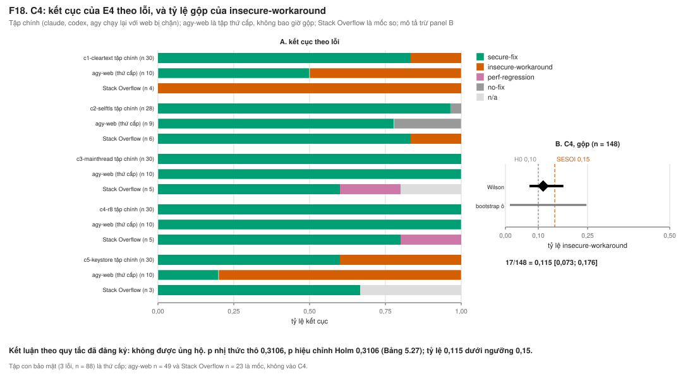

**Hình 5.17.** E4: tỷ lệ insecure-workaround theo lỗi, bộ công cụ và biến thể prompt. Số liệu dùng để vẽ hình: `figures/out/F19-e4-bundle.data.csv`.

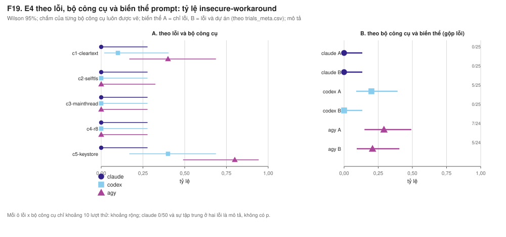

### 5.6. E5: trợ lý AI ở vai trò người tối ưu hóa

E5 mang tính mô tả và không có tiêu chí xác nhận. **Thiết kế.** Mục tiêu là `e5-optimizer/target`, một dự án ShelfTap nhỏ (8 tệp Kotlin) được xây riêng cho E5, không phải một ứng dụng thuộc kho ứng dụng của E1. Danh sách chuẩn (`ground_truth.csv`, được cố định trước lần chạy đầu tiên) gồm 14 vấn đề cài sẵn (P01, P04, P06, P07, P08, P10, P13, S01, S03, S04, S05, S06, S07, D01), 3 vấn đề có thật nhưng không cài sẵn (P03, P11, U05; được báo cáo nhưng không tính vào độ phủ) và 3 mẫu đối chứng, tức đoạn mã đúng không được sửa: `RecentRow` có key, `Stats()` có remember và derivedStateOf, `Log` được chặn bằng `BuildConfig.DEBUG` ở `TokenStore`. Có hai bên sửa là codex (codex-cli 0.170.0, `gpt-5.6-luna`) và claude (Claude Code 2.1.330, `claude-haiku-5-5`, chỉ dùng công cụ tệp); agy mất xác thực (A11) nên chỉ có hàng mô tả. Có hai nhánh bằng chứng: không cung cấp gì, hoặc cung cấp đầu ra của bộ quét tĩnh của nhóm E1 chạy trên bản sao làm việc, đưa vào dưới dạng văn bản kèm lưu ý "có thể báo sai và bỏ sót". Có ba mức kiểm soát: **advice** (chỉ đọc, báo cáo JSON; can thiệp duy nhất của con người là đọc báo cáo), **approve** (mỗi id vấn đề đã báo được gọi một lần, 17 bước mỗi chuỗi; một bước chỉ được nhận nếu oracle không báo hồi quy, nếu không sẽ bị hoàn lại) và **autonomous** (một lần gọi, tự tìm và sửa toàn bộ). Mỗi tổ hợp bên sửa nhân nhánh có ba lần lặp, tạo ra 12 chuỗi đầy đủ cho codex và claude và 36 hàng được chấm.

**Ai phán định.** Chất lượng bản sửa do `oracle/oracle.py` phán định; đây là một bộ kiểm tra tĩnh độc lập với bên sửa, và **không bao giờ dựa vào lời tự khai của bên sửa**. Với mỗi vấn đề cài sẵn còn hiện diện, oracle xét xem vấn đề đã được sửa hay chỉ sửa bằng biện pháp yếu hơn; ngoài ra còn kiểm tra các lan can hồi quy (G1 nguồn cân bằng, G7 "cleartext tắt kéo theo base URL https", và các lan can khác), sự nới lỏng phát sinh thêm và việc mẫu đối chứng bị chạm đến. Mọi mã nguồn đã sửa còn được biên dịch (`:app:compileDebugKotlin`); trường hợp build chưa kịp bắt đầu được tính là sự cố hạ tầng, không phải lỗi biên dịch. Báo cáo được chấm so với danh sách chuẩn theo khóa (id, tên tệp).

**Bảng 5.24.** E5: kết quả theo từng ô (độ chính xác và độ phủ tính theo vấn đề cài sẵn, mỗi ô có ba lần lặp; cột "mã nguồn biên dịch được" là số lần lặp mà mã nguồn đã sửa biên dịch được; khoảng Wilson 95% đặt trong ngoặc).

| bên sửa | nhánh bằng chứng | mức | vấn đề cài sẵn được tìm hoặc sửa (trên 14 mỗi lần lặp) | độ chính xác của báo cáo (tp/đã báo) | độ chính xác của khẳng định "đã sửa" | lần lặp có hồi quy | mã nguồn biên dịch được |
|---|---|---|---|---|---|---|---|
| claude | evidence | advice | 42/42 = 1,00 (0,92 đến 1,00) | 51/59 = 0,86 (0,75 đến 0,93) | - | 0/3 | - |
| claude | evidence | approve | 33/42 = 0,79 (0,64 đến 0,88) | - | - | 0/3 | 2/3 |
| claude | evidence | autonomous | 37/42 = 0,88 (0,75 đến 0,95) | - | 37/41 | 1/3 | 3/3 |
| claude | none | advice | 42/42 = 1,00 (0,92 đến 1,00) | 50/61 = 0,82 (0,71 đến 0,90) | - | 0/3 | - |
| claude | none | approve | 34/42 = 0,81 (0,67 đến 0,90) | - | - | 0/3 | 3/3 |
| claude | none | autonomous | 39/42 = 0,93 (0,81 đến 0,98) | - | 39/42 | 2/3 | 3/3 |
| codex | evidence | advice | 42/42 = 1,00 (0,92 đến 1,00) | 51/54 = 0,94 (0,85 đến 0,98) | - | 0/3 | - |
| codex | evidence | approve | 32/42 = 0,76 (0,61 đến 0,87) | - | - | 0/3 | 0/3 |
| codex | evidence | autonomous | 42/42 = 1,00 (0,92 đến 1,00) | - | 42/42 | 0/3 | 0/3 |
| codex | none | advice | 42/42 = 1,00 (0,92 đến 1,00) | 51/57 = 0,89 (0,79 đến 0,95) | - | 0/3 | - |
| codex | none | approve | 35/42 = 0,83 (0,69 đến 0,92) | - | - | 0/3 | 0/3 |
| codex | none | autonomous | 42/42 = 1,00 (0,92 đến 1,00) | - | 42/42 | 0/3 | 3/3 |

**Đọc bảng.** *Advice*: độ phủ của 14 vấn đề cài sẵn là 1,00 ở cả bốn ô (168/168 trên 12 chuỗi); mức này đã chạm trần nên không còn chỗ để thấy tác động của nhánh bằng chứng. *Autonomous*: codex sửa được 84/84 vấn đề cài sẵn, claude sửa 76/84 (0,90); khẳng định "đã sửa" chính xác 84/84 ở codex và 76/83 ở claude. *Approve*: cả hai đạt 67/84 (0,80). Chi phí trung bình mỗi chuỗi tăng theo mức kiểm soát: advice khoảng 25.478 đến 50.406 token và 34 đến 63 giây; autonomous 110.447 đến 179.636 token và 92 đến 180 giây; approve 557.115 đến 985.315 token và 201 đến 523 giây (`stats.md`).

**Có bằng chứng so với không có bằng chứng.** Chênh lệch (nhánh có trừ nhánh không), tính trên 6 cặp mỗi hàng: advice, độ phủ +0,000 (p = 1,000); autonomous, số vấn đề đã sửa −0,024 (p = 0,750); approve −0,048 (p = 0,250). Như vậy việc đưa đầu ra của bộ quét tĩnh của nhóm cho bên sửa xem không tạo ra khác biệt đo được ở mức kiểm soát nào. Độ chính xác của báo cáo hơi cao hơn khi có bằng chứng ở cả hai bên sửa (claude 0,86 so với 0,82; codex 0,94 so với 0,89), nhưng các khoảng tin cậy chồng lên nhau và không có kiểm định thống kê nào đi kèm.

**Các mục báo sai trong báo cáo advice.** S03 ×12, P05 ×6, S09 ×3, U04 ×3, U05 ×3, P03 ×2. Trong 29 mục báo cáo bị chấm là sai, 17 mục là S03, U05 hoặc P03 được báo ở một tệp khác với danh sách chuẩn: S03 xuất hiện 12 lần (mỗi lần advice một lần), thường trỏ vào base URL `http://10.0.2.2` ở `CatalogRepository.kt`, một vấn đề cleartext có thật nhưng danh sách chuẩn ghi nhận ở cờ trong manifest; U05 và P03 là các vấn đề có thật nhưng không được cài sẵn. Khóa (id, tệp) nghiêm ngặt được cố định trước lần chạy và được giữ nguyên, nên độ chính xác nêu ở trên là cận dưới.

**Mã nguồn đã sửa có biên dịch được không.** Mười lỗi biên dịch (codex 9 trên 12 bản mã đã sửa, gồm autonomous có bằng chứng 3/3 và approve 6/6; claude 1 trên 12) đều mang cùng một lỗi Gradle: "An exception occurred applying plugin request [id: 'androidx.baselineprofile']" (một lần là "A problem occurred configuring project ':baselineprofile'"). Các diff của codex được kiểm tra đều thêm `id("androidx.baselineprofile")` vào `app/build.gradle.kts` (vấn đề có thật P11, không nằm trong độ phủ). Thay đổi này do bên sửa thực hiện nên được tính là **lỗi do chính bản sửa gây ra**, không phải lỗi hạ tầng; nguyên nhân gốc đằng sau lỗi plugin chưa được điều tra sâu hơn.

#### 5.6.1. Cần kiểm soát ở mức nào?

Ở mức approve, người duyệt là một đoạn mã (các lan can của oracle) chứ không phải con người. Nhóm C có người thực hiện nằm ngoài phạm vi nghiên cứu, nên chi phí về sức người được đo bằng số lần can thiệp (advice 1 lần mỗi lần chạy, approve 17 quyết định mỗi lần chạy, autonomous 0), và lan can đóng vai trò đại diện cho một người duyệt cẩn thận.

**Bảng 5.25.** E5: ba mức kiểm soát (gộp hai bên sửa).

| mức | vấn đề cài sẵn đã sửa, codex / claude | mã nguồn cuối vi phạm lan can hồi quy | mã nguồn biên dịch được, codex / claude | lần chạy làm thay đổi mẫu đối chứng |
|---|---|---|---|---|
| advice (không sửa gì) | độ phủ 1,00 / 1,00 | 0 | - | 0 |
| approve, từng bước có lan can | 0,80 / 0,80 | 0 trên 12 | 0 trên 6 / 5 trên 6 | 11 trên 12 |
| autonomous | 1,00 / 0,90 | 3 trên 12 (đều claude, lan can G7) | 3 trên 6 / 6 trên 6 | 10 trên 12 |

- Lan can hoạt động đúng trong phạm vi những gì lan can đó kiểm tra: các vòng approve đã hoàn tác 10 bước (claude 3, codex 7; 9 ở G7 và 1 ở G1), và không bản approve nào kết thúc với lan can bị vi phạm. Ở mức autonomous, claude phá G7 trong 3 trên 6 lần lặp (tắt cleartext trong khi base URL vẫn là http).
- Cái giá phải trả là độ phủ: một bước đã bị hoàn lại thì không được thử lại, nên approve sửa được ít vấn đề cài sẵn hơn autonomous (0,80 so với 1,00 và 0,90).
- Một lan can không chạy trình biên dịch và không kiểm tra mẫu đối chứng thì không thể bắt được hai loại hỏng còn lại: mã nguồn của codex không còn build được (cả 6 bản approve đều qua lan can nhưng hỏng ở bước biên dịch) và mẫu đối chứng bị thay đổi. Mẫu đối chứng bị thay đổi ở 21 trên 24 lần chạy approve và autonomous: `Stats` (remember và derivedStateOf) bị đổi ở gần như tất cả, `TokenStore` có đoạn log được chặn ở bản debug bị đổi ở cả 6 lần chạy autonomous của codex và một lần của claude, còn `RecentRow` có key bị đổi ở 4 trên 6 lần autonomous của codex và 2 trên 6 lần approve của codex.
- Vậy ở mục tiêu này, advice đủ tin cậy để giao cho con người xử lý tiếp (mọi vấn đề cài sẵn đều được tìm thấy ở mọi lần chạy, độ chính xác từ 0,82 đến 0,94). Codex ở mức autonomous sửa hết các vấn đề cài sẵn nhưng cũng sửa cả mã đúng và làm hỏng build ở một nửa số bản mã. Approve từng bước với lan can tĩnh giảm được các hồi quy mà lan can nhìn thấy, đổi lại độ phủ thấp hơn. Việc một người đọc từng diff có làm tốt hơn người duyệt bằng mã hay không thì **chưa được thử**.

#### 5.6.2. Các bên sửa chính và các hàng của agy

Hai bên sửa chính là codex và claude (12 chuỗi đầy đủ, 36 hàng được chấm; `results/runs.csv` có 41 hàng được chấm, trong đó 5 hàng là của agy). Agy chỉ có một chuỗi cho mỗi nhánh và **không bao giờ được gộp** (A11, A12). Hàng advice `e5-agy-none-r1` dừng ở `harness-halt` (agy chạy không giao diện, cần một quyền mà agy không thể xin được), và hàng approve phụ thuộc vào hàng này không thực hiện gì (0 bước, diff rỗng). Hàng advice `e5-agy-evidence-r1` chạy xong (độ phủ 1,0; 17 tp trên 18 mục báo). Các hàng autonomous của cả hai nhánh sửa 13 vấn đề, và ở nhánh không có bằng chứng thì phá lan can G7. Chuỗi `e5-agy-evidence-r1` ở mức approve không có hàng nào (chuỗi bị dừng trước khi agy mất xác thực), nên ở mức này agy chỉ mang tính mô tả và không phần nào của agy nằm trong các số liệu nêu trên.

**Oracle và các bản mã "qua lan can nhưng hồi quy".** Oracle là bộ kiểm tra dựa trên mẫu và cấu trúc: "đã sửa" nghĩa là mẫu lỗi biến mất và các lan can vẫn giữ nguyên. Mục tiêu không có bộ kiểm thử và không có phép đo E2 nào trên mã nguồn đã sửa, nên giao thức §4.5 (bản sửa do bộ kiểm thử độc lập và số đo E2 phán định) được thay bằng oracle tĩnh cộng với bước kiểm tra biên dịch. Một bản mã biên dịch được và qua lan can **chưa được chứng minh** là hành xử đúng hoặc chạy nhanh như trước. Các trường hợp "qua lan can nhưng hồi quy" gồm sáu bản approve của codex (qua lan can nhưng không biên dịch được) và các lần mẫu đối chứng bị thay đổi (21 trên 24 lần chạy).

**Hình 5.18.** E5: số vấn đề được tìm, được sửa và số bản mã build được, theo bên sửa, nhánh bằng chứng và mức kiểm soát (agy không được vẽ, A11). Số liệu dùng để vẽ hình: `figures/out/F20-e5.data.csv`.

### 5.7. Tổng hợp theo giả thuyết

**Bảng 5.26.** Kết luận theo quy tắc đã đăng ký trước (nhánh chính v1 của E1; p sau hiệu chỉnh Holm nằm ở Bảng 5.27).

| giả thuyết | tiêu chí xác nhận | kết quả | độ lớn và khoảng tin cậy | kết luận theo quy tắc | thuộc kiểm định xác nhận? |
|---|---|---|---|---|---|
| H1 | D01 hoặc D02 | 66/66 lần chạy không có tệp quy tắc | 1,000 [0,945; 1,000] | được xác nhận (dải PB); không đặc trưng cho AI vì người viết cũng có D02 ở 17/20 và 18/20 | không |
| H2 (C4) | insecure-workaround, E4 | 17/148 | 0,115 [0,073; 0,176]; p thô 0,311 | **không được xác nhận** tại SESOI 0,15; không đủ cơ sở bác bỏ (cận trên 0,176 không thấp hơn 0,10) | có |
| H3 (C5) | P90 `FrameDurationCpuMs`, P08, A so với B | 62,87 so với 49,07 ms (n = 12 và 12) | delta% +28,13% [13,38; 54,31]; p thô 0,000308 | **được xác nhận** (thỏa cả ba điều kiện, trên cấu hình GPU swangle_indirect, A14); bộ nhớ đồ họa không được đo | có |
| H4 | tọa độ Gradle không tồn tại | 0 `hallucinated-artifact` trong 2105 thể hiện (REPORT E1; Hình 5.10) | cận trên theo quy tắc ba (rule of three) 0,14% | **bác bỏ** theo quy tắc (0 trong ít nhất 300 thể hiện); 1 `hallucinated-version` sau khi sửa lỗi tra cứu | không |
| H5 | U01 hoặc U05 | 1/66 (chỉ U01; U05 chưa được kiểm chứng) | 0,015 [0,003; 0,081] | bác bỏ đối với U01 (dải PB) | không |
| H6 | S05 | 10/66 | 0,152 [0,084; 0,257] | chưa đủ cơ sở kết luận | không |
| G1 (C1) | ít nhất một cảnh báo thuộc nhóm S, naive trừ guardrailed | 31/33 so với 17/34 | chênh lệch +0,439, p thô 0,00004; ở các ứng dụng build được là +0,000 | **được xác nhận** (p sau hiệu chỉnh 0,00016; độ lớn từ 0,15); không đúng ở các ứng dụng build được | có |
| G2 (C2) | số mã quy tắc khác nhau mỗi lần | 5,85 so với 2,82 | chênh lệch +3,025, p thô 0,00001 | **được xác nhận** (p sau hiệu chỉnh 0,00005; độ lớn từ 2,0); vẫn đúng ở các ứng dụng build được (+3,829) | có |
| G3 | tập được nêu trong chỉ dẫn so với tập bị giữ lại | chênh lệch +0,63 và +1,30 | [0,15; 1,14] và [0,75; 1,84] | được xác nhận theo quy tắc; các quy tắc bị giữ lại cũng giảm: "khái quát hóa hoặc ngẫu nhiên" | không (thứ cấp, có đăng ký trước) |
| B1 (C3) | số cảnh báo nhóm S trên 1000 dòng, AI không có tệp quy tắc so với mã trước 30/11/2022 | 2,37 so với 1,02 | delta Cliff +0,582, p thô 0,00009 | **được xác nhận** (p sau hiệu chỉnh 0,00027; delta từ 0,33); delta riêng của claude-haiku là +0,340 | có |

**Hình 5.19.** Bảng kết luận theo giả thuyết (lấy từ Bảng 5.26). Số liệu dùng để vẽ hình: `figures/out/F21-verdicts.data.csv`.

**Hiệu chỉnh Holm trên C1 đến C5.** Nhóm áp dụng hiệu chỉnh Holm–Bonferroni giảm dần (step-down) cho năm phép kiểm định xác nhận (m = 5, ngưỡng của bậc đầu là 0,01; Mục 4.8). Phép tính này do nhóm tự thực hiện, không lấy từ REPORT: p sau hiệu chỉnh của bậc k bằng p thô nhân (5 − k + 1), sau đó lấy cực đại lũy tiến theo thứ tự tăng dần của p thô, với các p thô lấy từ những giá trị đã in trong REPORT của từng thí nghiệm (riêng C4 lấy ở `c4_confirmatory.csv`, 0,3106). Vì vậy p sau hiệu chỉnh cũng chỉ chính xác ở mức làm tròn của các giá trị đã in.

**Bảng 5.27.** Hiệu chỉnh Holm và kết luận theo đầy đủ các điều kiện của từng tiêu chí xác nhận (Mục 4.8).

| tiêu chí xác nhận | p thô | bậc | ngưỡng của bậc | p sau hiệu chỉnh | độ lớn so với ngưỡng đã đăng ký trước | kết luận |
|---|---|---|---|---|---|---|
| C2 | 0,00001 | 1 | 0,01 | 0,00005 | +3,025 ≥ 2,0 (đạt) | được xác nhận |
| C1 | 0,00004 | 2 | 0,0125 | 0,00016 | +0,439 ≥ 0,15 (đạt) | được xác nhận |
| C3 | 0,00009 | 3 | 0,0167 | 0,00027 | delta Cliff +0,582 ≥ 0,33 (đạt) | được xác nhận |
| C5 | 0,000308 | 4 | 0,025 | 0,000616 | delta% +28,13% ≥ +10% (đạt); khoảng tin cậy [13,38; 54,31] không chứa 0 (đạt) | được xác nhận |
| C4 | 0,3106 | 5 | 0,05 | 0,3106 | tỷ lệ 0,115 < 0,15 (không đạt) | không được xác nhận |

Mỗi kết luận đều theo đủ các điều kiện đã đăng ký trước: C1, C2, C3 và C5 có p sau hiệu chỉnh dưới 0,05 và độ lớn vượt ngưỡng (C5 còn thêm điều kiện khoảng tin cậy không chứa 0); C4 không đạt cả hai điều kiện (p sau hiệu chỉnh 0,3106 không dưới 0,05, tỷ lệ 0,115 dưới 0,15). Hiệu chỉnh Holm không làm đổi kết luận nào: p thô của C1, C2, C3 và C5 đều đã dưới ngưỡng của bậc tương ứng, và p sau hiệu chỉnh không thể nhỏ hơn p thô. Cần đọc cùng các hạn chế nêu ở từng mục: C1 +0,439 không còn ở các ứng dụng build được (+0,000, Mục 5.2.3); C3 so với tầng người viết, vốn gồm cả các ứng dụng phổ biến và lớn (Mục 5.2.5); sự nới lỏng ở C4 tập trung ở hai lỗi và hai bộ công cụ (Mục 5.5); và C5 là một cấu trúc thực nghiệm trên một cấu hình GPU của máy ảo, xem Mục 5.3.3. Cụm "được xác nhận" ở đây chỉ có nghĩa là điều kiện thống kê đã đăng ký trước được thỏa; nguyên nhân (quá trình sinh mã) vẫn chỉ là giả thuyết, vì không có nhánh thực nghiệm nào kiểm tra nguyên nhân đó.

**Các lớp của Mục 2.6.** *Lớp nền (vấn đề có tần suất và chi phí).* Nhóm đã đo chi phí cho hai kỹ thuật nền và cho năm nhân tố lấy từ mã nguồn của E1, và kết quả chia thành ba nhóm. (1) Hiệu ứng lớn, độc lập với thiết bị và mất đi khi áp dụng cách sửa theo sách giáo khoa: P06 (byte giải mã −96,9%) cùng P01 và P09 (TTID −69,9%, tỷ lệ khung hình trễ (jank) từ 90,05% xuống 1,255%). (2) Hiệu ứng lên chính thao tác nhưng không lan tới khung hình: P13 (tổng thời gian truy vấn giảm từ 634,9 ms xuống 85,42 ms, trong khi khung hình không cải thiện). (3) Không đo được chi phí trong kịch bản này: P03 cùng P04 và nhân tố con P01. P08 (C5) là chi phí khung hình nhìn thấy được: +28,13% ở P90, trên một cấu hình GPU của máy ảo. Hai kỹ thuật nền cho kết quả như sau: R8 giảm APK 90,4% và cải thiện khởi động ở mức nhỏ nhưng nhìn thấy được (−8,7% `timeToInitialDisplayMs`), còn Baseline Profile giảm thời gian khởi động 5,88% (Bảng 5.9, 5.10). Về tần suất xuất hiện ở E1, P11 xuất hiện ở mọi mẫu của hai kiểu prompt không kèm tệp quy tắc, với 33/33, và gần như vắng ở kiểu guardrailed (7/34); P10 ở nhánh v2 lần lượt là 30/33, 33/33 và 0/34. Các mẫu ở cấp mã nguồn dao động từ khoảng một phần năm (P13, P01) đến dưới một phần mười (P06, P03, P04, P09), riêng P08 khoảng một phần tám. Bảng 5.20 chỉ xếp hạng ở mức mô tả. *Lớp quá trình sinh (H1 đến H4).* H1 đúng với mọi lần chạy nhưng không đặc trưng; H2 không đạt SESOI; H4 bị bác bỏ (0 artifact ảo trong 2105 thể hiện). Điểm khác với lớp nền nằm ở phần "tại sao": E1 cho thấy một tệp quy tắc làm giảm cả độ rộng lẫn độ phổ biến của nhóm S ở mức mã nguồn (G1, G2), nhưng ở các ứng dụng build được thì tác động lên việc "có hay không" biến mất. Điều E2 không cho biết là chi phí của mọi biến thể: mỗi nhân tố chỉ đo một ứng viên lấy từ E1, và đo trên máy ảo.

### 5.8. Các hạn chế phát sinh thực tế trong quá trình chạy

Phần này cập nhật Mục 4.10, dựa trên các mục "mối đe dọa" và "khai báo" của từng REPORT:

- **Cách ly và harness.** Bộ khởi chạy claude nạp ba mod người dùng và năm plugin tích hợp từ thư mục `~/.agents/mods` thật, vì tệp cấu hình hệ thống `/etc/claude-code/managed-settings.json` bật các mod và plugin này, còn thư mục home giả không ghi đè được cấu hình hệ thống (`isolation-audit/AUDIT.md`, R1; áp dụng cho mọi lần chạy claude ở E1, E4, E5 và E6). Kiểm toán 623 bản ghi hội thoại không tìm thấy văn bản chỉ dẫn nào từ cấu hình riêng. Công cụ vẫn bị giới hạn ở Edit, Glob, Grep, Read, Write; không thấy văn bản chỉ dẫn hay sự kiện hook, và phản hồi stub sạch không bị ảnh hưởng, nhưng mức rò rỉ không phải bằng không (`canary.json`). Ở chế độ không giao diện, agy kết thúc cả lần chạy ngay tại lệnh đầu tiên nằm ngoài danh sách cho phép (một lần chạy E1 cho kết quả rỗng; các lượt dừng harness ở E4 và E5). Hàng rào giới hạn quyền ghi không chặn mạng; việc dùng mạng và việc build được kiểm toán từ chuỗi lệnh trong bản ghi.
- **Web.** E1: 0 lần gọi công cụ web trong toàn bộ các lần chạy. E4: sai lệch A9 (agy có công cụ tìm kiếm và đã dùng ở 31/50 lượt của đợt đầu; quy tắc chặn không có hiệu lực cho đến khi chuyển sang dùng hook); tập thứ cấp `agy-web` không được gộp.
- **Trôi phiên bản.** Phiên bản mô hình có thể thay đổi trong khoảng thời gian sinh mã của E1, và không bộ công cụ nào công khai nhiệt độ (temperature) hay hạt giống (seed); Claude Code tự cập nhật từ 2.1.329 lên 2.1.330 giữa lúc chạy E4 (24 và 26 lượt thử chính; phân theo phiên bản trong `summary.csv`, phân tích khám phá).
- **Xác thực.** Agy bị mất xác thực: E1 dừng ở 101/108 ô (A11, A12), thiếu bảy ô r4; E5 loại agy khỏi các bên sửa.
- **Áp lực bộ nhớ của máy chủ trong E2.** Bộ nhớ của máy cạn nhiều lần: OOM killer đã kết thúc (kill) tiến trình của máy ảo và daemon Gradle, đồng thời kết thúc cả phiên của tác nhân khác. Lần chạy đầu được xếp vào loại thí điểm (A3); A7 thay tiêu chí swap-in toàn máy bằng lỗi trang chính (major page fault) của qemu, và máy ảo chạy trong một scope systemd riêng với `MemorySwapMax=0`.
- **Ổ NTFS hết bản ghi tệp (ENOSPC dù vẫn còn dung lượng trống).** Sự cố xảy ra ở E1 ba lần (một lần phải chạy lại build; kết quả cuối của `codex-luna-B3-naive-r4` là lỗi biên dịch), ở E3 ba lần quét, ở E4 một lần và làm gián đoạn E5. Không có mã sinh ra nào bị sửa đổi. Nhóm xử lý bằng cách dọn các bản sao thừa, đóng gói thành một tệp lưu trữ rồi thử lại.
- **Bộ quét tĩnh của nhóm và các quy tắc bị loại.** Chỉ có 20 trong 29 quy tắc được đưa vào phân tích chính; 9 quy tắc bị loại (Bảng 5.3). Độ nhạy đo bằng đột biến chỉ là cận trên, vì tác giả của bộ quét cũng là người viết các đột biến. Quy tắc tĩnh không thấy được hành vi lúc chạy; U05 không thể phán định bằng cửa sổ 6 dòng; và P07 vẫn không đạt ở cả hai nhánh.
- **Tính độc lập của người chấm.** Người chấm 1 là tác giả của bộ quét tĩnh của nhóm và của các đột biến, đồng thời là người thứ ba phân xử 26 bất đồng, nên khâu phân xử không độc lập với bộ quét. Sau khi người chấm 1 hoàn thành mỗi bảng, thông báo thay đổi tệp của harness khiến người chấm 1 nhìn thấy một số dòng của người chấm 2 (41 dòng của bảng v1; ở bảng v2 là toàn bộ, gồm tiêu đề và cả 31 dòng); nhãn của người chấm 1 đã được viết trước đó và không bị sửa sau này. Người chấm 2 không thấy dữ liệu E1, nhưng cũng là tác giả của danh mục và tệp quy tắc, nên biết ý đồ của các quy tắc nằm ngoài cửa sổ mã; tuy vậy nhãn chỉ dựa vào định nghĩa quy tắc và cửa sổ mã.
- **Xem số liệu sớm.** Một lần chạy phân tích thử trên 13 lần chạy hợp lệ (A6) và số đếm các mẫu theo bộ công cụ đã được nhìn thấy trước khi hoàn tất open coding. Điều kiện đã đăng ký trước là "không xem số liệu theo nhánh trước khi sửa bộ quét tĩnh" không được đáp ứng, vì vậy bộ v1 là bộ chính (A13).
- **E2.** Máy ảo dùng GPU phần mềm nên nhiều chi phí kết xuất chỉ có giá trị tương đối. Baseline Profile của lab chỉ phủ ứng dụng lab. Các lần lặp sau lần đầu chạy với page cache đã ấm. P08 được đo trên cấu hình GPU `swangle_indirect`, còn các nhân tố khác đo trên `swiftshader_indirect` (A14), nên số tuyệt đối không so sánh được với nhau; lần đối chứng P01+P09@swangle cho thấy cấu hình GPU làm thay đổi cả độ lớn của phép đối chiếu khung hình (p90 −32,3% so với −78,2%, Mục 5.3.3). Mỗi nhân tố lấy một ứng viên của E1 và một kịch bản do người thực hiện chọn, nên cỡ hiệu ứng phụ thuộc vào kịch bản (P03 cùng P04 không có chi phí ở 300 lượt mượn).
- **E3 và E4.** Xem Mục 5.4 và 5.5: chỉ có một người phân loại, lần quét jadx đầu tiên chưa đầy đủ, và hồ sơ phân loại có mâu thuẫn nội bộ. Các lỗi được tự soạn thay vì được ghi nhận từ thiết bị; việc xác định lỗi "đã được giải quyết" dựa trên đọc diff chứ không dựa trên build; và sự khác biệt về khả năng giữa các bộ công cụ không thể tách khỏi ảnh hưởng của mô hình.
- **E5.** Mục tiêu nhỏ, chỉ có 14 vấn đề cài sẵn và danh mục trong prompt đã gọi tên từng vấn đề. Mức advice chỉ cho thấy việc này dễ khi danh mục đã được cung cấp, chứ không cho thấy công cụ có thể tìm ra những vấn đề chưa được cài sẵn. Chỉ có hai bên sửa và ba lần lặp; oracle chấm theo mẫu; bản sửa không được phán định bằng bộ kiểm thử hay số đo; và người duyệt ở mức approve là mã. Các hàng claude ở lần lặp 2 và 3 từng bị chấm như "không sửa được gì" khi yêu cầu bị từ chối do giới hạn tốc độ của tài khoản; 12 hàng đó đã bị loại, được ghi ở `infra_failed_rows.csv` và đã chạy lại.

---

## Chương 6. Kết luận và hướng phát triển

> **Phạm vi của chương.** Chương này rút ra kết luận từ Bảng 5.26 và các bảng khác của Chương 5; mỗi nhận định đều gắn với một kết quả cụ thể. Tiêu chí xác nhận (điểm cuối) C5, tức chi phí khung hình của hiệu ứng trang trí P08, và hiệu chỉnh Holm được trình bày ở Mục 5.3.3 và 5.7. Lời khuyên nào không có kết quả làm căn cứ đều được ghi rõ là ý kiến.

### 6.1. Tổng kết hiệu quả của AI Coding

**AI tạo ra vấn đề gì, với tần suất nào, so với mã do người viết (RQ1, C3).** Trong bản nháp đầu không dùng tệp quy tắc (guardrail), vấn đề thuộc nhóm bảo mật gần như luôn xuất hiện: có ít nhất một cảnh báo nhóm S ở 31/33 lần chạy naive (0,939) và 29/33 lần chạy detailed-functional (0,879). Phổ biến nhất là allowBackup (S06: 0,88 và 0,73), tiếp đến là lưu token hoặc dữ liệu cá nhân mà không mã hóa (S01: 8/33 và 11/33), màu và cỡ chữ gán cứng (U04: 9/33 và 13/33) và ghi dữ liệu nhạy cảm vào nhật ký (S05: 4/33 và 6/33). Thư viện phụ thuộc cũ hoặc API đã bị đánh dấu lỗi thời (deprecated) có mặt ở mọi lần chạy không dùng tệp quy tắc (H1, 66/66), nhưng ứng dụng do người viết cũng mắc lỗi này. Tính trên 1000 dòng mã, mật độ cảnh báo nhóm S ở mã AI không dùng tệp quy tắc cao hơn ở tầng ứng dụng viết trước khi có trợ lý (trung vị 2,37 so với 1,02; delta Cliff +0,582, vượt ngưỡng 0,33 của C3). Kết quả này cần được đọc cùng các lưu ý sau: chỉ 42 trên 100 bản nháp build thành công; ứng dụng do người viết lớn hơn và là những ứng dụng phổ biến đang được bảo trì; và với nhiều quy tắc hiệu năng, tỷ lệ bản nháp AI có ít nhất một vi phạm lại **thấp hơn** ở mã do người viết (ví dụ P01: 0,18 so với 0,70), có thể vì bản nháp AI ngắn hơn và ít cấu trúc danh sách hơn (giả thuyết, chưa được kiểm tra).

**Chi phí đo được (RQ2).** Trong năm nhân tố lấy từ mã E1, ba nhân tố có chi phí thực sự, và kết quả chia thành ba nhóm rõ rệt. (1) Hiệu ứng trang trí P08 (C5, được xác nhận): ô lưới trong một lần chạy E1 tốn thêm +28,13% [13,38; 54,31] ở P90 của thời gian CPU xử lý khung hình so với bản phẳng (62,87 so với 49,07 ms, p sau hiệu chỉnh 0,000616), đo trên một cấu hình GPU (đường GPU) của máy ảo (emulator); bộ nhớ đồ họa không được đo. (2) P06 và P01 cùng P09 cho mức cải thiện lớn, không phụ thuộc thiết bị, khi áp dụng cách sửa chuẩn theo tài liệu: số byte bitmap được giải mã −96,9%, `timeToInitialDisplayMs` −69,9% và tỷ lệ khung hình trễ (jank) giảm từ 90,05% xuống 1,255%. (3) P13 giúp truy vấn nhanh hơn (tổng thời gian giảm từ 634,9 ms xuống 85,42 ms) nhưng không cải thiện khung hình; P03 cùng P04 và nhân tố con P01 không có chi phí đo được trong kịch bản này. Với hai kỹ thuật nền, việc thiếu cấu hình phát hành có chi phí thực sự: bật R8 giảm kích thước APK 90,4% (từ 2,474e+07 byte xuống 2,384e+06 byte trong `summary.csv`) và giảm `timeToInitialDisplayMs` 8,7%; bật Baseline Profile giảm `timeToInitialDisplayMs` 5,88%. Các kết quả này cần được đọc cùng các lưu ý sau: mọi số đo tính bằng ms đều chạy trên máy ảo có GPU phần mềm; mỗi nhân tố chỉ đo một mẫu lấy từ E1, trong một kịch bản do người thực hiện chọn; P08 chạy trên một cấu hình GPU khác (A14), và lần kiểm soát thăm dò ở Mục 5.3.3 cho thấy cấu hình GPU làm thu hẹp chênh lệch khung hình giữa A và B của một nhân tố khác.

**Phát hiện và khắc phục (RQ3, RQ5).** Công cụ độc lập chỉ trả lời được một nửa câu hỏi: sau khi phân loại thủ công, MobSF đạt độ chính xác 0,291 (từ 0,244 đến 0,806 tùy cách diễn giải nhãn), và cả 30 cảnh báo đúng đều là thông tin về manifest, cấu hình build hoặc chữ ký, không phải điểm yếu trong mã. Bộ quét tĩnh của nhóm (bộ phát hiện) ở E1 ghi nhận những lỗi MobSF bỏ sót (lưu token ở dạng rõ (plaintext), ghi phần thân (body) của yêu cầu mạng vào nhật ký), nhưng chỉ trong phạm vi các quy tắc của chính bộ quét. Khi được giao vai trò người tối ưu và được gợi ý danh mục, trợ lý AI tìm đủ 14 lỗi cài sẵn ở mọi lần chạy advice (168/168; chạm trần) và, ở chế độ tự động (autonomous), sửa đủ 84/84 với codex và 76/84 với claude; tuy vậy, 9 trên 12 mã nguồn do codex sửa không biên dịch được, và mẫu đối chứng bị thay đổi ở 21 trên 24 lần chạy sửa.

**Có nên tin hoàn toàn vào đề xuất của AI không (RQ4, C4, E5).** Không, nhưng bằng chứng không xác nhận nhận định chung "trợ lý nới lỏng cơ chế bảo mật để sửa lỗi với tần suất đáng kể": C4 là 17/148 = 0,115 [0,073; 0,176], p thô 0,311, dưới ngưỡng 0,15, nên **không được xác nhận**. Bằng chứng chỉ ủng hộ một nhận định hẹp hơn: việc nới lỏng tập trung ở hai trong năm lỗi (cleartext và xác thực Keystore) và ở hai trong ba bộ công cụ (agy 8/10 và codex 4/10 ở C5; claude 0/50 trên cả năm lỗi), trong phạm vi các lượt thử và các lỗi này. Ở E5, lời khẳng định của bên sửa (84/84 đúng ở codex) không bảo đảm mã nguồn build được.

### 6.2. Những hạn chế khi giao việc tối ưu cho AI

Từ E4: loại bản sửa không đạt không nằm ở hiệu năng (ở C2, C3 và C4 không có lần nới lỏng nào trong 88 lượt thử) mà ở cấu hình bảo mật: bật cleartext trên cấu hình chính (S03, 5/30) và bỏ yêu cầu xác thực khỏi khóa Keystore (X01, 12/30); ở hai lỗi này, việc nới lỏng chính là gỡ bỏ thuộc tính gây ra lỗi. Lần đọc lại mù ba diff C5 còn tranh cãi cho thấy ngay cả những bản "secure-fix" cũng có thể chưa giải quyết được lỗi (15/30 so với 18/30). Từ E5: hồi quy do bản sửa gây ra thuộc ba loại, và mỗi lan can (bước kiểm tra tự động) chỉ phát hiện được loại lỗi mà lan can đó kiểm tra: phá vỡ ràng buộc "tắt cleartext thì phải dùng https" (3/12 mã nguồn autonomous, claude; lan can G7), mã nguồn không biên dịch được (9/12 mã nguồn do codex sửa; lỗi plugin baselineprofile do chính bản sửa thêm vào) và mẫu đối chứng bị thay đổi (21/24). Mức can thiệp của người: advice 1, approve 17, autonomous 0; chế độ approve giảm số hồi quy quan sát được, đổi lại độ phủ chỉ đạt 0,80, và ở E5 vai trò người duyệt do mã đảm nhận chứ không phải con người. Hạn chế của chính nghiên cứu: chỉ đo trên máy ảo, không có thiết bị thật; một miền (thư viện) và chỉ Android; cỡ mẫu và lực kiểm định còn hạn chế (E1 33, 33, 34, dưới mục tiêu 36; E4 148 so với 150; E5 ba lần lặp trên một mục tiêu); ba bộ công cụ gộp lẫn harness và mô hình; và việc chấm chưa hoàn toàn độc lập (Mục 5.8).

### 6.3. Vai trò kiểm duyệt của lập trình viên

Nguyên tắc "trợ lý không tự xác nhận kết quả của mình" đứng vững trên dữ liệu này, trong phạm vi hẹp của E5 và E3. Ở E5, lời tự khai của bên sửa là không đủ: codex khẳng định đúng 84/84 ở chế độ autonomous nhưng 3 trên 6 mã nguồn không biên dịch được, và chỉ có oracle tĩnh cùng bước kiểm tra biên dịch mới phát hiện ra điều đó; ở chế độ approve, các lan can của oracle đã hoàn tác 10 bước, nhưng vẫn không phát hiện được lỗi biên dịch lẫn mẫu đối chứng bị thay đổi. Ở E3, MobSF với cấu hình mặc định chỉ đạt độ chính xác 0,291 và cả 22 cảnh báo MASVS-PLATFORM đều sai, nên vẫn cần phân loại thủ công. Công cụ độc lập và người duyệt bổ sung cho nhau: MobSF (manifest, build, chữ ký) và bộ quét tĩnh của nhóm (mã nguồn) nhìn thấy hai tầng khác nhau (kappa 0,581 khi so với mọi cảnh báo MobSF, 0,78 khi so với các cảnh báo đúng (tp) đã phân loại), và cả ba cảnh báo chỉ bộ quét của nhóm ghi nhận đều cần được đối chiếu với sản phẩm (hai lỗi thật, một lỗi không khai thác được). Việc một người đọc từng diff có phát hiện được nhiều lỗi hơn người duyệt bằng mã hay không **không được nghiên cứu này kiểm tra** (nhóm C nằm ngoài phạm vi).

### 6.4. Đề xuất quy trình ứng dụng AI vào phát triển phần mềm thực tế

Mỗi khuyến nghị đều gắn với một kết quả; khuyến nghị nào không có kết quả làm căn cứ được ghi rõ là ý kiến.

1. **Đặt tệp quy tắc về chất lượng vào ngữ cảnh gốc của công cụ** (C1, C2, G3). Bằng chứng: tệp quy tắc giảm tỷ lệ bản nháp có cảnh báo nhóm S từ 0,939 xuống 0,500 và số mã quy tắc khác nhau từ 5,85 xuống 2,82; tệp này cũng làm giảm cả những quy tắc không được nêu trong tệp (G3: +1,10 và +0,71 cảnh báo mỗi lần chạy; nhóm diễn giải là "khái quát hóa hoặc ngẫu nhiên"). Chỉ bổ sung nội dung chức năng chi tiết thì không đủ (0,879 so với 0,939). **Giới hạn:** ở các ứng dụng build thành công, tệp quy tắc không làm giảm việc có hay không có cảnh báo nhóm S (C1 +0,000), nên không thay thế được bước kiểm tra.
2. **Đặt một bước kiểm tra độc lập khi tiếp nhận mã do trợ lý sửa:** một bước biên dịch và một bước phân loại thủ công kết quả của công cụ quét tĩnh (E5: 9/12 mã nguồn do codex sửa không biên dịch được dù trợ lý khẳng định đã sửa đúng; E3: độ chính xác mặc định 0,291). Khuyến nghị này dựa trên kết quả của E3 và E5, với một mục tiêu và 13 sản phẩm.
3. **Xem xét kỹ mọi diff liên quan tới cấu hình mạng hoặc khóa Keystore khi nhờ trợ lý sửa lỗi** (E4): việc nới lỏng tập trung ở hai lỗi đó (cleartext 5/30, Keystore 12/30). Đây là kết quả mô tả từ năm lỗi và ba bộ công cụ, **không** phải quy tắc chung "cấm nới lỏng cấu hình": C4 gộp không được xác nhận, và claude không nới lỏng lần nào trong 50 lượt thử.
4. **Dùng Kotlin từ phiên bản 2.0.20 trở lên để P03 (tham số không ổn định) không còn gây chi phí, vì strong skipping khi đó được bật mặc định** (Mục 2.2.3, [Compose-StrongSkipping]). Đây là ý kiến dựa trên tài liệu, không dựa trên kết quả của nghiên cứu này (ở E2, P03 cùng P04 không có chi phí đo được với Kotlin 2.4.21, Mục 5.3.3).
5. **Ý kiến, chưa có kết quả làm căn cứ:** chạy bước tối ưu hóa cho bản phát hành (R8, Baseline Profile) ngay từ bản nháp đầu, vì P10 và P11 gần như luôn có mặt ở bản nháp không dùng tệp quy tắc và hai kỹ thuật này mang lại lợi ích đo được (Bảng 5.9, 5.10); tuy vậy, nghiên cứu không so sánh quy trình có và không có bước này.

### 6.5. Hướng phát triển

Từ các mối đe dọa tới tính hợp lệ chưa được xử lý: (i) đo trên thiết bị thật; (ii) nhóm C do người thực hiện, nghiên cứu trải nghiệm người dùng (UX: SUS, tỷ lệ hoàn thành tác vụ) và người duyệt thật thay cho người duyệt bằng mã ở E5; (iii) trợ lý có truy xuất tài liệu (retrieval) và có người kiểm duyệt, thay cho bản nháp đầu không trạng thái; (iv) miền ứng dụng khác và iOS; (v) hoàn tất các phần còn dang dở của chính nghiên cứu: hai lần chạy khám phá của E2 (độ nhạy với biến thể A viết tay; quét theo số lượng lượt mượn), xác nhận S11 ở nhánh chính (hiện S11 chỉ được kiểm chứng bằng phân giải ở các nhánh đã sửa bước tra cứu), kiểm chứng lại P07, P05, P06, S04, S08, U05 bằng mẫu mới, tần suất theo bộ công cụ và phân bố mật độ hiệu ứng ở E1, xác thực lại agy để lấp bảy ô còn trống, và quét ứng dụng do người viết ở E3; (vi) **chạy lại các truy vấn tìm kiếm tài liệu ở Mục 1.2 trước khi nộp bài**, vì các khẳng định "chưa có nghiên cứu" dựa trên nhật ký của 10 truy vấn.

<!-- REFS-BEGIN -->
---

## Tài liệu tham khảo

*Danh sách này được sinh tự động từ `references.md` cho các khóa đã dùng trong bài; mỗi mục trong `references.md` ghi cách đã kiểm chứng và từng con số đã dùng. Bản thảo arXiv chưa qua bình duyệt được ghi rõ trong mục tương ứng. Các tài liệu nội bộ của dự án được dẫn là [Protocol §n] (`00-protocol.md`) và "đề cương" (tệp docx `De_cuong_AI_Coding_UI_UX_Hieu_nang_Bao_mat_ban_mo_rong.docx`).*

- **[A11y-Scanner]** Get started with Accessibility Scanner, Android Accessibility Help. https://support.google.com/accessibility/android/answer/6376570
- **[A11y-Testing]** Test your app’s accessibility, Android Developers (UI Check Mode flags low contrast). https://developer.android.com/guide/topics/ui/accessibility/testing
- **[Androcec2026]** Andročec, D. "Vibe Coding and Web Application Security: A Twin-Prompt Study." arXiv:2608.20963 (preprint, 2026). https://arxiv.org/abs/2608.20963
- **[Android-ANR]** ANRs, Android Developers (App quality). https://developer.android.com/topic/performance/vitals/anr
- **[Android-Crypto]** Cryptography, Android Developers. https://developer.android.com/privacy-and-security/cryptography
- **[Android-Exported]** android:exported, Android Developers (OWASP category MASVS-PLATFORM). https://developer.android.com/privacy-and-security/risks/android-exported
- **[Android-Jank]** Slow rendering (jank), Android Developers. https://developer.android.com/topic/performance/vitals/render
- **[Android-Keystore]** Android Keystore system, Android Developers. https://developer.android.com/privacy-and-security/keystore
- **[Android-Launch]** App startup time, Android Developers. https://developer.android.com/topic/performance/vitals/launch-time
- **[Android-Lint]** Improve your code with lint checks, Android Studio docs. https://developer.android.com/studio/write/lint
- **[Android-Memory]** Overview of memory management, Android Developers. https://developer.android.com/topic/performance/memory-overview
- **[Android-NSC]** Network security configuration, Android Developers. https://developer.android.com/privacy-and-security/security-config
- **[Android-TLS]** Security with network protocols, Android Developers. https://developer.android.com/privacy-and-security/security-ssl
- **[Android12]** Behavior changes: Apps targeting Android 12, Android Developers. https://developer.android.com/about/versions/12/behavior-changes-12
- **[AndroidX-Security]** Security release notes (androidx.security), Android Developers. https://developer.android.com/jetpack/androidx/releases/security
- **[AsyncTask]** AsyncTask, Android API reference. https://developer.android.com/reference/android/os/AsyncTask
- **[AutoBackup]** Back up user data with Auto Backup, Android Developers. https://developer.android.com/identity/data/autobackup
- **[Baseline-Config]** Configure Baseline Profile generation, Android Developers. https://developer.android.com/topic/performance/baselineprofiles/configure-baselineprofiles
- **[Baseline-Overview]** Baseline Profiles overview, Android Developers. https://developer.android.com/topic/performance/baselineprofiles/overview
- **[Central-Namespace]** Sonatype. "Register a Namespace", Maven Central (Central Portal) documentation. https://central.sonatype.org/register/namespace/
- **[ChatGPT2022]** OpenAI. "Introducing ChatGPT." 30 November 2022. https://openai.com/index/chatgpt/
- **[Cliff1993]** Cliff, N. "Dominance statistics: Ordinal analyses to answer ordinal questions." Psychological Bulletin 114(3):494–509, 1993. https://doi.org/10.1037/0033-2909.114.3.494
- **[Cohen1960]** Cohen, J. "A Coefficient of Agreement for Nominal Scales." Educational and Psychological Measurement 20(1):37–46, 1960. https://doi.org/10.1177/001316446002000104
- **[Coil]** Coil image loading library (overview and Compose pages). https://coil-kt.github.io/coil/
- **[Coil-Compose]** Coil Compose: AsyncImage sizing. https://coil-kt.github.io/coil/compose/
- **[Compose-A11y-Defaults]** API defaults (touch target sizes), Jetpack Compose accessibility, Android Developers. https://developer.android.com/develop/ui/compose/accessibility/api-defaults
- **[Compose-BestPractices]** Follow best practices, Jetpack Compose performance, Android Developers. https://developer.android.com/develop/ui/compose/performance/bestpractices
- **[Compose-Graphics]** Graphics modifiers, Jetpack Compose, Android Developers. https://developer.android.com/develop/ui/compose/graphics/draw/modifiers
- **[Compose-Lists]** Lazy lists and lazy grids, Jetpack Compose, Android Developers. https://developer.android.com/develop/ui/compose/lists
- **[Compose-Phases]** Jetpack Compose phases, Android Developers. https://developer.android.com/develop/ui/compose/phases
- **[compose-rules]** compose-rules: lint rules for ktlint/detekt for healthier Compose usage (mrmans0n). https://github.com/mrmans0n/compose-rules
- **[Compose-Semantics]** Semantics, Jetpack Compose accessibility, Android Developers. https://developer.android.com/develop/ui/compose/accessibility/semantics
- **[Compose-Stability]** Stability in Compose, Android Developers. https://developer.android.com/develop/ui/compose/performance/stability
- **[Compose-StrongSkipping]** Strong skipping mode, Android Developers. https://developer.android.com/develop/ui/compose/performance/stability/strongskipping
- **[Coroutines-BP]** Best practices for coroutines in Android, Android Developers. https://developer.android.com/kotlin/coroutines/coroutines-best-practices
- **[Deng2026]** Deng, J., Fan, Z., Meng, R. "Understanding the (In)Security of Vibe-Coded Applications." arXiv:2606.23130 v4 (preprint, 2026). https://arxiv.org/abs/2606.23130
- **[detekt]** detekt static analysis for Kotlin. https://detekt.dev/
- **[Efron1979]** Efron, B. "Bootstrap Methods: Another Look at the Jackknife." The Annals of Statistics 7(1):1–26, 1979. https://doi.org/10.1214/aos/1176344552
- **[Fahl2012]** Fahl, S., Harbach, M., Muders, T., Smith, M., Baumgärtner, L., Freisleben, B. "Why Eve and Mallory Love Android: An Analysis of Android SSL (In)Security." ACM CCS 2012, pp. 50–61. https://doi.org/10.1145/2382196.2382205
- **[Fischer2017]** Fischer, F., Böttinger, K., Xiao, H., Stransky, C., Acar, Y., Backes, M., Fahl, S. "Stack Overflow Considered Harmful? The Impact of Copy&Paste on Android Application Security." IEEE S&P 2017, pp. 121–136. https://doi.org/10.1109/SP.2017.31 ; https://arxiv.org/abs/1710.03135
- **[FLAG_SECURE]** WindowManager.LayoutParams.FLAG_SECURE, Android API reference. https://developer.android.com/reference/android/view/WindowManager.LayoutParams#FLAG_SECURE
- **[Flow-Debounce]** debounce, kotlinx.coroutines Flow API. https://kotlinlang.org/api/kotlinx.coroutines/kotlinx-coroutines-core/kotlinx.coroutines.flow/debounce.html
- **[Freitas2025]** "Image-to-UI Accessibility: Assessing ChatGPT’s Effectiveness in Generating Accessible Android Screens from Figma Templates." Proceedings of the 31st Brazilian Symposium on Multimedia and the Web (WebMedia 2025). (Author list not extracted; cite by title.) https://doi.org/10.5753/webmedia.2025.15298 ; https://sol.sbc.org.br/index.php/webmedia/article/view/37974
- **[Georgiev2012]** Georgiev, M., Iyengar, S., Jana, S., Anubhai, R., Boneh, D., Shmatikov, V. "The Most Dangerous Code in the World: Validating SSL Certificates in Non-Browser Software." ACM CCS 2012, pp. 38–49. https://doi.org/10.1145/2382196.2382204
- **[GitClear2025]** Anderson, T. "AI is eroding code quality, states new in-depth report." DevClass, 20 February 2025, reporting GitClear’s AI Copilot Code Quality 2025 research. SECONDARY report of a vendor white paper (the primary page blocks automated retrieval); not peer-reviewed. https://www.devclass.com/ai-ml/2025/02/20/ai-is-eroding-code-quality-states-new-in-depth-report/1626250
- **[GlobalScope]** GlobalScope, kotlinx.coroutines API (@DelicateCoroutinesApi). https://kotlinlang.org/api/kotlinx.coroutines/kotlinx-coroutines-core/kotlinx.coroutines/-global-scope/
- **[Hanley1983]** Hanley, J.A., Lippman-Hand, A. "If Nothing Goes Wrong, Is Everything All Right? Interpreting Zero Numerators." JAMA 249(13):1743–1745, 1983. https://doi.org/10.1001/jama.1983.03330370053031
- **[Hasan2026]** Hasan, A.A., Biswas, S. "What Breaks When LLMs Code? Characterizing Operational Safety Failures of Agentic Code Assistants." arXiv:2605.30777 v3 (2026), DOI 10.1145/3832783.3834393. https://doi.org/10.1145/3832783.3834393 ; https://arxiv.org/abs/2605.30777
- **[Holm1979]** Holm, S. "A Simple Sequentially Rejective Multiple Test Procedure." Scandinavian Journal of Statistics 6(2):65–70, 1979. JSTOR 4615733. https://www.jstor.org/stable/4615733
- **[Huang2024]** Huang, D., Qing, Y., Shang, W., Cui, H. "EffiBench: Benchmarking the Efficiency of Automatically Generated Code." arXiv:2402.02037 v6 (preprint). https://arxiv.org/abs/2402.02037
- **[JADX]** JADX dex to Java decompiler. https://github.com/skylot/jadx
- **[JitPack]** JitPack, package repository for Git (home page). https://jitpack.io/
- **[Landis1977]** Landis, J.R., Koch, G.G. "The Measurement of Observer Agreement for Categorical Data." Biometrics 33(1):159–174, 1977. https://doi.org/10.2307/2529310
- **[Liao2024]** Liao, D., Pan, S., Yang, S., Zhao, Y. et al. "A Comparative Study of Android Performance Issues in Real-world Applications and Literature." arXiv:2407.05090 (preprint). https://arxiv.org/abs/2407.05090
- **[Liao2026]** Liao, D., Pan, S., Xing, Z., Sun, X. "Many a Little Makes a Mickle: A Code-Centric Empirical Study of Data Minimization Principle in Android App Development." arXiv:2606.02960 (preprint, 2026). https://arxiv.org/abs/2606.02960
- **[Liu2014]** Liu, Y., Xu, C., Cheung, S.C. "Characterizing and Detecting Performance Bugs for Smartphone Applications." ICSE 2014, pp. 1013–1024. https://doi.org/10.1145/2568225.2568229
- **[LiuChrome2025]** Liu, Y., Xing, Z., Pan, S., Tantithamthavorn, C. "When AI Takes the Wheel: Security Analysis of Framework-Constrained Program Generation." arXiv:2510.16823 (preprint, 2025). https://arxiv.org/abs/2510.16823
- **[Load-Bitmaps]** Loading large bitmaps efficiently, Android Developers. https://developer.android.com/topic/performance/graphics/load-bitmap
- **[Macrobenchmark]** Macrobenchmark overview, Android Developers. https://developer.android.com/topic/performance/benchmarking/macrobenchmark-overview
- **[Mahmud2024]** Mahmud, T., Duan, B., Che, M., Yasmin, A. et al. "Automated Update of Android Deprecated API Usages with Large Language Models" (GUPPY). arXiv:2411.04387 (preprint). https://arxiv.org/abs/2411.04387
- **[Mahmud2026]** Mahmud, T., Che, M., Yang, G. "A Systematic Study of Deprecated Android API Usage Updates." arXiv:2610.19150 (preprint, 2026). https://arxiv.org/abs/2610.19150
- **[Mann1947]** Mann, H.B., Whitney, D.R. "On a Test of Whether one of Two Random Variables is Stochastically Larger than the Other." The Annals of Mathematical Statistics 18(1):50–60, 1947. https://doi.org/10.1214/aoms/1177730491
- **[MASTG]** OWASP MASTG (Mobile Application Security Testing Guide). https://mas.owasp.org/MASTG/
- **[MASVS]** OWASP MASVS (Mobile Application Security Verification Standard), v2 control groups STORAGE, CRYPTO, AUTH, NETWORK, PLATFORM, CODE, RESILIENCE, PRIVACY https://mas.owasp.org/MASVS/
- **[MASWE]** OWASP MASWE (Mobile Application Security Weakness Enumeration), weakness list MASWE-0001 to MASWE-0078 as published on 2026-11-21. https://mas.owasp.org/MASWE/
- **[MASWE-0001]** MASWE-0001 Sensitive Data Stored Unencrypted in Private Storage. https://mas.owasp.org/MASWE/MASVS-STORAGE/MASWE-0001/
- **[MASWE-0004]** MASWE-0004 Sensitive Data Hardcoded in the App Package. https://mas.owasp.org/MASWE/MASVS-STORAGE/MASWE-0004/
- **[MASWE-0005]** MASWE-0005 Insertion of Sensitive Data into Logs. https://mas.owasp.org/MASWE/MASVS-STORAGE/MASWE-0005/
- **[MASWE-0006]** MASWE-0006 Sensitive Data Not Excluded From Backup. https://mas.owasp.org/MASWE/MASVS-STORAGE/MASWE-0006/
- **[MASWE-0007]** MASWE-0007 Improper Encryption. https://mas.owasp.org/MASWE/MASVS-CRYPTO/MASWE-0007/
- **[MASWE-0008]** MASWE-0008 Improper Hashing. https://mas.owasp.org/MASWE/MASVS-CRYPTO/MASWE-0008/
- **[MASWE-0026]** MASWE-0026 Network Traffic Not Encrypted. https://mas.owasp.org/MASWE/MASVS-NETWORK/MASWE-0026/
- **[MASWE-0027]** MASWE-0027 Insecure Certificate Validation. https://mas.owasp.org/MASWE/MASVS-NETWORK/MASWE-0027/
- **[MASWE-0032]** MASWE-0032 Insecure Intents. https://mas.owasp.org/MASWE/MASVS-PLATFORM/MASWE-0032/
- **[MASWE-0038]** MASWE-0038 Insufficient Protection of Sensitive Data from Screenshots or Screen Recordings. https://mas.owasp.org/MASWE/MASVS-PLATFORM/MASWE-0038/
- **[MASWE-0044]** MASWE-0044 Dependencies with Known Vulnerabilities. https://mas.owasp.org/MASWE/MASVS-CODE/MASWE-0044/
- **[MASWE-0050]** MASWE-0050 Unsafe Handling of Untrusted Data. https://mas.owasp.org/MASWE/MASVS-CODE/MASWE-0050/
- **[MASWE-0063]** MASWE-0063 Debug Mechanisms Not Disabled. https://mas.owasp.org/MASWE/MASVS-RESILIENCE/MASWE-0063/
- **[MobSF]** Mobile Security Framework (MobSF). https://github.com/MobSF/Mobile-Security-Framework-MobSF
- **[Mousavi2026]** Mousavi, Z., Islam, C., Babar, M.A., Abuadbba, A. "Understanding the Impact of AI Code Assistants on Security API Usage: An Empirical Study." arXiv:2607.11348 (preprint, 2026). https://arxiv.org/abs/2607.11348
- **[OkHttp-Logging]** OkHttp logging-interceptor README (square/okhttp). https://raw.githubusercontent.com/square/okhttp/master/okhttp-logging-interceptor/README.md
- **[Oltrogge2021]** Oltrogge, M., Huaman, N., Klivan, S., Acar, Y., Backes, M., Fahl, S. "Why Eve and Mallory Still Love Android: Revisiting TLS (In)Security in Android Applications." USENIX Security 2021. https://www.usenix.org/conference/usenixsecurity21/presentation/oltrogge
- **[Paging]** Paging library overview, Android Developers. https://developer.android.com/topic/libraries/architecture/paging/v3-overview
- **[Pearce2022]** Pearce, H., Ahmad, B., Tan, B., Dolan-Gavitt, B. et al. "Asleep at the Keyboard? Assessing the Security of GitHub Copilot’s Code Contributions." IEEE Symposium on Security and Privacy (S&P) 2022, pp. 754–768. https://doi.org/10.1109/SP46214.2022.9833571 ; https://arxiv.org/abs/2108.09293
- **[Perry2023]** Perry, N., Srivastava, M., Kumar, D., Boneh, D. "Do Users Write More Insecure Code with AI Assistants?" ACM CCS 2023, pp. 2785–2799. https://doi.org/10.1145/3576915.3623157 ; https://arxiv.org/abs/2211.03622
- **[R8]** Enable app optimization with R8, Android Developers. https://developer.android.com/topic/performance/app-optimization/enable-app-optimization
- **[Room-Fts4]** Fts4 annotation, Room API reference. https://developer.android.com/reference/androidx/room/Fts4
- **[Shukla2025]** Shukla, S., Joshi, H., Syed, R. "Security Degradation in Iterative AI Code Generation: A Systematic Analysis of the Paradox." arXiv:2506.11022 (preprint, 2025). https://arxiv.org/abs/2506.11022
- **[Spracklen2025]** Spracklen, J., Wijewickrama, R., Sakib, A.H.M.N., Maiti, A., Viswanath, B., Jadliwala, M. "We Have a Package for You! A Comprehensive Analysis of Package Hallucinations by Code Generating LLMs." USENIX Security 2025, pp. 3687–3706. https://arxiv.org/abs/2406.10279 ; https://www.usenix.org/conference/usenixsecurity25/presentation/spracklen
- **[Veracode2025]** Veracode. "AI-Generated Code Poses Major Security Risks in Nearly Half of All Development Tasks, Veracode Research Reveals" (2025 GenAI Code Security Report), press release, 30 July 2025. Vendor report, not peer-reviewed. https://www.veracode.com/press-release/ai-generated-code-poses-major-security-risks-in-nearly-half-of-all-development-tasks-veracode-research-reveals/
- **[Wang2025]** Wang, C., Huang, K., Zhang, J., Feng, Y. et al. "LLMs Meet Library Evolution: Evaluating Deprecated API Usage in LLM-based Code Completion." ICSE 2025. DOI 10.1109/ICSE55347.2025.00245. https://doi.org/10.1109/ICSE55347.2025.00245 ; https://arxiv.org/abs/2406.09834
- **[Wilson1927]** Wilson, E.B. "Probable Inference, the Law of Succession, and Statistical Inference." Journal of the American Statistical Association 22(158):209–212, 1927. https://doi.org/10.1080/01621459.1927.10502953
- **[Zheng2026]** Zheng, J., Guan, H., Liu, Y. "When LLMs Invent Rust Crates: An Empirical Study of Hallucination Patterns and Mitigation." arXiv:2606.08444 (preprint, 2026). https://arxiv.org/abs/2606.08444

<!-- REFS-END -->
