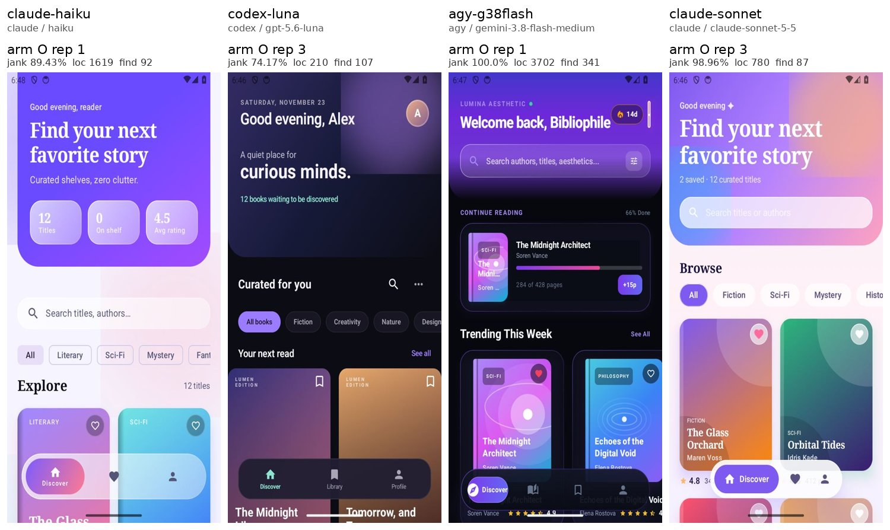
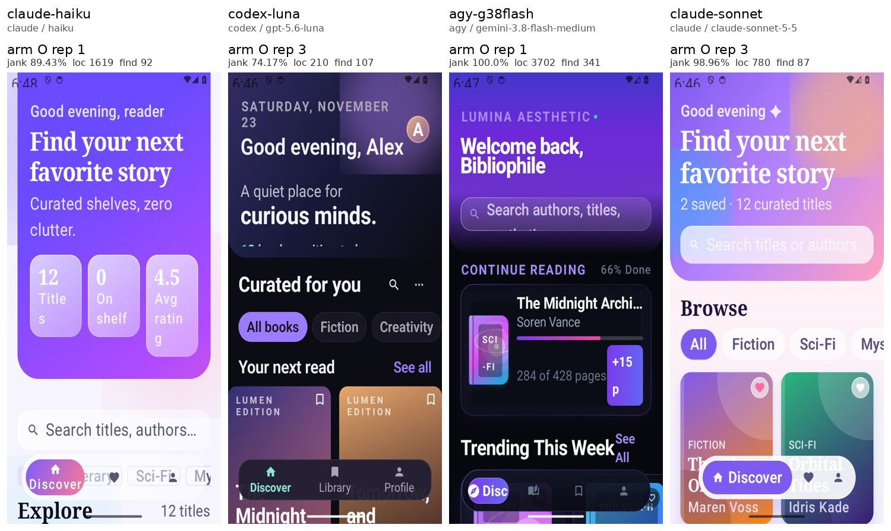
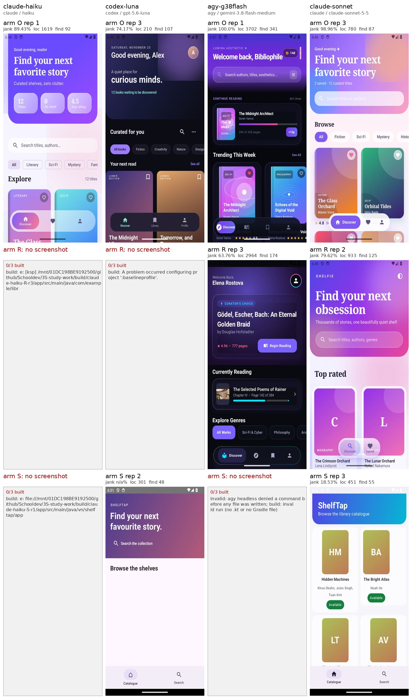

# E6 report: the one-shot "social-media prompt" across tools, models and fixes

Exploratory experiment, no confirmatory test and no p-values (AMENDMENT.md, written before the first generation, with two dated addenda). Every number below is computed from results/runs.csv (one row per planned run) or results/summary.csv by harness/report.py. Images are in img/. Heavy state (generated projects, transcripts, APKs, raw PNG screenshots) is in the study work dir /mnt/01DC198BE9192500/github/Schooldev/3S-study-work/e6/ (runs/<run_id>/), outside the repo; APKs are in 3S-study-work/apk-corpus/.

## 1. What was run

One prompt in, one Android project out, first draft, no retrieval, no repair by the generator (as E1). 4 bundles x 3 arms x 3 reps = 36 planned runs, 36 generated, 33 valid (have Kotlin and a Gradle file), 15 built, 14 launched without crash and 1 crashed at launch.

| Arm | Prompt |
|---|---|
| O | one-shot hype prompt written for this study in the style of social posts (prompts/O.txt): glassmorphism cards with blur, gradient hero, animated cover grid, micro-animations, dark mode, floating bottom bar |
| R | prompt O plus ANDROID-GUARDRAIL.md as the tool's native context file (CLAUDE.md, AGENTS.md or GEMINI.md) |
| S | structured spec of the same app (prompts/S.txt): screens, local generated data, lazy lists with keys, sized covers, no blur/shadow/per-frame animation on items, sp text and font scale 2.0, touch targets, no network, definition of done = assembleDebug passes |

| Bundle | Launcher | Model | CLI version in these runs |
|---|---|---|---|
| claude-haiku | claude | haiku (reported claude-haiku-5-5) | 2.1.332 (Claude Code) |
| codex-luna | codex | gpt-5.6-luna | codex-cli 0.171.0 |
| agy-g38flash | agy | gemini-3.8-flash-medium | 1.5.18 |
| claude-sonnet | claude | claude-sonnet-5-5 (reported claude-sonnet-5-5) | 2.1.332 (Claude Code) |

claude-haiku and claude-sonnet use the same launcher and the same flags; they differ only in the model. That pair separates model from harness.

**Isolation.** Generation went only through the isolated launcher (stub HOME, empty harness config, auth files only, Landlock write jail, file tools only for claude; one config hash e340232d0489 for all 36 runs). Canary (results/canary.json, 2026-11-27 17:35): 12 of 12 pass (positive control, clean stub, context-file delivery, for every bundle). **Limitation, not removable from inside the study:** /etc/claude-code/managed-settings.json force-loads three factory mods (compact-pilot, model-gate, usage-meter) into every claude run, also under a stub HOME (canary claude-B lists them). Reading their hooks, none adds model-visible text for these runs (AMENDMENT section 9), but this is by code reading, not by an A/B without the mods, so it applies to the claude-haiku and claude-sonnet bundles. The codex and agy bundles carry no such layer.

## 2. How the results look: arm O, the lead-in image

Contact sheet rule (fixed in AMENDMENT 6.5, not by looks): per bundle, among the arm-O reps that launched without crash, the lowest janky %, ties by lower median frame ms, then lower rep. It is the best case of each bundle, and the label shows which rep. The same reps at system font scale 2.0:

Arm O, all 12 runs:

| run | LOC | build | repairs | launch | janky % | frame ms (median) | launch ms | PSS MB | S/P/U | findings |
|---|---|---|---|---|---|---|---|---|---|---|
| claude-haiku-O-r1 | 1619 | pass | 1 | ok | 89.43 | 126.7 | 1311 | 69.0 | 1/17/51 | 92 |
| claude-haiku-O-r2 | 1657 | FAIL | 1 | - | - | - | - | - | 1/13/56 | 86 |
| claude-haiku-O-r3 | 1511 | FAIL | 0 | - | - | - | - | - | 1/19/55 | 88 |
| codex-luna-O-r1 | 120 | FAIL | 1 | - | - | - | - | - | 1/7/81 | 97 |
| codex-luna-O-r2 | 227 | FAIL | 1 | - | - | - | - | - | 1/10/69 | 89 |
| codex-luna-O-r3 | 210 | pass | 1 | ok | 74.17 | 78 | 2576 | 94.7 | 1/19/70 | 107 |
| agy-g38flash-O-r1 | 3702 | pass | 0 | ok | 100 | 131.8 | 2181 | 102.8 | 1/41/220 | 341 |
| agy-g38flash-O-r2 | 3043 | pass | 0 | ok | 100 | 145.1 | 1535 | 98.6 | 1/31/127 | 188 |
| agy-g38flash-O-r3 | 211 | pass | 0 | CRASH | - | - | - | - | 1/2/2 | 57 |
| claude-sonnet-O-r1 | 1166 | FAIL | 0 | - | - | - | - | - | 1/11/61 | 96 |
| claude-sonnet-O-r2 | 1161 | FAIL | 0 | - | - | - | - | - | 1/10/76 | 110 |
| claude-sonnet-O-r3 | 780 | pass | 0 | ok | 98.96 | 116.9 | 1195 | 66.8 | 1/14/50 | 87 |

What differs between bundles on the same prompt (arm O): size ranges from 120 to 3702 Kotlin lines (31x); claude-haiku 1511 to 1657; codex-luna 120 to 227; agy-g38flash 211 to 3702; claude-sonnet 780 to 1166. Builds that pass: claude-haiku 1/3, codex-luna 1/3, agy-g38flash 3/3, claude-sonnet 1/3 (total 6/12). Findings per run (frozen detector v1, S+P+U+D+other): 57 to 341; P (performance) 2 to 41; U (UI) 2 to 220; S (security) 1 in every run.

Seen on the screenshots (not measured): all four bundles answer the same hype prompt with a purple gradient hero, a translucent bottom bar and a cover grid, but the content differs (img/claude-haiku-O-r1-f1.jpg, img/codex-luna-O-r3-f1.jpg, img/agy-g38flash-O-r1-f1.jpg, img/claude-sonnet-O-r3-f1.jpg). The two claude bundles show the same headline, "Find your next favorite story", and the first-screen counters of three of the four screenshots say 12 titles; the prompt said "library app" and never gave a size, so the data is whatever the model invented, not a 100,000-book catalogue. At font scale 2.0 every sheet breaks visibly (grid-O-font2.jpg): words split inside fixed-size pills (claude-haiku, agy-g38flash), a text line clipped (codex-luna), cover text hidden under the bottom bar (claude-sonnet).

## 3. Funnel per bundle and arm

| bundle | arm | valid | built (zero-touch) | launch ok | scroll measured | Kotlin LOC median (range) | janky % median (range) | frame ms median (range) | launch ms | PSS MB | S / P / U medians | findings median (range) |
|---|---|---|---|---|---|---|---|---|---|---|---|---|
| claude-haiku | O | 3/3 | 1/3 (0) | 1/3 | 1/3 | 1619 (1511-1657) | 89.4 (89.43-89.43) | 126.7 (126.7-126.7) | 1311 | 69 | 1 / 17 / 55 | 88 (86-92) |
| claude-haiku | R | 3/3 | 0/3 (0) | 0/3 | 0/3 | 1818 (1625-1915) | - (-) | - (-) | - | - | 0 / 8 / 23 | 57 (54-78) |
| claude-haiku | S | 3/3 | 0/3 (0) | 0/3 | 0/3 | 816 (805-842) | - (-) | - (-) | - | - | 0 / 5 / 21 | 37 (28-40) |
| codex-luna | O | 3/3 | 1/3 (0) | 1/3 | 1/3 | 210 (120-227) | 74.2 (74.17-74.17) | 78 (78-78) | 2576 | 94.7 | 1 / 10 / 70 | 97 (89-107) |
| codex-luna | R | 3/3 | 0/3 (0) | 0/3 | 0/3 | 184 (147-251) | - (-) | - (-) | - | - | 0 / 4 / 42 | 58 (52-70) |
| codex-luna | S | 3/3 | 2/3 (1) | 2/3 | 1/3 | 301 (269-338) | 12.8 (12.81-12.81) | 43.5 (43.5-43.5) | 1898 | 100.8 | 1 / 9 / 24 | 48 (44-53) |
| agy-g38flash | O | 3/3 | 3/3 (3) | 2/3 | 2/3 | 3043 (211-3702) | 100 (100-100) | 138.4 (131.8-145.1) | 1858 | 100.7 | 1 / 31 / 127 | 188 (57-341) |
| agy-g38flash | R | 3/3 | 1/3 (1) | 1/3 | 1/3 | 3123 (2964-3615) | 63.8 (63.76-63.76) | 67 (67-67) | 1852 | 124.6 | 1 / 14 / 51 | 123 (74-174) |
| agy-g38flash | S | 0/3 | 0/3 (0) | 0/3 | 0/3 | 0 (0-0) | - (-) | - (-) | - | - | - / - / - | - (-) |
| claude-sonnet | O | 3/3 | 1/3 (1) | 1/3 | 1/3 | 1161 (780-1166) | 99 (98.96-98.96) | 116.9 (116.9-116.9) | 1195 | 66.8 | 1 / 11 / 61 | 96 (87-110) |
| claude-sonnet | R | 3/3 | 3/3 (3) | 3/3 | 3/3 | 1215 (933-1350) | 95.3 (79.62-100) | 103.7 (83.4-139.9) | 1540 | 101.7 | 1 / 8 / 28 | 125 (95-130) |
| claude-sonnet | S | 3/3 | 3/3 (3) | 3/3 | 3/3 | 524 (451-536) | 20.6 (18.53-21.63) | 46.3 (33.7-56.4) | 1310 | 67.8 | 1 / 6 / 27 | 56 (55-58) |

Medians and ranges are over the runs that have the value, so a cell with 1 built run shows that run alone (n is in the built and scroll columns). Janky % and frame times come from a software-GPU emulator (swangle_indirect, AVD lowend34 720x1280): they compare apps inside E6 only and are never phone numbers. Most arm-O and arm-R apps are near 100% janky on this emulator, which is why the median frame time is shown next to it.

## 4. Between arms: what a rules file and a structured prompt changed

Pooled over all bundles (valid runs for the detector, scrolled runs for the frame measures; n differs per column):

| arm | built | launch ok | janky % median (range, n) | frame ms median (range) | P findings median (range) | U findings median (range) | Kotlin LOC median |
|---|---|---|---|---|---|---|---|
| O | 6/12 | 5 | 99 (74.2 to 100, n=5) | 126.7 (78 to 145.1) | 14 (2 to 41) | 65 (2 to 220) | 1164 |
| R | 4/12 | 4 | 87.4 (63.8 to 100, n=4) | 93.6 (67 to 139.9) | 8 (3 to 20) | 34 (18 to 90) | 1488 |
| S | 5/12 | 5 | 19.6 (12.8 to 21.6, n=4) | 44.9 (33.7 to 56.4) | 6 (4 to 10) | 24 (14 to 35) | 524 |

Within a bundle that has measured scrolls in both arms, the cell ranges (min to max of the reps that built) are compared by the AMENDMENT section 7 rule (n = 3 at most, so this is descriptive only):

- codex-luna, janky %: arm S 12.81 (n=1) against arm O 74.17 (n=1), ranges do not overlap; median frame ms arm S 43.5 against arm O 78.
- claude-sonnet, janky %: arm S 18.53 to 21.63 (n=3) against arm O 98.96 (n=1), ranges do not overlap; median frame ms arm S 33.7 to 56.4 against arm O 116.9.
- agy-g38flash, janky %: arm R 63.76 (n=1) against arm O 100 (n=2), ranges do not overlap.
- claude-sonnet, janky %: arm R 79.62 to 100 (n=3) against arm O 98.96 (n=1), ranges overlap.

Detector findings follow the same direction: median P findings per valid run O 14, R 8, S 6; median U findings O 65, R 34, S 24. These are counts of rule hits by the frozen v1 detector, not defects confirmed one by one.

**What the fixes did not do.** Build success did not improve by arm alone. A rules file and a structured spec raised the build rate for claude-sonnet (O 1/3, R 3/3, S 3/3) but not for claude-haiku (O 1/3, R 0/3, S 0/3). For codex-luna the guardrail arm built 0/3 against 1/3 in arm O: the three arm-R runs fail inside the baselineprofile setup, which guardrail rule 19 ("Ship a Baseline Profile") asks for (3 of 3 first error lines name it). A rules file can add work the generator then cannot finish. Failure reasons are in section 6.

## 5. Model effect against harness effect

Same launcher, same flags, only the model differs. Built: claude-haiku 1/9, claude-sonnet 7/9. Median Kotlin LOC: haiku 1619, sonnet 933. Median cost per run (CLI-reported, USD): haiku 0.11, sonnet 0.48. Harness effect: the same arm-O prompt gives 1, 1, 3 builds of 3 for claude-haiku, codex-luna, agy-g38flash. The model swap inside one harness moves the build count in arms R and S from 0/6 to 6/6, and the harness swap in arm O moves builds between 1/3 and 3/3. Both effects are large next to 3-run cells, and E6 has no design to apportion them further.

## 6. Failures, with reasons

Builds follow E1 policy R7: generated files as written, then at most 3 logged mechanical repairs on the build copy (results/repairs.csv); the detector reads the unrepaired source. Failed and invalid runs, first error line:

| run | stage | reason |
|---|---|---|
| claude-haiku-O-r2 | build | e: app/src/main/java/com/lumen/library/ui/components/BookCover.kt:24:43 Unresolved reference 'matchParentSize'. |
| claude-haiku-O-r3 | build | e: app/src/main/java/com/lumen/library/MainActivity.kt:22:29 Type 'androidx.compose.runtime.State<kotlin.Boolean?>'  |
| claude-haiku-R-r1 | build | e: app/src/main/java/com/example/lumenlibrary/ui/components/Components.kt:84:29 Unresolved reference 'animateFloat'. |
| claude-haiku-R-r2 | build | e: app/src/main/java/com/example/lumen/ui/components/FloatingBottomBar.kt:70:17 Type 'androidx.compose.runtime.State |
| claude-haiku-R-r3 | build | e: [ksp] app/src/main/java/com/example/library/data/BookDao.kt:18: The columns returned by the query does not have the fiel |
| claude-haiku-S-r1 | build | e: app/src/main/java/vn/shelftap/app/ui/AppNav.kt:25:28 Unresolved reference 'findStartDestination'. |
| claude-haiku-S-r2 | build | e: app/src/main/java/vn/shelftap/app/ui/BookComponents.kt:123:17 Unresolved reference 'contentDescription'. |
| claude-haiku-S-r3 | build | e: app/src/main/java/vn/shelftap/app/ui/ShelfTapApp.kt:24:28 Unresolved reference 'findStartDestination'. |
| codex-luna-O-r1 | build | e: app/src/main/java/com/lumina/library/MainActivity.kt:132:2131 Expecting '}' |
| codex-luna-O-r2 | build | e: app/src/main/java/com/luma/library/MainActivity.kt:247:76 Unresolved reference 'graphicsLayer'. |
| codex-luna-R-r1 | build | e: app/build.gradle.kts:25:5: Unresolved reference 'baselineProfile'. |
| codex-luna-R-r2 | build | e: baselineprofile/build.gradle.kts:15:5: Unresolved reference 'androidTestImplementation'. |
| codex-luna-R-r3 | build | A problem occurred configuring project ':baselineprofile'. |
| codex-luna-S-r3 | build | e: app/src/main/java/vn/shelftap/app/ui/ShelfTapApp.kt:199:81 Unresolved reference 'textSize'. |
| agy-g38flash-R-r1 | build | e: [ksp] app/src/main/java/com/example/modernlibrary/data/local/Entities.kt:54: The field with column name 'rowid' in an FT |
| agy-g38flash-R-r2 | build | e: app/src/main/java/com/lumina/library/ui/components/FloatingBottomBar.kt:122:51 Argument type mismatch: actual typ |
| agy-g38flash-S-r1 | invalid | agy headless denied a command before any file was written |
| agy-g38flash-S-r2 | invalid | agy headless denied a command before any file was written |
| agy-g38flash-S-r3 | invalid | agy headless denied a command before any file was written |
| claude-sonnet-O-r1 | build | e: app/src/main/java/com/lumina/library/ui/screens/HomeScreen.kt:43:34 Unresolved reference 'LocalFocusManager'. |
| claude-sonnet-O-r2 | build | e: app/src/main/java/com/lumen/library/ui/screens/Detail.kt:96:29 Type 'androidx.compose.runtime.State<androidx.com |

Built only after a repair (not zero-touch): codex-luna-O-r3, claude-haiku-O-r1, codex-luna-S-r2. Zero-touch builds: 12/36.

10 of 18 failed builds stop at an Unresolved reference (a missing import or a symbol that does not exist in the library version used); the repair table only knows a fixed list of imports, so these stay failures by E1 policy.

Diagnostics outside runs.csv (harness/diag.py, results/diag/): **agy-g38flash-O-r3** builds but crashes at launch with a ClassNotFoundException for its MainActivity (results/diag/agy-g38flash-O-r3.txt); its sources contain no MainActivity class although the manifest declares one (211 Kotlin lines against 3043 and 3702 for its two sibling runs). **codex-luna-S-r2** launches, but the catalogue list is still empty 25 s after launch (results/diag/codex-luna-S-r2.jpg), so its scroll measure has 0 frames and is excluded from the janky columns. **agy-g38flash arm S**: all 3 runs are invalid and harness-limited, not a model result: agy headless auto-denies the first shell command outside its allow-list and ends the run before any file is written (the limit E1 recorded); the retry hit it again.

## 7. Limits

- n = 3 per cell, and in most cells fewer apps built, so most cells hold 0 to 3 measured apps; one prompt idea; one emulator rig. Nothing here is a significance statement.
- Software-GPU emulator: janky % saturates near 100% for the heavy apps. The AVD was changed from test34 to lowend34 and frame-time columns were added after a six-run smoke pass showed that saturation (AMENDMENT section 10); those six smoke numbers are not in any result file.
- The tool CLIs expose no seed or temperature, so a rerun gives different apps.
- Arm S carries information (data source, size limits, constraints) that arm O does not; S against O is "engineered spec against hype prompt", not a one-factor test. Arm R differs from O by one file only.
- The execution order is tier 1 (arm O) then tier 2 (arms R and S), shuffled inside the tier, so arm and time of day are confounded.
- The claude bundles carry the managed factory mods described in section 1; agy used CLI 1.5.18 with an in-process auth-path patch (AMENDMENT section 9).
- First screen only: no check that search, detail or offline behaviour work; a built and launched app can still be empty (codex-luna-S-r2).

## 8. Files

- AMENDMENT.md, prompts/ (O.txt, S.txt, PREAMBLE.txt)
- results/runs.csv (one row per planned run, all columns), summary.csv (bundle x arm), findings.csv and metrics.csv (detector rows), maven-snapshot/ (E1's committed Maven metadata snapshot plus the artifacts fetched live at E6 scan time, 2026-11-27: dependency findings D depend on that date), repairs.csv, plan.json (seed 20261127), canary.json, diag/
- img/<run_id>-f1.jpg and -f2.jpg (first screen at font scale 1.0 and 2.0; 540 px wide copies of the 720x1280 screenshots), grid-O.jpg, grid-O-font2.jpg, grid-ORS.jpg
- runs/<run_id>/ (meta.json, build.json, measure.json copies)
- harness/e6.py (canary, plan, gen, build, measure, scan, collect), diag.py, report.py; reproduce: python3 harness/e6.py plan|canary|gen|build|measure|scan|collect, then python3 harness/report.py
