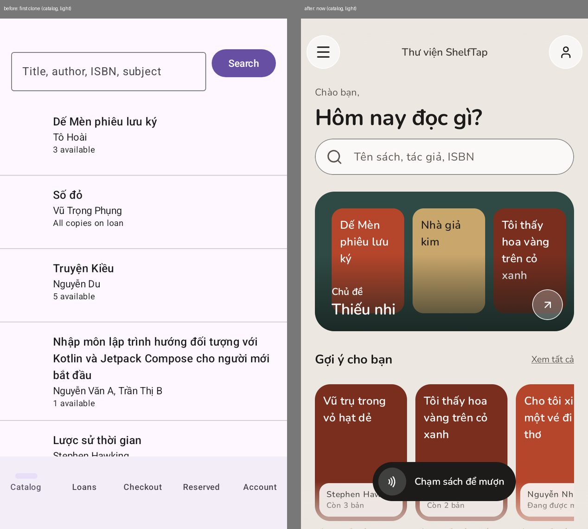
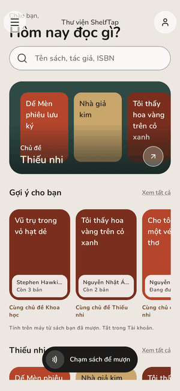

# ShelfTap Android: bản lần đầu clone và bản hiện tại

Ngày lập: 2026-11-28. Nhánh `opt/ui-ux`. So sánh **app Android như lúc clone về máy này** (2026-11-22, `af2c9cf`; code trùng tag `ui-baseline`, vì `git diff af2c9cf ui-baseline -- android/app/src/main` rỗng) với **`HEAD`**.

Mọi con số ở đây do công cụ trong `optimization/ui-ux/tools/` đếm từ repo hoặc từ bảng một lần chạy ghi ra (cách chạy lại ở `tools/README.md`). Số đo cần máy thật (khung hình, bộ nhớ trên Xiaomi) không đo lại ở đây: chúng ở `optimization/ui-ux-metrics.md`, `optimization/ui-ux/measure/` và nhật ký `optimization/log/opt-ui-ux.md`.

## 1. Đã thay đổi gì

| Mảng | Bản đầu | Bây giờ | Mục nhật ký |
|---|---|---|---|
| Điều hướng | thanh 5 tab chữ, không icon; phải đăng nhập mới thấy sách | menu ☰ (cửa sổ hẹp), thanh dọc (vừa), menu cố định (rộng); khách xem được danh mục; nút nổi "Chạm sách để mượn" đổi hình thành thanh đặt trước; tìm khi gõ | 2026-11-24 16:17, 23:05 |
| Chữ | 51 chuỗi tiếng Anh viết cứng trong Kotlin | 0 chuỗi cứng; tiếng Việt (mặc định) và tiếng Anh, đủ số nhiều | 2026-11-24 15:36 |
| Giao diện | `lightColorScheme()` mặc định của Material, font hệ thống, không chọn sáng/tối | hệ thống thiết kế (`ui/theme/`): màu sáng và tối, Nunito, khoảng cách; chọn sáng/tối/theo máy ở Tài khoản | 2026-11-24 15:52 |
| Kính và hiệu ứng | không có | ba tầng hiệu ứng theo máy (Đầy đủ, Vừa, Nhẹ), blur nền menu, dải kính ở đầu và chân trang (Haze), icon Lucide và icon morph | 2026-11-24 16:28, 17:02; 2026-11-26 |
| Chuyển động | chuyển cảnh mặc định | nhấn co lại, hàng trồi lên, khung xương, hàng đổi chỗ, trượt vào trang sách, cử chỉ back theo ngón tay, vòng NFC, dấu tích | 2026-11-24 17:32, 22:20; 2026-11-25 |
| Trạng thái | chỉ spinner và một dòng chữ khi rỗng | khung xương, trạng thái rỗng có hướng dẫn, lỗi mạng, offline, lý do không gia hạn | 2026-11-24 16:09 |
| Cửa sổ lớn | bố cục điện thoại bị kéo giãn | cửa sổ vừa và rộng: hai cột, hai khung (danh sách và chi tiết) cho Danh mục, Đang mượn, Đặt trước, Tài khoản; đăng nhập chia đôi | 2026-11-24 16:42; 2026-11-26, 27 |
| Màn hình | Catalog, Loans, Checkout, Reservations, Account, Detail, Login dựng thô | dựng lại theo thiết kế: thẻ kính, bìa chữ, Lịch sử đọc, Khóa, Đổi mật khẩu lần đầu, Tự mượn có đĩa NFC | 2026-11-24 đến 2026-11-25 |
| Chức năng mới | không | **Gợi ý cho bạn** (tính trên máy, ba khổ), **Thông báo** (nhắc hạn trả tính trên máy, ẩn tên sách trên màn khóa) | 2026-11-28 |
| Truy cập | 2 nút trùng nhãn đọc giống nhau | nhãn nói rõ sách nào, vùng chạm không dưới 48 dp, liveRegion cho kết quả tự mượn | 2026-11-24 15:37 |
| Hiệu năng | không đo | kiểu build `measure` (R8, Baseline Profile) để đo thật; trang sách dựng ngay từ dữ liệu danh sách; bìa lỗi được nhớ; thẻ dựng trước khi cuộn tới; chi phí của dải kính đã đo trên Xiaomi | 2026-11-24 21:35; 2026-11-25; 2026-11-26 |
| Công cụ | không | bài audit giao diện chạy được trên emulator (Accessibility Test Framework, ảnh vẽ bằng GPU trong tiến trình), kịch bản đo khung hình trên máy thật, bộ mockup 35 bản, ảnh cặp board và app | cả nhánh |

## 2. Con số đếm từ repo

| What | First clone (`ui-baseline`) | Now (`HEAD`) |
|---|---|---|
| Kotlin files in `android/app/src/main` | 27 | 74 |
| Kotlin lines in `android/app/src/main` | 2745 | 9836 |
| files in `ui/` | 6 | 44 |
| hard-coded `Text("` in `ui/` | 51 | 0 |
| strings in `values/strings.xml` (Vietnamese) | 1 | 281 |
| strings in `values-en/strings.xml` (English) | 0 | 281 |
| unit tests (`@Test` in `src/test`) | 59 | 127 |
| instrumented tests (`@Test` in `src/androidTest`) | 6 | 10 |
| files named `*Screen*` | 4 | 13 |

Bản đầu chỉ có một chuỗi trong `strings.xml` (tên app) vì chữ nằm cứng trong Kotlin. Số kiểm thử đơn vị đếm `@Test` trong `android/app/src/test`.

## 3. Accessibility Test Framework

Accessibility Test Framework findings (the same 13 checks; before = `audit/A`, now = optimization/ui-ux/audit/C1). "Same 7 screens" counts only the screens the first audit covered, so the two columns can be compared; "all screens" is every screen the audit visits now:

| Configuration | First clone (7 screens) | Now, same 7 screens | Now, all screens |
| light (720 x 1280 px, 280 dpi) | 4 (DuplicateSpeakableTextCheck 2, TextContrastCheck 2) | 5 (TextContrastCheck 5) | 11 (RedundantDescriptionCheck 1, TextContrastCheck 9, TouchTargetSizeCheck 1) on 22 screens |
| dark | 4 (DuplicateSpeakableTextCheck 2, TextContrastCheck 2) | 5 (TextContrastCheck 5) | 11 (RedundantDescriptionCheck 1, TextContrastCheck 9, TouchTargetSizeCheck 1) on 22 screens |
| font scale 2.0 | 4 (DuplicateSpeakableTextCheck 2, TextContrastCheck 2) | 5 (TextContrastCheck 5) | 11 (RedundantDescriptionCheck 1, TextContrastCheck 9, TouchTargetSizeCheck 1) on 22 screens |
| 320 dp wide | 4 (DuplicateSpeakableTextCheck 2, TextContrastCheck 2) | 1 (TextContrastCheck 1) | 5 (RedundantDescriptionCheck 1, TextContrastCheck 3, TouchTargetSizeCheck 1) on 22 screens |

Đọc thế nào: bản đầu 4 phát hiện (2 contrast ở hai nút bị vô hiệu, 2 trùng nhãn). Cùng 7 màn, bản này không còn trùng nhãn nhưng có 5 cảnh báo `TextContrastCheck`, cả 5 ở Danh mục, ở mép dưới màn (y từ 1207 đến 1280 trên màn 1280 px): chữ "Còn 3 bản", "Đang được mượn · đặt trước" và ba dòng lý do gợi ý của băng **Gợi ý cho bạn**, đang nằm dưới dải lớp phai và nút nổi của chân trang. Đó là cùng loại cảnh báo đã phân loại ở mục nhật ký 2026-11-27 06:00 (chữ của trang dưới dải thanh), nhưng là năm chữ mới do băng Gợi ý thêm vào; hai nút bị vô hiệu của bản đầu không còn trong danh sách. Chưa kiểm độ tương phản của năm chữ này khi cuộn chúng lên giữa màn. Lần chạy này bằng tiếng Việt trên emulator Android 16; bản đầu đo bằng tiếng Anh. Cột "tất cả màn" cho thấy bài audit hôm nay đi qua 22 màn, nhiều hơn 3 lần so với 7 màn của bản đầu, nên số tuyệt đối không so sánh trực tiếp với cột đầu. Không có vùng chạm nào dưới 48 dp ngoài một thành phần của Material (tay kéo của tờ giải thích).

## 4. Ảnh: bản đầu và bản bây giờ

Mỗi ảnh `pairs/<theme>-<màn>.jpg` có **bản đầu bên trái, bản bây giờ bên phải**, cùng cỡ cửa sổ emulator (720 × 1280 px, 280 dpi). Ảnh bản đầu là ảnh đo ngày 2026-11-23 còn trong lịch sử git (`audit/A/` tại `c4280b8`, vẽ từ cây view trong tiến trình); ảnh bản bây giờ do bộ vẽ GPU (`*-hw.png`). Hai bên không cùng trạng thái: bản đầu có thanh 5 tab và không có menu.

| Màn | Sáng | Tối |
|---|---|---|
| Danh mục | [light-catalog](pairs/light-catalog.jpg) | [dark-catalog](pairs/dark-catalog.jpg) |
| Chi tiết sách | [light-detail](pairs/light-detail.jpg) | [dark-detail](pairs/dark-detail.jpg) |
| Đang mượn | [light-loans](pairs/light-loans.jpg) | [dark-loans](pairs/dark-loans.jpg) |
| Đặt trước | [light-reservations](pairs/light-reservations.jpg) | [dark-reservations](pairs/dark-reservations.jpg) |
| Tài khoản | [light-account](pairs/light-account.jpg) | [dark-account](pairs/dark-account.jpg) |
| Tự mượn | [light-checkout](pairs/light-checkout.jpg) | [dark-checkout](pairs/dark-checkout.jpg) |
| Đăng nhập | [light-login](pairs/light-login.jpg) | [dark-login](pairs/dark-login.jpg) |

## 5. Hiệu ứng chuyển động (khung hình do chính app vẽ)

Bản đầu không có hiệu ứng nào đáng kể: chuyển màn mặc định, không menu, không nút đổi hình. Dưới đây là hiệu ứng của bản bây giờ, từ các khung hình bài audit ghi lại (bài test tăng đồng hồ của Compose bằng tay, nên mốc thời gian mỗi khung là chính xác). Mỗi hiệu ứng có ảnh động (`.webp` và `.gif`) và một tờ các khung (`-frames.png`) có thời gian dưới mỗi khung.

| Hiệu ứng | Ảnh động | Các khung |
|---|---|---|
| Mở trang sách: màn trượt vào, nút nổi đổi thành thanh có nút đặt trước (260 ms) | [app-detail-open.webp](anim/app-detail-open.webp), [gif](anim/app-detail-open.gif) | [khung](anim/app-detail-open-frames.png) |
| Quay lại từ trang sách | [app-detail-close.webp](anim/app-detail-close.webp) | [khung](anim/app-detail-close-frames.png) |
| Mở menu ☰ | [app-menu-open.webp](anim/app-menu-open.webp) | [khung](anim/app-menu-open-frames.png) |
| Đóng menu | [app-menu-close.webp](anim/app-menu-close.webp) | [khung](anim/app-menu-close-frames.png) |
| Cùng hiệu ứng mở trang sách trong **mockup** (CSS, ở các mốc 0 đến 700 ms) | [mockup-detail-open.webp](anim/mockup-detail-open.webp) | [khung](anim/mockup-detail-open-frames.png) |

## 6. Video thật và thống kê khung hình

Hai video quay trên cùng emulator `lowend36ui`, cùng cỡ cửa sổ, cùng kiểu build (debug), sau một lượt khởi động nóng, cùng một kiểu thao tác: cuộn trang chủ, mở một sách rồi quay lại, chuyển Đang mượn, Đặt trước, về Danh mục. Mở `video/compare.html` trong trình duyệt để xem hai video chạy song song (có nút phát, dừng, tốc độ 0,25). File: `video/BASE/effects.mp4` (bản đầu), `video/NOW/effects.mp4` (bản bây giờ).

| Frame statistics of the recorded pass | First clone (BASE) | Now (NOW) |
|---|---|---|
| Total frames rendered | 295 | 172 |
| Janky frames | 84 | 40 |
| Janky frames (%) | 28.47 | 23.26 |
| Janky frames, legacy | 224 | 152 |
| 50th percentile (ms) | 25 | 29 |
| 90th percentile (ms) | 48 | 48 |
| 95th percentile (ms) | 65 | 65 |
| 99th percentile (ms) | 400 | 200 |
| Missed Vsync | 20 | 20 |
| High input latency | 421 | 261 |
| Slow UI thread | 40 | 19 |
| Slow bitmap uploads | 2 | 3 |
| Slow issue draw commands | 63 | 30 |
| Frame deadline missed | 84 | 40 |

**Đọc con số này thận trọng.** Đây là emulator và bản debug: nó cho thấy cả hai bản chạy ở mức tương đương (phân vị 90 đều 48 ms, trung vị 25 so với 29 ms), không cho thấy bản mới nhanh hơn. Số khung khác nhau (295 so với 172) vì hai lượt thao tác không vẽ cùng số khung (màn khác nhau); tỷ lệ khung giật 28,5% so với 23,3% và phân vị 99 400 ms so với 200 ms chịu ảnh hưởng của vài khung đầu mỗi màn và không đủ để kết luận. Số đo hiệu năng đáng tin hơn là trên Xiaomi 25053RT47C, bản `measure` (R8, Baseline Profile), 100.013 đầu sách, nhiều lượt xen kẽ: giật 0,02% ở mọi cảnh cuộn; phân vị 90 từ 5 đến 14 ms tùy cảnh và cấu hình (có hoặc không có dải kính) (nhật ký 2026-11-26 19:00, 21:30 và 2026-11-27 04:30). Bản đầu **đã được đo trên Xiaomi bằng cùng kịch bản** ở mục 8, và cho kết quả ngược hướng với mong đợi: bản mới tốn nhiều thời gian mỗi khung hơn.

## 7. Chưa làm, chưa so được

- ~~Cột "bản đầu" của đo khung hình và bộ nhớ trên máy thật~~ và ~~video bản release~~: đã làm ở mục 8 (Xiaomi, bản `measure`).
- Video của các cỡ cửa sổ trên emulator là bản **debug**; riêng hai cỡ **vừa (720 × 840 dp) và rộng (960 × 720 dp) của bản mới quay ra màn hình đứng yên** (app không vẽ lại trong lúc bài test chạy, chưa rõ nguyên nhân; bản đầu quay được ở cả hai cỡ), nên không đưa video của hai cỡ đó vào.
- Không có video `.mp4` của mockup: hiệu ứng mockup là CSS, được chụp thành khung và ảnh động (WebP, GIF).
- Thử trên máy có tỷ lệ đặc biệt thật (gập, bầu dục).
- Hộp xin quyền thông báo (cửa sổ riêng) chưa có ảnh app.

## 8. Đo và quay trên Xiaomi, bản `measure`, bản cũ nhất và bản mới nhất

Máy: Xiaomi 25053RT47C, Android 17, màn 1280 × 2772. Server dev chạy trên máy này (Spring Boot và PostgreSQL trong Docker), **100.013 đầu sách**, phone nối qua mạng LAN (HTTPS, chứng chỉ dev đã cài làm CA người dùng trên phone). Hai bản dựng bằng kiểu `measure`: giống release (R8, tối ưu, không cờ gỡ lỗi), ký bằng khóa debug, tin chứng chỉ dev. Bản cũ nhất là tag `ui-baseline` được thêm đúng kiểu `measure` đó (và file `network_security_config` của nó); bản mới nhất là `HEAD`. Mỗi lượt cài lại bản và cho nó hồ sơ như cài từ cửa hàng (Baseline Profile rồi biên dịch theo hồ sơ), nghỉ 20 giây giữa các lần, **5 lượt**, tầng hiệu ứng tự chọn. Kịch bản là của `optimization/ui-ux/measure/measure.ps1`; bản đầu chạy hai kịch bản có tương đương (nó không có menu, và danh sách dài là trang chủ của nó):

| Kịch bản | Bản đầu (trung vị, khoảng min–max của 5 lượt) | Bản mới nhất |
|---|---|---|
| Mở sách rồi quay lại, 12 lần | 0,05% (0,05–0,05), p90 5 ms (5–9), RSS 220 MB | 0,94% (0,89–1), p90 14 ms (14–14), RSS 228 MB |
| Cuộn danh sách dài (bản đầu: trang chủ là danh sách; bản mới: "Xem tất cả sách") | 0% (0–0), p90 5 ms (5–5), RSS 220 MB | 0,02% (0,01–0,02), p90 11 ms (11–11), RSS 242 MB |
| Cuộn trang chủ (bản mới: các băng sách) | không có | 0,02% (0,02–0,02), p90 10 ms (10–10), RSS 215 MB |
| Mở và đóng menu ☰ | không có (không có menu) | 0,02% (0,02–0,02), p90 11 ms (10–11), RSS 224 MB |

Kết quả thô: `optimization/ui-ux/measure/results-xiaomi-base/` và `results-xiaomi-now/` (`results.tsv`, `summary.tsv`). Chỉ kết luận "khác nhau" khi hai khoảng min–max không chồng nhau.

**Đọc kết quả, theo đúng số đo:**

- Bản mới **tốn nhiều thời gian mỗi khung hơn** bản đầu và hai khoảng không chồng nhau ở cả hai kịch bản có thể so: ở mở sách, phân vị 90 là 14 ms so với 5 ms, tỷ lệ khung giật 0,94% so với 0,05%; ở cuộn danh sách dài là 11 ms so với 5 ms (giật 0,02% so với 0%). Nguyên nhân hợp lý, chưa tách riêng bằng thí nghiệm: giao diện mới vẽ nhiều hơn (kính, dải mờ, bìa chữ, chuyển trang trượt, nút đổi hình, bo góc), đúng với chi phí đã đo riêng của dải kính ở nhật ký 2026-11-26.
- Cả hai đều ở mức tốt trên máy flagship này: khung giật từ 0 đến 1%, phân vị 90 từ 5 đến 14 ms. Chưa đo trên máy yếu, nơi chênh lệch này có thể lớn hơn.
- Số khung của kịch bản mở sách khác hẳn (bản đầu 4030 khung, bản mới 1692 cho cùng 12 lần mở): bản đầu chờ máy chủ trả chi tiết với vòng quay tải chạy liên tục nên vẽ thêm khung; bản mới dựng trang ngay từ dữ liệu danh sách. Vì vậy **tỷ lệ giật của hai bản trong kịch bản này không so thẳng được**; phân vị theo khung công bằng hơn.
- Bộ nhớ (RSS) tương đương: 220 MB (bản đầu) so với 215 đến 242 MB (bản mới).

### Video và thống kê khung hình trên Xiaomi

Hai video quay trên cùng máy bằng `screenrecord` (`optimization/ui-ux/video/phone-BASE/effects.mp4`, `phone-NOW/effects.mp4`; xem song song: `video/compare-phone.html`), mỗi video là một lượt thao tác cố định sau một lượt khởi động nóng, màn 576 × 1248, 6 Mbps. Bản đầu: vuốt danh sách, mở một sách rồi quay lại, Loans, Reserved, Catalog. Bản mới (duyệt như khách): vuốt trang chủ, mở và đóng menu, mở một sách rồi quay lại, "Xem tất cả sách" và vuốt danh sách.

| Thống kê khung hình của lượt quay | Bản đầu | Bản mới |
|---|---|---|
| Số khung vẽ | 1702 | 2410 |
| Khung giật | 0,12% | 0,21% |
| Phân vị 50, 90, 99 (ms) | 5, 9, 10 | 9, 11, 18 |

Hai lượt không cùng việc (màn khác nhau, số thao tác khác nhau), nên bảng này là để xem cả hai chạy trơn, không phải để so từng con số.

**Cách quay, và vì sao video này không phải bản người dùng cài.** App đặt `FLAG_SECURE`, làm đen cả `screenrecord`. Cờ đó **không bị gỡ trong repo hay trong bản đo**. Hai video được quay từ **hai bản sao tạm** của mã (cây `git worktree` ngoài repo) trong đó đúng một dòng `window.setFlags(FLAG_SECURE ...)` bị comment, dựng cùng kiểu `measure`, chỉ cài trên máy đo rồi cài lại bản có cờ (`now-measure.apk`, máy hiện giữ bản này) và xóa các cây tạm. Số đo ở trên (bảng đầu mục 8) là của bản **có** cờ. Quy trình ở `optimization/ui-ux/tools/README.md`.

## 9. Các tỷ lệ màn hình khác (emulator)

Video của cùng một lượt thao tác ở nhiều cỡ cửa sổ, quay trên emulator `lowend36ui` bằng bản debug, sau khởi động nóng (`tools/record_effects.ps1 -Window <cỡ>`), bản đầu và bản mới cạnh nhau; xem bằng trang HTML ở cột cuối (mở trong trình duyệt, có nút phát song song và tốc độ 0,25). Thống kê khung hình do emulator vẽ bằng phần mềm nên chỉ để so sánh giữa hai bản, không phải hiệu năng thật.

| Cỡ cửa sổ | Bản đầu | Bản mới | Trang xem |
|---|---|---|---|
| Cao (411 × 914 dp, 20:9) | 335 khung, giật 3,88%, p50 17 ms, p90 23 ms, p99 48 ms | 186 khung, giật 10,75%, p50 17 ms, p90 40 ms, p99 200 ms | [compare-tall.html](../video/compare-tall.html) |
| Xoay ngang (731 × 411 dp) | 180 khung, giật 7,22%, p50 17 ms, p90 26 ms, p99 150 ms | 175 khung, giật 11,43%, p50 22 ms, p90 36 ms, p99 200 ms | [compare-land.html](../video/compare-land.html) |
| Cover của máy gập (360 × 400 dp) | 183 khung, giật 7,65%, p50 17 ms, p90 31 ms, p99 250 ms | 108 khung, giật 46,30%, p50 34 ms, p90 77 ms, p99 250 ms | [compare-flipcover.html](../video/compare-flipcover.html) |

Đọc: trên emulator bản mới nặng hơn ở cả ba cỡ (p90 cao hơn, tỷ lệ giật cao hơn nhiều ở cover gập: 46% so với 8%), cùng hướng với số đo trên Xiaomi nhưng lớn hơn nhiều vì emulator không có GPU thật. Video cỡ cover gập cho thấy giao diện mới trên cửa sổ rất ngắn; bản đầu chỉ là giao diện điện thoại bị kéo ngang ở các cỡ rộng. Video các cỡ **vừa và rộng** của bản đầu có trong `video/BASE-medium/` và `video/BASE-expanded/`; của bản mới thì không (xem mục 7).
